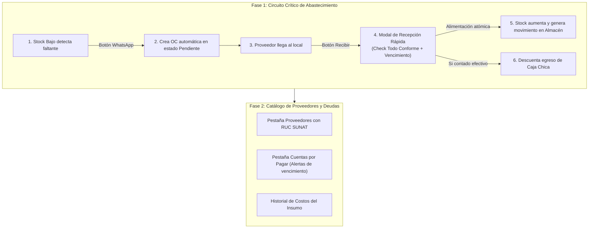

# Informe de análisis funcional: Módulo de Compras (Rol Almacén)

## 1 Lo que restaurant.pe tiene en este tema (separa EN VIVO de REFERENCIA): pantallas, pestañas, campos, filtros, columnas, botones, reglas, reportes y permisos

### Estado de la inspección en vivo
> **NO SE PUDO VER EN VIVO: requiere que el usuario inicie sesión.**  
> Al intentar ingresar a la dirección web de restaurant.pe (`https://restaurant.pe`), el sistema solicita de forma obligatoria credenciales de autenticación (usuario y contraseña). En cumplimiento estricto de la regla número 2 (seguridad y no manipulación de credenciales ni variables de entorno), se detuvo la navegación en ese punto. Toda la información presentada en esta sección proviene de la documentación técnica y funcional de **REFERENCIA** recopilada en auditorías de producción previas de la cafetería Caprichos (`compras.md`, `almacen.md`, `productos.md`, `informes.md`, `consolidado-reunion.md`).

---

### 1.1 Catálogo y Ficha de Proveedores (`#!/compras/proveedores`)
De acuerdo con `compras.md` (§2), restaurant.pe implementa la administración de proveedores bajo un diseño de dos columnas (maestro-detalle):
- **Pantalla y distribución**: A la izquierda se presenta la lista paginada de proveedores y a la derecha el panel de detalle con la ficha integral del proveedor seleccionado (`proveedor-ver.html`).
- **Columnas de la tabla maestra**:
  - Proveedor / Identificación: Razón social en negrita, nombre comercial y número de RUC/documento (`PROVEEDOR_RUC`).
  - Teléfono: Número telefónico de contacto.
  - Historial de Compras: Contador de adquisiciones acumuladas (`_proveedor_totalcompras compras`).
- **Campos del formulario (Nuevo / Editar)** (`proveedor-editar.html`):
  - *Tipo documento proveedor*: Selector con RUC, DNI, Carnet de Extranjería, Pasaporte (obligatorio).
  - *Razón social*: Texto libre, mínimo 2 caracteres (obligatorio).
  - *Nombre comercial*: Texto libre (opcional).
  - *RUC / N° Documento*: 11 dígitos para RUC, 8 para DNI (obligatorio). Incluye botón integrado de consulta y autocompletado en línea con SUNAT (`fnConsultarSunat`).
  - *Dirección principal / fiscal* y *Dirección secundaria / almacén*: Textos libres.
  - *Teléfono* y *Email*: Datos de contacto comercial.
  - *Contacto*: Nombre del ejecutivo de cuenta o vendedor asignado.
  - *Cuenta Corriente*: Número de cuenta bancaria del proveedor para transferencias.
  - *Días de pago*: Plazo en días del crédito comercial otorgado (numérico, máximo 2 dígitos).
  - *Observaciones*: Notas adicionales sobre el proveedor.
  - *Estado*: Casilla de verificación (Activo / Inactivo).
  - *Compras - Compite por precio bajo*: Casilla para incluir automáticamente al proveedor en sugerencias de cotizaciones económicas.
- **Filtros disponibles**: Caja de búsqueda reactiva por texto (`Buscar...`), selector de paginación (10, 25, 50 o Todos los registros) y botón de recarga de datos.
- **Botones y acciones**: `Descargar` (exportación a Excel), `Nuevo proveedor`, `Guardar`, `Modificar`, `Cancelar`, `Editar`, `Consultar SUNAT`.
- **Reglas de negocio**: Validación de longitud según tipo de documento (RUC de 11 dígitos exactos); bloqueo de guardado si los campos obligatorios están incompletos.

---

### 1.2 Registro General de Compras y Facturas (`#!/compras/todas` y `compra-form.html`)
Según `compras.md` (§5), restaurant.pe cuenta con un circuito completo para formalizar las adquisiciones de mercadería y gastos operativos:
- **Cabecera del comprobante de compra**:
  - *Fecha de compra*: Fecha de emisión del documento físico o electrónico.
  - *Fecha de tributación*: Periodo fiscal contable al que se imputa el crédito fiscal del IGV.
  - *Proveedor*: Buscador reactivo por RUC o Razón Social con modal de creación rápida de proveedor sin abandonar el registro.
  - *Establecimiento / Local*: Sucursal que recibe la mercadería (en Caprichos: local principal).
  - *Documento de la compra*: Selector de tipo de comprobante (Factura, Boleta de Venta, Recibo por Honorarios, Guía de Remisión, Liquidación de Compra).
  - *Serie y Correlativo*: Campos alfanuméricos del documento impreso por el proveedor.
  - *Moneda*: Soles (S/) o Dólares ($).
  - *Tipo de Cambio (T.C.)*: Tipo de cambio oficial SUNAT para la fecha.
  - *Generar impuestos a partir del total*: Casilla que define si los precios se ingresan con IGV incluido o sobre la base imponible.
- **Detalle de ítems comprados (Insumos, Productos y Servicios)**:
  - *Insumos / Productos de almacén*: Buscador predictivo en catálogo; selector de *Almacén de destino* físico (Barra, Cocina, Almacén Central); *Cantidad*; *Unidad de Medida (UM)* o presentación de compra (ej. sacos de 50 kg, cajas de 12 litros); *Precio unitario*; *Subtotal*; indicador de afectación fiscal (Gravado con IGV, Exonerado, Inafecto); y campo crítico de **Fecha de Vencimiento (`Fecha Venc.`)** donde se captura la caducidad del lote que ingresa.
  - *Servicios adquiridos*: Buscador de servicios tercerizados no inventariables (mantenimiento, fletes, luz, agua), costo y aplicación de impuestos.
- **Liquidación, pagos y vínculo con Caja**:
  - *Condición Contado*: Permite desglosar el pago en Efectivo, Tarjeta o Cheque/Transferencia. Incluye la casilla de verificación **Registrar como egreso de caja (Solo efectivo)** (`compra_saliodecaja`), la cual genera automáticamente un asiento de egreso en el turno de caja abierto en el POS para que el cuadre de caja coincida al final del día.
  - *Condición Crédito*: Genera una cuenta por pagar comercial (`comprasporpagar`), cuotas pactadas y fechas de vencimiento.
  - *Régimen de Percepciones*: Cálculo del recargo de percepción del IGV aplicable a compras peruanas.
  - *Régimen de Detracciones (SPOT SUNAT)*: Casilla de aplicación de detracción, selección de tasa (ej. 4%, 10%, 12%), cálculo del monto a depositar en el Banco de la Nación y determinación del saldo neto a pagar al proveedor.

---

### 1.3 Recepción de Mercadería contra la Orden / Requerimiento (`almacen.md` §4)
En `almacen.md` (§4) se detalla la pantalla de recepción formal de mercadería (`#!/almacen/requerimientomovimiento/requerimientos/nuevo-recepcion`):
- **Propósito**: Registrar el ingreso físico de insumos cotejando la carga que llega contra un documento de despacho previo (Guía interna o requerimiento en estado *En camino*).
- **Flujo de recepción**:
  1. El operador visualiza en el panel izquierdo la lista de guías y despachos pendientes.
  2. Al seleccionar una guía, el panel derecho desglosa los productos, insumos y recetas con las columnas: `Ítems`, `Cantidad a mover` (la enviada/solicitada), `Cant. recibida` y `Presentación`.
  3. Pulsa el botón `Realizar registro`, abriendo la ventana de conciliación (`modal-canje-guia-remision-mov.view.html`).
  4. Dispone de una casilla rápida de coincidencia: *"Haz clic en las casillas en caso de que la cantidad recibida sea igual a la solicitada"*.
  5. Si un producto llegó incompleto, golpeado o vencido, desmarca la casilla y anota la cantidad neta que efectivamente entra al almacén.
  6. Al confirmar con `Finalizar registro`, el sistema incrementa el stock en el almacén de destino, actualiza el kárdex y cierra el requerimiento en estado `Recepcionado`.

---

### 1.4 Programación Financiera y Deudas: Lotizar Compras (`compras.md` §3)
En restaurant.pe, la administración de deudas a proveedores se gestiona en la pantalla **Lotizar compras** (`#!/compras/lotes`):
- **Propósito**: Agrupar cuotas de compras al crédito pendientes de pago en lotes financieros asociados a una cuenta bancaria para programar transferencias consolidadas.
- **Columnas de la tabla de lotes**: Fecha de registro, Fecha de programación, Fecha de pago, Día de pago, Identificador de lote, Cuenta bancaria origen, Estado (Pendiente, Pagado, Parcial), Total consolidado y Opciones.
- **Formulario de Lote (`lotecompra-form.html`)**: Identificador de lote, cuenta bancaria de salida, fecha programada, fecha tentativa de desembolso y tabla de selección de facturas con checkbox (columnas: Fecha pago, Proveedor, Comprobante, N° Comprobante, Monto deuda, Interés, Amortizado, Saldo pendiente). Totaliza en tiempo real el monto acumulado del lote.
- **Pantalla de Pago del Lote (`lotecompra-pagar.html`)**: Registro del medio de pago (Transferencia, Depósito, Cheque diferido con número y fecha de cobro), código de operación bancaria y confirmación del egreso.

---

### 1.5 Ajustes y Configuración de Compras (`compras.md` §4)
Bajo la ruta `#!/compras/ajustes/banco`, restaurant.pe agrupa la configuración maestra del módulo en 7 pestañas:
1. *Bancos*: Catálogo de entidades financieras (Nombre, Dirección, RUC bancario).
2. *Cuentas Bancarias*: Banco, Número de cuenta, Titular, Código de Cuenta Interbancario (CCI) y Cuenta contable.
3. *Comprobantes de Compra*: Tipos de documentos admitidos (Factura, Boleta, Recibo por Honorarios, Guía de Remisión, Nota de Crédito) con indicación de si dan derecho a crédito fiscal (IGV) y código SUNAT.
4. *Percepciones*: Configuración de tasas porcentuales del régimen de percepciones del IGV.
5. *Transportistas*: Catálogo de empresas de flete (Razón social, RUC, Placa, Licencia, Teléfono).
6. *Categorías de Servicios*: Familias de gastos operativos (Servicios Básicos, Mantenimiento, Publicidad).
7. *Servicios de Compra*: Catálogo de prestaciones con costo referencial e indicador de IGV.

---

### 1.6 Costos, Historial de Precios y Reportes (`informes.md` §2, §3.10, §3.11, §4)
- **Cálculo de Costos**: El inventario se valoriza mediante el método de **Costo Promedio Ponderado** en el reporte de Stock Valorizado (`#!/informes/inventario/stockvalorizado`).
- **Historial de Precios por Proveedor**: Reporte especializado **Proveedor vs. Artículos** (`informes.md`, línea 91), que muestra la variación de precios cotizados y facturados por cada proveedor a lo largo del tiempo.
- **Reporte Todas las Compras** (`#!/informes/compras/todas`): Columnas: Fecha, Local, Proveedor, Tipo documento, Serie doc., Número doc., Nota de crédito vinculada, Monto total y Estado (Pagado, Al Crédito, Anulado).
- **Reportes complementarios de compras y cuentas por pagar**: *Compras del mes*, *Detalle de compras por insumo*, *Estado de cuentas por pagar a proveedores* y *Servicios adquiridos*.
- **Indicadores Gerenciales (`#!/indicadores`)**: Tablero ejecutivo con la ecuación de balance contable en tiempo real:  
  $$\text{Utilidades} = \text{Ventas facturadas} - \text{Compras / Costo en ventas} - \text{Cuentas por pagar}$$

---

### 1.7 Permisos del Módulo en restaurant.pe (`compras.md` §9)
La seguridad se valida contra el endpoint `obtenerPermisosPorUsuarioValidado`:
- `PERMISO_COMPRAS_VER`: Visualizar el historial de adquisiciones y facturas.
- `PERMISO_COMPRAS_REGISTRAR`: Crear compras y comprobantes de proveedores.
- `PERMISO_COMPRAS_ANULAR`: Anular facturas o devoluciones de mercadería.
- `PERMISO_PROVEEDORES_EDITAR`: Dar de alta o modificar fichas de proveedores.
- `PERMISO_LOTES_PAGAR`: Autorizar y liquidar lotes de pago de tesorería.
- `PERMISO_AJUSTES_COMPRAS`: Modificar bancos, cuentas y comprobantes.

---

## 2 Lo que el mockup YA tiene para el rol almacen en este tema (con evidencia)

En el prototipo de interfaz analizado estáticamente (`/tmp/claude-1000/almacen-agy/fuente/Admin.dc.html` y los documentos de alcance `modulos-y-roles.md`, `registro-mockup.md`, `BRD.md`), el rol **Almacén** dispone de elementos funcionales y visuales concretos relacionados con compras y existencias. A continuación se detalla la evidencia exacta:

### 2.1 Definición y Accesos del Rol Almacén
En `Admin.dc.html` (línea 2833), el rol está declarado formalmente:
```javascript
almacen: { n: 'Almacén', user: 'alm01', person: 'Almacenero de ejemplo', ini: 'AL', color: '#F08A3E', views: [ 'escritorio', 'compras', 'almacen', 'stock', 'informes', 'notificaciones' ], home: 'escritorio', manage: false }
```
- Cuenta con acceso a 6 vistas: Escritorio (`escritorio`), Compras (`compras`), Movimientos de almacén (`almacen`), Stock y recetas (`stock`), Informes (`informes`) y Notificaciones (`notificaciones`).
- Por regla de diseño (`modulos-y-roles.md`, línea 100), el rol Almacén **no ve ventas, caja ni clientes**.

### 2.2 Pantalla de Inicio del Almacenero: Escritorio (`Admin.dc.html`, líneas 3192-3195)
Al iniciar sesión con el rol `almacen`, la vista del escritorio presenta métricas y accesos dedicados al abastecimiento:
1. **Indicadores clave (KPIs) en la cabecera**:
   - `Insumos bajo el mínimo`: Conteo dinámico calculado a partir de los insumos cuyo stock actual es menor a su umbral mínimo (`lowSupplies.length`, línea 3165).
   - `Compras por recibir`: Conteo en tiempo real de las compras en estado `Pendiente` registradas en la tabla de compras (`TABLES.compras.rows.filter(r => r[6] === 'Pendiente').length`).
   - `Movimientos de hoy`: Cifra fija de ejemplo (`'3'`).
   - `Requerimientos pendientes`: Cifra fija de ejemplo (`'1'`).
2. **Botones de acción "Para hacer ahora" (`dPending`)**:
   - `Insumos con stock bajo`: Muestra la cantidad y redirige con un clic a la pantalla `stock`.
   - `Compras pendientes`: Muestra la cantidad pendiente y redirige con un clic a la pantalla `compras`.
   - `Movimientos de almacén`: Redirige con un clic a la pantalla `almacen`.
3. **Lista de Últimos Movimientos**:
   - Despliega las últimas 4 operaciones de almacén con título (insumo y cantidad), subtítulo (fecha, origen $\rightarrow$ destino, documento) y chip coloreado según el tipo de movimiento.
4. **Widget lateral de Insumos con Stock Bajo (`dStockList`, línea 3207)**:
   - Lista compacta que detalla cada insumo crítico con su saldo actual, unidad y stock mínimo de seguridad.

### 2.3 Módulo de Compras en el Mockup (`Admin.dc.html`, líneas 2867-2872 y 1018-1122)
La vista de compras (`s.view === 'compras'`) se renderiza mediante el componente reutilizable de tablas con tarjetas interactivas (`isTable`):
- **Estructura declarada (`TABLES.compras`)**:
  - Título: `Compras`.
  - Subtítulo: `Compras a proveedores y su estado de recepción y pago.`.
  - Placeholder del buscador: `Buscar por proveedor o compra`.
  - Columna de estado con chip visual (índice 6).
- **Columnas de la tabla**:
  - `Compra` (código de orden, ej. `OC-211`, `OC-210`).
  - `Proveedor` (nombre del proveedor).
  - `Fecha` (día y mes de registro, ej. `13/10`).
  - `Insumos` (resumen de artículos comprados, ej. `Leche, crema`).
  - `Total` (importe total formateado en soles, ej. `s/ 380.00`).
  - `Pago` (condición financiera: `Contado` o `Crédito`).
  - `Estado` (situación de la orden: `Recibida`, `Pendiente`, `Anulada`).
- **Filtros desplegables integrados**:
  - Filtro por *Estado*: `Recibida`, `Pendiente`, `Anulada`.
  - Filtro por *Pago*: `Contado`, `Crédito`.
  - Filtro general de *Registro*: `Activos`, `Desactivados` (regla transversal: nada se elimina, solo se desactiva).
- **Datos de prueba cargados**:
  Contiene 8 órdenes de compra con proveedores de la cafetería:
  - `OC-211`: Lácteos del Norte, 13/10, Leche, crema, s/ 380.00, Crédito, Pendiente.
  - `OC-210`: Café de Altura SAC, 12/10, Café en grano, s/ 900.00, Crédito, Recibida.
  - `OC-209`: Panificadora Central, 12/10, Pan de molde, s/ 210.00, Contado, Recibida.
  - `OC-208`: Frutas Selectas, 10/10, Maracuyá, fresa, s/ 275.00, Crédito, Recibida.
  - `OC-207`: Insumos Dulces, 09/10, Nutella, galletas, s/ 520.00, Contado, Recibida.
  - `OC-206`: Empaques y Envases, 08/10, Vasos y tapas, s/ 340.00, Contado, Anulada.
  - `OC-205`: Lácteos del Norte, 06/10, Leche, s/ 360.00, Crédito, Recibida.
  - `OC-204`: Frutas Selectas, 04/10, Kiwi, plátano, s/ 190.00, Contado, Recibida.
- **Acciones disponibles por cada tarjeta**:
  - `Editar`: Abre el modal genérico de edición de celdas (`kind === 'table'`, línea 3048, 3146).
  - `Desactivar` / `Activar`: Conmuta el estado del registro (`tinactive`, línea 3144) sin borrar el historial.
  - Paginador interactivo con cuota de 6 tarjetas por página (`TPAGE = 6`, línea 3129).

### 2.4 Generación de Órdenes de Compra hacia Proveedores por WhatsApp (`Admin.dc.html`, líneas 810-825 y 3634-3650)
En la vista de **Stock y recetas** (`isStock`), el sistema enlaza el inventario bajo con las compras hacia proveedores:
1. **Catálogo de proveedores fijos por categoría (`PROVS`, línea 2307)**:
   - Lácteos (`lac`): Lácteos del Norte, Macro, Productor local.
   - Café (`caf`): Café de Altura SAC, Macro, Productor local.
   - Dulces/confitería (`dul`): Insumos Dulces, Macro, Productor local.
   - Frutas (`fru`): Frutas Selectas, Mercado de frutas de San Luis, Productor local.
   - Panadería (`pan`): Panificadora Central, Macro, Productor local.
   - Cárnicos (`pol`): Proveedor de pollo, Macro, Productor local.
   - Interno (`int`): Producción propia.
   Cada insumo exhibe en pantalla sus tres alternativas: `Proveedor A: ... · B: ... · C: ...` (línea 3638).
2. **Generación individual de orden por WhatsApp (`s.order`, línea 3640)**:
   - Para cualquier insumo que no esté en verde, se habilita el botón `Pedir por WhatsApp`.
   - Calcula automáticamente la cantidad requerida para alcanzar el stock máximo (`Math.max(0, x.max - stockOf(x))`).
   - Abre la ventana emergente `hasOc` (líneas 817-824) mostrando el destinatario (Proveedor A) y el texto redactado:  
     `"Hola, necesito para su próxima visita: X [Unidad] de [Insumo]. Gracias."`.
   - Incluye el enlace oficial de WhatsApp (`wa.me`) para enviar el mensaje con un solo toque desde el navegador o celular.
3. **Generación consolidada de orden de compra (`orderAll`, líneas 812 y 3644-3646)**:
   - Botón destacado en cabecera: `Armar orden de compra con lo bajo`.
   - Revisa todos los insumos que están en nivel bajo o regular, los agrupa automáticamente por su Proveedor A correspondiente y genera un mensaje unificado listo para despachar por WhatsApp.
4. **Alertas automáticas por correo electrónico (`toggleMail`, líneas 814-815, 4164)**:
   - Conmutador de alertas que avisa al correo configurado del dueño (`info.correoDueno`) cada vez que un insumo cae por debajo del nivel mínimo.

### 2.5 Registro de Entradas y Movimientos de Almacén (`Admin.dc.html`, líneas 1057-1062 y 3950-3969)
En la vista `almacen`:
- El rol Almacén dispone del botón `Registrar movimiento` (`canMove`, línea 3950).
- Despliega el modal interactivo `mvf` (líneas 3955-3959) con:
  - *Tipo de movimiento*: Entrada, Salida, Merma, Devolución.
  - *Insumo*: Selector entre los insumos del maestro `SUPPLIES`.
  - *Cantidad*: Valor numérico con validación de mayor que cero.
  - *Origen*: Proveedor, Almacén central, Cocina, Barra, Producción.
  - *Destino*: Almacén central, Cocina, Barra, Producción.
- Si el almacenero registra una **Entrada** proveniente de **Proveedor**, la función `addMov` (línea 3954) **incrementa atómicamente el stock lógico del insumo en memoria** (`this.state.stock`), graba una línea en la bitácora (`stockLog`) y agrega el registro al historial con correlativo automático (ej. `ENT-100`).
- Botón `Registrar la producción del día` (`openProd`): Preconfigura una entrada de 24 donas artesanales elaboradas en la mañana desde Producción hacia Almacén central.
- Botón `Cerrar el día (sobrantes a merma)` (`closeDay`, líneas 3960-3963): Identifica los insumos perecederos con vida útil de un día (`vida: 1`, como las donas), traslada el remanente a merma con motivo "Merma · Donación" y restablece el stock a cero para el día siguiente.

### 2.6 Costeo de Recetas e Informes Vinculados
- En `isStock` (líneas 846-860, 3647-3649), el almacenero puede consultar la pestaña de recetas (`RECIPES`), donde se detallan los insumos consumidos por plato, su cantidad teórica, el costo de cada ingrediente, el costo total del plato, el precio de carta y el margen de ganancia resultante en soles y porcentaje.
- En `informes` (línea 2878), el rol almacén visualiza en catálogo los informes `Compras por proveedor`, `Kardex de insumos`, `Stock bajo` y `Mermas`.

---

## 3 Lo que FALTA o está incompleto

| Qué falta o está incompleto | Dónde lo tiene restaurant.pe | Por qué importa para Caprichos | Gravedad | Esfuerzo |
| :--- | :--- | :--- | :---: | :---: |
| **Formulario funcional para registrar una nueva compra** (no existe botón "+ Nueva compra" ni captura de comprobante en `TABLES.compras`). | `compra-form.html` (`#!/compras/todas/nuevo/`) | Sin esto, el almacenero no puede registrar las facturas ni guías de los insumos que llegan a diario al local. | **Alta** | **M** |
| **Recepción física de mercadería contra la Orden de Compra** (actualmente la orden pasa de 'Pendiente' a texto editable sin conciliar qué llegó). | `modal-canje-guia-remision-mov.view.html` (`#!/almacen/.../nuevo-recepcion`) | Permite cotejar lo pedido vs. lo recibido, marcar "vino todo completo", registrar faltantes o roturas y cerrar la orden. | **Alta** | **M** |
| **Módulo o pestaña de Proveedores** (en el mockup `PROVS` es un objeto estático de solo lectura con nombres genéricos). | `#!/compras/proveedores` y `proveedor-editar.html` | Se requiere registrar RUC, teléfono para WhatsApp, ejecutivo de contacto, dirección y cuentas bancarias de los proveedores reales. | **Alta** | **M** |
| **Validación de RUC ante SUNAT en el registro de proveedores** (NO EXISTE en el mockup). | `fnConsultarSunat` en ficha de proveedor | Evita errores de digitación en facturas y garantiza que la razón social coincida con el padrón tributario peruano. | **Media** | **S** |
| **Captura de Comprobantes de Compra** (Serie, Correlativo, Tipo: Factura/Boleta/Guía y foto del papel/voucher). | Cabecera de compra en `compra-form.html` | Soporte indispensable para cuadre contable y auditoría de egresos ante SUNAT. | **Alta** | **M** |
| **Vínculo directo Compra - Egreso de Caja Chica** (NO EXISTE casilla para descontar compras en efectivo del turno activo). | Checkbox `compra_saliodecaja` en `compra-form.html` | Si el almacenero compra leche o fruta en efectivo, debe restarse automáticamente de la caja del cajero para que el arqueo final cuadre. | **Alta** | **S** |
| **Captura de Fecha de Vencimiento por insumo al ingresar la compra** (hoy solo existe el flag estático `vida: 1` en donas). | Campo `Fecha Venc.` en cada línea de `compra-form.html` | Esencial en una cafetería para controlar la caducidad de lácteos, pulpas y cremas (gestión PEPS/FIFO). | **Media** | **S** |
| **Control de Cuentas por Pagar a Proveedores y deudas pendientes** (no hay seguimiento de vencimientos de compras al crédito). | Submódulo `compracreditos` y `lotecompra` | Permite a Kevin saber cuánto dinero debe pagar a 7 o 15 días a proveedores de café, leche y pan. | **Media** | **M** |
| **Historial de variaciones de precios de insumos y costos** (no hay registro cronológico de a cuánto se compró cada insumo anteriormente). | Informe "Proveedor vs. Artículos" (`#!/informes/compras/...`) | Permite detectar si un proveedor subió el precio del café o la leche y comparar con los proveedores alternativos B y C. | **Media** | **M** |
| **Compras recurrentes / Plantillas de abastecimiento periódico** (las órdenes se arman una por una manualmente). | Plantillas de requerimiento en `almacen.md` | Automatiza el pedido de insumos de consumo diario fijo (pan del día, leche entera, hielo) ahorrando tiempo al personal. | **Baja** | **S** |

---

## 4 Mejoras sobre restaurant.pe (qué haría mejor nuestro sistema: menos tablas, más intuitivo, todo en un solo lugar)

restaurant.pe adolece de una fragmentación arquitectónica severa: para gestionar compras y abastecimiento, el usuario debe navegar entre cinco módulos desconectados (`Compras > Proveedores`, `Compras > Lotizar`, `Compras > Ajustes`, `Almacén > Requerimientos/Recepción`, `Créditos > Pago compras` y `Almacén > Stock`). Para la cafetería Caprichos, el nuevo sistema debe implementar las siguientes ventajas competitivas:

1. **Hub Unificado de Abastecimiento (Todo en una sola pantalla)**:
   - En lugar de obligar al almacenero a saltar de un menú a otro, la pantalla de Compras debe estructurarse en **tres pestañas claras**:
     - *Órdenes y Recepción*: Lista de compras emitidas y por recibir, con recepción rápida.
     - *Proveedores*: Catálogo de proveedores con sus datos, teléfonos de WhatsApp y cuentas.
     - *Cuentas por Pagar*: Calendario de facturas al crédito con sus fechas de vencimiento.
2. **Recepción en dos toques ("Vino todo conforme" vs. Discrepancias)**:
   - En restaurant.pe, recepcionar mercadería requiere un proceso engorroso de guías en tránsito, códigos y múltiples pantallas modales.
   - En Caprichos, al llegar el repartidor del proveedor, el almacenero toca la orden pendiente y tiene un botón grande: **"Confirmar recepción completa (todo conforme)"**. Con un solo toque, el sistema actualiza el stock de todos los insumos de la orden, cambia el estado a *Recibida* y registra la fecha. Solo si hubo un faltante o avería, toca "Ajustar cantidades" para editar la línea afectada.
3. **Generación y Despacho Directo por WhatsApp con Trazabilidad Automática**:
   - restaurant.pe no posee integración nativa con WhatsApp para compras; exige descargar PDFs o enviar correos electrónicos (que Kevin descartó expresamente en el acta 02).
   - El mockup de Caprichos ya cuenta con la idea de redactar el mensaje de WhatsApp. La mejora consiste en que **al presionar "Enviar por WhatsApp", el sistema cree automáticamente la Orden de Compra en estado `Pendiente de recepción`**, asignándole correlativo (ej. `OC-212`) sin obligar al usuario a digitarla por separado en otra tabla.
4. **Carga Rápida de Comprobante por Foto desde el Celular**:
   - restaurant.pe requiere ingresar a mano cada serie, número y dato tributario en formularios extensos pensados para una computadora de escritorio.
   - En Caprichos, dado que el almacenero opera habitualmente desde una tableta o celular, podrá tomar una fotografía clara de la factura física o ticket de compra del proveedor (`input accept="image/*"`). La imagen queda adjunta a la compra para auditoría y el almacenero solo anota el total y el número del documento.
5. **Egreso Directo de Caja Chica con Validación de Turno**:
   - En restaurant.pe, vincular una compra con caja chica requiere que el cajero esté enterado o que se cree un comprobante complejo en `compra-form.html`.
   - En nuestro sistema, al registrar una compra pagada al contado en efectivo, el formulario incluye la opción: *¿Salió de caja chica?*. Al activarla, se descuenta de forma inmediata del turno activo de caja, registrando el concepto (ej. "Compra de emergencia: Leche entera - Factura F001-1234"), evitando que al final del turno la cajera tenga un faltante injustificado de dinero.
6. **Eliminación de la Burocracia de "Lotizar Compras"**:
   - "Lotizar compras" en restaurant.pe fue concebido para empresas corporativas con departamentos de tesorería que liquidan cientos de facturas por lotes bancarios. Para Caprichos (cafetería de local único), esto es complejidad innecesaria. Se reemplaza por un listado limpio de **Cuentas por pagar**: semáforo de facturas por vencer (verde a más de 5 días, naranja a 2 días, rojo vencido) y botón "Registrar abono/pago".

---

## 5 Propuesta concreta de implementación en el mockup, priorizada (pantallas, campos, reglas)

Para convertir el mockup actual en una réplica operativa superior de restaurant.pe sin sobrecargar la interfaz, se propone la siguiente implementación por etapas:



### Prioridad 1: Circuito Operativo Central (Indispensable para el día a día)

1. **Conversión de la vista `compras` a módulo transaccional con botón `+ Nueva compra`**:
   - En la vista `compras` (`isTable`), agregar en la cabecera superior el botón destacado:  
     `<button onClick="{{openNewBuy}}" class="btn-orange">+ Registrar compra</button>`.
   - Campos del modal de registro de compra (`buyModal`):
     - *Proveedor*: Selector desplegable con búsqueda entre proveedores registrados.
     - *Comprobante*: Tipo (Factura, Boleta, Guía, Nota de venta), Serie y Número correlativo.
     - *Foto del comprobante*: Botón para capturar o subir la imagen del ticket/factura.
     - *Tabla de insumos comprados*: Agregar filas con Insumo (de `SUPPLIES`), Cantidad, Unidad y Costo unitario en soles.
     - *Fecha de vencimiento*: Campo de fecha por insumo para insumos perecederos.
     - *Forma de pago*: Contado (Efectivo con casilla *¿Descontar de caja chica?*, Transferencia, Yape/Plin) o Crédito (plazo en días y fecha de vencimiento).
     - *Estado*: `Recibida` (ingresa de inmediato al stock) o `Pendiente` (por recibir).

2. **Acción `Recibir mercadería` en tarjetas de compras pendientes**:
   - En las tarjetas de compras con estado `Pendiente` (línea 1108 de `Admin.dc.html`), activar el botón de acción principal:  
     `<button onClick="{{r.receive}}">Recibir mercadería</button>`.
   - Abre la ventana modal `modalRecepcion`:
     - Título: *"Recepción de compra OC-XXX · [Proveedor]"*.
     - Casilla destacada: `[✓] Recibí todo completo y en buen estado`.
     - Si está marcada, confirma las cantidades originales. Si se desmarca, permite editar la cantidad real que ingresa (registrando la diferencia como merma de transporte o producto no entregado).
     - Campo obligatorio para confirmar la fecha de caducidad del lote.
     - Botón de confirmación: *"Confirmar ingreso a almacén"*.
     - Regla: Al presionar este botón, se ejecuta `addMov` sumando las cantidades al stock físico de cada insumo, se cambia el estado de la compra a `Recibida` y se actualizan los contadores del Escritorio.

3. **Vínculo bidireccional entre "Pedir por WhatsApp" y la lista de Compras**:
   - Modificar la función `order` y `orderAll` de `Admin.dc.html` (líneas 3640 y 3646):
     - Actualmente solo abre el enlace de WhatsApp y no guarda nada.
     - La nueva regla debe: abrir el WhatsApp hacia el Proveedor A **y simultáneamente insertar una nueva fila en `TABLES.compras.rows`** con código correlativo (`OC-212`), fecha de hoy, nombre del proveedor, insumos solicitados, total estimado y estado `Pendiente`.
     - De esta forma, lo que el almacenero pide por WhatsApp queda registrado de inmediato como "Compra por recibir" en su escritorio.

### Prioridad 2: Gestión de Proveedores y Cuentas por Pagar (Segunda etapa)

1. **Sub-pestañas en el encabezado de Compras**:
   - Incorporar pestañas superiores en `compras`: `[Órdenes y facturas]`, `[Proveedores]`, `[Cuentas por pagar]`.
2. **Pestaña de Proveedores**:
   - Lista en tarjetas de proveedores con Razón Social, RUC, teléfono con enlace directo a WhatsApp, contacto, condiciones de crédito y cuenta bancaria (CCI) para transferencias.
   - Formulario de alta con validación de RUC de 11 dígitos.
3. **Pestaña de Cuentas por Pagar**:
   - Visualización de compras a crédito pendientes de cancelación, ordenadas por urgencia de vencimiento.
   - Botón `Registrar pago` que solicita el medio de pago bancario, guarda el voucher y marca la compra como `Pagado`.

---

## 6 Preguntas para el dueño (Kevin)

Para asegurar que el diseño final calce con la operación real de Caprichos, es necesario validar con Kevin las siguientes decisiones de negocio:

1. **Uso de Órdenes de Compra formales vs. Compras directas**:  
   ¿En Caprichos emiten primero una orden de compra antes de que el proveedor despache, o el proveedor suele llegar directamente con la mercadería y su factura/boleta para que almacén la ingrese en ese momento?
2. **Desembolsos de efectivo desde la Caja Chica del local**:  
   Cuando se compra mercadería urgente en efectivo (por ejemplo, leche o frutas en el mercado cercano), ¿cuál es el monto límite que el almacenero o cocinero puede retirar de la caja del turno sin requerir autorización previa de gerencia?
3. **Volumen de compras al crédito vs. al contado**:  
   ¿Con qué porcentaje aproximado de proveedores trabajan al crédito (7, 15 o 30 días) y cómo les pagan habitualmente (transferencia BCP/Interbank desde la banca móvil, o efectivo al momento de la entrega)?
4. **Tratamiento de compras con factura electrónica (XML / SUNAT)**:  
   ¿Les interesaría poder reenviar el archivo PDF o XML de la factura electrónica del proveedor por WhatsApp al sistema para que cargue automáticamente los datos y precios, o prefieren el ingreso manual rápido de datos?
5. **Criterio de actualización de costos de insumos**:  
   Si un proveedor entrega el kilo de café más caro que la semana anterior, ¿el sistema debe actualizar automáticamente el costo de la receta para recalcular el margen de ganancia, o el costo de las recetas lo fija Kevin de forma periódica?
6. **Responsable de la recepción física**:  
   El BRD indica que la tarea de almacén hoy la comparte quien reparte delivery en la tarde. ¿Quién recibe físicamente la mercadería cuando los proveedores llegan por la mañana (la encargada de producción o la cajera del turno mañana)?

---

## 7 NO VERIFICADO

1. **Comportamiento en vivo de restaurant.pe**:  
   No se pudo verificar la interacción en tiempo real en la plataforma en vivo de restaurant.pe debido a que exige inicio de sesión con usuario y contraseña (cumplimiento de regla estricta de seguridad sin credenciales). Se tomó como base fidedigna la documentación técnica de referencia (`compras.md`, `almacen.md`, `informes.md`).
2. **Generación automática de asientos de compra en el sistema contable**:  
   No se pudo verificar en los documentos de referencia si Caprichos exporta sus compras a un software contable externo (Concar, Siscont) o si la contabilidad la lleva un estudio contable externo mediante reportes en Excel.
3. **Tratamiento de Notas de Crédito de proveedores por devolución**:  
   En restaurant.pe existe el tipo de comprobante Nota de Crédito en compras, pero no está verificado con qué frecuencia Caprichos devuelve mercadería a proveedores ni si estas devoluciones descuentan deudas pendientes o generan saldos a favor.

---

INFORME LISTO.
