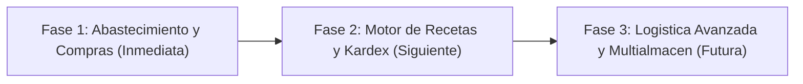

# Mapa de Modulos y Analisis Funcional: restaurant.pe vs. Mockup Caprichos para el Rol Almacen

Informe tecnico y funcional comparativo elaborado por el analista de sistemas de restaurantes e inventarios para la cafeteria Caprichos (Lima, Peru).

---

## 1. Lo que restaurant.pe tiene en este tema (separa EN VIVO de REFERENCIA)

### A. Vista en Vivo de restaurant.pe
**NO SE PUDO VER EN VIVO: requiere que el usuario inicie sesion**.  
Al acceder a la URL principal del servicio en la nube (`https://restaurant.pe`), el servidor responde con la portada comercial publica y redirige a la pantalla de autenticacion (`#!/login`). En estricto cumplimiento de las reglas de seguridad, auditoria pasiva y proteccion de credenciales, no se ingresaron usuarios, contrasenas ni tokens, procediendose a fundamentar el analisis en los documentos tecnicos de auditoria previa y analisis estatico del entorno de produccion.

---

### B. Informacion de REFERENCIA de restaurant.pe
De acuerdo con los documentos de auditoria del sistema en produccion (`modulos.md`, `modulos-lista.md`, `modulos-descripcion.md`, `almacen.md`, `compras.md`, `productos.md`, `informes.md`, `escritorio.md` y `modulos-usuarios-notificaciones.md`), restaurant.pe estructura su aplicacion administrativa en una arquitectura SPA (Single Page Application) basada en AngularJS 1.6.10, PHP 7.1.33 y base de datos MariaDB/MySQL con replicas de solo lectura (`/restaurant/readonly/rest/`).

#### B.1 Arbol Maestro de Modulos Funcionales (17 Macro-modulos y Submodulos)

A continuacion se detallan los 17 modulos operativos observados en la barra de navegacion lateral con la cuenta `krosales`:

1. **Escritorio**:
   - *Submodulos*: Resumen (`#!/`), Novedades (`#!/novedades`).
   - *Funcionalidad*: Tablero principal con metricas financieras del dia, hora punta y hora libre, tarjetas de ingresos desglosadas por medio de pago (efectivo, tarjetas, billeteras digitales, vales, credito), tiempos de despacho en cocina y sala, ticket promedio y ranking de platos vendidos por centro de produccion.
2. **Ventas**:
   - *Submodulos*: Pedidos en caja (`#!/ventas/hacer-pedidos/salones`), Pedidos Multimozo (`#!/ventas/multimozo`), Pantalla de cocina / KDS (`#!/ventas/ver-pedidos/estado`).
   - *Funcionalidad*: Digitacion de comandas en mostrador, toma de pedidos movil en mesas por mozo, monitor digital de despacho en cocina por estaciones de trabajo con semaforo de demora.
3. **Caja**:
   - *Submodulos*: Cobrar (`#!/caja/cobrar/salones`), Apertura y cierre (`#!/caja/apertura-cierre`), Cierre caja Z (`#!/caja/cierre-caja-z`), Cierres de caja (`#!/caja/movimientos`), Ingresos (`#!/caja/ingresos`), Egresos (`#!/caja/egresos`), Notas de credito (`#!/caja/Notas-Credito`), Notas de debito (`#!/caja/Notas-Debito`), Monitor de ventas (`#!/caja/monitorcaja`), Consulta de precios (`#!/informes/inventario/productos-con-precio`).
   - *Funcionalidad*: Liquidacion de cuentas, cuadre de turnos, arqueo ciego, control de flujo de efectivo en caja chica y emision de comprobantes tributarios.
4. **Reservas**:
   - *Submodulos*: Reservas (`#!/reservas/principal`).
   - *Funcionalidad*: Agenda y calendario de mesas reservadas por fecha, hora, salon y cantidad de personas.
5. **Creditos**:
   - *Submodulos*: Cobro de ventas (`#!/creditos/ventacreditos`), Pago de compras (`#!/creditos/compracreditos`).
   - *Funcionalidad*: Administracion de cuentas por cobrar a clientes autorizados y amortizacion de cuentas por pagar a proveedores.
6. **Clientes**:
   - *Submodulos*: Clientes (`#!/clientes`), Debito (`#!/clientes/debito`).
   - *Funcionalidad*: Directorio con identificacion fiscal (RUC/DNI), telefono, historial de compras y linea de consumo en cuenta corriente.
7. **Productos**:
   - *Submodulos*: Platos y Bebidas (`#!/productos/platos/categoria/All`), Combos (`#!/productos/combos`), Modificadores (`#!/productos/modificadores`), Insumos (`#!/productos/insumos`), Menus (`#!/productos/menus`), Descartables (`#!/productos/descartable`), Productos sugeridos (`#!/productos/productosugerido`).
   - *Funcionalidad*: Catalogo maestro de la carta gastrononica, categorias jerarquicas, recetas de costeo (escandallo), insumos puros, sub-recetas base, porcionables, modificadores con descarga de insumos, descartables para llevar y funcion de "Marcar como agotado".
8. **Ofertas**:
   - *Submodulos*: Ofertas (`#!/ofertas/sucursales/2en1/1/categoria/All`).
   - *Funcionalidad*: Promociones comerciales 2x1 y combos especiales por local.
9. **Descuentos**:
   - *Submodulos*: Descuentos (`#!/descuentos`), Cupon descuento (`#!/ajustes/cupondescuento`), Promociones y sorteos (`#!/promocionsorteo`), Vales de Pago (`#!/ajustes/valedepago`).
   - *Funcionalidad*: Rebajas porcentuales por horario o categoria, emision de codigos de cupon para comprobantes impresos, campañas de sorteo y gestion de gift cards.
10. **Compras**:
    - *Submodulos*: Proveedores (`#!/compras/proveedores`), Lotizar compras (`#!/compras/lotes`), Ajustes (`#!/compras/ajustes/banco`), Registro integral de facturas y compras (`#!/compras/todas`).
    - *Funcionalidad*: Directorio de proveedores con consulta SUNAT en linea, agrupacion financiera de facturas al credito en lotes de tesoreria, configuracion de cuentas bancarias y registro de facturas/guias con desglose de insumos, almacenes de destino, afectacion IGV, percepciones, detracciones y fecha de vencimiento por lote.
11. **Almacen**:
    - *Submodulos*: Movimiento interno (`#!/almacen/requerimientomovimiento/requerimientos/movimiento`), Requerimiento (`#!/almacen/requerimientomovimiento/requerimientos/nuevo-requerimiento`), Recepcion (`#!/almacen/requerimientomovimiento/requerimientos/nuevo-recepcion`), Lista de procesos (`#!/almacen/requerimientomovimiento/requerimientos/lista-de-proceso`), Stock y Existencias (`#!/almacen/stock`), Kardex (`#!/almacen/kardex/individual`), Mermas (`#!/almacen/merma`), Almacenes y Produccion (`#!/ajustes/produccion`).
    - *Funcionalidad*: Traslado entre almacenes mediante plantillas, solicitudes de abastecimiento entre sucursales/cocina central, recepcion de mercaderia contra guias de remision con deteccion de discrepancias, monitor de stock bajo con calculo de faltante, libro mayor de kardex valorizado y justificacion de mermas.
12. **Delivery**:
    - *Submodulos*: Menu online (`/carta-digital/#/inicio`), Pedidos QR, Call center (`#!/ventas/callcenter`), Zona de reparto (`#!/ajustes/zonareparto`), Ajustes (`#!/delivery/ajustes/motorizado`), Resumen (`#!/resumen/delivery`), Zona de reparto cobertura (`#!/informes/ventas/deliverys-cobertura`), Mapa de calor (`#!/informes/ventas/deliverys-cobertura/mapa`), Reclamos (`#!/ventas/callcenter/reclamo`), Frecuencia (`#!/informes/ventas/deliverys-frecuencia`).
    - *Funcionalidad*: Canal de pedidos digitales, atencion telefonica, ruteo y asignacion a motorizados, reporte geografico y gestion de incidencias.
13. **Informes**:
    - *Submodulos*: Centro consolidado de reportes (`#!/informes`).
    - *Funcionalidad*: Mas de 100 reportes clasificados en 9 dominios: Ventas (50), Caja y Finanzas (15), Inventario y Almacen (28), Compras (11), Clientes, Delivery, Personal/Operaciones, Reportes Consolidados y Gerenciales.
14. **Indicadores**:
    - *Submodulos*: Tablero grafico (`#!/indicadores`).
    - *Funcionalidad*: Panel ejecutivo con ecuaciones contables (Ventas netas, Compras, Margen de utilidad) y 8 graficos interactivos.
15. **Mi restaurant**:
    - *Submodulos*: Mi empresa (`#!/mirestaurante/miempresa`), Facturacion Electronica (`#!/ajustes/facturacionelectronica`), Series de contingencia (`#!/ajustes/serie-contingencia`), Integraciones (`#!/ajustes/integraciones`), Integracion POS (`#!/ajustes/pos`), Contrato (`#!/ajustes/contrato`).
    - *Funcionalidad*: Datos institucionales, conexion con PSE/OSE para SUNAT, certificados digitales y homologacion de terminales.
16. **Ajustes**:
    - *Submodulos*: Opciones sistema, Opciones de APP Quipu, Configuracion regional, Locales, Usuarios, Almacenes y Produccion, Salones y Mesas, Cajas, Comprobantes, Impresoras, Impuestos, Tarjetas, Turnos, Monedas, Moneda de facturacion, Cuentas de transferencia, Gestion de marcas, Imagenes self service, Categoria Anular Venta, Formas de pago.
    - *Funcionalidad*: Configuracion de parametros globales del ERP, hardware de red, impuestos y catalogo de seguridad.
17. **Notificaciones, Perfil y Usuarios**:
    - *Submodulos*: Notificaciones (campanita, comprobantes pendientes SUNAT, mensajes internos, alerta de stock bajo, error de impresion), Perfil (usuario activo, caja en uso, selector de sucursales, cierre seguro), Usuarios (`#!/ajustes/usuarios`, perfiles de acceso y mas de 500 permisos granulares).
    - *Funcionalidad*: Seguridad perimetral, conmutacion de locales y monitoreo activo del sistema.

*Modulos excluidos por carecer de valor funcional para Caprichos*:
Add-ons comerciales no contratados con boton "Activalo" (Plaza puntos, Encuestas, Self service, Workplace Logistica, Asistencias), Academia, Novedades de la plataforma, enlaces rotos sin destino (Ir a modulo logistica, Ir modulo gastos) y Pagos del sistema.

---

#### B.2 Que ve el Rol Almacen en restaurant.pe frente a otros roles
En la arquitectura de seguridad de restaurant.pe (`modulos-usuarios-notificaciones.md`, lineas 151-163 y 216-224), no existe un cargo rigido denominado "ALMACEN" con menu prefijado; los 7 cargos base son: `ADMINISTRADOR`, `CAJERO`, `PRODUCCION`, `MOZO`, `CALL CENTER`, `AUTO SERVICIO` y `MOTORIZADO`.

Para habilitar un operador de almacen en restaurant.pe, el administrador utiliza la pantalla `Ajustes > Usuarios` (`perfilUsuario.html`) y le asigna un perfil a la medida mediante checkboxes de permisos. A dicho usuario de almacen se le habilitan tipicamente los siguientes accesos:

- **En Almacen**: Movimiento interno, Requerimientos, Recepcion, Lista de procesos, Stock y Existencias (`almacen.stock`), Kardex individual y general (`almacen.kardex`), Registro de mermas (`almacen.movimientoalmacen`).
- **En Compras**: Directorio de Proveedores (`compras.proveedores`), Registro de Facturas/Compras (`compras.compras`), Lotizar compras si apoya en programacion financiera.
- **En Productos**: Consulta de Insumos, Recetas Base, Porcionables y Descartables (generalmente sin permiso de alterar precios de carta en salón).
- **En Informes**: Seccion 3 "Inventario y Almacen" (Kardex tributario, Stock valorizado a costo promedio ponderado, Movimientos entre almacenes, Historial de merma, Productos por vencer) y Seccion 4 "Compras" (Compras por insumo, Detalle por proveedor).
- **En Notificaciones**: Alertas automaticas de insumos con stock por debajo del minimo requerido.
- **Lo que NO ve el rol almacen en restaurant.pe**: Ventas de mesas, cobro de cuentas, apertura y arqueo de caja (Cierre Z), clientes ni facturacion electronica tributaria general.

---

## 2. Lo que el mockup YA tiene para el rol almacen en este tema (con evidencia)

En el prototipo de Caprichos (`/tmp/claude-1000/almacen-agy/fuente/Admin.dc.html`, linea 2833 y archivo auxiliar `fuente/modulos-y-roles.md`, lineas 96-100 y 110-127), el rol **Almacen** esta formalmente independizado y configurado con **6 vistas exclusivas**:

```javascript
// Admin.dc.html, linea 2833
almacen: { 
  n: 'Almacén', 
  user: 'alm01', 
  person: 'Almacenero de ejemplo', 
  ini: 'AL', 
  color: '#F08A3E', 
  views: [ 'escritorio', 'compras', 'almacen', 'stock', 'informes', 'notificaciones' ], 
  home: 'escritorio', 
  manage: false 
}
```

A continuacion se presenta la evidencia tecnica de lo que existe e implementa cada una de las 6 vistas:

### 1. Vista Escritorio (`view: 'escritorio'`)
- **Evidencia en Codigo**: `Admin.dc.html`, lineas 3192 a 3195 y lineas 937 a 985.
- **Contenido Funcional**:
  - Cuatro tarjetas KPI operativas de cabecera:
    1. *Insumos bajo el minimo*: valor numerico calculado en tiempo real segun existencias (`lowSupplies.length`).
    2. *Compras por recibir*: conteo de compras pendientes de recepcion (`TABLES.compras.rows.filter(r => r[6] === 'Pendiente').length`).
    3. *Movimientos de hoy*: contador fijo inicial de movimientos registrados ('3').
    4. *Requerimientos pendientes*: indicador de pedidos en cola ('1').
  - Lista interactiva de "Pendientes / Para hacer ahora" con navegacion directa:
    * Boton `Insumos con stock bajo` -> redirige a la vista `stock`.
    * Boton `Compras pendientes` -> redirige a la vista `compras`.
    * Boton `Movimientos de almacén` -> redirige a la vista `almacen`.
  - Tarjeta "Ultimos movimientos": lista de los ultimos 4 registros de kardex/movimientos con nombre de insumo, cantidad, origen, destino, documento y chip de estado.
  - Widget "Insumos con stock bajo": lista lateral compacta que advierte insumo, stock actual y stock minimo.
  - *Restriccion comprobada*: No muestra metricas de dinero facturado, curvas de ventas, medios de pago ni afluencia de clientes (blindaje para el rol).

### 2. Vista Compras (`view: 'compras'`)
- **Evidencia en Codigo**: `Admin.dc.html`, lineas 2847 a 2852 y lineas 1019 a 1120 (`isTable`).
- **Contenido Funcional**:
  - Titulo y descripcion: *"Compras: Compras a proveedores y su estado de recepción y pago"*.
  - Tabla de tarjetas maestras con columnas: `Compra`, `Proveedor`, `Fecha`, `Insumos`, `Total`, `Pago`, `Estado`.
  - Filtros interactivos integrados:
    * Filtro por *Estado*: Recibida, Pendiente, Anulada.
    * Filtro por *Forma de Pago*: Contado, Credito.
  - Buscador reactivo superior: campo de texto *"Buscar por proveedor o compra"*.
  - Datos precargados de ejemplo: ordenes `OC-204` a `OC-211` con proveedores reales del rubro (Lacteos del Norte, Cafe de Altura SAC, Panificadora Central, Frutas Selectas, Insumos Dulces, Empaques y Envases).
  - Botones por fila: `Editar` y `Desactivar/Activar`.

### 3. Vista Almacen (`view: 'almacen'`)
- **Evidencia en Codigo**: `Admin.dc.html`, lineas 1057 a 1065, lineas 1845 a 1865, lineas 2853 a 2858, lineas 3940 a 3969.
- **Contenido Funcional**:
  - Banner explicativo de regla de negocio: *"Registra lo que entra, sale, se devuelve o se pierde. Cada movimiento actualiza el stock. La producción de la mañana entra como producto terminado y sus insumos salen del almacén (acta 02)"*.
  - Tres botones operativos de accion directa (`canMove = true` para Almacen):
    1. **Registrar movimiento** (`openMov`): abre el modal interactivo `isMv` con seleccion de Tipo (Entrada, Salida, Devolucion, Merma), Insumo (catalogo `SUPPLIES`), Cantidad, Origen (Proveedor, Almacen central, Cocina, Barra, Produccion), Destino (Almacen central, Cocina, Barra, Produccion) y Motivo de Merma (Donacion, Personal, Desecho). Al guardar (`mvSave`), descuenta o suma stock y genera correlativo (ej. `ENT-101`, `SAL-102`, `MER-103`).
    2. **Registrar la produccion del dia** (`openProd`): atajo preconfigurado para dar entrada automatica a las donas elaboradas en el turno de la mañana desde Produccion hacia Almacen Central.
    3. **Cerrar el dia (sobrantes a merma)** (`closeDay`): regla automatizada (RN-CAP-040 del BRD) que barre los articulos perecibles de vida util de 1 dia (`vida: true`), traslada el stock sobrante a merma bajo motivo "Donacion" y resetea las existencias a cero con auditoria en log.
  - Tabla de movimientos historicos con columnas: `Fecha`, `Tipo`, `Insumo`, `Cantidad`, `Origen`, `Destino`, `Documento`.
  - Filtros por: *Tipo de movimiento*, *Origen* e *Insumo*.

### 4. Vista Stock y recetas (`view: 'stock'`)
- **Evidencia en Codigo**: `Admin.dc.html`, lineas 808 a 885, lineas 2235 a 2239, lineas 2900 a 2930.
- **Contenido Funcional**:
  - Monitor visual de Insumos con **Semaforo de 3 estados**: Verde (suficiente), Naranja (regular), Rojo (bajo), con barra de porcentaje de nivel respecto al maximo.
  - Campos por fila de insumo: Nombre, Unidad de medida, Proveedor sugerido (A, B, C), Dias de vida util (si aplica), Cantidad fisica y Stock minimo requerido.
  - Accion individual: boton `Pedir por WhatsApp` en cada insumo critico.
  - Boton global `Armar orden de compra con lo bajo` (`orderAll`): agrupa de forma automatica todos los insumos bajo el umbral minimo, calcula la cantidad faltante requerida, redacta un mensaje estructurado y genera el enlace directo a WhatsApp (`https://wa.me/51...`) para el proveedor principal.
  - Switch de configuracion: `Alertas por correo` (Activar/Desactivar).
  - Bloque de auditoria en vivo `Descontado por pedidos aceptados`: muestra el historial de descargo de insumos detonado automaticamente al confirmar comandas en caja.
  - Panel lateral de Recetas de plato: muestra el escandallo tecnico de preparaciones seleccionadas con insumos requeridos, cantidades, costo unitario, sumatoria de costo de materia prima, precio de venta y calculo del margen de ganancia.

### 5. Vista Informes (`view: 'informes'`)
- **Evidencia en Codigo**: `Admin.dc.html`, lineas 2859 a 2866, lineas 1019 a 1120.
- **Contenido Funcional**:
  - Catalogo maestro de reportes con columnas: `Informe`, `Categoria`, `Qué muestra`, `Filtros`, `Exportar`.
  - Filtro por Categoria: *Inventario*, *Compras*, *Ventas*, *Caja*, *Clientes*, *Delivery*.
  - Reportes pertinentes al rol Almacen listados en catalogo:
    * *Kardex de insumos* (Entradas y salidas por insumo, filtros Fecha/Insumo, exportable Excel).
    * *Stock bajo* (Insumos por debajo del minimo, filtro Almacen, exportable PDF/Excel).
    * *Mermas* (Perdidas por insumo y motivo, filtros Fecha/Motivo, exportable Excel).
    * *Compras por proveedor* (Total comprado por proveedor, filtros Fecha/Proveedor, exportable PDF/Excel).

### 6. Vista Notificaciones (`view: 'notificaciones'`)
- **Evidencia en Codigo**: `Admin.dc.html`, lineas 2877 a 2882, lineas 3667 a 3687.
- **Contenido Funcional**:
  - Tabla de notificaciones del sistema con columnas: `Fecha`, `Tipo`, `Mensaje`, `Estado`.
  - Filtro por Tipo: *Stock bajo*, *Pedido por confirmar*, *Error de impresora*, *Comprobante pendiente*, *Mensaje interno*, *Delivery por confirmar*.
  - Campanita interactiva en la cabecera: sistema de priorizacion por puntaje (alta, media, baja) y tiempo transcurrido. Alerta especificamente al rol almacen cuando se detectan quiebres de inventario (`lowSupplies.length > 0`) con boton de acceso rapido `Ver stock`.

*Modulo "Caja y cierres" (`view: 'cierre'`)*:  
Verificado en `Admin.dc.html`, lineas 2822 y 2829. Este modulo NO pertenece al rol almacen; esta asignado exclusivamente a los roles `admin` y `cajero`, respetando la segregacion de funciones.

---

## 3. Lo que FALTA o esta incompleto frente a restaurant.pe

### A. Tabla Comparativa de TODOS los Modulos de restaurant.pe vs. Mockup

A continuacion se contrastan los 17 modulos y submodulos de restaurant.pe contra la implementacion del mockup, indicando su nivel de cobertura y la visibilidad para el rol Almacen:

| # | Modulo en restaurant.pe | Submodulos en restaurant.pe | Estado en Mockup | Modulo equivalente en Mockup | ¿Lo ve Almacen en restaurant.pe? | ¿Lo ve Almacen en Mockup? |
| :-: | :--- | :--- | :--- | :--- | :---: | :---: |
| 1 | **Escritorio** | Resumen, Novedades | **Completo** | Escritorio (`escritorio`) | Si (solo metricas de stock) | **Si** (vista 1/6) |
| 2 | **Ventas** | Pedidos caja, Multimozo, KDS Cocina | **Completo** | Pedidos y caja (`caja`), Cocina (`cocina`) | No | **No** |
| 3 | **Caja** | Cobrar, Apertura/Cierre, Cierre Z, Arqueos, Egresos, Notas Cred./Deb. | **Completo** | Pedidos y caja (`caja`), Caja y cierres (`cierre`) | No | **No** |
| 4 | **Reservas** | Agenda de reservas | **Completo** | Reservas (`reservas`) | No | **No** |
| 5 | **Creditos** | Cobro ventas, Pago compras | **Parcial** | Creditos del personal (`creditos`), Compras (`compras`) | Si (solo pago compras) | **No** (solo ve compras) |
| 6 | **Clientes** | Directorio clientes, Cuentas debito | **Completo** | Clientes (`clientes`) | No | **No** |
| 7 | **Productos** | Platos, Combos, Modificadores, Insumos, Menus, Descartables | **Parcial** | Productos (`productos`), Stock y recetas (`stock`) | Si (insumos y recetas) | **Si** (recetas en vista 4) |
| 8 | **Ofertas** | Promociones 2x1, combos local | **Completo** | Ofertas y descuentos (`ofertas`) | No | **No** |
| 9 | **Descuentos** | Cupones, Descuentos automaticos, Vales | **Completo** | Ofertas y descuentos (`ofertas`) | No | **No** |
| 10 | **Compras** | Proveedores, Lotizar compras, Facturas de compra, Ajustes bancos | **Parcial** | Compras (`compras`) | **Si** | **Si** (vista 2/6) |
| 11 | **Almacen** | Movimientos, Requerimientos, Recepcion, Procesos, Stock, Kardex, Mermas | **Parcial** | Almacen (`almacen`), Stock y recetas (`stock`) | **Si** | **Si** (vistas 3 y 4) |
| 12 | **Delivery** | Carta web, QR, Call center, Motorizados, Zonas, Reclamos | **Completo** | Repartos (`repartos`), Pedidos y caja (`caja`) | No | **No** |
| 13 | **Informes** | 9 categorias, +100 reportes analiticos | **Parcial** (solo catalogo) | Informes (`informes`) | Si (solo inventario/compras) | **Si** (vista 5/6) |
| 14 | **Indicadores** | Tablero KPIs, graficos BI | **Completo** | Indicadores (`indicadores`) | No | **No** |
| 15 | **Mi restaurant** | Facturacion electronica SUNAT, POS, Contrato | **NO lo tiene** (fuera de alcance BRD) | No implementado en mockup | No | **No** |
| 16 | **Ajustes** | Locales, Cajas, Impresoras, Almacenes/Produccion, Salones, Monedas | **Parcial** | Config. local (`mirest`), Plano (`plano`), Pantallas (`pantallas`) | No | **No** |
| 17 | **Notificaciones, Perfil y Usuarios** | Alertas, Seguridad, 500 permisos, Usuarios | **Completo** | Usuarios (`usuarios`), Notificaciones (`notificaciones`), Perfil | Si (solo alertas) | **Si** (vista 6/6) |

---

### B. Tabla de Faltantes y Brechas Funcionales Criticas para el Rol Almacen

| Que falta en el Mockup | Donde lo tiene restaurant.pe | Por que importa para Caprichos | Gravedad | Esfuerzo |
| :--- | :--- | :--- | :---: | :---: |
| **Formulario de Registro de Facturas/Compras** | En `Compras > Registro de compras` (`#!/compras/todas/nuevo/`) | Hoy la vista Compras solo es una tabla fija de tarjetas. No se puede ingresar una factura fisica con numero de serie, proveedor, RUC, detalle de insumos, precios, IGV ni retenciones. | **Alta** | **L** |
| **Captura de Fecha de Vencimiento y Lote de Insumo** | En `Compras > compra-form.html` (columna `Fecha Venc.`) | En cafeteria, la leche fresca, crema chantilly, embutidos y pulpas expiran en pocos dias. Sin fecha de vencimiento no hay semaforo de caducidad ni control FEFO/FIFO. | **Alta** | **M** |
| **Directorio Maestro de Proveedores con RUC/SUNAT** | En `Compras > Proveedores` (`#!/compras/proveedores`) | El mockup asocia nombres simples en texto plano. Falta la ficha con RUC de 11 digitos, razon social, telefonos de contacto, dias de credito y cuentas bancarias. | **Media** | **M** |
| **Requerimientos Formales de Cocina/Barra a Almacen** | En `Almacen > Requerimiento` (`nuevo-requerimiento`) | El mockup muestra "Requerimientos pendientes: 1" en el Escritorio pero no existe la pantalla ni el formulario para que el personal de barra pida cafe o leche al almacen. | **Alta** | **M** |
| **Recepcion y Conciliacion de Mercaderia contra Guia** | En `Almacen > Recepcion` (`nuevo-recepcion`) | Cuando llega el repartidor del proveedor, almacen debe cotejar lo solicitado contra lo recibido fisico (marcar checks de conformidad y registrar faltantes o bultos rotos). | **Alta** | **M** |
| **Trazabilidad de Kardex Historico Transaccional** | En `Almacen > Kardex` (`#!/almacen/kardex/individual`) | El mockup registra movimientos en una lista, pero no calcula la columna de "Saldo acumulado" fisico ni la valorizacion del costo promedio ponderado de existencias. | **Alta** | **L** |
| **Ficha de Insumos: Conversion de Unidades de Medida** | En `Productos > Insumos` (`insumos-nuevo.html`) | El cafe se compra en sacos de 5 kg, se almacena en kg y se consume en recetas por gramos (18 g por taza). Sin factor de conversion la receta descuenta magnitudes erroneas. | **Alta** | **M** |
| **Sub-recetas Base y Porcionables** | En `Productos > Insumos > Recetas Base` (`tipoinsumo: 2`) | Preparaciones intermedias como jarabe de goma, salsa de chocolate o masa de queque que se elaboran previamente y luego componen multiples bebidas o postres. | **Media** | **M** |
| **Multiples Almacenes Fisicos y Sub-almacenes** | En `Ajustes > Almacenes y Produccion` (`#!/ajustes/produccion`) | El mockup asume un solo almacen central. No permite controlar el stock especifico de la Barra independiente del stock de Cocina o del Deposito seco. | **Media** | **L** |
| **Generacion Real de Reportes de Inventario y Kardex** | En `Informes > Inventario` (`stockvalorizado`, `kardex`) | En el mockup, la vista Informes es un catalogo informativo estatico. No filtra por rango de fechas real ni genera tablas de resultados ni exportacion a Excel/PDF. | **Media** | **M** |

---

## 4. Mejoras sobre restaurant.pe (que haria mejor nuestro sistema)

Frente a la arquitectura compleja, fragmentada y obsoleta de restaurant.pe, el sistema de Caprichos introduce ventajas de diseño sustanciales:

1. **Unificacion en un solo Hub de Abastecimiento vs. 5 Modulos Dispersos**:
   - *Problema en restaurant.pe*: Para comprar y controlar un insumo, el usuario debe navegar entre `Compras > Proveedores`, `Compras > Todas`, `Almacen > Stock`, `Productos > Insumos`, `Almacen > Movimiento interno` y `Ajustes > Produccion`, requiriendo mas de 15 clics entre pantallas que tardan de 2 a 4 segundos en estabilizarse.
   - *Mejora en Caprichos*: Todo el ciclo se consolida en 3 pantallas clave: **Compras** (facturas y suplidores), **Almacen** (entradas, salidas, mermas y produccion diaria) y **Stock y recetas** (semaforo visual, compras por WhatsApp y margen del plato).

2. **Orden de Compra Instantanea por WhatsApp**:
   - *Problema en restaurant.pe*: El boton "Generar orden compra" en la pantalla de stock abre un modulo administrativo interno rigido para generar un documento PDF que luego debe enviarse manualmente por correo o imprimirse.
   - *Mejora en Caprichos*: Con un solo clic en `Armar orden de compra con lo bajo` o en `Pedir por WhatsApp`, el sistema compila la lista de faltantes de los insumos en estado rojo/naranja, arma el mensaje de texto estructurado y abre directamente el chat oficial de WhatsApp con el proveedor asignado.

3. **Cierre del Dia Automatizado para Productos de Vida Util Corta (Donas y Reposteria)**:
   - *Problema en restaurant.pe*: Las mermas de productos que se vencen al cierre del turno requieren digitaciones manuales una por una en una pantalla restringida (`#!/almacen/merma`), generando retrasos y omisiones frecuentes por parte del personal nocturno.
   - *Mejora en Caprichos*: El boton `Cerrar el día (sobrantes a merma)` (linea 3957 de `Admin.dc.html`) detecta automaticamente todos los articulos perecibles de duracion diaria (`vida: true`), traslada el remanente a merma bajo causal de donacion/desecho y deja el inventario en cero listo para la produccion del dia siguiente.

4. **Escandallo y Margen Comercial en la Misma Pantalla de Stock**:
   - *Problema en restaurant.pe*: Ver la rentabilidad de un plato exige ir a `Informes > Inventario > Catalogo` o correr reportes de Food-Cost en el modulo de BI.
   - *Mejora en Caprichos*: En la vista `Stock y recetas`, el usuario selecciona cualquier plato y visualiza inmediatamente el costo teorico acumulado de ingredientes, el precio de venta y el porcentaje de margen bruto en soles (`recipeMargin`).

5. **Ergonomia Visual Moderna (Semaforo y Tarjetas en vez de Tablas Planas)**:
   - *Problema en restaurant.pe*: Tablas saturadas de texto plano diminuto, selectores AngularJS propensos a desincronizacion y tipografia ilegible en pantallas tactiles o tablets de cocina.
   - *Mejora en Caprichos*: Tarjetas con jerarquia clara, barras de nivel porcentual con codigo de color inmediato (verde, naranja, rojo) y botones grandes con zona de toque optimizada para dedos (minimo 44x44 px).

6. **Regla Estricta de Integridad: Nada se Elimina, Todo se Desactiva**:
   - A diferencia de otros sistemas donde la eliminacion de un insumo deja transacciones huerfanas en el kardex historico, en Caprichos los registros se desactivan, conservando la trazabilidad historica inalterable.

---

## 5. Propuesta concreta de implementacion en el mockup, priorizada

Para transformar el mockup en un prototipo completamente funcional y listo para desarrollo, se define la siguiente hoja de ruta de tres fases:



### Prioridad 1: Abastecimiento, Registro de Facturas e Insumos (Fase Inmediata / Esencial)
1. **Modal de Registro de Compra / Entrada de Mercaderia**:
   - *Ubicacion*: Boton `+ Registrar compra` en la cabecera de la vista `Compras`.
   - *Campos Cabecera*: Proveedor (selector con RUC y Razon Social), Tipo de Comprobante (Factura, Boleta, Nota de Venta, Guia de Remision), Serie y Numero de Comprobante, Fecha de Emision, Condicion de Pago (Contado efectivo, Transferencia, Credito a 7/15/30 dias).
   - *Tabla de Detalle*: Buscador predictivo de Insumo, Cantidad, Unidad de Medida, Costo Unitario, Subtotal, Checkbox ¿Afecto a IGV?, Fecha de Vencimiento del Lote.
   - *Regla de Negocio*: Al confirmar, incrementa las existencias en `stock` y asienta el movimiento de Entrada en la tabla de `almacen`.
2. **Directorio Maestro de Proveedores**:
   - Pestaña secundaria o modal `Gestionar proveedores` en Compras.
   - Campos: Razon Social, Nombre Comercial, RUC (11 digitos), Telefono/WhatsApp para pedidos, Correo, Dias de credito promedio y Banco/Numero de Cuenta para transferencias.
3. **Ficha de Insumos con Factores de Conversion**:
   - En la configuracion del insumo: definir Unidad de Compra (ej. Saco, Caja, Galon), Unidad de Almacen (KG, LT, UNID) y Unidad de Receta (Gramo, Mililitro, Porcion).
   - Equivalencia matematica obligatoria (ej. 1 KG = 1000 GR).

---

### Prioridad 2: Motor de Fichas Tecnicas y Kardex Valorizado (Fase Siguiente)
1. **Descuento Automatico por Explosión de Receta en Tiempo Real**:
   - Conectar la venta de cada cafe o postre en `Pedidos y caja` con la formula de `Stock y recetas`.
   - Ejemplo: La venta de 1 Capuchino descuenta automaticamente 18 g de Cafe en grano y 180 ml de Leche fresca en el stock.
2. **Kardex Transaccional con Saldo Continuo**:
   - Convertir la vista de movimientos de Almacen en una tabla de Kardex formal:
   - Columnas: `Fecha`, `Comprobante/Documento`, `Operacion (Compra, Venta, Merma, Produccion)`, `Entrada (Cant/Costo)`, `Salida (Cant/Costo)`, `Saldo Fisico`, `Costo Promedio Ponderado`, `Saldo Valorizado (S/)`.
3. **Alertas Preventivas de Vencimiento (Semaforo FEFO)**:
   - Notificacion en la campanita cuando un lote de insumos perecibles este a menos de 3 dias de su fecha de caducidad.

---

### Prioridad 3: Logistica Interna y Multialmacen (Fase Futura / Maduracion)
1. **Sub-almacenes Operativos**:
   - Diferenciar existencias entre *Almacen Principal (Bodega)*, *Barra de Cafeteria* y *Cocina*.
   - Transferencias internas entre almacenes con confirmacion de envio y recepcion.
2. **Circuito de Requerimientos Internos**:
   - Pantalla donde el mozo de barra o cocinero registra: *"Solicito 5 bolsas de leche y 2 kg de cafe al Almacen Central"*.
   - El almacenero despacha y el solicitante confirma recepcion fisica.
3. **Carga Digital de Facturas XML (UBL 2.1 SUNAT)**:
   - Asistente para arrastrar el archivo XML de la factura del proveedor y autocompletar la compra sin digitacion manual.

---

## 6. Preguntas para el dueño (Kevin)

Para cerrar la definicion del modulo de inventarios con el cliente Kevin Rosales, se plantean las siguientes preguntas funcionales:

1. **Topologia Fisica de Almacenes**:  
   ¿Caprichos opera con un unico almacen central donde se guarda toda la mercaderia y el personal va tomando lo que necesita durante el dia, o la Barra de cafe y la Cocina manejan sus propios sub-almacenes con inventario y stock independiente?
2. **Emision de Pedidos a Proveedores**:  
   ¿Actualmente realizan pedidos de compra formales con Orden de Compra previa autorizada, o el encargado de turno llama o escribe directamente por WhatsApp al proveedor cuando ve que un insumo se esta terminando?
3. **Condiciones Financieras de Pago de Insumos**:  
   ¿Aproximadamente que porcentaje de los insumos se paga de inmediato en efectivo saliendo de la caja chica de la cafeteria vs. compras al credito con factura a 15 o 30 dias que se cancelan mediante transferencias bancarias de gerencia?
4. **Precision de Escandallo en Barra**:  
   Para la barra de cafe: ¿desean controlar el consumo al gramo por cada taza servida (ej. 18 gramos de cafe molido por taza de espresso) o prefieren controlar el cafe por bolsas completas retiradas de la bodega a la barra?
5. **Control de Envases y Descartables**:  
   ¿Los vasos descartables, tapas termicas, sorbetes y bolsas de delivery deben descontarse automaticamente por receta fija en cada comanda para llevar, o prefieren controlarlos mediante un conteo fisico semanal de existencias?
6. **Destino de las Mermas Diarias**:  
   En los productos de pasteleria y donas que no se venden al final de la jornada: ¿que porcentaje habitual se destina a consumo del personal, donacion o desecho? ¿Desean que el sistema registre quien autorizo la salida de la merma?
7. **Privacidad de Costos para el Almacenero**:  
   ¿El usuario con rol Almacen debe poder ver los precios monetarios de compra de las facturas y los margenes de utilidad de los platos, o su acceso debe limitarse estrictamente a cantidades fisicas (kilos, litros, unidades)?

---

## 7. NO VERIFICADO

Durante la presente auditoria y elaboracion del mapa funcional, no se pudieron comprobar los siguientes aspectos por las razones objetivas que se detallan:

1. **NO SE PUDO VER EN VIVO: requiere que el usuario inicie sesion**:  
   No se efectuo la navegacion dinamica en la interfaz web en vivo de `https://restaurant.pe` debido a que requeria la introduccion de credenciales y sesion activa de usuario, lo cual violaria la directiva estricta de no manipular credenciales ni alterar el entorno operativo de produccion.
2. **Restriccion de APIs de Backend sin Clave de Caja en restaurant.pe**:  
   No se pudo verificar si el backend PHP de restaurant.pe bloquea transacciones de almacén mediante error HTTP 403 Forbidden cuando el usuario se autentica dejando el campo `usuario_clavecaja` vacio, ya que no se ejecutaron llamadas POST ni PUT de escritura en produccion.
3. **Tiempos de Ejecucion del Lote de Kardex (`pendienteProcesoStock`)**:  
   No se pudo medir el impacto de rendimiento real ni la demora de la cola asincrona que calcula el kardex en la base de datos de Caprichos durante las horas punta de atencion en tienda.
4. **Catalogo de Proveedores y Acuerdos Comerciales Reales**:  
   No se verificaron los nombres comerciales reales, RUCs, numeros telefonicos ni condiciones crediticias vigentes de los proveedores actuales de Caprichos, al haberse respetado la proteccion de datos confidenciales y reglas de secreto comercial.
5. **Costeo y Margen Teorico Real de la Carta Vigente**:  
   No se verificaron los costes reales de los insumos ni las recetas completas de los 66 platos y bebidas del menu actual, ya que el mockup contiene datos y calculos estructurados de caracter demostrativo.

---

INFORME LISTO.
