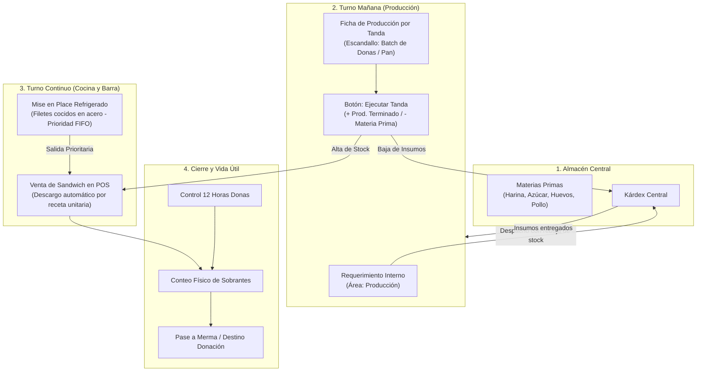

# Auditoria Integral del Rol PRODUCCION en Caprichos: Descubrimiento, Mockup y Gaps Operativos

**Fecha de emision**: 2026-10-18  
**Autor**: Antigravity (Auditoria de Sistemas)  
**Ambito**: Rol Produccion (`produccion`) en el Sistema Administrativo de Caprichos  
**Archivos fuente analizados**:
- `fuente/Admin.dc.html` (Mockup interactivo del sistema administrativo)
- `fuente/acta-01-descubrimiento.md` y `fuente/acta-02-descubrimiento.md` (Transcripciones de reuniones con Kevin Rosales)
- `fuente/iniciativas-acta-02.md` e `fuente/iniciativas-acta-02-evidencia.md` (Inventario y evidencias de requerimientos)
- `fuente/modulos-y-roles.md`, `fuente/BRD.md`, `fuente/registro-mockup.md` (Especificaciones del mockup)
- `referencia/almacen.md`, `referencia/productos.md`, `referencia/escritorio.md` (Modulo referencial de restaurant.pe)
- Informes previos de referencia: `fuente/almacen-informes/` y `fuente/cocina-informes/`

---

## 1. Resumen Ejecutivo y Alcance del Rol

El presente informe constituye la auditoria funcional y tecnica integral correspondiente al rol **PRODUCCION** (identificador en codigo `produccion`, usuaria `prod01`, "Encargada de produccion", color distintivo `#E6B89C`, indicador `manage: true` en `fuente/Admin.dc.html`).

En el modelo de negocio de Caprichos (cafeteria artesanal en Lima fundada y dirigida por Kevin Rosales), el rol de Produccion representa una pieza operativa fundamental pero marcadamente diferenciada de la cocina de linea (salados y despacho al momento):
1. **Turno y funciones clave**: Es el turno matutino que ingresa temprano a elaborar los lotes diarios de productos de pasteleria y panaderia: donas (glaseadas, manjar blanco, fresa), galletas artesanales, pan pullman de molde horneado en casa, gelatinas, bases de pizzas, masas madre/fermentadas y postres frios.
2. **Rutina de insumos y descargo**: La colaboradora retira insumos directamente del almacen fisico al inicio del turno, registra en papel lo utilizado y, al culminar su jornada, debe volcar al sistema tanto la salida de materia prima como la entrada al inventario de los productos terminados disponibles para venta.
3. **Doble flujo de inventario**: En una cafeteria existen dos mecanicas contables y operativas opuestas:
   - *Productos por lote (tanda matutina)*: La materia prima se consume al producir; el producto terminado entra al stock fisico/virtual y en el punto de venta (POS) o carta web se descuenta la unidad terminada (ej. donas, queques, galletas).
   - *Productos al momento (cocina de salados)*: La cocina se abastece en la manana y la materia prima se descuenta automaticamente al momento exacto de la venta segun la receta unitaria (ej. Club Sandwich, capuchinos, frappes).
4. **Conclusion del diagnostico del mockup**: Si bien el prototipo `Admin.dc.html` incorporo el rol `produccion` en su configuracion de usuarios y anadio botones especificos como "Registrar la produccion del dia" y "Cerrar el dia (sobrantes a merma)", **la implementacion actual es puramente cosmetica y desconectada**:
   - Registrar produccion NO descuenta ninguna materia prima ni valida recetas.
   - No existen insumos de pasteleria (harina, levadura, azucar, etc.) en el maestro de insumos.
   - No existen recetas por tanda ni escandallos de produccion.
   - Las cifras del escritorio de produccion estan cableadas de manera estatica ("24 donas", "2 salidas").
   - El sistema de requerimientos al almacen permite pedir insumos pero al marcarlos "Entregado" no mueve el kardex.
   - El cierre de dia fuerza a cero unicamente a las donas con motivo fijo de "Donacion", ignorando el recuento real y dejando fuera el mise en place de pollo cocido refrigerado.

---

## 2. Todo lo que Kevin Rosales declaro en las Actas sobre Produccion, Recetas y Mermas

A continuacion se sistematizan la totalidad de directivas, reglas operativas y declaraciones emitidas por Kevin Rosales a lo largo de las reuniones de descubrimiento sobre el area de produccion, inventarios y mermas.

### 2.1 La rutina operativa matutina y el registro diferido
- **Cita textual de Kevin**: *"En la manana viene produccion. Este viene un una senorita que hace toda la produccion, todo lo que son los postres, los panes, pulman, eh gelatinas, todo viene en la manana. Eh ella usualmente agarra directo del almacen. La idea es que ahorita agarre, apunte y despues en su salida ingrese todos esos registros al sistema de entrada... Que ingrese este los insumos que ha usado, no? Que saco del almacen. y que ingrese tambien los productos que ha preparado el stop diario al finalizar su jornada"* (Acta 02, lineas 72118-72174 / marcas de tiempo 01:12:58 a 01:14:24).
- **Regla de negocio derivada**: La encargada matutina tiene un rol dual:
  1) Salida de materias primas consumidas (descargo de stock en almacen).
  2) Entrada de productos elaborados disponibles para venta (alta de stock en productos de vitrina).
- **Metodo operativo**: Retiro con apunte manual durante la produccion intensiva y consolidacion informatica al finalizar su jornada laboral para no entorpecer el trabajo fisico de cocina con pantallas mojadas o enharinadas.

### 2.2 Donas: Vida util critica de 12 horas y stock cero al amanecer
- **Cita textual de Kevin**: *"Eh, de donas, si, solo de donas. Donas su periodo de vida es de un dia nada mas, es menos todavia. O sea, lo hacen en la tarde son como 12 horas y eso un dia... O sea, para caprichos. Para caprichos. Pero en realidad la dona hasta el dia siguiente esta muy bien. Un pan al dia siguiente te lo puedes comer igualito, pero esta la textura cambia, no?... pero ya es contabilizado como merma, pues a finales es contabilizado como merma, pero lo unico que dura un dia es eh en este caso la dona"* (Acta 02, lineas 76045-77414 / marcas de tiempo 01:17:56 a 01:19:01).
- **Regla de negocio derivada**:
  1) Vida util comercial: Maximo 12 horas para mantener la textura crujiente y esponjosa estandar de Caprichos.
  2) Politica de stock diario: Cada manana el inventario de donas del dia anterior debe amanecer obligatoriamente en 0 unidades en la carta y el sistema.
  3) Lote diario tipico: Kevin ejemplifica lotes de aproximadamente 10 a 24 unidades diarias segun la demanda proyectada.

### 2.3 Sobrantes, mermas y politica de donaciones (no botar comida)
- **Cita textual de Kevin**: *"si cuando queda este donas se regalan, se se donan las donas, no se votan. Todavia no estoy acostumbrado a votar es esa cosa. Prefiero que alguien lo lo disfrute, no? Algo, pero no votarlo... Pero es merma... yo decido que hago con esa merma. Muchas veces le doy a Este, por ahi voy un familiar o lo que sea, no?... yo me encargo de yo y a veces la supervisora que esta aqui, ella es la"* (Acta 02, lineas 72174-75258 / marcas de tiempo 01:15:21 a 01:16:53).
- **Regla de negocio derivada**:
  1) Clasificacion contable: Todo sobrante de donas al cierre de jornada se registra formalmente como MERMA en el sistema.
  2) Destino fisico y etico: No se desechan a la basura; se destinan a donacion externa, regalo a familiares o consumo del personal autorizado.
  3) Autorizacion restringida: La decision final sobre el destino y la aprobacion del registro de mermas recae exclusivamente en Kevin (administrador/dueno) o la supervisora del local, no en operarios sin supervision.

### 2.4 Filetes de pollo cocidos, mise en place nocturno y conservacion en acero
- **Cita textual de Kevin**: *"A veces se quedan pollos, filetes de pollos se quedan cocidos ya que lo tienen parte como parte de su misan plaz. Le quedan de repente por ahi cuatro pechugas de cuatro filetes de pollo. Esto ellos lo que hacen es este lo refrigera, lo colocas en un tapper de acero y lo refrigeran para el dia siguiente y eso es lo que sale primero al dia siguiente, no? Pero ese eso vendria siendo este periodo de vida de un dia maximo del del pollo en los filetes por el tema de produccion. Y este hay productos asi, lo unico es la dona, es lo unico que dura asi 12 horas la dona. Y el pollo tambien, pero el pollo lo cosen en la noche y queda para el dia siguiente. O sea, a veces hacen un poquito de mas quea para el dia siguiente refrigerado"* (Acta 02, lineas 77272-77414 / marcas de tiempo 01:19:01 a 01:20:19).
- **Regla de negocio derivada**:
  1) Mise en place cocido: En el turno nocturno de cocina se cocinan filetes de pechuga que quedan como mise en place pre-elaborado (habitualmente un remanente de aprox. 4 unidades).
  2) Metodo de almacenamiento: Recipiente sellado de acero inoxidable bajo refrigeracion controlada.
  3) Vida util: Maximo 24 horas (1 dia).
  4) Regla de despacho FIFO / PEPS: Al abrir la cocina al dia siguiente, esos filetes cocidos refrigerados son estrictamente los primeros que deben consumirse en los pedidos de la manana antes de someter a coccion nuevo pollo fresco.
  5) Tratamiento frente al cierre de dia: A diferencia de las donas, el pollo cocido refrigerado NO se manda a merma a medianoche; permanece en inventario intermedio de cocina hasta su salida prioritaria.

### 2.5 Recetas, dosificacion, escandallo y rendimiento por tanda
- **Cita textual de Kevin**: *"de un pan, por ejemplo, salen este siete club sandwich. Entonces, o por rebanadas. De un pan salen x rebanadas. Entonces, el producto Club Sandwich cuando se venda van a salir automaticamente x x rebanada de cuatro rebanadas de panes y va a quedarse y cada vez se va a ir descontando, no? Y va a aparecer en tiempo real cuantos panes nos quedan. Cuanta cuanto pollo aproximado? Cuanto tomate, cuanta lechuga, cuanto tocino culinario, cuanto jamon, cuanto queso. Asi porque cada club sand lleva dos rebanadas de jamon edan y dos rebanadas de queso ingles, eh, perdon, queso, queso edan y jamon ingles, no? O sea, tiene una receta y esa receta tiene que estar anexada a productos para que cuando se venda ese producto automaticamente se descuente esa receta del almacen que salga"* (Acta 02, lineas 80000-82000 / marcas de tiempo 01:22:47 a 01:24:19).
- **Cita textual de Kevin sobre costeo y Excel pendiente**: *"las recetas en este caso, en que benefician las recetas? En que el costeo y la utilidad que va a tener cada producto en el costeo influye. Yo tengo por ahi un Excel de recetas. Lo voy a yo voy a armar todas las recetas que tengo mientras tu eso que sea lo ultimo que hagamos las recetas... Te voy a armar las recetas y ahi este ya cuando tenga toda la data lista te las paso"* (Acta 02, lineas 82500-83500 / marcas de tiempo 01:27:36 a 01:28:50).
- **Regla de negocio derivada**:
  1) Rendimiento y dosificacion de pan pullman: Un pan de molde pullman elaborado por produccion rinde aproximadamente 28 rebanadas utiles, lo que permite abastecer exactamente 7 Club Sandwich (4 rebanadas por unidad).
  2) Escandallo y costeo: Las recetas deben alimentar el costeo teorico y margen de utilidad. Kevin dispone de una hoja de calculo externa que se comprometio a depurar.
  3) Estandarizacion de porciones: Kevin senala que en Caprichos compran pechuga especial limpia ya fileteada (compras de 100 filetes cada 3 dias), pero identifica que a veces el filete viene pequeno y en cocina anaden 1.5 filetes; busca que el sistema y los procedimientos estandaricen el gramaje unitario.

### 2.6 Mesas refrigeradas y conservacion de insumos en estacion
- **Cita textual de Kevin**: *"al iniciar la jornada, el personal de Salado, que es que prepara el club Sandwich, tiene que ir al almacen y tienen que abastecerse para el dia... tienen mesas refrigeradas, pues ellos guardan ellos guardan ahi todo lo todo su queso, su jamon, su lechuga, tienen congeladores tambien. Entonces la idea es que anote la salida que es del dia... si le sobra, que se quede para el dia siguiente... Y si se malogra, es merma"* (Acta 02, lineas 82000-83000 / marcas de tiempo 01:26:46 a 01:27:36).
- **Regla de negocio derivada**:
  1) La estacion de cocina cuenta con infraestructura propia (mesas frias y congeladoras).
  2) No hay devolucion fisica diaria al almacen central de insumos frescos si mantienen cadena de frio.
  3) Solo se declara merma si el producto se deteriora.

### 2.7 Matriz de responsabilidades: Quien registra que por turno
Segun las actas, la asignacion de tareas de inventario se divide formalmente de la siguiente manera:
- **Turno Manana (Produccion - `prod01`)**:
  - Retira materias primas del almacen central (harinas, azucar, lacteos, levadura).
  - Elabora la tanda diaria de donas, panes pullman, galletas, gelatinas y masas.
  - Al concluir el turno matutino, registra en el sistema:
    1. Salidas de materias primas consumidas.
    2. Entradas al stock diario de productos terminados.
- **Turno Tarde/Noche (Almacen / Delivery - repartidor principal)**:
  - El motorizado principal asume el rol de almacenero vespertino.
  - Registra salidas de descartables e insumos de operacion (vasos, tapas, sorbetes, servilletas, crema de leche, fresas).
  - Registra entradas cuando llegan proveedores o compras en su turno.
- **Administracion y Suplencias (Kevin Rosales y Supervisora)**:
  - Kevin registra entradas directas de mercaderia adquirida por el en mercados mayoristas o Makro.
  - Cubre descansos del repartidor-almacenero (el segundo delivery solo acude un dia por semana y desconoce la bodega).
  - Autoriza y ejecuta formalmente el registro de mermas y donaciones de sobrantes.

---

## 3. Revision Exhaustiva de Punta a Punta del Mockup (`Admin.dc.html`) para el Rol PRODUCCION

Se audito el codigo fuente de `fuente/Admin.dc.html` simulando el acceso y la experiencia de usuario con el rol `produccion`.

### 3.1 Definicion del Rol y Matriz de Permisos
- **Codigo fuente**:
  ```javascript
  produccion: { 
    n: 'Producción', 
    user: 'prod01', 
    person: 'Encargada de producción', 
    ini: 'PR', 
    color: '#E6B89C', 
    views: [ 'escritorio', 'almacen', 'stock', 'notificaciones' ], 
    home: 'escritorio', 
    manage: true 
  }
  ```
- **Modulos que VE**:
  1. `escritorio`: Pantalla de inicio personalizada con indicadores de produccion y accesos rapidos.
  2. `almacen`: Gestion de movimientos (entradas, salidas, mermas, devoluciones, produccion del dia, cierre del dia).
  3. `stock`: Vista de existencias de insumos con semaforo, fichas tecnicas, pedidos al almacen y recetas.
  4. `notificaciones`: Centro de alertas del sistema.
- **Modulos que NO VE**:
  - `caja` (Pedidos y caja), `cierre` (Arqueo de caja), `cocina` (KDS de comandas), `repartos` (Gestion de motorizados), `reservas`, `clientes`, `creditos`, `productos` (Catalogo y carta), `ofertas`, `compras`, `informes`, `indicadores`, `configuracion`, `diseno`, `destacadas`, `novedades`, `paleta`, `plano`, `pantallas`, `usuarios`, `mapa`.
- **Analisis de lo que ve y lo que no ve**:
  - *Correcto*: Se aisla a produccion de datos sensibles (ventas en dinero, arqueos de caja, datos de clientes, configuracion financiera).
  - *Deficiencia grave*: Produccion **no ve el modulo de Productos**. Si la encargada elabora una nueva variedad de queque o postre, no puede darlo de alta en carta ni marcarlo disponible/agotado; depende de que administracion lo cree previamente. Tampoco tiene una vista de pedidos pendientes o demanda proyectada para saber cuantas donas hornear en funcion de reservas o ventas del dia anterior.

---

### 3.2 Pantalla de Inicio: Escritorio (`s.role === 'produccion'`)
- **Implementacion en codigo**:
  ```javascript
  else if (s.role === 'produccion') {
    dKpis = [ 
      { n: 'Insumos bajo el mínimo', v: String(lowSupplies.length) }, 
      { n: 'Producción registrada hoy', v: '24 donas' }, 
      { n: 'Salidas de insumos hoy', v: '2' } 
    ];
    dPending = [ 
      nav2('Registrar la producción del día', '', 'almacen'), 
      nav2('Registrar salidas de insumos', '', 'almacen'), 
      nav2('Insumos con stock bajo', lowSupplies.length, 'stock') 
    ];
    dListTitle = 'Últimos movimientos'; 
    dList = TABLES.almacen.rows.slice(0, 4).map((r) => ({ ... })); 
    dStock = true;
  }
  ```
- **Evaluacion critica**:
  1. **Cifras cableadas y estaticas**: El KPI `'Producción registrada hoy'` tiene el texto fijo quemado en el codigo: `'24 donas'`. El KPI `'Salidas de insumos hoy'` tiene quemado el numero `'2'`. Si la encargada registra movimientos en la sesion, estos contadores no se incrementan ni reflejan la realidad.
  2. **Enfoque unidimensional en donas**: El KPI asume que lo unico que se produce son donas, omitiendo galletas, pan pullman, gelatinas y postres.
  3. **Ausencia de planificacion matutina**: El escritorio no le indica a la pastelera que debe producir hoy (ej. meta de produccion segun dia de la semana: lunes 15 donas, sabado 40 donas; o alertas de vitrina baja). Solo ofrece enlaces genericos al modulo de almacen.

---

### 3.3 Pantalla de Almacen (`isAlmacenView`)
- **Implementacion en codigo**:
  ```javascript
  const canMove = [ 'admin', 'almacen', 'produccion' ].indexOf(s.role) >= 0;
  // Botones habilitados en la barra superior:
  // 1. "Registrar movimiento" (openMov)
  // 2. "Registrar la producción del día" (openProd)
  // 3. "Cerrar el día (sobrantes a merma)" (closeDay)
  ```
- **Flujo de "Registrar la produccion del dia" (`openProd`)**:
  Al pulsar este boton, se ejecuta:
  ```javascript
  openProd: () => openMov({ 
    tipo: 'Entrada', 
    insumo: 'Donas (producción del día)', 
    origen: 'Producción', 
    destino: 'Almacén central' 
  })
  ```
  Se abre el modal de movimiento con estos valores preseleccionados. La usuaria ingresa una cantidad (ej. 20) y pulsa Guardar.
- **Evaluacion critica y fallas de fondo**:
  1. **NULIDAD DE DESCUENTO DE MATERIA PRIMA**: Esta es la falencia mas severa del prototipo. Al guardar la entrada de "Donas (produccion del dia)", el codigo ejecuta:
     ```javascript
     const nv = Math.max(0, Math.round((cur + (SIGN[m.tipo] || 0) * q) * 100) / 100);
     addMov([...], { [m.insumo]: nv }, ...);
     ```
     Solo incrementa el stock de `Donas (producción del día)`. **NO DESCUENTA NADA DE MATERIA PRIMA**. No descarga harina, no descarga azucar, no descarga manteca, no descarga levadura ni manjar blanco.
  2. **Confusion conceptual entre insumo y producto**: "Donas (produccion del dia)" fue creada dentro del arreglo `SUPPLIES` (insumos de materia prima) en lugar de ser un producto terminado del catalogo de ventas. En el mundo real, la dona terminada es un producto de venta que consume insumos al nacer.
  3. **Inexistencia de materias primas en el catalogo**: En `SUPPLIES` no existen: harina, levadura, azucar blanca, huevos, mantequilla, esencia de vainilla, cobertura de chocolate ni polvo de gelatina. Solo existen lacteos, cafe, Oreo, Nutella, pulpa de maracuya, pan de molde y pollo. Es imposible registrar las salidas reales de la manana porque los insumos basicos de panaderia y pasteleria no existen en la base de datos.
  4. **Falta de recetas por tanda (Batch Processing)**: La encargada no deberia digitar manualmente cada gramo de harina gastado. Deberia existir la accion "Elaborar Tanda de Donas (24 unidades)" que, mediante un clic, sume 24 donas a vitrina y descargue proporcionalmente 1 kg de harina, 200 g de azucar, 4 huevos y 50 g de levadura segun el escandallo tecnico.
  5. **Omision de los demas productos del turno matutino**: No hay botones ni opciones preconfiguradas para registrar la produccion de:
     - Galletas artesanales
     - Pan de molde pullman (en moldes u horneadas)
     - Gelatinas individuales
     - Masas para pizza
     - Postres de vitrina (queques, pies, empanadas)

---

### 3.4 Pantalla de Stock y Recetas (`isStock`)
- **Capacidades habilitadas para `produccion`**:
  - `canRq: s.role === 'cocina' || s.role === 'produccion' || s.role === 'admin'`: Puede abrir el modal "Pedir al almacen" (`openRq`).
  - `canMerma: canMove || s.role === 'cocina'`: Puede pulsar "Registrar merma" (`openMerma`).
  - `canClose: canMove || s.role === 'cocina'`: Puede pulsar "Cerrar el dia (sobrantes a merma)" (`closeDay`).
  - Visualizacion de la lista de insumos con semaforos y barras de nivel.
  - Visualizacion de la seccion de recetas y pedidos de abastecimiento.

- **Auditoria de Pedidos de Insumos al Almacen (`openRq` / `rqCards`)**:
  - *Como opera*: La encargada pulsa "Pedir al almacen", selecciona insumos de `SUPPLIES`, ingresa cantidades requeridas, agrega una nota opcional y confirma. El sistema genera un registro con ID correlativo (`RQ-0001`), fecha, hora y asigna automaticamente el area:
    ```javascript
    area: s.role === 'cocina' ? 'Cocina y barra' : 'Producción'
    ```
  - *Falla critica en el despacho*: Cuando el almacen recibe el pedido y pulsa "Marcar entregado" (`deliver`), el codigo se limita a:
    ```javascript
    deliver: ask('¿Marcar ' + r.id + ' como entregado?', '...', () => {
      const l2 = this.state.reqs.map((x) => (x.id === r.id ? Object.assign({}, x, { estado: 'Entregado' }) : x));
      writeCfg({ reqs: l2 });
      this.setState({ reqs: l2 });
    })
    ```
    El aviso de confirmacion dice explicitamente: *"Le llega al almacenero con lo que necesitas. No cambia el stock hasta que se entregue"*. Sin embargo, **al entregarse TAMPOCO cambia el stock**. No genera un movimiento de salida en almacen ni transfiere los insumos al inventario de produccion. Es un cambio de estado puramente visual que no impacta en el kardex.

- **Auditoria de Recetas (`RECIPES`) y Escandallo**:
  - *Recetas existentes*: El prototipo solo tiene 3 recetas estaticas en codigo:
    1. `Frappe Oreo 16 oz` (Leche, Oreo, Chantilly, Jarabe, Vaso/sorbete)
    2. `Capuccino 12 oz` (Cafe en grano, Leche, Vaso/tapa)
    3. `Club Sandwich` (Pan de molde, Pollo, Tocino/jamon, Queso/verduras, Papas)
  - *Ausencia total de recetas de produccion*: No existe ninguna ficha tecnica para los productos que elabora el rol de produccion:
    - 0 recetas de donas (ni clasica, ni rellena de manjar, ni glaseada de fresa).
    - 0 recetas de galletas.
    - 0 recetas de pan pullman.
    - 0 recetas de gelatina.
    - 0 recetas de masa de pizza.
  - *Ausencia de recetas por tamano y por tanda*:
    - Las recetas estan modeladas como porciones individuales unitarias. No hay soporte para configurar recetas escaladas por tanda (ej. "Masa base para 20 panes pullman").
    - No existe variacion de receta por tamano dinamico (ej. pizza personal vs familiar; torta entera vs porcion).
    - No hay factor de escandallo: no se contemplan porcentajes de merma por coccion/horneado, evaporacion, rendimiento volumetrico ni costo indirecto de elaboracion.
    - No se pueden crear ni editar recetas desde la interfaz: no hay boton de "+ Nueva receta" ni edicion de ingredientes; `RECIPES` es un arreglo constante no modificable por el usuario.

---

### 3.5 Cierre del Dia y Gestion de Sobrantes (`closeDay`)
- **Implementacion en codigo**:
  ```javascript
  const closeDay = ask(
    '¿Cerrar el día?', 
    'Lo que sobra de los productos que duran un día (por ejemplo las donas) pasa a merma y el stock queda en cero. Se registra el movimiento.', 
    () => { 
      const st = Object.assign({}, this.state.stock); 
      let rows = []; const logs = [];
      SUPPLIES.filter((x) => x.vida).forEach((x) => { 
        const v = st[x.n] !== undefined ? st[x.n] : x.s; 
        if (v > 0) { 
          rows.push([ '15/10', 'Merma', x.n, qty1(v) + ' ' + x.u, 'Producción', 'Merma · Donación', 'MER-' + String(100 + this.state.movAdded.length + rows.length) ]); 
          logs.push('Cierre del día: ' + x.n + ' −' + qty1(v) + ' ' + x.u + ' pasó a merma'); 
          st[x.n] = 0; 
        } 
      });
      if (!rows.length) { return; }
      this.setState({ ... }); 
    }
  );
  ```
- **Evaluacion critica frente a los requerimientos de Kevin**:
  1. **Acierto conceptual**: Incorpora la regla de negocio de Kevin respecto a que el sobrante de donas al final de la jornada pasa formalmente a merma contable bajo el concepto de "Donacion" (`'Merma · Donación'`), sin botarse a la basura.
  2. **Deficiencia de aplicacion a otros perecibles**: La propiedad `vida: 1` solo esta definida en `Donas (producción del día)`. Ni las gelatinas, ni los postres frios con crema, ni los productos de pasteleria perecible cuentan con este atributo.
  3. **Falla operativa en filetes de pollo cocidos**: En `SUPPLIES`, `Filete de pollo` NO tiene la propiedad `vida`. Pero si se le pusiera `vida: 1`, la funcion `closeDay` actual lo vaciaria a cero (`st[x.n] = 0`) mandandolo a merma. Esto contradice diametralmente la instruccion de Kevin: los filetes cocidos de la noche que sobraron en el mise en place se guardan en un taper de acero inoxidable refrigerado para ser despachados prioritariamente al dia siguiente, NO deben destruirse ni mermarse al cerrar el dia.
  4. **Falta de arqueo fisico de inventario**: La funcion asume a ciegas el saldo teorico de la variable `stock[x.n]`. En un cierre de cafeteria real, la encargada o supervisora debe ingresar el recuento fisico real (ej. "quedaron 3 donas fisicas"), contrastar contra el teorico del sistema, detectar posibles descuadres y confirmar el pase a donacion.

---

### 3.6 Modulo de Notificaciones (`notificaciones`)
- **Notificaciones que recibe el rol `produccion`**:
  - `net`: Alerta de desconexion a internet (afecta a todos los roles).
  - `sync`: Aviso de restablecimiento de red (todos los roles).
  - `stk`: Insumos bajo el minimo (`lowSupplies.length > 0`, roles: `admin`, `almacen`, `produccion`, `cocina`).
- **Avisos criticos que FALTAN para produccion**:
  1. *Aviso de despacho de requerimiento*: Cuando almacen marca como "Entregado" un pedido de insumos de produccion, no se envia ninguna notificacion a produccion para avisar que la mercaderia esta lista para recoger.
  2. *Alerta de caducidad de donas (reloj de 12 horas)*: No existe temporizador ni alerta que avise que el lote de donas elaborado en la manana ha cumplido 10 u 11 horas en vitrina para proceder a su retiro comercial antes de que pierda textura.
  3. *Alerta de prioridad de mise en place*: Al abrir turno en la manana, no hay aviso en pantalla que recuerde al personal usar primero los filetes de pollo cocidos de la noche anterior guardados en refrigeracion.
  4. *Alerta de produccion requerida por demanda o stock cero*: Si se agotan las donas en vitrina o la carta web detecta stock critico en la tarde, no hay mecanismo de aviso interno hacia el area de produccion para evaluar una segunda tanda.

---

## 4. Diagnostico Estructurado: Que Cumple, Que Cumple a Medias y Que Falta

A continuacion se resume la clasificacion del estado del mockup para el rol PRODUCCION:

### 4.1 Que CUMPLE
1. **Existencia y segregacion del rol `produccion`**: Dispone de usuario propio (`prod01`), perfil diferenciado, color de interfaz y aislamiento estricto de vistas financieras, POS de caja y administracion de usuarios.
2. **Accion dedicada para registrar produccion**: Cuenta con el boton exclusivo "Registrar la produccion del dia" (`openProd`) en Almacen y con enlace directo desde el Escritorio.
3. **Flujo de Requerimientos Internos al Almacen**: La encargada puede crear pedidos formales de insumos (`canRq`), tipificados automaticamente bajo el remitente `area: 'Producción'`, con seleccion de insumos, cantidades y notas explicativas.
4. **Regla de vida util y donacion de sobrantes de donas**: La funcion `closeDay` implementa la directiva de Kevin de resetear el stock de donas al cierre de jornada y tipificar contablemente el remanente como Merma con motivo "Donacion".
5. **Monitoreo de insumos criticos**: Acceso completo a la matriz de insumos con semaforos de stock minimo, medio y maximo, filtrado rapido por insumos bajos y notificacion push ante desabastecimiento.

### 4.2 Que CUMPLE A MEDIAS
1. **Registro de produccion diario sin explosion de insumos**: Permite registrar el alta de unidades de donas terminadas, pero no descuenta la materia prima consumida ni asocia ninguna formula de preparacion.
2. **Despacho de pedidos al almacen**: El circuito de requerimientos permite enviar la solicitud y marcarla como "Entregada", pero no genera el asiento de salida en el almacen ni rebaja el kardex de existencias.
3. **Escritorio de produccion con datos estaticos**: Presenta la estructura correcta de KPIs y pendientes, pero los valores numericos ("24 donas", "2 salidas") estan cableados de forma rigida y no responden a la operacion real.
4. **Cierre de dia sin recuento fisico**: Automatiza el paso a merma de productos perecibles, pero fuerza el stock a cero sin permitir a la encargada auditar fisicamente cuantas unidades reales quedaron en vitrina.
5. **Tratamiento de donas como insumo**: "Donas (produccion del dia)" figura en la lista de insumos de bodega (`SUPPLIES`) cuando operativamente es un producto terminado de venta al publico.

### 4.3 Que FALTA TOTALMENTE
1. **Catalogo de materias primas de pasteleria y panaderia**: Ausencia absoluta en la base de datos de harina, azucar, levadura, manteca, huevos, premezclas, chocolate de cobertura y polvos de gelatina.
2. **Recetas de produccion matutina**: Cero fichas tecnicas para donas, galletas, pan pullman, gelatinas, pizzas y postres.
3. **Recetas por tanda (Batch) y dosificacion por tamano**: Imposibilidad de configurar recetas escaladas para produccion por lotes o con factores de rendimiento y merma por horneado.
4. **Subrecetas y elaboraciones intermedias**: Sin soporte para masas base fermentadas, mise en place semi-elaborado o fraccionamiento de panes pullman en rebanadas utiles.
5. **Flujo operativo para filetes de pollo cocidos**: Inexistencia del protocolo de conservacion en taper de acero, control de vida util de 24 horas y prioridad estricta de salida matutina (FIFO).
6. **Planificacion de la produccion del dia**: Inexistencia de un panel o sugeridor de produccion diaria basado en el historico de ventas, reservas o niveles minimos de vitrina.
7. **Control temporal de vida util (temporizador de 12 horas)**: Falta de alertas de vencimiento por horas para el retiro oportuno de donas antes del cambio de textura.

---

## 5. Matriz Completa de Hallazgos Operativos

A continuacion se desglosa cada hallazgo detectado conforme al formato estandar de auditoria.

### Hallazgo 1: Falta de deduccion automatica de materia prima al registrar produccion
- **Donde esta**: Mockup `Admin.dc.html`, funciones `openProd` y `mvSave` en Almacen; Acta 02 (01:12:58).
- **Por que importa para una cafeteria**: Si la pastelera registra que preparo 24 donas pero el sistema no descuenta la harina, azucar y levadura correspondientes, el stock de almacen jamas cuadrara con las existencias reales, haciendo imposible el control de costos y la reposicion oportuna.
- **Prioridad**: Alta.
- **Certeza**: CONFIRMADO en el codigo y en el acta.

### Hallazgo 2: Omision de materias primas de pasteleria y panaderia en el catalogo de insumos
- **Donde esta**: Mockup `Admin.dc.html`, arreglo `SUPPLIES`; Acta 02 (01:12:58).
- **Por que importa para una cafeteria**: Una cafeteria artesanal depende criticamente de insumos secos (harina especial, azucar blanca/rubia, levadura fresca/seca, manteca, cobertura de cacao). Al no existir en `SUPPLIES`, la encargada de produccion no puede registrar ni formalizar las salidas de insumos que utiliza a diario.
- **Prioridad**: Alta.
- **Certeza**: CONFIRMADO en el codigo y en el acta.

### Hallazgo 3: Inexistencia de recetas para los productos elaborados por el turno matutino
- **Donde esta**: Mockup `Admin.dc.html`, arreglo `RECIPES` y vista `stock`; Acta 02 (01:12:58, 01:27:36).
- **Por que importa para una cafeteria**: Las unicas tres recetas creadas corresponden a cafeteria y barra (frappe, capuchino y sandwich). No existe escandallo ni receta para donas, pan pullman ni postres, lo que impide calcular el costo unitario de elaboracion y el margen bruto real de los productos horneados en casa.
- **Prioridad**: Alta.
- **Certeza**: CONFIRMADO en el codigo y en el acta.

### Hallazgo 4: Falta de soporte para recetas por tanda (Batch Recipe) y rendimiento por escandallo
- **Donde esta**: Mockup `Admin.dc.html`, seccion `isStock`; Acta 02 (01:22:47).
- **Por que importa para una cafeteria**: La pasteleria se elabora por lotes (ej. tanda de 30 donas o molde de pan para 28 rebanadas). Exigir recetas unitarias obliga a calcular fracciones absurdas de huevos o levadura, en lugar de manejar la formula global de la tanda y el rendimiento efectivo de unidades terminadas.
- **Prioridad**: Alta.
- **Certeza**: CONFIRMADO en el codigo y en el acta.

### Hallazgo 5: Entrega ficticia de pedidos al almacen sin rebaja de stock
- **Donde esta**: Mockup `Admin.dc.html`, funcion `deliver` en modulo de requerimientos (`rqCards`); Acta 02 (01:12:58).
- **Por que importa para una cafeteria**: Si el almacen entrega 10 litros de leche o 5 kg de azucar a produccion pulsando "Marcar entregado", pero el stock central no se rebaja, se genera una duplicidad contable y una falsa percepcion de stock en bodega.
- **Prioridad**: Alta.
- **Certeza**: CONFIRMADO en el codigo y en el acta.

### Hallazgo 6: KPIs fijos y quemados en el Escritorio de Produccion
- **Donde esta**: Mockup `Admin.dc.html`, bloque `else if (s.role === 'produccion')` (valores `'24 donas'` y `'2'`); `fuente/modulos-y-roles.md`.
- **Por que importa para una cafeteria**: El escritorio debe ser la herramienta de control del operario al iniciar y terminar el turno. Al mostrar valores fijos cableados, el personal pierde la confianza en el sistema y deja de interactuar con la pantalla de inicio.
- **Prioridad**: Media.
- **Certeza**: CONFIRMADO en el codigo.

### Hallazgo 7: Cierre de dia automatico sin arqueo fisico y sesgado exclusivamente a donas
- **Donde esta**: Mockup `Admin.dc.html`, funcion `closeDay`; Acta 02 (01:17:56).
- **Por que importa para una cafeteria**: En el cierre operativo, el sistema debe solicitar a la persona encargada cuantas unidades reales sobraron. Resetear el sistema automaticamente a 0 unidades asumiendo el saldo teorico oculta hurtos, consumos no registrados o errores de digitacion en caja.
- **Prioridad**: Media.
- **Certeza**: CONFIRMADO en el codigo y en el acta.

### Hallazgo 8: Desatencion del protocolo de conservacion y prioridad para filetes de pollo cocidos
- **Donde esta**: Mockup `Admin.dc.html`, definicion de `Filete de pollo` en `SUPPLIES` y funcion `closeDay`; Acta 02 (01:19:01).
- **Por que importa para una cafeteria**: El pollo cocido refrigerado en taper de acero representa un costo de preparacion ya incurrido. Si no se prioriza su salida en los primeros sandwiches de la manana (metodo FIFO), el producto corre riesgo microbiologico de descomponerse o de generar perdida economica por descarte innecesario.
- **Prioridad**: Media.
- **Certeza**: CONFIRMADO en el codigo y en el acta.

### Hallazgo 9: Ausencia de temporizadores y alertas de caducidad para vida util de 12 horas en donas
- **Donde esta**: Mockup `Admin.dc.html`, modulo de Notificaciones y vista de catalogo; Acta 02 (01:17:56).
- **Por que importa para una cafeteria**: Kevin enfatizo que la textura de la dona cambia pasadas las 12 horas. Una cafeteria artesanal no puede arriesgar su reputacion vendiendo en la noche una dona endurecida elaborada a las 6:00 AM; el sistema debe alertar visualmente cuando un lote esta proximo a su limite de frescura.
- **Prioridad**: Media.
- **Certeza**: CONFIRMADO en el codigo y en el acta.

### Hallazgo 10: Falta de modulo de planificacion y metas de produccion diaria
- **Donde esta**: Mockup `Admin.dc.html`, escritorio de produccion; Acta 02 (01:12:58).
- **Por que importa para una cafeteria**: Sin una hoja o tablero de planificacion que le indique a la pastelera cuantas unidades hornear de cada producto en funcion de las reservas del dia y el dia de la semana, la produccion queda al criterio subjetivo del trabajador, provocando quiebres de stock en horas pico o sobreproduccion con altas mermas.
- **Prioridad**: Media.
- **Certeza**: CONFIRMADO en el acta; SUPOSICION respecto al diseno ideal del tablero en el sistema.

---

## 6. Recomendaciones Tecnicas y Plan de Accion para el Sistema Real

Para subsanar las deficiencias detectadas y cumplir plenamente con las directrices operativas establecidas por Kevin Rosales, se proponen las siguientes adecuaciones arquitectonicas:



### 1. Modelo de Doble Receta (Receta de Venta vs Ficha de Tanda)
- **Ficha de Tanda (Produccion)**: Permitir definir formulas maestras de elaboracion por tanda (ej. "Tanda de 24 Donas de Manjar"):
  - Consume: 1.2 kg Harina pastelera, 250 g Azucar, 6 Huevos, 80 g Manteca, 400 g Manjar blanco.
  - Produce: 24 unidades de producto terminado.
  - Al pulsar "Registrar Tanda Elaborada", el sistema debe ejecutar una transaccion atomica que ingrese las 24 donas al stock comercial de carta y descuente en kardex las materias primas consumidas.
- **Receta Unitaria (Venta al Momento)**: Mantener el modelo actual de `usageOf` para platos de cocina caliente y barra (Club Sandwich, Cafes, Frappes), donde la venta en POS descuenta los ingredientes individuales en tiempo real.

### 2. Saneamiento del Maestro de Insumos
- Incorporar al catalogo de insumos la totalidad de ingredientes de reposteria y panaderia utilizados en Caprichos:
  - Harina especial / pastelera (kg)
  - Levadura fresca / seca (g)
  - Azucar blanca / rubia (kg)
  - Huevos (unidades)
  - Manteca / Mantequilla (kg)
  - Cobertura de chocolate y manjar blanco pastelero (kg)
  - Polvo de gelatina (sabores varios) (kg)
- Extraer "Donas (produccion del dia)" del maestro de insumos y ubicarlo exclusivamente en el catalogo de productos terminados.

### 3. Sincronizacion Transaccional de Requerimientos Internos
- Vincular el boton "Marcar entregado" (`deliver`) con el modulo de movimientos:
  - Generar automaticamente un movimiento de `Salida` por `Transferencia interna` en el almacen central.
  - Descontar inmediatamente las existencias del kardex de bodega.
  - Enviar una notificacion en tiempo real al usuario de produccion confirmando la entrega del pedido.

### 4. Circuito de Cierre con Arqueo Fisico y Gestion de Pollo
- Modificar la ventana modal de "Cerrar el dia":
  - Presentar la lista de productos perecibles del dia (donas, postres con crema, gelatinas).
  - Exigir ingresar el campo `Sobrante fisico contado` (unidades reales en vitrina).
  - Calcular la merma real y registrar el movimiento de salida clasificado como `Merma · Donación`.
  - Excluir del reseteo a cero al mise en place de pollo cocido; en su lugar, habilitar una casilla de confirmacion: *"Filetes de pollo cocidos guardados en taper de acero para consumo prioritario manana: [X] unidades"*.

### 5. Indicadores Dinamicos en el Escritorio
- Reemplazar las cadenas estaticas en `dKpis` por acumuladores reales calculados a partir de los registros de produccion del dia (`movAdded` filtrados por tipo 'Entrada' y origen 'Produccion').
- Incorporar un widget con la "Meta sugerida de produccion del dia" para orientar el trabajo matutino del personal.

---

INFORME LISTO
