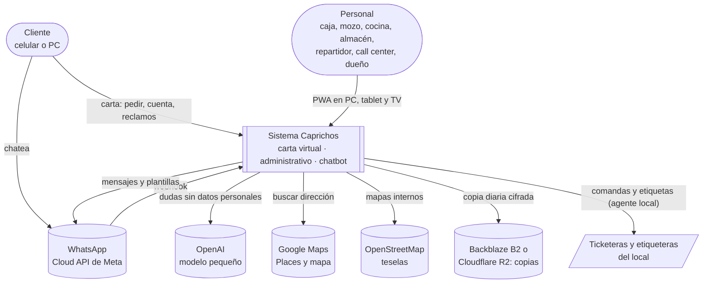
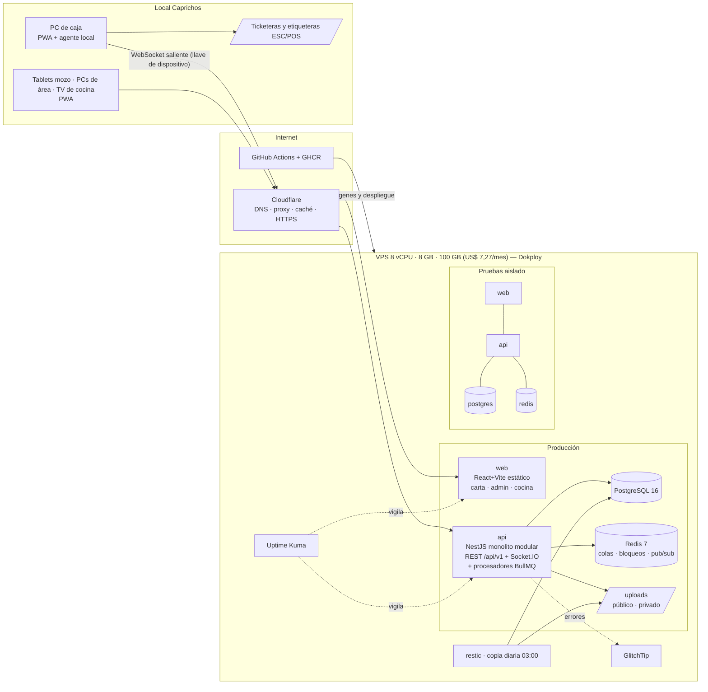
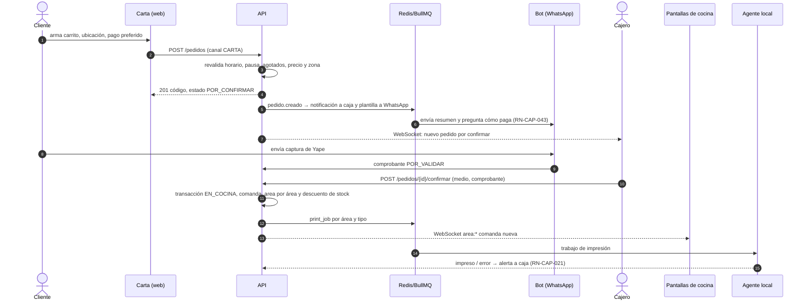
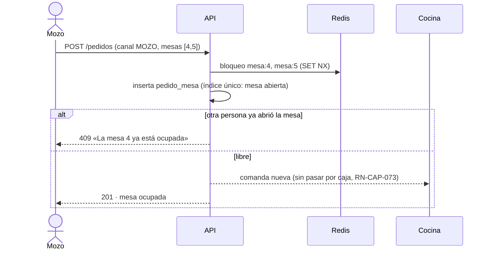
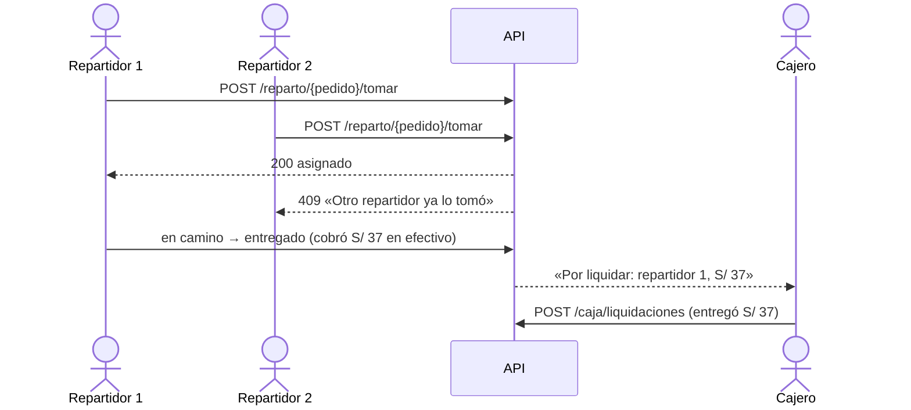
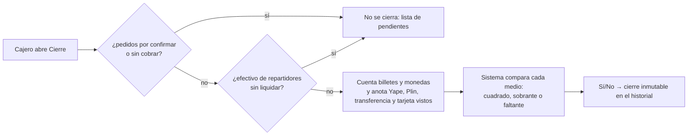

# ARQ-CAP-001 — Vista de arquitectura de Caprichos

> Resume los 14 ADR (todos *propuestos*) en una sola vista para G3. Las decisiones mandan; si esta vista y un ADR no coinciden, corrige la vista.

## 1. Contexto (C4 nivel 1)



## 2. Contenedores (C4 nivel 2) y despliegue



| Contenedor | Tecnología | Responsabilidad | ADR |
|---|---|---|---|
| `web` | React + Vite, PWA | Carta (`caprichos.pe`), administrativo (`admin.`) y pantallas de cocina/TV | ADR-001 |
| `api` | NestJS (TypeScript) | Reglas de negocio, REST, WebSocket, webhook de WhatsApp, colas y tareas programadas | ADR-001, ADR-006, ADR-007, ADR-009 |
| `postgres` | PostgreSQL 16 + Prisma | Datos de negocio | ADR-003, ADR-004 |
| `redis` | Redis 7 + BullMQ | Colas, tareas programadas, bloqueos, límite de intentos, pub/sub de Socket.IO | ADR-007 |
| `agente-local` | Node en la PC de caja | Imprimir ESC/POS; base del modo sin internet | ADR-002, ADR-013 |
| `uptime-kuma`, `glitchtip` | Docker | Vigilancia y errores | ADR-012 |
| Cloudflare | Servicio | DNS, proxy, caché, HTTPS, protección | ADR-011 |

**RAM estimada:** producción 2–2,5 GB · pruebas ~1 GB · Dokploy ~0,4 GB · GlitchTip ~0,5 GB · Uptime Kuma ~0,1 GB → **~4–4,5 GB de 8**.

## 3. Módulos del monolito (C4 nivel 3)

| Módulo | Épicas / features | Tablas principales | Publica eventos | Usa |
|---|---|---|---|---|
| `personas` | EP-CAP-003, EP-CAP-013 (FT-CLI-01, FT-USR-01) | `party` y satélites | — | — |
| `usuarios` (acceso y auditoría) | EP-CAP-013 (FT-USR-01..04) | `user_account`, `customer_account`, `sesion`, `rol_permiso`, `auditoria` | — | personas |
| `configuracion` | EP-CAP-017 | `parametro`, `horario_dia`, `fecha_especial`, `foto_local` | `config.cambio` | — |
| `carta` (catálogo) | EP-CAP-001, EP-CAP-016 (FT-CON-01) | `categoria`, `producto`, `grupo_opciones`, `opcion`, `sabor`, `lista*` | `agotado.cambio` | configuracion |
| `contenidos` | EP-CAP-016 (FT-CON-02, FT-CON-03), FT-CAR-03 | `version_carta`, `novedad`, `destacada`, `ranking_mes`, `mensaje_carta` | `carta.publicada` | carta |
| `ofertas` | EP-CAP-012 | `oferta`, `combo_*`, `cupon*`, `regla_acumulacion` | — | carta |
| `pedidos` | EP-CAP-002, EP-CAP-004 | `pedido`, `pedido_linea`, `comprobante_pago` | `pedido.creado`, `pedido.confirmado`, `pedido.estado` | carta, ofertas, personas, reparto (zonas) |
| `caja` | EP-CAP-004, EP-CAP-005 | `caja`, `cobro*`, `movimiento_caja`, `liquidacion`, `cierre_*` | `caja.cobro` | pedidos |
| `cocina` | EP-CAP-006 | `area_cocina`, `comanda_area`, `print_job`, `agotado`, `alta_demanda`, `device_key` | `comanda.estado`, `pedido.listo`, `impresion.fallo`, `altademanda.cambio` | pedidos |
| `salon` | EP-CAP-007 | `piso`, `elemento_plano`, `pedido_mesa`, `reserva*` | `mesa.estado` | pedidos |
| `reparto` | EP-CAP-008 | `zona_reparto`, `asignacion_reparto`, `incidente_entrega` | `reparto.tomado`, `entrega.incidente` | pedidos, caja |
| `stock` | EP-CAP-009, EP-CAP-010, EP-CAP-011 | `insumo`, `stock`, `movimiento_stock`, `receta*`, `traslado`, `produccion`, `compra*` | `stock.bajo` | carta, pedidos (escucha `pedido.confirmado`) |
| `bot` | EP-CAP-014 | `conversacion`, `mensaje_chat`, `solicitud_reserva`, `uso_externo` | `chat.mensaje` | carta, pedidos, ofertas, salon |
| `atencion` | EP-CAP-015 | `respuesta_rapida`, `solicitud_cambio`, `encuesta` | `chat.tomado` | bot, pedidos |
| `informes` | EP-CAP-018 (FT-INF-01, 02) | vistas de lectura | — | todos (solo lectura) |
| `notificaciones` | EP-CAP-018 (FT-INF-03) | `notificacion` | `notificacion.nueva` | escucha eventos de todos |
| `iniciativas` | EP-CAP-022 | `iniciativa`, `iniciativa_comentario` (captura en `archivo` privado) | — | usuarios y auditoría (`@Auditar`) |
| `legal` | EP-CAP-020 | `reclamo`, `data_request`, comprobante en `pedido` | — | personas, pedidos |

**Regla de dependencias** (ADR-001): un módulo solo llama a otro por su servicio de aplicación exportado o reacciona a sus eventos; nunca lee sus tablas. `informes` es la única excepción y solo lee vistas. Se verifica en el CI con dependency-cruiser.

## 4. Flujos clave

### 4.1 Pedido de la carta: por confirmar → caja → cocina → impresión



### 4.2 Pedido del mozo (directo a cocina)



### 4.3 Reparto: tomar, entregar y liquidar



### 4.4 Cierre de caja



## 5. Cómo se cumplen los RNF

| RNF | Cómo | ADR |
|---|---|---|
| RNF-CAP-001 carta ≤ 3 s | Front estático en caché de Cloudflare; fotos WebP optimizadas; carga diferida | ADR-011, ADR-012 |
| RNF-CAP-002 cocina ≤ 3 s | Socket.IO con salas por área; eventos después del commit | ADR-006 |
| RNF-CAP-003 disponibilidad | Uptime Kuma, copias diarias, restauración con Ansible en < 1 h | ADR-011, ADR-012 |
| RNF-CAP-006 acceso por rol | Guard de permisos en el servidor | ADR-008 |
| RNF-CAP-007 contraseñas | argon2id | ADR-008 |
| RNF-CAP-008 datos personales | `consent`, enmascarado, carpeta privada, filtros en GlitchTip e IA | ADR-005 |
| RNF-CAP-009 auditoría | Columnas de auditoría y tabla `auditoria` solo de inserción con huella encadenada; pantalla Historial de acciones | ADR-003, ADR-014 |
| RNF-CAP-010 concurrencia | Bloqueos en Redis e índices únicos parciales | ADR-007, ADR-003 |
| RNF-CAP-011 montos | `numeric(12,2)`; cálculo único en `packages/compartido` | ADR-001, ADR-003 |
| RNF-CAP-013 impresión | Trabajos por cola, confirmación del agente, alerta a los 10 s | ADR-002 |
| RNF-CAP-014 sin borrado | `activo`/`anulado_en` | ADR-003 |
| RNF-CAP-015 costo externo | `uso_externo` y topes (OpenAI, plantillas, Google) | ADR-009, ADR-010 |
| RNF-CAP-018 sin internet | Mini servidor en la PC de caja (segunda meta, DT-52) | ADR-013 |
| RNF-CAP-019 hora de Lima | Tareas programadas y reglas de día en `America/Lima` | ADR-003, ADR-007 |
| RNF-CAP-020 trazabilidad de stock | `movimiento_stock` para todo cambio | ADR-003 |

## 6. Estructura del repositorio

```
caprichos/
├─ apps/
│  ├─ api/                 NestJS · src/modulos/<modulo>/{dominio,aplicacion,infraestructura}
│  ├─ web/                 React + Vite · src/{carta,admin,cocina}
│  └─ agente-local/        Node · impresión ESC/POS y mini servidor del modo sin internet (segunda meta, DT-52)
├─ packages/
│  └─ compartido/          precio con opciones, descuentos, cupones, zonas (punto en polígono), tipos
├─ infra/
│  ├─ ansible/             base, seguridad, docker, dokploy, backups
│  └─ docker/              Dockerfiles y compose de referencia
├─ docs/                   paquete Aybar (este)
└─ .github/workflows/      ci.yml (PR), deploy-staging.yml (main), deploy-prod.yml (tag)
```

## 7. Pendientes para G3

- Relevar las ticketeras (DEP-03) antes de cerrar ADR-002.
- Acceso a la cuenta de Meta y costo de plantillas (DEP-12, D-08).
- Revisión legal de datos personales y Libro de Reclamaciones (DEP-09).
- Dispensa de compatibilidad con M0 por no usar el SDK de Aybar (todos los ADR).
- Firma de G3 por el TL, José Ángel Espinoza (DT-48).

---

Generado por IA: vista armada desde los ADR-001 a ADR-014, el modelo DAT-CAP-001 y las 55 features — Revisado por: (pendiente)
