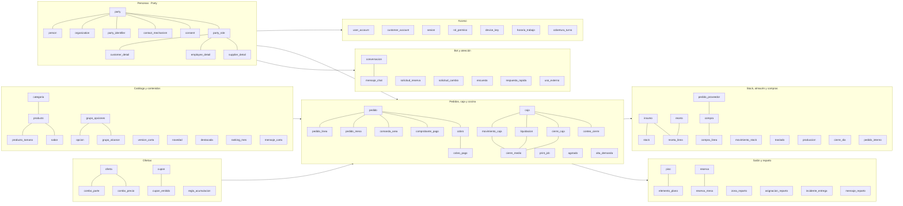
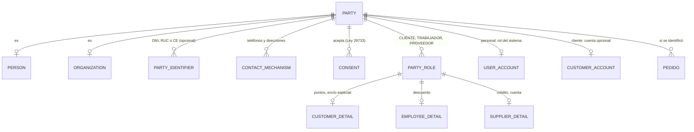
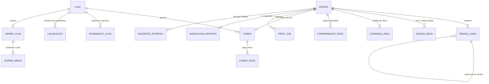
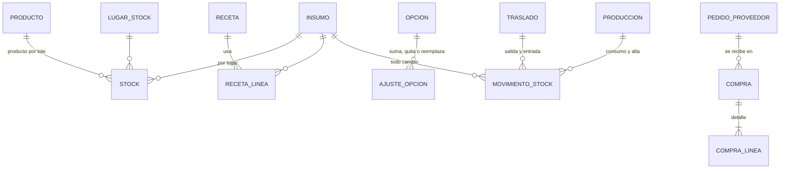
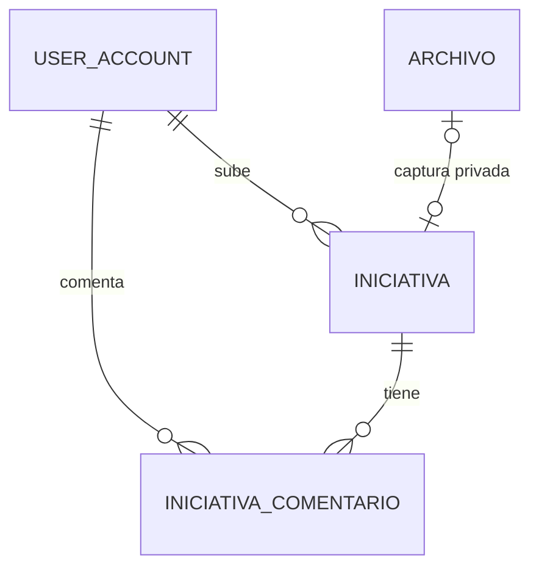

# DAT-CAP-001 — Modelo de datos de Caprichos

> Modelo lógico y físico de referencia para G3. El script `datos/ddl-propuesto.sql` es la fuente: se probó en PostgreSQL 16 el 21/10/2026. Crea **102 tablas y 3 vistas** sin errores, y las restricciones clave rechazan los casos inválidos: rol vigente duplicado, DNI mal formado, dos pedidos abiertos en una mesa y delivery sin ubicación. Las migraciones reales las genera Prisma (ADR-003).

## 1. Convenciones

| Tema | Regla | Fuente |
|---|---|---|
| Claves | `bigint generated always as identity`; ningún documento (DNI o RUC) es clave | ADR-004 |
| Dinero | `numeric(12,2)` en soles | RNF-CAP-011, RN-CAP-038 |
| Cantidades de insumos | `numeric(14,3)`; conversiones con factor por insumo | NEC-CAP-071 |
| Fechas | `timestamptz`; los cortes de día («agotado por hoy», caja, reservas, ranking) usan `America/Lima` | RNF-CAP-019 |
| Nada se borra | `activo`, `anulado_en`/`anulado_por`/`motivo`; excepciones: `elemento_plano` y `destacada` | RN-CAP-014, DT-06 |
| Auditoría | `creado_en`/`creado_por`/`actualizado_en`/`actualizado_por` en tablas de negocio; `auditoria` con cambios sensibles, accesos y lecturas sensibles, **solo de inserción** (trigger que rechaza editar y borrar) y **huella encadenada** sha256 verificada a diario; 2 años en línea | RNF-CAP-009, ADR-014, DT-49 |
| Listas | `lista` + `lista_valor` (tamaños, leches, endulzantes, orígenes y destinos de merma, motivos), con nombres únicos por lista | RN-CAP-128, RN-CAP-129 |
| Concurrencia | La base es la garantía final: índices únicos parciales y `UPDATE` condicionales; Redis solo adelanta el bloqueo | ADR-007 |

## 2. Dominios y tablas

## 3. Núcleo Party (ADR-004)

| Caso real | Cómo queda |
|---|---|
| Ana es cajera y también compra con su cuenta | 1 `party` + `person`; `party_role` TRABAJADOR y CLIENTE; `user_account` (CAJERO); sus puntos en `customer_detail`. Una sola persona, un solo DNI (NEC-CAP-057). |
| Un cliente pide por teléfono sin dar DNI | `party` + `person` + `contact_mechanism` (TELEFONO y DIRECCION con lat/lng); sin `party_identifier`. Solo si hay `consent` se recuerda (ADR-005). |
| Empresa que pide factura | `party` ORGANIZACION + `organization` + `party_identifier` RUC; rol CLIENTE. |
| Proveedor «Lácteos SAC» | `party` ORGANIZACION + RUC + `contact_mechanism` WHATSAPP; rol PROVEEDOR con `supplier_detail`. |
| Se despide a un mozo | `user_account.activo = false` y `party_role.hasta = fecha`; su historial queda (RN-CAP-098). |

Reglas en la base: `ux_rol_vigente` (un rol vigente por tipo), `unique (tipo, numero)` en documentos, formato de DNI (8 dígitos) y RUC (11).

## 4. Pedidos, caja y cocina

| Regla | Control en la base | Fuente |
|---|---|---|
| Una mesa no tiene dos pedidos abiertos | `ux_mesa_un_pedido_abierto` sobre `pedido_mesa(mesa_id) where abierta` | NEC-CAP-023, R-09 |
| Un delivery confirmado tiene punto y zona | `check` en `pedido` | RN-CAP-104 |
| Una sola caja abierta | `ux_una_caja_abierta` | FT-CIE-01 |
| Un pedido se cobra una vez | `cobro.pedido_id unique` | FT-CAJ-02 |
| Un reparto lo toma uno solo | `asignacion_reparto.pedido_id` es clave primaria | RN-CAP-024 |
| Los puntos se suman una vez | `movimiento_puntos unique (pedido_id, tipo)` | RN-CAP-072 |
| Cierre sin editar | `cierre_caja` sin `UPDATE` en la aplicación; `cierre_medio.diferencia` calculada | RN-CAP-080 |
| Los pedidos copian los datos del cliente | `cliente_nombre`, `cliente_telefono`, `entrega_*` en `pedido` | ADR-004 |

## 5. Stock, almacén y compras

- **Stock por lugar** (RN-CAP-127): `lugar_stock` = almacén central + un lugar por área. Un traslado baja el almacén al enviarse y sube el área solo al confirmarse «Recibí».
- **Todo cambio de stock es un `movimiento_stock`** (RNF-CAP-020); `stock` es el saldo. Un movimiento no se edita: se anula con otro que apunta a él (`movimiento_anulado_id`).
- La venta puede dejar un área en negativo («avisar y dejar vender», decisión del 19/10); la producción no (RN-CAP-117), y eso lo valida la aplicación antes de registrar.
- Proveedores A, B y C distintos: `check` en `insumo` (RN-CAP-082, 2.ª).

## 6. Estados

| Entidad | Estados y transiciones | Fuente |
|---|---|---|
| `pedido` | Chatbot y teléfono: `POR_CONFIRMAR` → `EN_COCINA` (confirmar) o `RECHAZADO`. Carta y mozo: nacen en `EN_COCINA` (la carta con el pago por coordinar, `pago_coordinado_en` vacío, DT-57). Luego `LISTO` (todas las áreas despejaron) → `EN_CAMINO` → `ENTREGADO` o `EN_COORDINACION` (entrega fallida) → `COBRADO`. `ANULADO` con motivo y el PIN de la supervisora (`anulacion_aprobada_por`); un cobrado, solo con caja abierta. Ya no existe `EN_PREPARACION` (DT-58) | RN-CAP-074, RN-CAP-084, RN-CAP-096, RN-CAP-125, DT-57, DT-58, DT-61 |
| `comanda_area` | `EN_COCINA` → `DESPEJADA` (un solo botón); desde el Historial vuelve a `EN_COCINA` (`devuelta_en`) | NEC-CAP-072, DT-58 |
| `asignacion_reparto` | tomado (`tomado_en`) → en camino (`salida_en`) → he llegado (`llegado_en`) → entregado (`entregado_en`) | DT-59 |
| `mensaje_reparto` | 1 al salir; 2 y 3 desde «He llegado» si no responde: `ENVIADO` → `RESPONDIDO` o `FALLIDO` | DT-60 |
| `cierre_caja` | cada intento en `conteo_cierre` (`CUADRA` / `NO_CUADRA`); se cierra con `CUADRA`, o con `NO_CUADRA` y el PIN de la supervisora (`aprobado_por`) | DT-61 |
| `pedido_interno` | `PENDIENTE` (suena y avisa a quien está de turno) → `RECIBIDO` → `ENTREGADO` | DT-64 |
| `reserva` | `ACTIVA` → `SENTADA`, `NO_ASISTIO` (vence la tolerancia) o `CANCELADA` | RN-CAP-107 |
| `cupon_emitido` | `VIGENTE` → `CANJEADO`, `VENCIDO` o `ANULADO` | RN-CAP-133 |
| `conversacion` | dueño `BOT` ↔ `PERSONA`; estado `ABIERTA`, `VALIDAR_PAGO` o `ATENDIDA` | RN-CAP-102 |
| `caja` | `ABIERTA` → `CERRADA` (sin pendientes ni liquidaciones) | RN-CAP-079, RN-CAP-097 |
| `traslado` | `POR_RECIBIR` → `RECIBIDO` (con cantidad real) | RN-CAP-127 |
| `pedido_proveedor` | `POR_RECIBIR` → `PARCIAL` → `RECIBIDO`, o `ANULADO` | RN-CAP-136 |
| `version_carta` | `BORRADOR` → `PUBLICADA` (una sola) → `ARCHIVADA` | RN-CAP-018 |

## 7. Datos personales y sensibles (ADR-005)

| Dato | Dónde | Clasificación | Tratamiento |
|---|---|---|---|
| DNI, RUC, CE | `party_identifier`; copia en `pedido.comprobante_doc`; `reclamo.documento` | Personal | Enmascarado en listas; completo solo para ADMIN |
| Nombre, teléfono, correo, cumpleaños | `person`, `contact_mechanism`, `pedido` (copia), `conversacion` | Personal | Solo con `consent` se recuerda; anonimización a los 24 meses sin actividad (propuesta) |
| Ubicación de entrega | `contact_mechanism`, `pedido.entrega_*` | Personal | Igual que la fila anterior; Google solo recibe el texto buscado |
| Capturas de pago | `comprobante_pago` → `archivo.privado` | Sensible | Carpeta privada, por API con permiso; 12 meses (propuesta) |
| Contraseñas y PIN | `user_account.hash`, `pin_hash`, `customer_account.hash`, `sesion.refresh_hash` | Secreto | argon2id o huella; nunca en registros ni GlitchTip |
| Mensajes de WhatsApp | `mensaje_chat` | Personal | No se envían a la IA con datos personales |

## 7a. Iniciativas del equipo (FT-INI-01, DT-53)

| Tabla | Para qué sirve |
|---|---|
| `iniciativa` | Queja, mejora o idea: código `IN-NNNN`, tipo, área, título (80), detalle (600), captura opcional, estado (`NUEVA`, `EN_REVISION`, `HECHA`, `NO_POR_AHORA`), autor y fecha; quién y cuándo cambió el estado |
| `iniciativa_comentario` | Comentarios (400) con autor y fecha; no se editan ni se borran |

Todo el personal lee las dos tablas; solo `ADMIN` cambia el estado. Cada acción lleva `@Auditar('iniciativas', ...)` y queda en `auditoria`. Probado en PostgreSQL 16 el 21/10/2026 (102 tablas con los cambios del acta 03).

## 7c. Cambios del acta 03 (revisión del mockup, 20/10/2026)

| Cambio | Dónde | Decisión |
|---|---|---|
| Puntos con decimales (5 % del total) y canje en el pedido | `movimiento_puntos.puntos numeric(12,2)`, tipo `DEVOLUCION_CANJE`; `pedido.puntos_canjeados` | DT-55 |
| Marca «No suma puntos ni aplica cupones» | `producto.no_suma_beneficios`, `oferta.no_suma_beneficios` | DT-65 |
| Pedido de la carta directo a cocina, pago por coordinar | `pedido.pago_coordinado_en/por`; el `check` de ubicación solo exige punto para salir a reparto | DT-57 |
| Nombre de quien toma cada bebida | `pedido_linea.nombres_persona text[]` (no más que la cantidad) | DT-57 |
| Un solo botón «Despejar», historial y despacho | `comanda_area` con `EN_COCINA`/`DESPEJADA`, `despejada_en`, `devuelta_en`; `pedido.despachado_en/por` | DT-58 |
| Alta demanda visible para todas las áreas | `alta_demanda.area_id` (quién la activó) | DT-58 |
| Estados del reparto y mensajes al cliente | `asignacion_reparto.llegado_en`; tabla `mensaje_reparto` | DT-59, DT-60 |
| Cierre ciego y anulación con PIN de la supervisora | `cierre_caja.resultado`, `aprobado_por`; tabla `conteo_cierre`; `pedido.anulacion_aprobada_por` con `check` | DT-61 |
| Crédito del personal por semana o rango | `consumo_personal.fecha` (antes `anio_mes`) | DT-63 |
| Horario de trabajo, coberturas y aviso del almacén | tablas `horario_trabajo`, `cobertura_turno`; `pedido_interno.avisado_party_id`, `recibido_por/en`, estado `RECIBIDO` | DT-64 |
| Compras sin lote ni vencimiento | se quitan `compra_linea.lote`, `compra_linea.vence` e `insumo.perecible` | DT-64 |

Todo lo anterior se probó en PostgreSQL 16 (`postgres:16-alpine`) el 21/10/2026: 102 tablas y 3 vistas, sin errores.

## 7b. Auditoría (ADR-014)

| Qué | Cómo |
|---|---|
| Qué se registra | `CAMBIO` (precios, ofertas, cupones, parámetros, permisos, usuarios, anulaciones, PIN), `ACCESO` (ingresos e intentos fallidos) y `LECTURA_SENSIBLE` (DNI completo, comprobantes, exportaciones) |
| Quién escribe | Interceptor `@Auditar` de NestJS, en la misma transacción de la acción |
| Inmutable | Trigger `tg_auditoria_inmutable` rechaza `UPDATE` y `DELETE`; el usuario de la API solo tiene `SELECT` e `INSERT` |
| Huella | Trigger `tg_auditoria_encadenar`: `hash = sha256(hash_anterior ‖ fila)` con bloqueo para una cadena lineal; verificación diaria a las 03:30 |
| Datos personales | DNI y teléfonos enmascarados en `antes`/`despues`; nunca contraseñas, PIN ni tokens |
| Volumen | 300 a 800 filas al día; índices por fecha, módulo y persona, y por entidad |
| Conservación | 2 años en línea; luego archivo cifrado en las copias (plazo legal por confirmar, DEP-09) |

Probado en PostgreSQL 16 el 20/10/2026: la cadena se arma, `UPDATE` y `DELETE` se rechazan con «La auditoría no se edita ni se borra» y la verificación da 0 eslabones rotos.

## 8. Linaje

| Origen | Escribe | Leen |
|---|---|---|
| Carta (cliente) | `pedido`, `pedido_linea`, `party`/`contact_mechanism`/`consent` (si acepta), `mensaje_carta`, `reclamo` | Caja, cocina, bot, informes |
| Administrativo (personal) | Todo el resto según permiso | Pantallas, informes |
| Bot (webhook de Meta) | `conversacion`, `mensaje_chat`, `pedido` (canal BOT), `comprobante_pago`, `solicitud_*`, `encuesta` | Consola de chats, caja |
| Agente local | `print_job.estado` | Caja (alertas) |
| Tareas programadas | `reserva.estado`, `agotado.hasta`, `ranking_mes`, `cupon_emitido.estado`, anonimización | Todas |

## 9. Reglas de calidad para la batería de F10

1. Para cada día: suma de `cobro_pago` por medio = `cierre_medio.sistema` (RNF-CAP-011).
2. 0 cambios de `stock` sin `movimiento_stock` (RNF-CAP-020).
3. 0 `pedido` en `EN_COCINA` o posterior con canal fuera del local sin `confirmado_por`.
4. 0 `party` con dos `party_role` vigentes del mismo tipo.
5. 0 `cupon_emitido` de modo único canjeado dos veces.
6. 0 clientes recordados sin `consent` vigente.
7. 0 `print_job` en `PENDIENTE` por más de 10 minutos sin alerta.

## 10. Pendientes para G3

- Afinar el índice de «insumo con pedido por recibir» (RN-CAP-137): el del script es aproximado.
- Decidir si `stock` de productos por lote lleva lote y hora de producción por fila (vida útil, RN-CAP-092) o se calcula desde `produccion`.
- Plazos de conservación con revisión legal (DEP-09).
- Particionar `mensaje_chat` y `movimiento_stock` por mes si crecen (no se espera en el piloto).

---

Generado por IA: modelo derivado de las 54 features, los ADR-003 a ADR-005 y ADR-012 y el patrón Party de `UPN/base-datos-upn/docs/proyecto-final/02-modelo-datos/patron-party.md`; DDL probado en PostgreSQL 16 — Revisado por: (pendiente)
