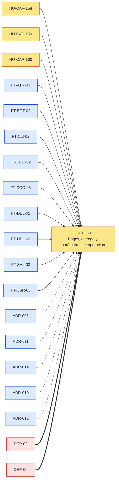
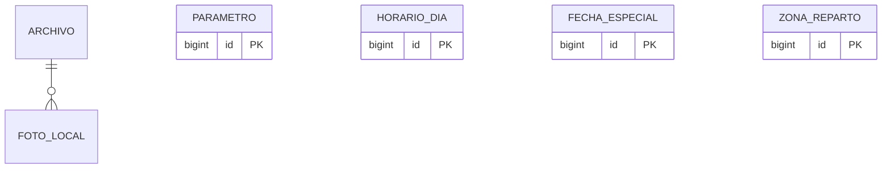
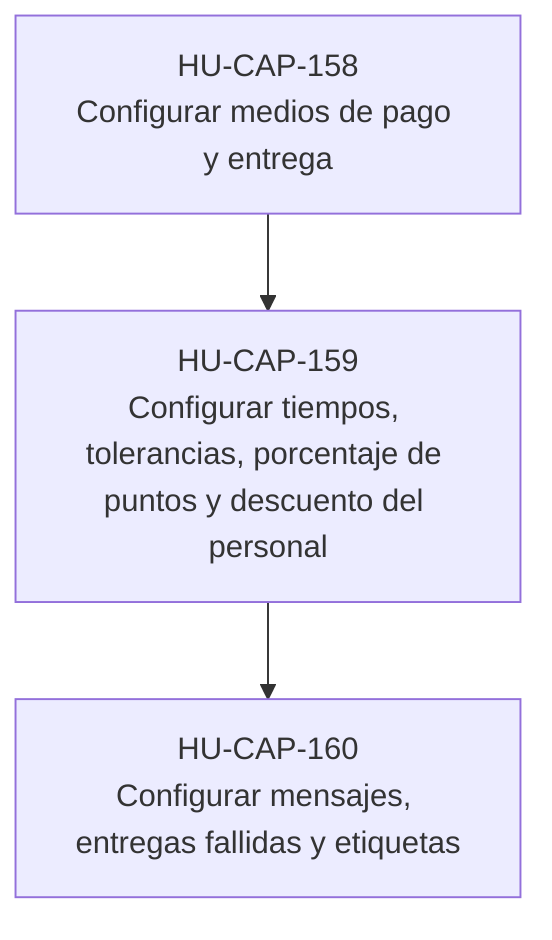
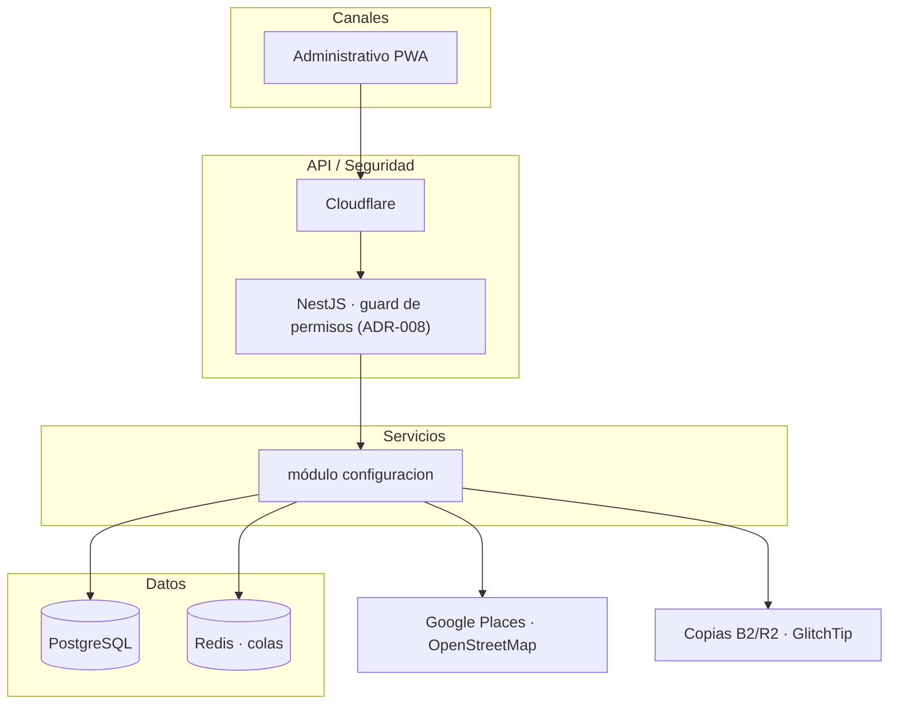

# PLT-05 · DEFINITION OF READY — FT-CFG-02 Pagos, entrega y parámetros de operación

**Frente CONFIGURACION · módulo `configuracion` · Caprichos · ticket *(pendiente — R13, D-14)***

| Campo | Valor |
| --- | --- |
| ÍTEM EVALUADO | EP-CAP-017 Configuración del local · FT-CFG-02 Pagos, entrega y parámetros de operación |
| PRODUCT OWNER | José Ángel Espinoza (DT-48) |
| LÍDER TÉCNICO | José Ángel Espinoza (DT-48) |
| FECHA DE REVISIÓN | 2026-10-20 |
| SPRINT / RELEASE DESTINO | H1 · piloto en el local · 28/12/2026 (supuesto, D-19) |
| RESULTADO | (lo decide el PO — propuesta IA: **NO READY**) |

> Insumos: `analisis/decisiones.md` (fuente de verdad), la feature `FT-CFG-02`, sus 3 historias (HU-CAP-158, HU-CAP-159, HU-CAP-160), la épica EP-CAP-017, los ADR ADR-001, ADR-011, ADR-014, ADR-010, ADR-012, `arquitectura/ARQ-CAP-001` y `ARQ-CAP-002`, y `datos/DAT-CAP-001`.

## 1 CHECKLIST DE PREPARACIÓN

| Grupo | ☐/☑ | Ítem | Responsable / evidencia |
| --- | --- | --- | --- |
| NEGOCIO | ☑ | Objetivo y valor con KPI | Épica EP-CAP-017 §2 y feature §1 (hipótesis medible) |
| NEGOCIO | ☐ | Alcance dentro y fuera acordado | Redactado en la feature; falta la firma del PO (DT-48) |
| NEGOCIO | ☐ | Prioridad y release confirmados | Debe tener · H1 · piloto en el local · 28/12/2026 (supuesto, D-19); fechas supuestas hasta D-19 |
| FUNCIONAL | ☑ | Historias con criterios verificables | 3 historias, 14 criterios Dado/Cuando/Entonces |
| FUNCIONAL | ☐ | Reglas de negocio documentadas y validadas | Documentadas; abiertas: D-01, D-02, D-03 |
| FUNCIONAL | ☐ | Estimación por el equipo | Tareas en `backlog/tareas/EP-CAP-017.json` con `estimacion_horas: null` |
| DISEÑO / UX | ☐ | Prototipos aprobados (DEP-06) | Mockup navegable como referencia (DT-04); Figma o aceptación del mockup pendiente (G2) |
| DISEÑO / UX | ☐ | Textos y mensajes definidos | Los del mockup; por revisar con Kevin |
| TÉCNICO | ☑ | Dependencias, modelado y arquitectura | Secciones 2 a 4 de este DoR; ARQ-CAP-001 |
| TÉCNICO | ☐ | Contrato de API | Borrador en ARQ-CAP-002 §FT-CFG-02; se aprueba en G3 |
| TÉCNICO | ☐ | Modelo de datos / DDL | DAT-CAP-001 y `datos/ddl-propuesto.sql` (probado en PostgreSQL 16); sin aprobar (G3) |
| TÉCNICO | ☐ | RNF y seguridad | RNF-CAP-006, RNF-CAP-009, RNF-CAP-012; umbrales propuestos (feature §3) |
| CALIDAD | ☑ | Estrategia y datos de prueba | `pruebas/test-plan.md`: 14 casos TC para estas historias, datos sintéticos |
| CALIDAD | ☑ | Riesgos con mitigación y dueño | Sección 5 |

## 2 DIAGRAMA DE DEPENDENCIAS

- **Ítems evaluados:** FT-CFG-02 y sus historias HU-CAP-158, HU-CAP-159, HU-CAP-160.
- **Dependencias técnicas:** FT-ATN-03, FT-BOT-02, FT-CLI-02, FT-COC-02, FT-COC-03, FT-DEL-02, FT-DEL-03, FT-SAL-03, FT-USR-03; decisiones técnicas ADR-001, ADR-011, ADR-014, ADR-010, ADR-012.
- **Dependencias externas:** DEP-02, DEP-06.
- **Decisiones abiertas:** D-01, D-02, D-03.

**Bloqueantes**

| ID | Bloqueante | Tipo | Dueño | Fecha | Estado |
| --- | --- | --- | --- | --- | --- |
| G2 | Mockup aprobado o aceptación del mockup navegable (DEP-06) | Diseño | José Ángel Espinoza (UX, DT-48) | Antes de G4 | Abierto |
| G3 | Aprobación de ADR-001, ADR-011, ADR-014, ADR-010, ADR-012 | Arquitectura | José Ángel Espinoza (TL, DT-48) | Antes de G4 | Abierto |
| DEP-02 | Plataforma y hosting (ADR-001, ADR-011) | Técnica | Desarrollo | Antes de G3 | Abierto |
| D-01 | Decisión pendiente (ver `analisis/decisiones.md`) | Decisión | Kevin | Antes de G4 | Abierto |
| D-02 | Decisión pendiente (ver `analisis/decisiones.md`) | Decisión | Kevin | Antes de G4 | Abierto |
| D-03 | Decisión pendiente (ver `analisis/decisiones.md`) | Decisión | Kevin | Antes de G4 | Abierto |

## 3 MODELADO (DATOS Y PROCESO)

Tablas de `datos/ddl-propuesto.sql` que usa la feature: `parametro`, `horario_dia`, `fecha_especial`, `foto_local`, `archivo`, `zona_reparto`. Las relaciones son las claves foráneas físicas del script (ADR-003); el detalle de columnas y restricciones está en DAT-CAP-001.

Proceso (orden de las historias):

## 4 DIAGRAMA DE ARQUITECTURA

| Aspecto | Detalle |
| --- | --- |
| Decisiones clave (ADR) | ADR-001 Plataforma: monolito modular en NestJS con front React y monorepo; ADR-011 Infraestructura: VPS con Dokploy, Ansible, Cloudflare y CI/CD con GitHub Actions; ADR-014 Auditoría de acciones: qué se registra, inmutabilidad con huella encadenada y conservación; ADR-010 Mapas: Google Places para elegir la dirección y Leaflet con zonas propias; ADR-012 Archivos en el VPS, copias de seguridad y vigilancia del sistema |
| Integración | Externos: Google Places · OpenStreetMap, Copias B2/R2 · GlitchTip |
| Ambientes | Local, pruebas aislado (staging) y producción en el VPS (DT-39, ADR-011) |
| Seguridad | JWT y permisos por rol en el servidor (ADR-008) |
| Datos personales | No maneja datos personales propios |

## 5 RIESGOS

| ID | Riesgo | Prob. | Impacto | Mitigación | Dueño | Estado |
| --- | --- | --- | --- | --- | --- | --- |
| R-01 | Riesgo de roadmap (ver PLT-01) | — | — | Según roadmap | Ver PLT-01 | Abierto |
| R-FT-CFG-02-01 | Si no se resuelve «Valores iniciales», hay que rehacer criterios o pantallas | Media | Medio | Resolver con Kevin antes de G4 con la propuesta escrita en la feature | Kevin | Abierto |
| R-FT-CFG-02-02 | Si no se resuelve «Lista de medios de pago», hay que rehacer criterios o pantallas | Media | Medio | Resolver con Kevin antes de G4 con la propuesta escrita en la feature | Kevin | Abierto |

## 6 DECISIÓN Y APROBACIÓN

☐ READY · Puede ingresar a desarrollo  ☐ READY CON CONDICIONES · ver acuerdos  ☐ NO READY · devolver a refinamiento

**Propuesta IA: NO READY.** Motivos: G0 a G3 sin aprobar (DT-48); ADR ADR-001, ADR-011, ADR-014, ADR-010, ADR-012 propuestos, no aprobados (G3); tareas sin estimar; mockup sin aprobar (G2, DEP-06); decisiones abiertas D-01, D-02, D-03. Lo que sí está listo: historias con criterios verificables, casos de prueba 1 a 1, modelo de datos probado y dependencias identificadas. Con las firmas de G2 y G3 y la estimación, pasaría a **READY CON CONDICIONES**. La decisión es del PO.

| Rol | Nombre | Fecha | Firma |
| --- | --- | --- | --- |
| Product Owner | José Ángel Espinoza |  |  |
| Líder técnico / Arquitecto | José Ángel Espinoza |  |  |
| QA | José Ángel Espinoza |  |  |
| UX | José Ángel Espinoza |  |  |

---

Generado por IA: DoR armado desde FT-CFG-02, sus historias, los ADR ADR-001, ADR-011, ADR-014, ADR-010, ADR-012, DAT-CAP-001 (ER desde las claves foráneas del DDL) y el plan de pruebas — Revisado por: (pendiente)
