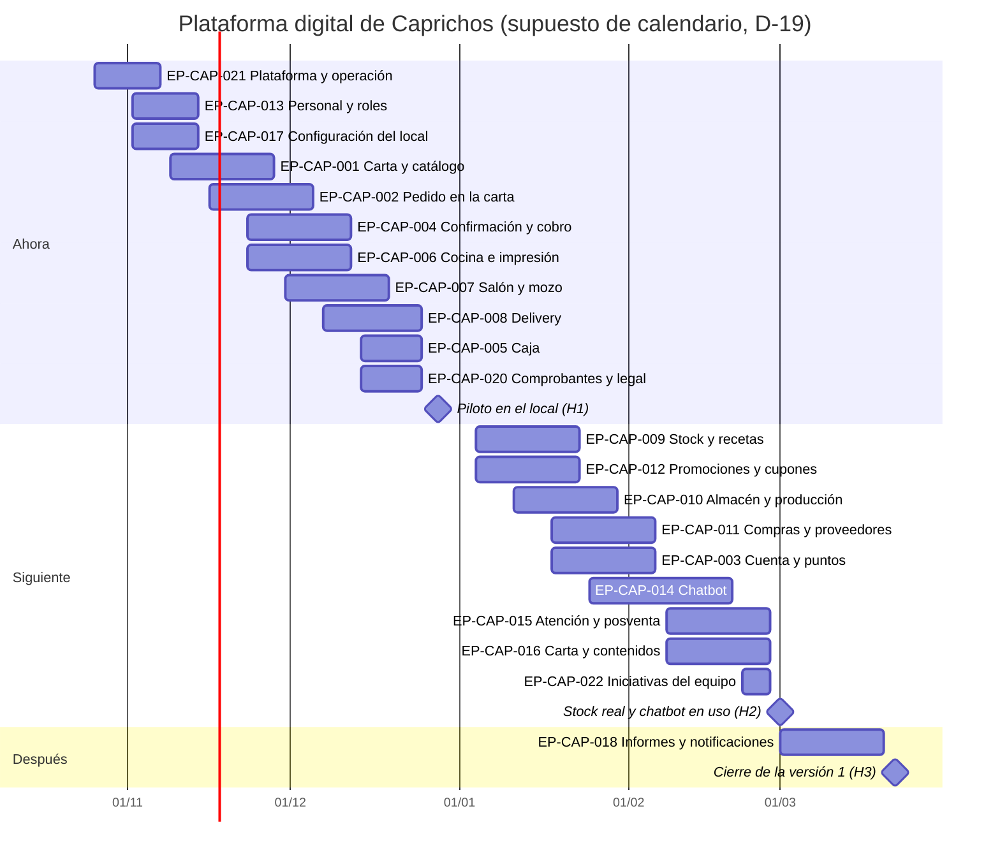

# PLT-01 · ROADMAP DE PRODUCTO

**Dependencias · Riesgos · Hitos**

| Campo | Valor |
| --- | --- |
| Producto | Plataforma digital de Caprichos (carta virtual, administrativo, pantallas de cocina y chatbot de WhatsApp) |
| PO | José Ángel Espinoza (DT-48) |
| Versión / Fecha | 1.0 · 19/10/2026 |
| Horizonte | Tres fases: Ahora, Siguiente y Después |
| Visión del producto | Que un pedido nacido en la carta, en WhatsApp o en la mesa llegue a cocina sin reescribirse, se cobre y cuadre en caja, y descuente el stock real, con un negocio que el dueño administra sin programador. |
| Estado | Borrador (`draft`) |

> **Adaptación del formato:** no hay plazo comprometido (DT-08). Las fechas del cronograma son un **supuesto de calendario** que arranca el lunes 2 de noviembre de 2026 y se recalcula cuando se fije la fecha del piloto (D-19). Las duraciones son estimaciones de la IA, no del equipo.

## 1 ROADMAP POR FASE

| Fase | Épica | Prioridad | Inicio (supuesto) | Fin (supuesto) |
| --- | --- | --- | --- | --- |
| Ahora | EP-CAP-021 Plataforma, despliegue y operación (habilitadora, DT-51) | Debe | 26/10/2026 | 06/11/2026 |
| Ahora | EP-CAP-013 Personal, usuarios y roles | Debe | 02/11/2026 | 13/11/2026 |
| Ahora | EP-CAP-017 Configuración del local | Debe | 02/11/2026 | 13/11/2026 |
| Ahora | EP-CAP-001 Carta virtual y catálogo | Debe | 09/11/2026 | 27/11/2026 |
| Ahora | EP-CAP-002 Pedido del cliente en la carta | Debe | 16/11/2026 | 04/12/2026 |
| Ahora | EP-CAP-004 Confirmación y cobro en caja | Debe | 23/11/2026 | 11/12/2026 |
| Ahora | EP-CAP-006 Cocina por áreas e impresión | Debe | 23/11/2026 | 11/12/2026 |
| Ahora | EP-CAP-007 Salón: plano, mesas, pedido del mozo y reservas | Debe | 30/11/2026 | 18/12/2026 |
| Ahora | EP-CAP-008 Delivery y entregas | Debe | 07/12/2026 | 24/12/2026 |
| Ahora | EP-CAP-005 Apertura y cierre de caja | Debe | 14/12/2026 | 24/12/2026 |
| Ahora | EP-CAP-020 Comprobantes y obligaciones legales | Debe | 14/12/2026 | 24/12/2026 |
| Siguiente | EP-CAP-009 Stock y recetas | Debería | 04/01/2027 | 22/01/2027 |
| Siguiente | EP-CAP-010 Almacén y producción | Debería | 11/01/2027 | 29/01/2027 |
| Siguiente | EP-CAP-011 Compras y proveedores | Debería | 18/01/2027 | 05/02/2027 |
| Siguiente | EP-CAP-012 Promociones, descuentos y cupones | Debería | 04/01/2027 | 22/01/2027 |
| Siguiente | EP-CAP-003 Cuenta del cliente y puntos | Debería | 18/01/2027 | 05/02/2027 |
| Siguiente | EP-CAP-014 Chatbot: pedido y pago por WhatsApp | Debería | 25/01/2027 | 19/02/2027 |
| Siguiente | EP-CAP-015 Atención por WhatsApp y posventa | Debería | 08/02/2027 | 26/02/2027 |
| Siguiente | EP-CAP-016 Administración de la carta y contenidos | Debería | 08/02/2027 | 26/02/2027 |
| Siguiente | EP-CAP-022 Iniciativas del equipo (DT-53) | Debería | 22/02/2027 | 26/02/2027 |
| Después | EP-CAP-018 Informes, indicadores y notificaciones | Podría | 01/03/2027 | 19/03/2027 |
| Segunda meta (después del piloto) | EP-CAP-019 Modo sin internet (mini servidor en la caja, DT-52) | Debe | *(por cotizar — D-11)* | *(por cotizar — D-11)* |

| Hito | Fecha (supuesto) | Logro | Gate |
| --- | --- | --- | --- |
| H1 | 28/12/2026 | Piloto en el local: pedido de la carta, del mozo y de delivery llega a caja y a cocina, se imprime, se cobra y la caja cuadra. | G5 de la fase Ahora (requiere G3 y G4 aprobados) |
| H2 | 01/03/2027 | El stock se descuenta por receta, las compras reponen, hay promociones y cupones, y el chatbot toma pedidos con pago confirmado por una persona. | G5 de la fase Siguiente |
| H3 | 22/03/2027 | Informes con período y filtros, y notificaciones con historial; cierre de la versión 1. | G8 de la versión 1 |

**Agrupación por horizonte**

- **Ahora:** EP-CAP-021 (primero: habilitadora), EP-CAP-013, EP-CAP-017, EP-CAP-001, EP-CAP-002, EP-CAP-004, EP-CAP-006, EP-CAP-007, EP-CAP-008, EP-CAP-005, EP-CAP-020.
- **Siguiente:** EP-CAP-009, EP-CAP-010, EP-CAP-011, EP-CAP-012, EP-CAP-003, EP-CAP-014, EP-CAP-015, EP-CAP-016.
- **Después:** EP-CAP-018.
- **Segunda meta:** EP-CAP-019, el modo sin internet con un mini servidor en la caja (DT-52); su cotización queda aparte (DT-12).

**Metas de construcción (DT-52)**

| Meta | Qué se construye | Qué queda para después |
|---|---|---|
| **Primera meta** | La **carta y el administrativo en línea**, sin el agente local: EP-CAP-021, EP-CAP-013, EP-CAP-017, EP-CAP-001, EP-CAP-002, EP-CAP-004, EP-CAP-007, EP-CAP-008, EP-CAP-005, EP-CAP-020 y las pantallas de cocina (FT-COC-01 y FT-COC-03) | La impresión automática (FT-COC-02) |
| **Segunda meta** | El **agente local en la PC de caja**: impresión automática de comandas y etiquetas (FT-COC-02, ADR-002) y el **modo sin internet** con mini servidor (EP-CAP-019, ADR-013) | — |

En la primera meta, cocina trabaja con las pantallas y caja puede reimprimir desde el navegador; la impresión automática llega con el agente. Las épicas de la fase «Siguiente» siguen su orden.

## 2 DEPENDENCIAS

| ID | Dependencia | Tipo | Bloquea a | Responsable | Fecha requerida | Estado |
| --- | --- | --- | --- | --- | --- | --- |
| DEP-01 | Ticket del tablero y personas que aprueben (PO, TL, QA, UX) | Interna | Todos los gates (D-14) | José Ángel Espinoza (DT-48) | Antes de G0 | Pendiente |
| DEP-02 | Plataforma, lenguaje y hosting decididos | Técnica | Toda la construcción (ADR-001, D-12) | Desarrollo | Antes de G3 | Pendiente |
| DEP-03 | Modelo y conexión de las ticketeras del local | Externa | EP-CAP-006 (D-13) | Kevin y desarrollo | 23/11/2026 | Pendiente |
| DEP-04 | Datos del negocio: RUC, horario, pagos, dirección | Externa | EP-CAP-017, EP-CAP-020 (D-15) | Kevin | 02/11/2026 | Pendiente |
| DEP-05 | Carta validada (precios, tamaños, opciones) y fotos | Externa | EP-CAP-001, EP-CAP-016 (D-15) | Kevin | 09/11/2026 | Pendiente |
| DEP-06 | Mockup en Figma o aceptación del mockup navegable como diseño (G2) | Interna | Todas las HU con pantalla (DT-04) | José Ángel Espinoza (UX, DT-48) | Antes de G4 | Pendiente |
| DEP-07 | Zonas de reparto, tarifas y repartidores | Externa | EP-CAP-008 (D-03) | Kevin | 07/12/2026 | Pendiente |
| DEP-08 | Plano real del local | Externa | EP-CAP-007 (D-16) | Kevin | 30/11/2026 | Pendiente |
| DEP-09 | Texto del Libro de Reclamaciones, términos y privacidad con revisión legal | Legal | EP-CAP-020 (D-06, D-18) | Kevin y asesor legal | 14/12/2026 | Pendiente |
| DEP-10 | Recetas, insumos con costos y stock inicial | Externa | EP-CAP-009, EP-CAP-010 (D-15) | Kevin y encargada de producción | 04/01/2027 | Pendiente |
| DEP-11 | Proveedores con RUC, WhatsApp y condiciones | Externa | EP-CAP-011 (D-15) | Kevin y almacén | 18/01/2027 | Pendiente |
| DEP-12 | Acceso a la cuenta de WhatsApp Business (API de Meta) y costo de plantillas | Externa | EP-CAP-014, EP-CAP-015 (D-08) | Kevin | 25/01/2027 | Pendiente |
| DEP-13 | Facturador electrónico actual (si se integra) | Externa | EP-CAP-020 (D-07) | Kevin y contador | *(sin fecha — fuera de la versión 1)* | Pendiente |
| DEP-14 | Plazo del proyecto y fecha del piloto | Interna | Todo el calendario (D-19) | Kevin y desarrollo | Antes de G1 | Pendiente |

## 3 RIESGOS

| ID | Riesgo | Prob. | Impacto | Nivel | Mitigación / plan de contingencia | Dueño |
| --- | --- | --- | --- | --- | --- | --- |
| R-01 | Alcance amplio: tres líneas de producto a la vez. | Alta | Alto | ALTO | Entregar por fases; el piloto (H1) solo con la fase Ahora. | Desarrollo |
| R-02 | Datos de partida incompletos (recetas, costos, proveedores). | Alta | Alto | ALTO | Pedirlos en tandas con plantillas (D-15); stock y recetas pasan a Siguiente. | Kevin |
| R-03 | Reglas y precios de la web anterior desactualizados. | Media | Medio | MEDIO | Validar la carta y las tarifas antes del piloto (DEP-05, DEP-07). | Kevin |
| R-04 | Errores del canal de WhatsApp que generan quejas (pasó el 11/10/2026). | Media | Alto | ALTO | Pedido por botones, IA solo para dudas y una persona confirma el pago (DT-17, DT-18). | Desarrollo |
| R-05 | Convivencia con restaurant.pe y el bot actual. | Media | Medio | MEDIO | Definir qué se mantiene durante un mes de transición (D-20). | Kevin y desarrollo |
| R-06 | Caída de internet en hora punta. | Media | Alto | ALTO | Modo sin internet con un mini servidor en la caja (DT-52), después de la primera meta; mientras tanto, modo manual (PCN-CAP-001). **Riesgo aceptado:** sin internet no llegan pedidos de la carta ni de WhatsApp. | Kevin |
| R-07 | Costo y errores de la IA del bot (casi US$ 10 en 3 días con el bot actual). | Media | Medio | MEDIO | IA acotada a dudas, con límite de uso y registro de costo. | Desarrollo |
| R-08 | Ticketeras incompatibles con la impresión automática. | Media | Alto | ALTO | Relevar modelos antes (DEP-03); ADR-002 con opción de respaldo. | Desarrollo |
| R-09 | Pedidos duplicados en una mesa al usarla dos personas a la vez. | Media | Medio | MEDIO | Bloqueo de la mesa en tiempo real (RN-CAP-025). | Desarrollo |
| R-10 | Sin PO ni TL que aprueben, no se puede cerrar ningún gate. | Alta | Alto | ALTO | Mitigado el 20/10/2026: José Ángel Espinoza asume PO, TL, QA y UX (DT-48); Kevin firma como Stakeholder. | José Ángel Espinoza |
| R-11 | Datos personales tratados sin consentimiento o sin plazo de conservación. | Baja | Alto | MEDIO | DNI solo con aceptación y enmascarado; política en ADR-005 (D-18). | Desarrollo |

**Matriz de probabilidad e impacto**

| Probabilidad \ Impacto | Bajo | Medio | Alto |
| --- | --- | --- | --- |
| Alta | — | — | R-01, R-02, R-10 |
| Media | — | R-03, R-05, R-07, R-09 | R-04, R-06, R-08 |
| Baja | — | — | R-11 |

**Guía de uso de la matriz:** los riesgos de la celda Alta × Alto se revisan en cada entrega y tienen que tener una mitigación en curso; los de Media × Alto se revisan antes de cada gate; los demás se revisan al cerrar cada fase.

**Supuestos.** El negocio usa la API oficial de WhatsApp con un chip exclusivo; las reglas de delivery y el horario siguen vigentes; habrá recetas y costos para cargar; el cajero seguirá aceptando los pedidos; la facturación electrónica se mantiene fuera; hay una computadora en caja y una mini computadora en cocina; hay 3 áreas de producción, un solo local y un solo almacén.

**Restricciones.** Moneda en soles y un solo local (RN-CAP-038); nada se elimina, se desactiva (DT-06); toda acción que cambia datos pide confirmación (RN-CAP-015); no se escribe código hasta que G3 y G4 estén aprobados; sin plazo comprometido (DT-08).

## 4 CONTROL DE VERSIONES Y APROBACIÓN

| Versión | Fecha | Autor | Cambio | Aprobado por |
| --- | --- | --- | --- | --- |
| 1.0 | 19/10/2026 | IA (Claude) con José Ángel Espinoza | Primera versión: 20 épicas en tres fases, 14 dependencias y 11 riesgos. | *(pendiente de firma, G1)* |
| 1.1 | 20/10/2026 | IA (Claude) con José Ángel Espinoza | Se agrega EP-CAP-021 Plataforma, despliegue y operación como primera épica de la fase Ahora (DT-51). | *(pendiente de firma, G1)* |

---
Generado por IA: a partir de `analisis/BRD.md` (§4 Alcance, §7 Riesgos), `analisis/decisiones.md` y `analisis/informacion-a-pedir-al-cliente.md` — Revisado por: (pendiente)
