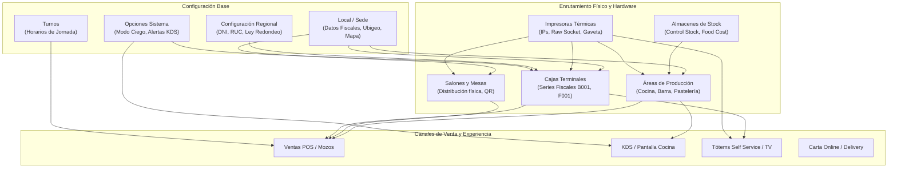

# Módulo de Ajustes (Parte Operativa): Configuración del Sistema, Locales, Producción, Salones, Cajas e Impresoras

**Sistema**: Restaurant.pe (Instancia de Producción: CAPRICHOS - Lima, Perú)  
**URL de Producción**: `https://caprichos.restaurant.pe/restaurant/#!/login`  
**Usuario de Auditoría**: `krosales`  
**Modalidad**: SOLO LECTURA estricto en entorno de PRODUCCIÓN en operación activa.  
**Fecha de Inspección**: 2026-10-13  
**Documento Generado**: `/home/jose/JoseEM/caprichos/web-anterior/administrativo/modulos/ajustes-a.md`  

---

## 1. Resumen Ejecutivo y Alcance del Módulo

El macro-módulo de **Ajustes Operativos** constituye el núcleo de parametrización física, lógica y de enrutamiento transaccional de Restaurant.pe para la cafetería CAPRICHOS. Gobierna desde la topología de red de los periféricos de caja y cocina (ticketeras térmicas, cajones monedero, balanzas), el enrutamiento de pedidos hacia áreas de preparación (KDS/comandas), los espacios de atención al público (salones y mesas), las terminales de cobro (cajas y series fiscales), las jornadas laborales (turnos), hasta las identidades comerciales (multimarca / dark kitchen) y la experiencia multimedia en quioscos de autoservicio y pantallas de televisión para clientes.

El presente documento detalla la auditoría estructural y técnica de las **11 pantallas operativas** asignadas:

1. **Opciones sistema** (`#!/ajustes/opcionessistema`)
2. **Opciones de APP Quipu** (`#!/ajustes/configuracionpos`)
3. **Configuración regional** (`#!/ajustes/configuracionregional`)
4. **Locales** (`#!/ajustes/locales`)
5. **Almacenes y Producción** (`#!/ajustes/produccion`)
6. **Salones y Mesas** (`#!/ajustes/salones`)
7. **Cajas** (`#!/ajustes/cajas`)
8. **Impresoras** (`#!/ajustes/impresoras`)
9. **Turnos** (`#!/ajustes/turnos`)
10. **Gestión de marcas** (`#!/ajustes/marca`)
11. **Imágenes self service** (`#!/ajustes/imagen-self-service`)

> [!NOTE]
> **Módulo Excluido**: Conforme a las instrucciones, la pantalla de **Usuarios** (`#!/ajustes/usuarios`) fue excluida de esta auditoría por haber sido relevada previamente en otro documento.

> [!IMPORTANT]
> **Garantía de Solo Lectura y Protección de Datos**: La recolección se efectuó mediante navegación pasiva por el enrutador SPA de AngularJS (`#!/`), inspección estática del DOM en vivo y análisis del bundle público de la aplicación (`frontend_bundle.js` / `$templateCache`). No se pulsaron botones de registro, modificación ni eliminación, ni se ejecutaron transacciones. Todos los datos sensibles reales han sido omitidos, reportando exclusivamente arquitectura de interfaz, validaciones, flujos de datos y endpoints GET.

---

## 2. Pantalla 1: Opciones sistema (`#!/ajustes/opcionessistema`)

### 2.1 Propósito
Centralizar las banderas de configuración (*feature flags*), políticas de operación y parámetros de comportamiento global y por sucursal de toda la plataforma. Define cómo interactúan entre sí los módulos de Ventas, Caja, Cocina, Delivery, Almacén e Inventario.

### 2.2 Flujo de Uso Paso a Paso
1. El administrador ingresa a `#!/ajustes/opcionessistema`.
2. La vista presenta dos pestañas principales: **Configuraciones generales** (a nivel de cuenta/empresa) y **Configuraciones por local** (específicas de la sucursal activa).
3. En la pestaña **Configuraciones por local**, el usuario utiliza el buscador de texto reactivo para localizar opciones por palabra clave (ej. "ciegas", "comanda", "costos", "delivery").
4. Cada fila muestra un ícono representativo, el código identificador de la configuración (`#ID`), el título descriptivo, una explicación detallada y los controles asociados:
   - Para opciones binarias: un interruptor *iCheck* (Activar/Desactivar).
   - Para opciones parametrizables: al activarse se despliegan campos auxiliares (selectores, inputs numéricos, selectores de horas o selectores múltiples de correos/usuarios).
5. Tras modificar las opciones deseadas, el usuario pulsa **Registrar cambios** en la cabecera.
6. Si requiere auditoría, pulsa **Ver ultimas actualizaciones** para desplegar el registro histórico de quién cambió cada parámetro.

### 2.3 Estructura de Interfaz y Controles

#### Botones y Acciones Disponibles
- `Habilitar edición` (`ng-click="vm.habilitarEdiccionConfiguracionesCriticas()"`): Visible únicamente para soporte técnico o reseller, permitiendo desbloquear configuraciones con candado.
- `Registrar cambios` (`ng-click="vm.fnAgregar()"`): Botón primario de guardado con animación de carga Ladda.
- `Ver ultimas actualizaciones` (`ng-click="vm.getLogPorLogTablaConfigLocal()"`): Abre el modal `opsistverdetallelog-modal.html` con historial de cambios.
- `Ver log` (por cada fila): Despliega el histórico puntual de esa opción.

#### Pestañas y Filtros
- **Pestaña 1**: *Configuraciones generales* (Ícono `fa-globe`).
- **Pestaña 2**: *Configuraciones por local* (Ícono `fa-map-marker`).
- **Filtro de búsqueda**: `<input type="text" ng-model="vm.valBusqueda" placeholder="Busca una opción...">`.

#### Catálogo de Parámetros Operativos Destacados
| ID | Descripción de Opción | Categoría | Controles Auxiliares | Comportamiento en el Sistema |
| :--- | :--- | :--- | :--- | :--- |
| **#1** | Activa Plaza Puntos | General | Checkbox | Requiere suscripción activa al add-on Plaza Puntos. |
| **#7** | Contraseña de seguridad | Seguridad | Input texto (`placeholder="Contraseña"`) | Clave maestra para autorizar anulaciones o descuentos en POS. |
| **#8** | Restricción de acceso | Seguridad | Aviso alerta | Restringe pantallas críticas solo a administradores. |
| **#15** | Correo al anular ventas | Notificaciones | Selector múltiple de correos | Dispara email automático con detalle de tickets anulados. |
| **#21** | Correo al modificar pagos | Notificaciones | Checkbox + Selector de correos | Alerta cuando se reclasifica un medio de pago ya cobrado. |
| **#36** | Valor de control de venta | Ventas | Input numérico con símbolo monetario | Límite máximo permitido por ticket para alertas de control. |
| **#43** | Enviar resumen de caja | Caja | Select: `Enviar Excel` / `Enviar PDF` | Envía liquidación de turno por correo al cerrar caja. |
| **#46** | Cierre de caja a ciegas | Caja | Checkboxes: `Ocultar totales` / `No imprimir cierres` | Oculta saldos esperados para evitar fraudes en el arqueo. |
| **#62** | Impresión comandas por salón | Impresión | Checkbox: `Seleccionar múltiples impresoras` | Permite enrutar platos a distintas ticketeras según el salón. |
| **#68** | Puerto balanza | Periféricos | Input texto (`COM1`, `COM2`, etc.) | Conexión serial para pesar productos a granel en caja. |
| **#78** | Enviar resumen cierre Z | Caja | Select: `Al realizar cierre X` / `Al realizar cierre Z` | Despacho de informe fiscal acumulado por correo. |
| **#83** | Canales de delivery | Delivery | Select: `Por integración` / `Telefónicos` / `Todos` | Filtra qué pedidos disparan ciertas reglas de despacho. |
| **#88** | Impedir apertura X sin cierre Z | Caja | Input hora (`clockpicker`) | Bloquea nueva jornada si no se cerró el día fiscal previo. |
| **#93** | Tiempos de despacho personalizados | Cocina | Inputs numéricos: `Minutos para crítico` / `Minutos para malo` | Configura colores del semáforo KDS de preparación. |
| **#108** | Dark Kitchen y Marcas | Operación | Checkbox: `Facturación por marcas` | Permite multi-facturación en un único local físico. |
| **#128** | No despachar pedidos automáticos | Cocina | Checkboxes: `Delivery` / `Mesa` | Obliga a marcar manualmente el despacho en cocina. |
| **#146** | Timbre nuevo delivery | Delivery | Select de tonos de sonido (`timbre_delivery1..5`) + input repeticiones | Alerta sonora en navegador ante nuevos pedidos web/app. |

### 2.4 Estados y Reglas Visibles
- Las opciones marcadas como *Configuración Restringida* muestran un banner amarillo con ícono de candado: *"Configuración restringida, para poder activar esta configuración favor registrar una incidencia para que un soporte pueda ayudarlo"*.
- Las opciones que dependen de add-ons no adquiridos (ej. Plaza Puntos) se inhabilitan mostrando aviso de requerimiento de compra.

### 2.5 Relaciones con Otros Módulos
- **Caja**: Determina el modo ciego, envío de cierres por correo y bloqueo de apertura sin cierre Z.
- **Cocina**: Define los umbrales de tiempo crítico del monitor KDS y las alertas de sonido.
- **Impresoras**: Activa la impresión multidireccional por salón y copias de comandas.

### 2.6 Entidades de Datos
- `Configuracion`: `configuracion_id`, `configuracion_descripcion`, `configuracion_descripcionlarga`, `configuracion_categoria`, `configuracion_debemostrarse`.
- `ConfiguracionLocal`: `configuracionlocal_id`, `local_id`, `configuracion_id`, `configuracionlocal_valor`, `configuracionlocal_valoraux1`, `configuracionlocal_valoraux2`, `configuracionlocal_valoraux3`.

### 2.7 Permisos Asociados (ACL)
- Requiere permiso `ajustes.opcionessistema`. Opciones críticas restringidas a perfiles `esUsuarioSistemas()` o `esUsuarioReseller()`.

### 2.8 Endpoints GET Utilizados
- `GET /restaurant/api/rest/configuracion/obtenerTodasLasConfiguracionesPorLocalLogeadoNew/:idLocal`: Retorna la lista consolidada de opciones y sus valores asignados a la sucursal.
- `GET /restaurant/api/rest/canaldelivery/obtenerTodoslosCanaldeliverysPorBusquedaPaginado/-1/1/-1/-1`: Catálogo de canales de delivery activos.
- `GET /restaurant/api/rest/precuenta/getAllByLocalId/:idLocal/1/0/0`: Listado de precuentas para asignar formatos.
- `GET /restaurant/api/rest/tokenusuario/obtenerDistintosDispositivosLogueados/:idLocal`: Dispositivos conectados.

---

## 3. Pantalla 2: Opciones de APP Quipu (`#!/ajustes/configuracionpos`)

### 3.1 Propósito
Ajustar parámetros específicos para las aplicaciones móviles y terminales cliente táctiles de punto de venta (QuipuPOS para cajas Android/Windows y QuipuNET para comandas móviles de mozos).

### 3.2 Flujo de Uso Paso a Paso
1. El usuario accede a `#!/ajustes/configuracionpos`.
2. Se lista una cuadrícula vertical con opciones móviles, identificadas con el ícono `fa-mobile` y su código correlativo `#ID`.
3. El operador activa las casillas correspondientes y completa los parámetros de interfaz:
   - Configuración de tótems de efectivo Cashdro (IP y credenciales).
   - Monedas extranjeras visibles (dólares / euros).
   - Formatos visuales de mesas y platos.
   - Medios de pago aceptados en el datáfono táctil.
   - Agrupación de comandas térmicas por tiempos de cocina (Entrada, Plato Fuerte).
4. Pulsa **Registrar cambios** para propagar la configuración a todos los dispositivos Quipu en red.

### 3.3 Estructura de Interfaz y Controles

#### Botones
- `Registrar cambios` (`vm.fnAgregar()`): Guarda las configuraciones de la app táctil.

#### Opciones y Campos Configurables
| Parámetro | Tipo | Modelo Angular | Opciones / Valores |
| :--- | :--- | :--- | :--- |
| **Débito Daypass** | Input numérico | `configuracionlocalpos_valoraux1` | Horas de duración del daypass para tarjetas recargables. |
| **Tótem Cashdro** | Inputs texto | `configuracionCashdro.user`, `.password`, `.ip` | Integración con cajón automático de cobro en efectivo. |
| **Equivalente en Dólares** | `ui-select` múltiple | `configuracion.monedaSelectedList` | Monedas a mostrar simultáneamente en pantalla de cobro. |
| **Comprobante por Defecto** | `<select>` | `configuracionlocalpos_valoraux1` | `Factura`, `Boleta`, `Nota de Venta`. |
| **Formato de Pantalla** | `<select>` | `configuracionlocalpos_valor` | `Formato 1`, `Formato 2`, `Formato reducido`. |
| **Modificadores Visuales** | `<select>` | `configuracionlocalpos_valoraux1` | `Modificadores verticales`, `Modificadores horizontales`. |
| **Validar Duplicidad Voucher** | Checkboxes | `configuracionlocalpos_valoraux1`, `...aux2` | Validación de código de operación y código AP del POS. |
| **Medios de Pago en App** | Checkboxes independientes | `configuracionlocalpos_valoraux2Obj.*` | `Efectivo`, `Crédito`, `Tarjeta`, `Transferencia`, `Delivery`, `Venta Rápida`. |
| **Tiempos Self Service V6** | Inputs numéricos | `configuracionlocalpos_valoraux1`, `...aux2` | Tiempo mínimo y máximo en minutos para pedidos en quiosco. |
| **Agrupación Comandas** | `ui-select` múltiple (máx 2) | `etiquetasAgrupacionSeleccionadas` | Máx. 12 caracteres por etiqueta (ej. `Entrada`, `Plato Fuerte`). |

### 3.4 Estados y Reglas Visibles
- Las etiquetas de agrupación de comandas tienen un límite estricto de **máximo 2 etiquetas** y **12 caracteres** cada una.
- Al habilitar Cashdro, los tres campos (usuario, clave, IP) son obligatorios para conectar el websocket local.

### 3.5 Relaciones con Otros Módulos
- **Ventas (POS/Mozos)**: Define el diseño ergonómico de la toma de pedidos en tabletas.
- **Impresoras**: Establece si las comandas se cortan por tiempos de comida (entradas primero, fondos después).

### 3.6 Entidades de Datos
- `ConfiguracionPos`: `configuracionpos_id`, `configuracionpos_descripcion`, `configuracionpos_descripcionlarga`, `configuracionpos_debemostrarse`.
- `ConfiguracionLocalPos`: `configuracionlocalpos_id`, `local_id`, `configuracionpos_id`, `configuracionlocalpos_valor`, `configuracionlocalpos_valoraux1`, `configuracionlocalpos_valoraux2`.

### 3.7 Permisos Asociados (ACL)
- Requiere permiso `ajustes.opcionessistema`.

### 3.8 Endpoints GET Utilizados
- `GET /restaurant/api/rest/configuracionlocalpos/obtenerTodasLasConfiguracionesPOSPorLocalLogeado/:idLocal`: Recupera las opciones de la app para la tienda.
- `GET /restaurant/api/rest/moneda/allmonedasbylocal/:idLocal/0/0`: Catálogo de monedas disponibles.

---

## 4. Pantalla 3: Configuración regional (`#!/ajustes/configuracionregional`)

### 4.1 Propósito
Establecer las reglas de validación de documentos de identidad tributarios y personales aplicables a la jurisdicción de Perú (SUNAT/RENIEC) y definir la política de redondeo monetario en las ventas.

### 4.2 Flujo de Uso Paso a Paso
1. El usuario accede a `#!/ajustes/configuracionregional`.
2. Visualiza las 3 normativas configuradas:
   - **Documento Personal (DNI)**: Ajusta la longitud máxima (8 dígitos), el tipo de dato y la obligatoriedad.
   - **Documento Empresarial (RUC)**: Ajusta la longitud (11 dígitos) y el formato numérico.
   - **Redondeo en Venta**: Selecciona la fórmula matemática de liquidación de céntimos.
3. Modifica los parámetros y pulsa **Registrar cambios**.

### 4.3 Estructura de Interfaz y Controles

#### Botones
- `Registrar cambios` (`vm.fnAgregar()`): Guarda las reglas regionales.
- `Ver ultimas actualizaciones` (`vm.getLogPorLogTablaConfigLocal()`): Auditoría de cambios.

#### Campos de Configuración
| ID | Parámetro Regional | Controles Visibles | Opciones / Tipo |
| :--- | :--- | :--- | :--- |
| **#1** | Documento Personal (DNI) | Cantidad de caracteres Tipo de valor ¿Obligatorio? | Input numérico (maxlength 2) Select: `0 = Numérico`, `1 = Alfanumérico` Checkbox (Activa exigencia) |
| **#2** | Documento Fiscal (RUC) | Cantidad de caracteres Tipo de valor | Input numérico (11 caracteres) Select: `Numérico` / `Alfanumérico` |
| **#4** | Redondeo en Venta | Tipo de redondeo en venta | Select: `1 = Según ley del país` (Perú BCRP a 0.05 / 0.10) `2 = Sin redondeo` |

### 4.4 Estados y Reglas Visibles
- En Perú, la opción *Según ley del país* aplica la normativa de retiro de circulación de monedas de 1 y 5 céntimos, redondeando a favor o en contra del cliente según el medio de pago efectivo.
- La obligatoriedad del documento personal se vincula con la regla SUNAT que impide emitir boletas anónimas ("Clientes Varios") por importes superiores a S/ 700.

### 4.5 Relaciones con Otros Módulos
- **Caja y Facturación**: Valida la longitud del DNI/RUC ingresado en el modal de cobro antes de permitir la emisión del comprobante.
- **Clientes**: Formatea y valida las máscaras de entrada del maestro de clientes.

### 4.6 Entidades de Datos
- `ConfiguracionRegional`: `configuracionregional_id`, `configuracionregional_descripcion`, `configuracionregional_categoria`.
- `ConfiguracionRegionalLocal`: `configuracionregionallocal_id`, `local_id`, `configuracionregionallocal_valor`, `configuracionregionallocal_valoraux1`, `configuracionregionallocal_valoraux2`, `configuracionregionallocal_valoraux3`.

### 4.7 Permisos Asociados (ACL)
- Requiere permiso `ajustes.opcionessistema`.

### 4.8 Endpoints GET Utilizados
- `GET /restaurant/api/rest/configuracionregional/obtenerTodasLasConfiguracionesregionalesPorLocalLogeado/:idLocal`: Recupera las reglas regionales del local.

---

## 5. Pantalla 4: Locales (`#!/ajustes/locales`)

### 5.1 Propósito
Administrar los datos fiscales, comerciales, geográficos y operativos de la sucursal (sede CAPRICHOS), incluyendo la georreferenciación en mapa, horarios del menú online, condiciones de delivery y enlaces con sistemas contables externos (ERP).

### 5.2 Flujo de Uso Paso a Paso
1. El usuario ingresa a `#!/ajustes/locales` (estado `ajustes.sucursales`).
2. Se despliegan tarjetas visuales con cada sucursal configurada, mostrando miniatura del mapa estático, dirección, encargado, teléfono, moneda y estado de canales (Delivery, Recojos, Pagos online).
3. El operador pulsa **Editar** en la sucursal deseada para abrir la vista completa `scripts/restaurantpe/ajustes/sucursales/editar.html`.
4. En la vista de edición se configuran seis bloques temáticos:
   - Datos fiscales y comerciales (RUC, Razón Social, Dirección, Ubigeo SUNAT).
   - Carta QR personalizada (subida de PDF de la carta y descarga de plantillas QR).
   - Geolocalización (marcador arrastrable en Google Maps).
   - Menú en línea y delivery (costos, tiempos de entrega, métodos de pago online).
   - Horarios de atención por canal (delivery inmediato, recojo, pedidos programados).
   - Multimedia (logo para comprobantes y fondos del menú online).
5. Pulsa **Modificar** para guardar los cambios.

### 5.3 Estructura de Interfaz y Controles

#### Botones en Cabecera
- `Parametros para Integraciones` (Dropdown): Opciones de enlace contable (CONCAT - WSAHI, FE - Altheanet).
- `Parametros para Exportables` (Dropdown): Exportación a ERPs peruanos (`SISCONT`, `SISCONT TXT`, `CONCAR CB`, `CONCAR V.2`, `SAP B1`, `STARSOFT`, `ECB CONT`).
- `Ver ultimas actualizaciones`: Log de cambios del local.
- `Subir mi carta en PDF`: Carga de archivo PDF para visualización directa en carta digital.
- `Imprimir QR personalizado`: Generación de afiches imprimibles con QR de la sucursal.
- `Editar datos fiscales`: Protegido por PIN / clave de administrador para proteger datos tributarios.

#### Campos del Formulario de Sucursal
| Sección | Campo / Etiqueta | Tipo | Obligatorio | Modelo / Validación |
| :--- | :--- | :--- | :--- | :--- |
| **Identidad Fiscal** | Nombre | `<input text>` | Sí | `vm.sucursal.local_descripcion` (min. 3 caracteres) |
| | RUC | `<input text>` | Sí | `vm.sucursal.local_ruc` (11 dígitos numéricos) |
| | Razón Social | `<input text>` | Sí | `vm.sucursal.local_razonsocial` |
| | Nombre Comercial | `<input text>` | Sí | `vm.sucursal.local_nombrecomercial` |
| | Dirección Fiscal | `<input text>` | Sí | `vm.sucursal.local_direccionfiscal` |
| | Código Ubigeo | `<input text>` | Sí | `vm.sucursal.local_coddistritoubigeo` (6 dígitos) |
| | Código País | `<input text>` | Sí | `vm.sucursal.local_codpais` (`PE`) |
| **Operación** | Teléfono | `<input tel>` | Sí | `vm.sucursal.local_telefono` |
| | Encargado | `<input text>` | Sí | `vm.sucursal.local_encargado` |
| | Email | `<input email>` | No | `vm.sucursal.local_email` |
| | Zona Horaria | `<select>` | Sí | `vm.sucursal.local_zonahoraria` (`America/Lima`) |
| | Pagos mPOS | Checkbox | No | `vm.sucursal.local_aceptamposvisa` |
| | % Propina Automática | Checkbox + Input | No | `vm.sucursal.local_porcentajepropina` |
| | Tipo Propina | `ui-select` | No | Efectivo / Tarjeta |
| **Tickets** | Pie de Ticket Venta | `<textarea>` | No | `vm.sucursal.local_pieticket` (admite `\n`) |
| | Pie de Precuenta | `<textarea>` | No | `vm.sucursal.local_mensajeprecuenta` |
| **Delivery Online** | Canales Aceptados | Checkboxes | No | Delivery inmediato, Recojo en tienda, Programados |
| | Medios de Pago | Checkboxes | No | Efectivo contraentrega, Tarjeta contraentrega, Pago online, Transferencia |
| | Costo Delivery | Input decimal | Sí | `vm.sucursal.local_costodelivery` |
| | Pedido Mínimo | Input decimal | Sí | `vm.sucursal.local_montominimo` |
| | Tiempos de Entrega | Inputs minutos | Sí | `local_tiempominimodelivery`, `local_tiempomaximodelivery` |
| | Switch Tienda Abierta | Toggle On/Off | Sí | `vm.sucursal.estadoOnOff` |

### 5.4 Estados y Reglas Visibles
- Los datos fiscales (RUC, Razón Social, Dirección) permanecen bloqueados en modo solo lectura (`ng-disabled="vm.inhabilitarDatosFiscales"`) a menos que el usuario se autentique con el botón *Editar datos fiscales* mediante PIN de soporte.
- El switch *Tienda abierta* desactiva inmediatamente la recepción de pedidos en la carta web y delivery de la sede sin necesidad de alterar los horarios programados.

### 5.5 Relaciones con Otros Módulos
- **Delivery y Carta Digital**: Provee los horarios de atención, costo de envío, tiempos y catálogo para los clientes web.
- **Caja y Facturación**: Proporciona el encabezado fiscal (Razón social, RUC, Ubigeo) y los mensajes de pie de ticket impresos.

### 5.6 Entidades de Datos
- `Local`: `local_id`, `local_descripcion`, `local_ruc`, `local_razonsocial`, `local_nombrecomercial`, `local_direccion`, `local_telefono`, `local_encargado`, `local_coddistritoubigeo`, `local_costodelivery`, `local_montominimo`, `local_pieticket`, `local_logo`.
- `HorarioAtencionDia`: `horarioatenciondia_id`, `local_id`, `horarioatenciondia_dia`, `horarioatenciondia_tipo` (1: tienda, 2: reparto, 3: recojo, 4: delivery inmediato, 5: programado).

### 5.7 Permisos Asociados (ACL)
- Requiere permiso `ajustes.locales`.

### 5.8 Endpoints GET Utilizados
- `POST /restaurant/api/rest/local/getLocalList`: Recupera las sucursales autorizadas.
- `POST /restaurant/api/rest/local/getLocalesPermitidos/0`: Locales asignados al usuario.
- `GET /restaurant/api/rest/moneda/get/:idMoneda`: Moneda principal del local.

---

## 6. Pantalla 5: Almacenes y Producción (`#!/ajustes/produccion`)

### 6.1 Propósito
Configurar la arquitectura de preparación y abastecimiento del restaurante. Define las **Áreas de Producción** (estaciones físicas como Cocina Caliente, Barra de Bebidas, Pastelería), las vincula a un **Almacén** de descarga de inventario y establece la ticketera de comanda o pantalla KDS asignada. Asimismo, gestiona los **Almacenes** físicos (Almacén Principal, Barra, etc.).

### 6.2 Flujo de Uso Paso a Paso
1. El usuario ingresa a `#!/ajustes/produccion`.
2. La pantalla presenta un diseño maestro-detalle de dos columnas:
   - **Columna Izquierda**: Dos tablas apiladas: *Áreas de producción* (arriba) y *Almacenes* (abajo).
   - **Columna Derecha**: Panel lateral interactivo (*sticky*) para creación y edición rápida.
3. Para registrar un área de producción:
   - Pulsa **Nueva Área de producción**.
   - Completa el nombre (ej. "Cocina"), selecciona el almacén de donde descargará insumos, elige la impresora térmica de red y marca si imprime comanda.
   - Si tiene habilitada la auditoría de tiempos, define los minutos para alerta amarilla ("Malo") y roja ("Crítico").
   - Pulsa **Guardar**.
4. Para registrar un almacén:
   - Pulsa **Nuevo Almacén**.
   - Ingresa la descripción, activa el control de stock y si participa en el cálculo de *Food Cost*.
   - Pulsa **Guardar**.

### 6.3 Estructura de Interfaz y Controles

#### Botones en Barra Superior y Paneles
- `Nuevo almacén` (`ui-sref="ajustes.produccion.nuevoAlmacen"`): Lanza formulario de almacén.
- `Nueva área de producción` (`ui-sref="ajustes.produccion.nuevaArea"`): Lanza formulario de área de cocina.
- `Ver ultimas actualizaciones`: Historial de auditoría.
- `Refrescar`: Botón con ícono `fa-refresh` en cada tabla.

#### Tabla 1: Áreas de Producción
| Columna | Descripción | Elemento Visual |
| :--- | :--- | :--- |
| **Nombre** | Descripción del área | Texto (ej. "Cocina", "Barra") |
| **Almacén** | Almacén de insumos vinculado | Texto (ej. "Almacén Principal") |
| **Impresora** | Ticketera asignada | Nombre de impresora o badge *"Ninguna impresora"* |
| **¿Imprime comandas?** | Estado de impresión | Badge azul `Sí` / Badge rojo `No` |
| **Estado** | Disponibilidad | Label verde `Activo` / Label rojo `Inactivo` |
| **Acciones** | Edición | Botón verde `Editar` |

#### Tabla 2: Almacenes
| Columna | Descripción | Elemento Visual |
| :--- | :--- | :--- |
| **Nombre** | Descripción del almacén | Texto (ej. "Almacén General") |
| **Estado** | Disponibilidad | Label verde `Activo` / Label rojo `Inactivo` |
| **Acciones** | Edición | Botón verde `Editar` |

#### Formulario de Área de Producción (`area-editar.html`)
- `Nombre`: `<input text>` (obligatorio, min. 3 caracteres, modelo `vm.produccion.areaproduccion_descripcion`).
- `Almacén`: `ui-select` (obligatorio, modelo `vm.almacenSeleccionado`, enlace directo para crear nuevo almacén).
- `Impresora`: `ui-select` (modelo `vm.impresoraSeleccionado`, muestra nombre e IP).
- `Imprimir comandas`: Checkbox (`vm.produccion.areaproduccion_imprimir`).
- `Omitir configuración descuento por almacén de caja`: Checkbox (`areaproduccion_omitiralmacencaja`).
- `Número de copias`: Input numérico (si imprime comandas por duplicado).
- `Min. para ser considerado malo`: Input numérico (alerta de demora en KDS).
- `Min. para ser considerado crítico`: Input numérico (alerta de atraso severo en KDS).
- `Configuración por Salón`: Tabla de asignación cruzada de impresoras específicas según el salón de origen del pedido.
- `Visible en centro logístico`: Checkbox.
- `Estado`: Checkbox `Área activa` (`areaproduccion_estado`).

#### Formulario de Almacén (`almacen-editar.html`)
- `Nombre`: `<input text>` (obligatorio, min. 3 caracteres, modelo `vm.almacen.almacen_descripcion`).
- `Control stock`: Checkbox (`vm.almacen.almacen_controlstock`).
- `Incluir en foodcost`: Checkbox (`vm.almacen.almacen_aplicafoodcost`).
- `Es línea de producción`: Checkbox (`vm.almacen.almacen_eslineaproduccion`).
- `Estado`: Checkbox `Almacén activo` (`vm.almacen.almacen_estado`).

### 6.4 Estados y Reglas Visibles
- **Bloqueo de edición cruzada**: Si el usuario está editando un Almacén, el botón de editar Área de producción se inhabilita mostrando el tooltip: *"Debes terminar de modificar el Almacén para poder editar un Área de producción"*, y viceversa.
- Si no se selecciona una impresora para el área, la opción de imprimir comandas queda deshabilitada.

### 6.5 Relaciones con Otros Módulos
- **Productos / Recetas**: Cada plato del catálogo tiene asignada un Área de Producción, lo que determina a qué ticketera se envía su comanda cuando un mozo toma la orden.
- **Almacén / Kardex**: Al cobrar o despachar el pedido, el sistema descarga los insumos del almacén vinculado a dicha área de producción.
- **Pantalla de Cocina (KDS)**: Filtra los pedidos entrantes por el área de producción correspondiente.

### 6.6 Entidades de Datos
- `AreaProduccion`: `areaproduccion_id`, `local_id`, `almacen_id`, `impresora_id`, `areaproduccion_descripcion`, `areaproduccion_imprimir`, `areaproduccion_tiempodespachomalo`, `areaproduccion_tiempodespachocrititco`, `areaproduccion_estado`.
- `Almacen`: `almacen_id`, `local_id`, `almacen_descripcion`, `almacen_controlstock`, `almacen_aplicafoodcost`, `almacen_eslineaproduccion`, `almacen_estado`.

### 6.7 Permisos Asociados (ACL)
- Requiere permiso `ajustes.produccionyalmacenes`.

### 6.8 Endpoints GET Utilizados
- `GET /restaurant/api/rest/areaproduccion/getAllByLocalId/:idLocal/-1/:pagina/:tamano`: Lista paginada de áreas.
- `GET /restaurant/api/rest/almacen/getAllByLocalYEstadoPaginado/:idLocal/-1/:pagina/:tamano`: Lista paginada de almacenes.
- `GET /restaurant/api/rest/impresora/getAllByLocalId/:idLocal/-1/0/0`: Catálogo de impresoras activas.

---

## 7. Pantalla 6: Salones y Mesas (`#!/ajustes/salones`)

### 7.1 Propósito
Estructurar el plano físico del local en salones o zonas (ej. Salón Principal, Terraza, Barra) y distribuir las mesas de atención, configurando su capacidad, forma geométrica, numeración correlativa y generación de códigos QR para pedidos desde mesa.

### 7.2 Flujo de Uso Paso a Paso
1. El usuario ingresa a `#!/ajustes/salones`.
2. Se lista la tabla de salones del restaurante.
3. Para crear un salón:
   - Pulsa **Nuevo salón**.
   - Ingresa el nombre (ej. "Salón Principal").
   - Utiliza el asistente de generación automática de mesas indicando un prefijo (ej. "M") y la cantidad (ej. 20). El sistema genera automáticamente las mesas "M01" a "M20".
   - Pulsa **Guardar**.
4. Para gestionar las mesas individuales de un salón:
   - Pulsa **Ver** en la fila del salón correspondiente (navega a `#!/ajustes/salones/:idSalon/ver`).
   - Se visualiza el listado detallado de mesas del salón con su capacidad, forma geométrica y código QR.
   - Puede crear mesas individuales con **Nueva mesa** o modificar asientos y formas con **Editar**.

### 7.3 Estructura de Interfaz y Controles

#### Botones
- `Nuevo salón` (`ui-sref="ajustes.salones.nuevo"`): Abre formulario de salón.
- `Ver` (`ui-sref="ajustes.salones.ver"`): Accede a la gestión de mesas del salón seleccionado.
- `Editar`: Modifica las propiedades del salón.
- `Nueva mesa`: Agrega una mesa individual dentro del salón.

#### Columnas de la Tabla de Salones
| Columna | Contenido |
| :--- | :--- |
| **Nombre** | Nombre descriptivo del salón (ej. "Salon") |
| **Mesas** | Contador numérico de mesas activas configuradas |
| **Estado** | Badge `Activo` o `Inactivo` |
| **Acciones** | Botones de acción: `Ver` (azul) y `Editar` (verde) |

#### Formulario de Salón (`salones-nuevo.html` / `salones-editar.html`)
- `Nombre`: `<input text>` (obligatorio, min. 3 letras, modelo `vm.salon.salon_descripcion`).
- `Costo por reserva`: `<input text>` numérico (`vm.salon.salon_costoporreserva`).
- `Estado`: Checkbox `Salón activo` (`vm.salon.salon_estado`).
- Panel de Autogeneración de Mesas:
  - `Prefijo`: `<input text>` (máscara de 1 carácter, ej. `M`, `T`, `B`).
  - `Cantidad de mesas`: `<input text>` (número de 1 a 99).
  - Previsualización dinámica: Muestra ejemplo de las etiquetas generadas (`M01, M02, M03...`).

#### Formulario de Mesa (`mesas-editar.html`)
- `Nombre`: `<input text>` (máscara `*?*?*?`, máx. 5 caracteres, modelo `vm.mesa.mesa_descripcion`).
- `Número asientos`: `<input text>` numérico (`vm.mesa.mesa_numeroasientos`).
- `Forma`: `ui-select` con tipos de mesa (`Redonda`, `Cuadrada`, `Rectangular`).
- `Salón`: `ui-select` para reasignar la mesa a otro salón.
- `Estado`: Checkbox `Mesa(s) activa(s)` (`vm.mesa.mesa_estado`).

### 7.4 Estados y Reglas Visibles
- **Bloqueo por Mesa Ocupada**: Si una mesa tiene un pedido activo o comensales asignados (`vm.mesa.mesa_estado > 1`), el selector de salón y el cambio de estado se bloquean automáticamente, mostrando la alerta informativa: *"Atención la mesa está ocupada, esta opción estará disponible cuando la mesa se libere."*
- Los nombres de mesas están restringidos a 5 caracteres para asegurar legibilidad en el mapa interactivo del mozo y del cajero.

### 7.5 Relaciones con Otros Módulos
- **Ventas (Salones / Mozo)**: Alimenta el mapa visual de ocupación de mesas donde los mozos abren cuentas y toman pedidos.
- **Caja (Cobrar)**: Muestra el estado de precuenta y consumo pendiente para el checkout.
- **Delivery y QR**: Permite a los comensales escanear el QR pegado en la mesa física para ordenar desde su smartphone vinculando el consumo a la mesa exacta.

### 7.6 Entidades de Datos
- `Salon`: `salon_id`, `local_id`, `salon_descripcion`, `salon_costoporreserva`, `salon_nmesas`, `salon_prefijomesas`, `salon_estado`.
- `Mesa`: `mesa_id`, `salon_id`, `mesa_descripcion`, `mesa_numeroasientos`, `mesa_forma`, `mesa_estado` (0: inactiva, 1: libre, 2: ocupada, 3: por salir).

### 7.7 Permisos Asociados (ACL)
- Requiere permiso `ajustes.salones`.

### 7.8 Endpoints GET Utilizados
- `GET /restaurant/api/rest/salon/getAllByLocalId/:idLocal/-1/:pagina/:tamano`: Lista de salones.
- `GET /restaurant/api/rest/mesa/getAllBySalonId/:idSalon/-1/:pagina/:tamano`: Lista de mesas por salón.

---

## 8. Pantalla 7: Cajas (`#!/ajustes/cajas`)

### 8.1 Propósito
Definir las terminales físicas de recaudación monetaria de la sucursal (ej. Caja Principal, Caja Barra), configurar su enlace con almacén de inventario, habilitarlas para recepción de pedidos delivery o modo Self Service, y numerar las series y correlativos fiscales de los comprobantes electrónicos emitidos.

### 8.2 Flujo de Uso Paso a Paso
1. El usuario accede a `#!/ajustes/cajas`.
2. Se lista la tabla de cajas registradas con sus características operativas.
3. Para registrar una nueva caja:
   - Pulsa **Nueva caja**.
   - Digita el nombre (ej. "Caja Principal").
   - Asigna opcionalmente el almacén predeterminado del cual descargará inventario al cobrar.
   - Selecciona la impresora térmica asignada para tickets de delivery y comprobantes.
   - Activa las casillas según corresponda: si es quiosco Self Service, si factura e imprime deliverys confirmados, o si gestiona marcas de Dark Kitchen.
   - Pulsa **Guardar**.
4. En la sección de comprobantes asociados:
   - Configura las series (ej. `B001` para Boletas, `F001` para Facturas) y el número correlativo inicial anterior.

### 8.3 Estructura de Interfaz y Controles

#### Botones
- `Nueva caja` (`ui-sref="ajustes.cajas.nuevo"`): Formulario de alta de caja.
- `Editar`: Modificación de propiedades de la caja.

#### Columnas de la Tabla de Cajas
| Columna | Descripción | Formato Visual |
| :--- | :--- | :--- |
| **Nombre** | Nombre de la caja | Texto (ej. "Caja Principal") |
| **Almacén** | Almacén asignado | Texto o badge de asignación |
| **Factura e imprime?** | Emisión automática de delivery | Badge de confirmación |
| **Self Service?** | Operación como quiosco de autoservicio | Badge Sí / No |
| **Estado** | Disponibilidad | Label verde `Activo` / Label rojo `Inactivo` |
| **Acciones** | Edición | Botón verde `Editar` |

#### Formulario de Caja (`cajas/editar.html`)
- `Nombre`: `<input text>` (obligatorio, min. 3 letras, modelo `vm.caja.caja_descripcion`).
- `Asignar almacén`: Checkbox + `ui-select` de almacén (`vm.almacenSeleccionado`).
- `Plataforma`: `ui-select` (obligatorio, tipo de plataforma con la que operará).
- `Impresora`: `ui-select` de ticketera asignada. Alerta visible: *"Al seleccionar una impresora en esta sección, con cada delivery pagado se imprimirá automáticamente una copia en formato 'Copia para despacho' en la impresora configurada."*
- `Dispositivo ID`: `<input text>` (`vm.caja.caja_deviceid`) para enlazar el hardware físico por MAC/IP.
- `Estado`: Checkbox `Caja activa` (`vm.caja.caja_estado`).
- `Self Service?`: Checkbox `caja_esselfservice` (habilita la caja como terminal de autopedido).
- `Facturación e impresión`: Checkbox `Factura e imprime deliverys confirmados` (`caja_disparaimpresion`).
- `Delivery`: Checkbox `Puede aceptar y revisar deliverys` (`caja_aceptadelivery`).
- `Dark kitchen`: Checkbox `Habilitar para dark kitchen` (`caja_darkkitchen`) + tabla de marcas asociadas.

#### Formulario de Comprobantes por Caja (`comprobantecaja-editar.html`)
- `Caja`: Selector de la caja terminal.
- `Tipo`: Selector del comprobante (Factura, Boleta, Ticket de Venta, Nota de Crédito, Nota de Débito).
- `Serie`: `<input text>` (ej. `B001`, `F001`).
- `Número correlativo anterior`: `<input text>` (ej. `0` para que el primer folio sea `1`). Tooltip: *"Por ejemplo: Si eliges como correlativo anterior el número 0; el documento iniciará en 1."*
- `Impresora`: Selector de ticketera donde se imprimirá este tipo de comprobante.
- `Estado`: Checkbox Activo.

### 8.4 Estados y Reglas Visibles
- El nombre de la caja debe ser estrictamente único dentro del mismo local (`uniquenombrecaja`).
- Si se activa *Habilitar para dark kitchen*, es obligatorio seleccionar al menos una marca comercial vinculada.

### 8.5 Relaciones con Otros Módulos
- **Caja (Apertura y Cierre / Cobro)**: Al iniciar sesión, el cajero selecciona a qué caja física se asigna su turno. Los arqueos, ingresos y egresos quedan amarrados a este registro.
- **Facturación Electrónica (SUNAT)**: Controla las series y folios autorizados por SUNAT para cada punto de emisión.

### 8.6 Entidades de Datos
- `Caja`: `caja_id`, `local_id`, `almacen_id`, `impresora_id`, `caja_descripcion`, `caja_disparaimpresion`, `caja_aceptadelivery`, `caja_esselfservice`, `caja_darkkitchen`, `caja_deviceid`, `caja_estado`.
- `ComprobanteCaja`: `comprobantecaja_id`, `caja_id`, `comprobante_id`, `impresora_id`, `comprobantecaja_serie`, `comprobantecaja_numero`, `comprobantecaja_estado`.

### 8.7 Permisos Asociados (ACL)
- Requiere permiso `ajustes.cajas`.

### 8.8 Endpoints GET Utilizados
- `GET /restaurant/api/rest/caja/allcajasbylocal/:idLocal/-1/:pagina/:tamano`: Lista de cajas de la sucursal.
- `GET /restaurant/api/rest/almacen/getPorLocal`: Catálogo de almacenes para vincular.
- `GET /restaurant/api/rest/impresora/getAllByLocalId/:idLocal/-1/0/0`: Catálogo de impresoras.
- `GET /restaurant/api/rest/comprobantecaja/getComprobantecajaList/:pagina/:tamano`: Relación de series y comprobantes por caja.

---

## 9. Pantalla 8: Impresoras (`#!/ajustes/impresoras`)

### 9.1 Propósito
Configurar las ticketeras térmicas de red local (Ethernet/IP), USB y seriales de la cafetería, y administrar la matriz de enrutamiento de impresión para comandas de cocina, precuentas de salones y comprobantes fiscales de caja.

### 9.2 Flujo de Uso Paso a Paso
1. El usuario accede a `#!/ajustes/impresoras`.
2. La pantalla se organiza en dos áreas:
   - **Área Superior (Vincular impresoras)**: Pestañas organizadas para asignación rápida de dispositivos a *Áreas de producción*, *Cajas y comprobantes* y *Estaciones de pre-cuentas*.
   - **Área Inferior (Todas las impresoras)**: Listado de dispositivos de hardware instalados.
3. Para registrar una nueva impresora:
   - Pulsa **Registrar impresora** (navega a `impresoras-editar.html`).
   - El sistema comprueba la conexión con el servicio local Windows `PrinterRestaurant.PE` (puerto local). Si no está instalado, provee el enlace de descarga de `ServicioV5.msi`.
   - Ingresa el nombre de la impresora (debe coincidir con la cola de Windows o identificador de red).
   - Ingresa la dirección IP fija de la ticketera (ej. `192.168.1.200`).
   - Selecciona el tipo de conector (Red / Impresión Directa Raw TCP puerto 9100, USB o Spooler).
   - Captura la MAC address del dispositivo.
   - Configura el ancho de papel (42 columnas para 58mm o 48 columnas para 80mm).
   - Activa si la impresora dispara el pulso eléctrico de apertura de gaveta portabilletes.
   - Pulsa **Guardar nueva impresora**.
4. Para verificar la conectividad:
   - Pulsa el botón **Probar** en la tabla de impresoras para enviar un ticket de calibración con corte automático.
   - Pulsa **Simular Rutas de impresión** para auditar qué ticketera recibirá los platos según la categoría seleccionada.

### 9.3 Estructura de Interfaz y Controles

#### Pestañas de Enrutamiento de Impresión
- **Pestaña 1: Áreas de producción**:
  - Columnas: `Nombre` (área de cocina), `Impresora` (selector rápido desplegable), `Imprimir comandas` (toggle), `Acciones`.
- **Pestaña 2: Cajas y comprobantes**:
  - Columnas: `Caja`, `Comprobante` (Boleta, Factura, Ticket, etc.), `Impresora` (selector), `Imprime logo` (toggle), `Acciones`.
- **Pestaña 3: Estaciones de pre-cuentas**:
  - Columnas: `Estación` (Salón/Zona), `Impresora` (selector), `Imprime logo` (toggle), `Estado`, `Acciones`.

#### Tabla de Dispositivos (Todas las impresoras)
| Columna | Descripción | Elemento Visual |
| :--- | :--- | :--- |
| **Nombre** | Nombre identificador de la impresora | Texto (ej. "TICKETERA BARRA", "COCINA") |
| **Tipo** | Interfaz de comunicación | Texto (Red, USB, Compartida) |
| **Estado** | Disponibilidad operativa | Label verde `Activo` / Label rojo `Inactivo` |
| **Acciones** | Mantenimiento y diagnóstico | Botón verde `Editar`, Botón celeste `Probar` |

#### Botones en Pantalla
- `Simular Rutas de impresión`: Validador de reglas de derivación de comandas.
- `Registrar impresora` (`ui-sref="ajustes.impresoras.nuevo"`): Alta de hardware.
- `Ver ultimas actualizaciones`: Log de cambios.
- `Conectar con servicio`: Comprobación del daemon local de impresión.
- `Ver impresoras activas`: Checkbox filtro rápido (`vm.verSoloActivos`).

#### Formulario de Impresora (`impresoras-editar.html`)
- `Nombre de la impresora`: `<input text>` (nombre idéntico al dispositivo en el SO).
- `Dirección IP`: `<input text>` (con validación de formato IPv4).
- `Nro. de serie`: `<input text>` de identificación física.
- `Tipo de conector`: Selector (`Red con socket directo`, `USB / Driver Windows`, `Serial COM`).
- `Impresión directa en impresora`: Checkbox (envío raw ESC/POS sin spooler de Windows).
- `MAC de impresora` / `IP de impresora` / `IP de fábrica`: Parámetros de red con botón `Capturar MAC`.
- `Modelo`: Selector (`Epson`, `Bixolon`, `Star Micronics`, `Genérica ESC/POS`).
- `Estructura y modo de impresión`: Gráficos raster vs texto crudo.
- `Caracteres por línea`: Input numérico (42 o 48 columnas).
- `Nº caracteres para comanda`: Ancho específico para tickets de comanda.
- `Tamaño de fuente` / `Saltos de línea para QR` / `Tamaño para QR`.
- `Datos de la PC vinculada`: Nombre de la máquina, MAC de la PC cliente, ID de AnyDesk para asistencia remota.
- `Gaveta`: Checkbox `Abrir la gaveta` (`impresora_abregaveta`).
- `Habilitar impresión`: Checkbox general (`impresora_imprimedocumento`).
- `Estado`: Checkbox `Impresora habilitada`.
- `Observaciones`: Textarea de notas técnicas.

### 9.4 Estados y Reglas Visibles
- Si la opción *Habilitar impresión* está apagada, el sistema omite el envío de tickets sin arrojar error, útil para modo depuración/pruebas.
- Si el servicio Windows `PrinterRestaurant.PE` no responde en `localhost`, se despliega un tutorial interactivo paso a paso para abrir `services.msc` e iniciar el daemon.

### 9.5 Relaciones con Otros Módulos
- **Cocina y Ventas**: Las comandas emitidas por mozos viajan a la ticketera asignada al área de producción correspondiente.
- **Caja**: Al emitir un comprobante o precuenta, el sistema busca la impresora asignada a esa serie o estación y dispara el pulso RJ11 a la gaveta de dinero.

### 9.6 Entidades de Datos
- `Impresora`: `impresora_id`, `local_id`, `impresora_nombre`, `impresora_ip`, `impresora_serie`, `impresora_macdeimpresora`, `impresora_tipoconector`, `impresora_modelo`, `impresora_numerocaracteres`, `impresora_abregaveta`, `impresora_imprimedocumento`, `impresora_impresiondirecta`, `impresora_estado`.

### 9.7 Permisos Asociados (ACL)
- Requiere permiso `ajustes.impresoras`.

### 9.8 Endpoints GET Utilizados
- `GET /restaurant/api/rest/impresora/getAllByLocalId/:idLocal/-1/:pagina/:tamano`: Lista de impresoras.
- `GET /restaurant/api/rest/areaproduccion/getAllByLocalId/:idLocal/1/0/0`: Áreas de cocina para vinculación.
- `GET /restaurant/api/rest/comprobante/getComprobanteList/0/0`: Comprobantes para asignación.
- `GET /restaurant/api/rest/precuenta/getAllByLocalId/:idLocal/-1/0/0`: Estaciones de precuenta.
- `GET /restaurant/api/rest/impresora/cargarModelos`: Modelos homologados de hardware.

---

## 10. Pantalla 9: Turnos (`#!/ajustes/turnos`)

### 10.1 Propósito
Establecer las ventanas horarias de trabajo y jornadas operativas del personal (Turno Mañana, Turno Tarde/Noche). Cada venta, movimiento de caja y arqueo queda etiquetado por el turno activo.

### 10.2 Flujo de Uso Paso a Paso
1. El usuario accede a `#!/ajustes/turnos`.
2. Se lista la tabla de turnos registrados con sus horas de inicio y fin.
3. Para crear un nuevo turno:
   - Pulsa **Nuevo turno**.
   - Ingresa el nombre descriptivo (ej. "Turno Dia", "Turno Tarde").
   - Selecciona la hora de inicio y fin mediante el selector de reloj digital (`clockpicker`).
   - Marca la casilla de estado activo.
   - Pulsa **Guardar**.
4. Para modificar horarios existentes, pulsa **Editar** en la fila correspondiente.

### 10.3 Estructura de Interfaz y Controles

#### Botones
- `Nuevo turno` (`ui-sref="ajustes.turnos.nuevo"`): Abre formulario de turno.
- `Editar`: Modifica el turno seleccionado.

#### Columnas de la Tabla de Turnos
| Columna | Descripción | Elemento Visual |
| :--- | :--- | :--- |
| **Turno** | Nombre del turno | Texto (ej. "Turno Dia", "Turno Noche") |
| **Inicia** | Hora de inicio programada | Hora formato `HH:mm` (ej. `07:00`) |
| **Termina** | Hora de cierre programada | Hora formato `HH:mm` (ej. `16:00`) |
| **Estado** | Disponibilidad | Label verde `Activo` / Label rojo `Inactivo` |
| **Acciones** | Edición | Botón verde `Editar` |

#### Formulario de Turno (`turnos/editar.html`)
- `Nombre`: `<input text>` (obligatorio, min. 3 letras, modelo `vm.turno.turno_descripcion`).
- `Hora de inicio`: `<input text>` con componente `data-lng-clockpicker` (obligatorio, modelo `vm.turno_hora_inicio`).
- `Hora de fin`: `<input text>` con componente `data-lng-clockpicker` (obligatorio, modelo `vm.turno_hora_fin`).
- `Estado`: Checkbox `Turno activo` (`vm.turno.turno_estado`).
- Botones: `Guardar` (nuevo), `Modificar` (editar), `Cancelar`.

### 10.4 Estados y Reglas Visibles
- El nombre del turno debe ser único en la sucursal (`uniquenombrecaja`).
- Las horas se capturan con selector visual de reloj de 24 horas para evitar errores tipográficos de formato.

### 10.5 Relaciones con Otros Módulos
- **Login / Inicio de Sesión**: Al ingresar al sistema, el cajero selecciona el turno de trabajo con el que operará.
- **Caja (Apertura y Cierre / Movimientos / Monitor de Ventas)**: Todas las transacciones, ingresos, egresos y cuadres se consolidan y filtran por el Turno asignado.

### 10.6 Entidades de Datos
- `Turno`: `turno_id`, `local_id`, `turno_descripcion`, `turno_horainicio`, `turno_horafin`, `turno_estado`.

### 10.7 Permisos Asociados (ACL)
- Requiere permiso `ajustes.turnos`.

### 10.8 Endpoints GET Utilizados
- `GET /restaurant/api/rest/turno/getAllByLocalId/:idLocal/-1/:pagina/:tamano`: Recupera el listado de turnos de la sucursal.

---

## 11. Pantalla 10: Gestión de marcas (`#!/ajustes/marca`)

### 11.1 Propósito
Soportar la operación multimarca y el modelo de negocio *Dark Kitchen* (cocinas ocultas). Permite que una misma infraestructura física y operativa opere simultáneamente múltiples marcas gastronómicas virtuales con distinta razón social, RUC, logo y comprobantes.

### 11.2 Flujo de Uso Paso a Paso
1. El usuario accede a `#!/ajustes/marca`.
2. Se lista la tabla de marcas comerciales activas.
3. Para dar de alta una nueva marca:
   - Pulsa **Nueva marca**.
   - Completa el nombre comercial, RUC, razón social, dirección fiscal y comercial.
   - Sube el archivo gráfico del logo corporativo de la marca (para impresión en comandas y comprobantes).
   - Pulsa **Guardar**.
4. La marca queda disponible para asociarse a cajas, productos de la carta y canales de venta.

### 11.3 Estructura de Interfaz y Controles

#### Botones
- `Nueva marca` (`ui-sref="ajustes.marca.nuevo"`): Abre formulario de marca.
- `Editar`: Modifica los datos corporativos de la marca.

#### Columnas de la Tabla de Marcas
| Columna | Descripción | Elemento Visual |
| :--- | :--- | :--- |
| **Nombre** | Nombre comercial de la marca | Texto (ej. "CAPRICHOS") |
| **RUC** | Registro tributario asignado | Texto numérico de 11 dígitos |
| **Estado** | Disponibilidad | Label verde `Activo` / Label rojo `Inactivo` |
| **Acciones** | Edición | Botón verde `Editar` |

#### Formulario de Marca (`marca/editar.html`)
- `Nombre`: `<input text>` (obligatorio, modelo `vm.marca.marca_nombre`).
- `RUC`: `<input text>` (11 dígitos, modelo `vm.marca.marca_ruc`).
- `Razón social`: `<input text>` (modelo `vm.marca.marca_razonsocial`).
- `Nombre comercial`: `<input text>` (modelo `vm.marca.marca_nombrecomercial`).
- `Dirección fiscal`: `<input text>` (`vm.marca.marca_direccionfiscal`).
- `Dirección comercial`: `<input text>` (`vm.marca.marca_direccioncomercial`).
- `Estado`: Checkbox `Marca activa` (`vm.marca.marca_estado`).
- `Logo de la marca`: Botón `Elige tu logo` con previsualizador Cloudinary. Nota visible: *"El logo que selecciones podrá ser impreso en los comprobantes y precuentas que emitas."*

### 11.4 Estados y Reglas Visibles
- Las marcas inactivas no pueden asociarse a nuevos productos ni vincularse a cajas de Dark Kitchen.

### 11.5 Relaciones con Otros Módulos
- **Cajas**: Permite segmentar comprobantes fiscales independientes por marca en una misma caja física.
- **Productos**: Cada plato de la carta puede pertenecer a una marca específica.
- **Self Service y Menú Online**: Permite a los clientes elegir qué marca ordenar dentro del quiosco o carta digital.

### 11.6 Entidades de Datos
- `Marca`: `marca_id`, `local_id`, `marca_nombre`, `marca_ruc`, `marca_razonsocial`, `marca_nombrecomercial`, `marca_direccionfiscal`, `marca_direccioncomercial`, `marca_logo`, `marca_estado`.

### 11.7 Permisos Asociados (ACL)
- Requiere permiso `ajustes`.

### 11.8 Endpoints GET Utilizados
- `GET /restaurant/api/rest/marca/getBusquedaPaginadaByEstado/-1/-1/:pagina/:tamano`: Lista paginada de marcas.
- `GET /restaurant/api/rest/marca/getAll/1/0/0`: Catálogo completo de marcas.

---

## 12. Pantalla 11: Imágenes self service (`#!/ajustes/imagen-self-service`)

### 12.1 Propósito
Administrar el contenido multimedia de los dispositivos de autoservicio: quioscos táctiles de pedidos (tótems *Self Service*) y pantallas de televisión donde los clientes visualizan el estado de preparación de sus órdenes (pantalla de avisos de cocina / turnador).

### 12.2 Flujo de Uso Paso a Paso
1. El usuario accede a `#!/ajustes/imagen-self-service`.
2. Utiliza el selector superior para filtrar por **Local** o por **Marca**.
3. La interfaz se divide en 4 zonas de carga gráfica con especificaciones de resolución técnica obligatorias:
   - **Imágenes para pantalla de bloqueo**: Banners rotativos de descanso del tótem táctil.
   - **Banners de publicidad dentro de la app**: Publicidad horizontal mientras el cliente navega la carta del quiosco.
   - **Banners en pantalla de TV**: Publicidad rotativa (hasta 3 imágenes) en la pantalla de entrega de pedidos.
   - **Logo de marca en pantalla de TV**: Logo corporativo horizontal en la cabecera del monitor de turnos.
4. Para cada sección, el usuario pulsa **Elegir una imagen**, selecciona el archivo local y el sistema lo procesa en la nube.
5. Puede desplazar el carrusel con las flechas laterales y eliminar piezas obsoletas con el ícono de papelera.

### 12.3 Estructura de Interfaz y Controles

#### Filtros de Cabecera
- `Filtrar por`: Selector personalizado (`Local` o `Marca`).
- Selector de Local (con miniatura) o Selector de Marca (con logo).

#### Secciones Multimedia y Especificaciones Técnicas
| Sección | Dispositivo Destino | Dimensiones Mínimas | Dimensiones Recomendadas | Límite y Formato | Controles |
| :--- | :--- | :--- | :--- | :--- | :--- |
| **Pantalla de Bloqueo** | Tótem Self Service (Standby vertical) | 1200 x 1920 px | 2400 x 3840 px | Máx. 2MB (JPG/PNG) | Carrusel horizontal, botón `Elegir una imagen`, botón eliminar imagen |
| **Banners In-App** | Tótem Self Service (Navegación carta) | 1920 x 804 px | 3840 x 1608 px | Máx. 2MB (JPG/PNG) | Carrusel horizontal, botón de subida, overlay de eliminación |
| **Banners de TV** | Monitor de cocina / Turnador clientes | 1920 x 980 px | 3840 x 1960 px | Hasta 3 imágenes, máx. 2MB | Carrusel rotativo, contador de límite, botón eliminar |
| **Logo de Marca en TV** | Monitor de cocina / Turnador clientes | 232 x 44 px | 464 x 88 px (horizontal) | Máx. 2MB (JPG/PNG) | Preview único, botón de reemplazo / eliminación |

### 12.4 Estados y Reglas Visibles
- Banner informativo superior: *"Aquí podrás modificar tus imágenes de Self Service, recuerda respetar los tamaños recomendados para lograr una vista adecuada de las imágenes en tus dispositivos."*
- La sección de banners de TV restringe la subida a un máximo estricto de **3 imágenes simultáneas**.
- El logo de TV exige orientación horizontal para no romper la grilla de tickets en la pantalla.

### 12.5 Relaciones con Otros Módulos
- **Quioscos Self Service (Ventas)**: Descarga las imágenes de portada y publicidad en el cliente táctil de autoservicio.
- **Pantalla de Cocina / Turnador (Ventas)**: Alimenta el reproductor de avisos en los televisores de salón donde el cliente espera que su pedido cambie de "En preparación" a "Listo para recoger".

### 12.6 Entidades de Datos
- `ImagenLocalMarca`: `imagenlocalmarca_id`, `local_id`, `marca_id`, `imagenlocalmarca_tipo` (1: bloqueo, 2: banner in-app, 3: banner TV, 4: logo TV), `imagenlocalmarca_url`, `imagenlocalmarca_estado`.

### 12.7 Permisos Asociados (ACL)
- Requiere permiso `ajustes`.

### 12.8 Endpoints GET Utilizados
- `GET /restaurant/api/rest/imagenlocalmarca/getAllSync/:idLocal/-1/1/0/0`: Recupera las piezas gráficas asignadas.
- `GET /restaurant/api/rest/marca/getAll/1/0/0`: Catálogo de marcas para filtrar.

---

## 13. Matriz de Interdependencias y Flujo Operativo Integral

Para la replicación del sistema, es crucial comprender cómo interactúan estas configuraciones:

### Reglas Clave de Enrutamiento:
1. **Comandas de Cocina**: Al agregar un plato en una mesa, el sistema consulta el `AreaProduccion` de la categoría del plato -> recupera la `Impresora` asociada -> si la opción #62 está activa, evalúa si el `Salon` tiene una impresora alternativa asignada -> despacha el ticket vía socket directo a la IP de la ticketera o a la pantalla KDS.
2. **Descarga de Inventario**: Al cobrar un pedido en una `Caja`, el sistema descarga las recetas del `Almacen` vinculado a dicha Caja, a menos que el Área de Producción tenga marcado *Omitir configuración descuento por almacén de caja*.
3. **Control de Apertura y Cierre**: Una `Caja` solo puede abrirse si se selecciona un `Turno` válido. Si la opción #88 está activa, el sistema prohíbe aperturar si no se completó el Cierre Z fiscal del día anterior.

---

## 14. Funcionalidades Imprescindibles para Replicar

1. **Matriz de Enrutamiento de Comandas Flexible**: Capacidad de dirigir ítems automáticamente a múltiples áreas de preparación (cocina caliente, fría, barra, hornos) combinando área por producto e impresora por salón.
2. **Independencia de Impresión Térmica (Raw TCP / Socket Directo)**: Envío directo de comandos ESC/POS vía IP (puerto 9100) sin depender obligatoriamente de controladores o spoolers de Windows que se cuelgan en horas punta.
3. **Gestión Jerárquica de Salones y Mesas con Estados en Tiempo Real**: Bloqueo estricto de reasignación cuando una mesa tiene comensales o pedidos activos.
4. **Separación de Cajas Físicas, Almacenes y Series Fiscales**: Cada caja debe poder tener su propia serie correlativa SUNAT (Boleta, Factura, Notas de Crédito) y descontar existencias de su almacén asignado.
5. **Configuración de Cierre Ciego**: Ocultamiento estricto de los saldos teóricos al cajero para forzar un conteo físico honesto en el arqueo de turno.
6. **Soporte Multimarca / Dark Kitchen**: Habilidad para que una misma cocina opere múltiples marcas comerciales virtuales con diferente identidad fiscal, logo y precios.

---

## 15. Mejoras Propuestas para el Nuevo Sistema

1. **Gestión de Impresoras con Detección Automática mDNS / ZeroConf**: En lugar de exigir la configuración manual de IPs estáticas o la instalación de un instalador MSI de Windows (`ServicioV5.msi`), integrar descubrimiento automático de ticketeras en la red local y soporte para impresión directa desde el navegador vía WebSockets seguros o agentes ligeros multiplataforma (Linux/macOS/Windows).
2. **Diseñador Visual de Salones (Drag & Drop)**: El sistema actual solo permite ingresar listas de mesas con prefijos numéricos. Proponer un lienzo interactivo 2D donde el administrador arrastre mesas, barras y paredes reflejando el plano arquitectónico real del salón.
3. **Consolidación Reactiva de Opciones del Sistema**: La pantalla de opciones actual agrupa más de 100 checkboxes en una lista plana de difícil navegación. Se recomienda una interfaz categorizada en pestañas con buscador semántico, vista previa del impacto visual y guardado inmediato reactivo por interruptor.
4. **Gestión Unificada de Periféricos en la Nube**: Monitorizar el estado de salud de las ticketeras (falta de papel, desconexión de cable, tapa abierta) con telemetría en tiempo real, alertando al cajero antes de que se pierdan comandas.
5. **Mapeo Inteligente de Horarios de Menú Online**: Simplificar la interfaz de horarios de delivery y recojo, permitiendo definir excepciones festivas y cierres por lluvia en un solo clic.

---

## 16. Dudas para el Cliente

1. *¿Cuántas ticketeras físicas operan actualmente en la sede CAPRICHOS y cuál es la distribución habitual entre barra, cocina caliente y caja?*
2. *¿La cafetería opera o tiene proyectado operar marcas virtuales independientes (Dark Kitchen) desde la misma cocina?*
3. *¿Se utiliza el módulo de quioscos de autoservicio (Self Service) o tótems en el local, o se prioriza la carta digital por código QR en las mesas?*
4. *¿Qué servicio de impresión local utilizan actualmente en las PCs de caja (el instalador ServicioV5.msi de Restaurant.pe o impresión directa por red IP)?*
5. *¿Se aplica el cierre de caja a ciegas de forma estricta para todos los turnos en CAPRICHOS?*

---

## 17. Registro de Elementos NO OBSERVADOS

| Pantalla / Elemento | Motivo de No Observación | Alternativa Aplicada |
| :--- | :--- | :--- |
| **Impresión Física en Ticketeras de Red (Botón Probar)** | Modo SOLO LECTURA estricto en PRODUCCIÓN. No se dispararon tickets de prueba para no gastar papel térmico ni interrumpir al personal de CAPRICHOS. | Se analizaron los métodos de prueba de `AjustesImpresorasCtrl`, comandos ESC/POS y endpoints de hardware del bundle. |
| **Pulsación de "Registrar cambios" / Modificar** | Modo SOLO LECTURA estricto. Está prohibido alterar parámetros de producción en horario operativo. | Se extrajo el modelo de datos completo de formularios, validaciones HTML5/Angular y llamadas API de guardado. |
| **Carga Real de Imágenes en Cloudinary (Self Service)** | Modo SOLO LECTURA estricto. No se subieron archivos al servidor para evitar consumo de cuota y no modificar banners en pantallas activas. | Se documentaron las restricciones dimensionales exactas (píxeles, peso, formato) a partir de las plantillas y reglas del controlador. |
| **Subida de PDF de Carta QR y Descarga** | Modo SOLO LECTURA estricto. No se sobreescribió la carta digital en producción. | Se inspeccionaron las funciones `fnSubirArchivoCartaQR` y `AbrirModalPdfQRPersonalizado` del código cliente. |
| **Pantalla de Usuarios (`#!/ajustes/usuarios`)** | Excluida expresamente por instrucción del usuario (módulo previamente documentado). | No se abrió ni navegó a la ruta para evitar duplicidad y respetar los límites de la auditoría. |
