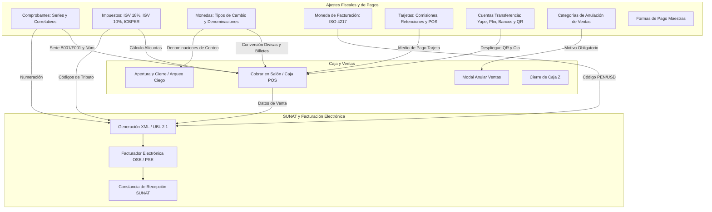

# Auditoría Técnica y Documentación Estructural: Módulo Ajustes (Fiscal y Pagos)

**Sistema**: Restaurant.pe (Ambiente de Producción: Cafetería CAPRICHOS - Lima, Perú)  
**URL Base**: `https://caprichos.restaurant.pe/restaurant/#!/login`  
**Usuario Auditado**: `krosales`  
**Modalidad de Auditoría**: SOLO LECTURA estricta en entorno de PRODUCCIÓN activo.  
**Fecha de Inspección**: 2026-10-13  
**Archivo de Entrega**: `/home/jose/JoseEM/caprichos/web-anterior/administrativo/modulos/ajustes-b.md`  
**Módulo**: **Ajustes - Parte Fiscal y de Pagos**  

---

## 1. Resumen Ejecutivo y Alcance del Módulo

El submódulo **Fiscal y de Pagos** de Ajustes constituye el núcleo normativo, tributario y financiero de la plataforma Restaurant.pe en CAPRICHOS. Desde aquí se definen las reglas que rigen la legalidad de las ventas frente a SUNAT en el Perú, la gestión de series y numeraciones correlativas de comprobantes de pago, el cálculo de impuestos (IGV general del 18%, régimen especial gastronómico del 10%, ICBPER para plásticos y recargos al consumo), así como la parametrización de los canales monetarios de recaudación (efectivo, divisas, pasarelas de pago, datafonos, billeteras móviles como Yape/Plin, transferencias bancarias y causales de anulación de ventas).

El presente documento detalla la estructura funcional, interfaces, entidades, controladores, validaciones y servicios de las 8 pantallas asignadas:

1. **Comprobantes** (`#!/ajustes/comprobantes`)
2. **Impuestos** (`#!/ajustes/impuestos`)
3. **Tarjetas** (`#!/ajustes/tarjetas`)
4. **Monedas** (`#!/ajustes/monedas`)
5. **Moneda de facturación** (`#!/ajustes/monedafacturacion`)
6. **Cuentas de transferencia** (`#!/ajustes/tipotransferencia`)
7. **Categoría Anular Venta** (`#!/ajustes/categoriaanularventa`)
8. **Formas de pago** (`#!/ajustes/formas-de-pago`)

> [!IMPORTANT]
> **Protocolo de Seguridad y Confidencialidad**: Conforme a la política de solo lectura en producción, no se ejecutaron botones de creación, modificación ni eliminación. Para preservar el secreto bancario y la privacidad de la empresa, no se registran números de cuentas corrientes, Códigos de Cuenta Interbancaria (CCI), identidades de titulares ni correlativos tributarios reales; las menciones a cuentas de prueba se anonimizan a sus últimos tres dígitos. La inspección se complementó con el análisis estático del frontend (`frontend_bundle.js`), templates compilados en `$templateCache` y las llamadas GET pasivas del navegador.

---

## 2. Pantalla 1: Comprobantes (`#!/ajustes/comprobantes`)

### 2.1 Propósito
Configurar y supervisar los tipos de comprobantes emitidos por cada caja y sucursal de la cafetería. Permite asociar cada documento tributario o interno (Boletas de Venta, Facturas, Notas de Crédito, Notas de Débito, Tickets y Notas de Venta) con su serie asignada, correlativo inicial, límites de numeración, rangos de contingencia e impresora térmica de destino.

### 2.2 Flujo de Uso Paso a Paso
1. El usuario accede desde el menú lateral a `Ajustes > Comprobantes` (`#!/ajustes/comprobantes`).
2. El sistema carga la vista dividida en dos columnas (*Master-Detail*): a la izquierda el listado paginado de comprobantes configurados y a la derecha el contenedor preparado para el formulario de edición (`ui-view="form"`).
3. El administrador revisa el listado: puede filtrar por tipo de comprobante escribiendo en el buscador o ajustar la paginación (10, 25, 50 o Todos).
4. Para ajustar una serie, hace clic en el botón verde **Editar** correspondiente al registro.
5. **Regla de Protección de Facturación Electrónica**: Dado que el restaurante cuenta con un proveedor de Facturación Electrónica activo (`existeProveedorFE = true`), el sistema intercepta el clic y abre el modal de advertencia `scripts/common/modals/modal-restricciondeuso.html`. En este modal se informa que modificar correlativos de comprobantes electrónicos en producción puede ocasionar inconsistencias ante SUNAT; solo los usuarios que ingresen un **PIN de soporte** o inicien sesión como Reseller/Soporte pueden acceder a los campos modificables.
6. Si el comprobante es interno (Nota de Venta) o se aprueba el PIN de soporte, se despliega el panel de edición a la derecha con los datos precargados.
7. El usuario puede cambiar la serie, el correlativo anterior, la impresora térmica asignada o el estado predeterminado.
8. Para consultar el historial de alteraciones de una serie, se pulsa el botón superior **Ver últimas actualizaciones** (`vm.fnObtenerLogtablaPorId(...)`).
9. Se pulsa **Guardar** para confirmar o **Cancelar** para volver a la tabla general.

### 2.3 Columnas de la Tabla Principal
| Columna | Descripción / Formato Visual | Observación Técnica |
| :--- | :--- | :--- |
| **Caja** | Nombre de la caja asignada (ej. `Caja Principal`) | Proveniente de `comprobante.caja.caja_descripcion` |
| **Comprobante** | Tipo de documento en negrita (ej. `BOLETA`, `FACTURA`, `NOTA DE VENTA`) y descripción secundaria con indicador de serie auxiliar si aplica | Concatena tipo fiscal, serie auxiliar y flag no fiscal |
| **Numeración** | Detalle en bloque: • `Serie:` (ej. `B001`, `F001`) • `Numeración:` Correlativo actual • `Tope Num.:` Límite máx. productos (condicional) • `Rango Desde / Hasta:` Contingencias físicas | Estructura clave para sincronización con SUNAT |
| **Impresora** | Nombre de la impresora vinculada o texto `Ninguna impresora` | Objeto `comprobante.impresora.impresora_nombre` |
| **Estado** | Badge: `Activo` (azul/primary) o `Inactivo` (rojo/danger) | Evalúa método `comprobante.estaActivo()` |
| **Predeterminado** | Icono de verificación verde (`fa-check`) si es el comprobante por defecto | Evalúa `comprobante.esPredeterminado()` |
| **Acciones** | Botón verde `Editar` | Dispara `vm.fnAbrirModalRestriccionComprobantes(comprobante)` |

### 2.4 Campos del Formulario de Edición (`editar.html`)
| Campo / Etiqueta | Tipo de Control | Obligatorio | Modelo Angular | Reglas y Validaciones |
| :--- | :--- | :---: | :--- | :--- |
| **Serie** | `<input type="text">` | Sí | `vm.comprobante.comprobante_serie` | Transformación automática a mayúsculas (`capitalize`). Formato alfanumérico (ej. B001, F001). |
| **Prefijo** | `<input type="text">` | No | `vm.comprobante.comprobante_ruta` | Visible condicionalmente (`vm.mostrarPrefijo`). Usado en esquemas internacionales. |
| **Número correlativo anterior** | `<input type="text">` | Sí | `vm.comprobante.comprobante_numero` | Numérico. Tooltip: *"Si eliges como correlativo anterior el número 0; el documento iniciará en 1"*. |
| **Impresora** | `<ui-select>` | No | `vm.impresoraSeleccionada` | Lista desplegable de impresoras de red registradas. Incluye enlace para registrar nueva impresora vía modal. |
| **Tope de Correlativo** | `<input type="text">` | Condicional | `vm.comprobante.comprobante_maxproductos` | Visible si `vm.mostrarTopeCorrelativo`. |
| **Rango Contingencia Desde** | `<input type="text">` | No | `vm.comprobante.comprobante_rangodasignado` | Visible en contingencia. Máscara: `ui-mask="999999999"`. |
| **Rango Contingencia Hasta** | `<input type="text">` | No | `vm.comprobante.comprobante_rangohasignado` | Máscara: `ui-mask="999999999"`. |
| **Última contingencia utilizada** | `<input type="text">` | No | `vm.comprobante.comprobante_rangoultimousado` | Tooltip: *"De comenzar desde el número de inicio llenar con ceros o dejar vacío"*. |
| **Resolución y fecha** | `<textarea>` (4 filas)| No | `vm.comprobante.comprobante_rangosalvador` | Campo multi-país para autorizaciones fiscales externas. |
| **Estado** | `<input type="checkbox">`| No | `vm.comprobante.comprobante_estado` | Checkbox con iCheck (`'1'` = Activo, `'0'` = Inactivo). |
| **Predeterminada** | `<input type="checkbox">`| No | `vm.comprobante.comprobante_predeterminado`| Checkbox con iCheck (`'1'` = Predeterminado, `'0'` = Normal). |

### 2.5 Filtros y Acciones
- **Filtro reactivo**: Input de búsqueda por tipo de comprobante (`vm.valBusqueda`).
- **Selector de registros**: Desplegable de paginación (`vm.paginacionSeleccionada`).
- **Botón Recargar**: Icono `fa-refresh` para reconsultar la API.
- **Botón Ver últimas actualizaciones**: Abre el modal de auditoría de cambios sobre la tabla `comprobante`.
- **Botón Registrar nueva impresora**: Abre `impresora-modal.html` para crear puertos IP de ticketeras de red (nombre, IP, serie, tipo de protocolo).
- **Botón Guardar / Cancelar**: Confirma la actualización o cierra el panel lateral.

### 2.6 Estados y Reglas de Negocio Visibles
- **Bloqueo por Proveedor FE**: Si el sistema tiene configurado el emisor electrónico (facturador OSE/PSE en SUNAT), los usuarios estándar no pueden alterar correlativos directamente para evitar duplicidades o saltos sancionables por tributación.
- **Unicidad de Serie por Caja**: Dos cajas no pueden emitir comprobantes con la misma serie electrónica simultáneamente para evitar colisiones de correlativo ante SUNAT.
- **Comprobante Predeterminado**: Solo puede existir un comprobante por defecto activo por cada categoría en una misma caja.

### 2.7 Relación con Otros Módulos
- **Caja (`#!/caja/cobrar`)**: Al cobrar una mesa o pedido rápido, la caja consulta este listado para saber cuál es la serie activa, el siguiente número a emitir y a qué ticketera dirigir la impresión del comprobante.
- **Facturación Electrónica (`#!/ajustes/facturacionelectronica`)**: Los comprobantes se asocian a los certificados digitales y credenciales SOL configurados para la generación del XML y envío a SUNAT.
- **Series de Contingencia (`#!/ajustes/serie-contingencia`)**: Provee soporte cuando el servicio de internet o el facturador cae, permitiendo emitir comprobantes físicos preimpresos respetando los rangos asignados.

### 2.8 Entidad de Datos y Campos Clave
- **Entidad**: `Comprobante` (Modelo `model.comprobante`, Colección `ComprobanteCollection`).
- **Campos Clave**: `comprobante_id`, `caja_id`, `local_id`, `comprobante_tipo` (BOLETA, FACTURA, NOTA DE CREDITO, etc.), `comprobante_serie`, `comprobante_numero`, `comprobante_nofiscal`, `impresora_id`, `comprobante_estado`, `comprobante_predeterminado`, `comprobante_maxproductos`, `comprobante_rangodasignado`, `comprobante_rangohasignado`.

### 2.9 Permisos Asociados (ACL)
- Regla de control de acceso: `ajustes.comprobantes`.
- Requiere adicionalmente el permiso `EDITARCOMPROBANTES` para superar el PIN de soporte en locales con facturación electrónica activa.

### 2.10 Endpoints GET Utilizados
- `GET /restaurant/api/rest/comprobante/getComprobanteList/{local_id}/{limit}`: Retorna el catálogo de comprobantes con sus cajas asociadas e impresoras.
- `GET /restaurant/api/rest/impresora/getAllByLocalId/{local_id}/-1/0/0`: Obtiene las ticketeras y puertos de red disponibles para vincular.
- `GET /restaurant/api/rest/caja/get/{caja_id}`: Consulta atributos específicos de la caja asignada.
- `GET /restaurant/api/rest/logtabla/obtenerLogtablaPorId/{id}/{nombre}/{tabla}`: Recupera la traza de auditoría de quién modificó la serie o correlativo.

---

## 3. Pantalla 2: Impuestos (`#!/ajustes/impuestos`)

### 3.1 Propósito
Administrar los gravámenes e impuestos aplicables a los consumos y compras en la cafetería. Permite gestionar las tasas de Impuesto General a las Ventas (IGV 18% o tasa especial gastronómica del 10%), el Impuesto al Consumo de las Bolsas de Plástico (ICBPER), cargos no fiscales (propina/recargo al consumo) y definir en qué modalidades de venta se aplican.

### 3.2 Flujo de Uso Paso a Paso
1. El usuario navega a `Ajustes > Impuestos` (`#!/ajustes/impuestos`).
2. La pantalla presenta un listado de impuestos activos e inactivos y, de forma prominente, un banner amarillo de alerta sobre cambios de tasa programados.
3. **Banner de Programación de Ley Gastronómica (Ley 31556)**: Si está activa la función, muestra: *"Tienes programado el cambio de IGV al 10% para el 1 de septiembre, recuerda cerrar e iniciar sesión en tus dispositivos en este día"* o el botón para crear dicha programación automática.
4. Para crear un nuevo impuesto, se pulsa el botón azul **Nuevo impuesto**, abriendo el formulario en el panel derecho.
5. Se elige si se utiliza el catálogo nacional del país (`vm.usaCatalogo()`):
   - Al seleccionar del catálogo de Perú, se ofrecen opciones predefinidas: **Fiscales** (IGV 18%, IGV 10%, Exonerado, Inafecto, ICBPER) o **No fiscales** (Recargo al consumo 10%, Servicio).
   - La tasa se fija automáticamente o se selecciona de las tasas homologadas por SUNAT.
6. Se asigna el tributo al que pertenece si está habilitada la opción de impuestos dinámicos.
7. Se marcan las casillas de modalidades de venta en las que aplicará (Salones, Rápida, Delivery).
8. Se pulsa **Guardar** para registrar o **Cancelar** para salir sin guardar.

### 3.3 Columnas de la Tabla Principal
| Columna | Descripción / Formato Visual | Observación Técnica |
| :--- | :--- | :--- |
| **Nombre** | Texto del gravamen (ej. `IGV 18%`, `RECARGO AL CONSUMO`) | Campo `impuesto.igv_nombre` |
| **Porcentaje** | Valor porcentual formateado a 2 decimales (ej. `18.00%`, `10.00%`) | Campo `impuesto.igv_porcentajeigv` |
| **Modalidad** | Badges de letras con código de colores según esté activo (`S`, `RA`, `D`) | `S`: Salón (`igv_modsalon`), `RA`: Rápida (`igv_modrapida`), `D`: Delivery (`igv_moddelivery`) |
| **Estado** | Badge: `Activo` (label-primary) o `Inactivo` (label-danger) | Campo binario `igv_estado` (`'1'`/`'0'`) |
| **Fiscalizado** | Indicador: `Sí` (icono verde) o `No` (icono rojo) | Campo `igv_fiscalizado` (determina si reporta a libros contables SUNAT) |
| **Acciones** | Botón verde `Editar` | Dispara `vm.fnObtenerPorId(...)` y transición a estado `editar` |

### 3.4 Campos del Formulario (`editar.html` / `nuevo`)
| Campo / Etiqueta | Tipo de Control | Obligatorio | Modelo Angular | Reglas y Validaciones |
| :--- | :--- | :---: | :--- | :--- |
| **Nombre (Catálogo)** | `<select>` con `<optgroup>` | Sí | `vm.entradaCatalogo` | Agrupa opciones en "Fiscales" y "No fiscales". Si `nombreLibre` es verdadero, permite escribir nombre personalizado. |
| **Nombre (Libre)** | `<input type="text">` | Sí (si no hay catálogo) | `vm.impuesto.igv_nombre` | Texto en mayúsculas (`capitalize`). |
| **Porcentaje** | `<select>` o `<input text>` | Sí | `vm.impuesto.igv_porcentajeigv` | Solo números. Se inhabilita si la entrada de catálogo tiene tasa única no modificable. |
| **Tipo** | Badge visual | No | `vm.entradaCatalogo.fiscal` | Muestra automáticamente `Fiscalizado` o `No fiscalizado`. |
| **Tributo** | `<ui-select>` | Sí (con imp. dinámicos) | `vm.impuestomultipaisObj` | Asocia el impuesto al catálogo SUNAT de tributos (`impuestomultipais_nombre`). |
| **Venta por Salones** | `<input type="checkbox">` | No | `vm.impuesto.igv_modsalon` | Aplica en pedidos de mesas en comedor. |
| **Venta Rápida** | `<input type="checkbox">` | No | `vm.impuesto.igv_modrapida` | Aplica en pedidos directos en barra / mostrador. |
| **Venta por Delivery** | `<input type="checkbox">` | No | `vm.impuesto.igv_moddelivery`| Aplica en pedidos telefónicos o tienda online. |
| **Fiscalizado** | `<input type="checkbox">` | No | `vm.impuesto.igv_fiscalizado` | Solo habilitado para Colombia, Costa Rica o Superusuario en Perú. |
| **Estado** | `<input type="checkbox">` | No | `vm.impuesto.igv_estado` | `'1'` = Impuesto activo, `'0'` = Inactivo. |

### 3.5 Filtros y Acciones
- **Buscador reactivo**: `vm.valBusqueda` sobre la tabla de impuestos.
- **Paginación**: Desplegable de registros por página (`vm.paginacionSeleccionada`).
- **Botón Recargar**: `fa-refresh` para actualizar el listado.
- **Botón Nuevo impuesto**: Despliega el formulario de creación.
- **Botón Anular / Crear programación**: Gestiona la transición programada del IGV (Ley 31556).
- **Botón Ver últimas actualizaciones**: Traza de auditoría de cambios sobre la tabla `igv`.

### 3.6 Estados y Reglas de Negocio Visibles
- **Homologación con SUNAT**: Los impuestos clasificados como "Fiscales" no permiten alterar arbitrariamente su código de tributo para no provocar rechazos en las declaraciones mensuales o en la validación del XML (CDRs SUNAT).
- **Alerta de Edición Fuera de Catálogo**: Si un impuesto se creó bajo una versión previa del sistema que no coincide con las tablas oficiales del país, se despliega una advertencia amarilla indicando que el registro se muestra tal cual se guardó originalmente.

### 3.7 Relación con Otros Módulos
- **Productos (`#!/productos`)**: En la ficha técnica de cada plato o insumo se define si el precio incluye IGV o si está exonerado de impuestos.
- **Caja (`#!/caja/cobrar`)**: Al emitir la precuenta o comprobante final, el motor de cálculo desglosa el subtotal base, el monto del IGV (18% o 10%) y el recargo al consumo.
- **Compras (`#!/compras`)**: Los insumos comprados a proveedores aplican las tasas de crédito fiscal configuradas aquí.

### 3.8 Entidad de Datos y Campos Clave
- **Entidad**: `Impuesto` / `Igv` (Modelo `model.impuesto`, Recurso `ImpuestoResource`).
- **Campos Clave**: `igv_id`, `local_id`, `igv_nombre`, `igv_porcentajeigv`, `igv_estado`, `igv_fiscalizado`, `igv_modsalon`, `igv_modrapida`, `igv_moddelivery`, `igv_modreserva`, `impuestomultipais_id`.

### 3.9 Permisos Asociados (ACL)
- Regla de acceso: `ajustes.igv`.

### 3.10 Endpoints GET Utilizados
- `GET /restaurant/api/rest/igv/getAllByLocalId/{local_id}/-1/1/10`: Lista paginada de impuestos del local.
- `GET /restaurant/api/rest/igv/catalogo`: Catálogo oficial de tipos de gravamen según el país configurado.
- `GET /restaurant/api/rest/impuestomultipais/getAll`: Catálogo maestro de códigos tributarios internacionales/nacionales.
- `GET /restaurant/api/rest/detalleprogramado/getdetallelocal/{local_id}`: Consulta si hay un cambio diferido de alícuotas programado en el servidor.

---

## 4. Pantalla 3: Tarjetas (`#!/ajustes/tarjetas`)

### 4.1 Propósito
Parametrizar las tarjetas de crédito y débito autorizadas como medio de cobro en el restaurante. Permite vincular marcas financieras (Visa, Mastercard, American Express, Diners Club), asociar códigos de integración de datafonos POS físicos (Izipay, Niubiz), configurar comisiones financieras, retenciones de impuestos y determinar si se muestran prioritariamente en caja o en pedidos delivery.

### 4.2 Flujo de Uso Paso a Paso
1. El usuario accede a `Ajustes > Tarjetas` (`#!/ajustes/tarjetas`).
2. Se despliega la tabla con las tarjetas configuradas para la empresa (en CAPRICHOS se observan 7 registros activos e inactivos entre Visa, Mastercard, etc.).
3. Para dar de alta una nueva tarjeta, el administrador pulsa **Nueva tarjeta** en el panel lateral.
4. Completa la descripción comercial (ej. *Visa Débito*), asigna la marca homologada de la lista de **Tarjeta global** y digita el código POS del datafono.
5. Define si la tarjeta aplica comisiones financieras sobre la propina que perciben los mozos.
6. Si la empresa o el intermediario retiene impuestos, activa la casilla de **Retenciones** e ingresa el porcentaje y el umbral de subtotal.
7. Marca si la tarjeta estará visible en el aplicativo de delivery y si aparecerá entre los botones rápidos de cobro en QuipuPOS (*Mostrar en caja*).
8. Se pulsa **Guardar** para dar de alta o **Modificar** si se estaba editando una existente.

### 4.3 Columnas de la Tabla Principal
| Columna | Descripción / Formato Visual | Observación Técnica |
| :--- | :--- | :--- |
| **Nombre** | Nombre comercial de la tarjeta (ej. `Visa`, `MasterCard Crédito`) | Campo `tarjeta.tarjeta_descripcion` |
| **Tipo tarjeta** | Marca global y subtipo bancario (ej. `VISA CRÉDITO`, `MASTERCARD DÉBITO`) | Relación `tarjeta.tarjetaglobal` |
| **Deliverys** | Indicador: `Sí` (verde) o `No` (rojo) con icono | Evalúa método `tarjeta.aceptaDelivery()` |
| **Retención** | Muestra el % retenido y el umbral de subtotal o el texto `Sin retención` | Detalla `tarjeta_retencion` y `tarjeta_retencioncondicion` |
| **Mostrar** | Indicador: `Sí` (verde) o `No` (rojo) | Flag `tarjeta_mostrarcaja` para prioridad visual en POS |
| **Estado** | Badge: `Activa` (label-primary) o `Inactiva` (label-danger) | Evalúa `tarjeta.estaActivo()` |
| **Acciones** | Botón verde `Editar` | Redirige al estado `ajustes.tarjetas.editar` con ID de tarjeta |

### 4.4 Campos del Formulario (`editar.html` / `nuevo`)
| Campo / Etiqueta | Tipo de Control | Obligatorio | Modelo Angular | Reglas y Validaciones |
| :--- | :--- | :---: | :--- | :--- |
| **Nombre** | `<input type="text">` | Sí | `vm.tarjeta.tarjeta_descripcion` | Mínimo 3 caracteres (`ng-minlength="3"`), mayúsculas obligatorias, validación de nombre único (`uniquenombrecaja`). |
| **Código POS** | `<input type="text">` | No | `vm.tarjeta.tarjeta_codigopos` | Código identificador enviado o recibido por el terminal electrónico físico. |
| **Tarjeta comisión** | `<input type="text">` | No | `vm.tarjeta.tarjeta_comision` | Registro del costo financiero del adquirente. |
| **Tarjeta global** | `<ui-select>` | Sí | `vm.tarjeta.tarjetaglobal` | Selecciona la entidad bancaria internacional (`tarjetaglobal_marca` + `tarjetaglobal_tipo`). |
| **Para delivery** | `<input type="checkbox">` | No | `vm.tarjeta.tarjeta_delivery` | Checkbox con iCheck (`'1'`/`'0'`). Permite a clientes pagar delivery con este plástico. |
| **Estado** | `<input type="checkbox">` | No | `vm.tarjeta.tarjeta_estado` | Checkbox con iCheck (`'1'` = Activa, `'0'` = Inactiva). |
| **Retenciones** | `<input type="checkbox">` | No | `vm.tarjeta.tarjeta_tieneretencion` | Habilita el cálculo de retenciones tributarias. Al desactivar, borra valores (`eliminarRetencion()`). |
| **Porcentaje de retención** | `<input type="text">` (addon `%`) | Sí (si retiene) | `vm.tarjeta.tarjeta_retencion` | Rango entre 1 y 100, 2 decimales (`solo-numeros`). |
| **Porcentaje Comisión para propinas** | `<input type="text">` (addon `%`) | No | `vm.tarjeta.tarjeta_comisionpropina` | Tooltip: *"Porcentaje de comisión que se aplicará a todas las propinas generadas por esta tarjeta"*. |
| **Para subtotal menor que** | `<input type="text">` (addon moneda) | No | `vm.tarjeta.tarjeta_retencioncondicion` | Umbral dinerario a partir del cual se aplica la retención. |
| **¿El cliente asume retención?** | `<input type="checkbox">` | No | `vm.tarjeta.tarjeta_retienecliente` | Tooltip: *"Al asumir la retención el cliente, el total aumentará"*. |
| **Mostrar en caja** | `<input type="checkbox">` | No | `vm.tarjeta.tarjeta_mostrarcaja` | Tooltip: *"Seleccionar para mostrar primero en caja QuipuPOS"*. |

### 4.5 Filtros y Acciones
- **Buscador de tarjetas**: Filtro en tiempo real por texto (`vm.valBusqueda`).
- **Paginación dinámica**: Opciones de cantidad de registros visibles.
- **Botón Recargar**: Refresco inmediato contra el backend.
- **Botón Nueva tarjeta**: Despliega el formulario lateral en blanco.
- **Botón Ver últimas actualizaciones**: Auditoría de logs sobre la entidad `tarjeta`.

### 4.6 Estados y Reglas de Negocio Visibles
- **Comisión en Propinas de Mozos**: Si un comensal deja propina pagada mediante tarjeta, los operadores bancarios cobran una tasa por transacción. Esta pantalla permite configurar explícitamente qué porcentaje se descuenta al liquidar las propinas al personal para no perjudicar la caja del negocio.
- **Retención Asumida por Cliente**: Si el restaurante traslada la retención al comensal, el total a pagar se incrementa matemáticamente en el ticket de checkout.

### 4.7 Relación con Otros Módulos
- **Caja (`#!/caja/cobrar`)**: Al pulsar "Tarjeta" en el modal de checkout, se despliegan los botones asociados a estas opciones y se solicita opcionalmente el número de voucher/operación.
- **Informes (`#!/informes/ventas/retencionportarjeta`)**: Alimenta el informe analítico de retenciones bancarias por tarjeta.
- **Delivery (`#!/delivery`)**: Filtra qué tarjetas están habilitadas para los motorizados que llevan datafonos inalámbricos al domicilio.

### 4.8 Entidad de Datos y Campos Clave
- **Entidad**: `Tarjeta` (Modelo `model.tarjeta`, Recurso `TarjetaResource`).
- **Campos Clave**: `tarjeta_id`, `local_id`, `tarjeta_descripcion`, `tarjeta_codigopos`, `tarjetaglobal_id`, `tarjeta_delivery`, `tarjeta_estado`, `tarjeta_tieneretencion`, `tarjeta_retencion`, `tarjeta_retencioncondicion`, `tarjeta_retienecliente`, `tarjeta_comisionpropina`, `tarjeta_mostrarcaja`.

### 4.9 Permisos Asociados (ACL)
- Regla de acceso: `ajustes.tarjetas`.

### 4.10 Endpoints GET Utilizados
- `GET /restaurant/api/rest/tarjeta/getAllTarjetasByLocalId/{local_id}/1/10`: Lista de tarjetas asociadas al local.
- `GET /restaurant/api/rest/tarjetaglobal/getAll/1/-1/-1`: Catálogo global de franquicias bancarias (Visa, Mastercard, Amex, etc.).
- `GET /restaurant/api/rest/tarjeta/get/{id}`: Detalle de configuración de una tarjeta individual.

---

## 5. Pantalla 4: Monedas (`#!/ajustes/monedas`)

### 5.1 Propósito
Gestionar las monedas operativas en las que el restaurante efectúa cobros y arqueos en sala y mostrador (Soles peruanos y Dólares estadounidenses en CAPRICHOS). Controla los tipos de cambio diarios de compra y venta, la sincronización de tasas entre múltiples locales, las credenciales de pasarelas de cobro vinculadas a la moneda (Culqi y Visa mPOS), y el catálogo de denominaciones físicas (billetes y monedas) para el arqueo de caja.

### 5.2 Flujo de Uso Paso a Paso
1. El usuario ingresa a `Ajustes > Monedas` (`#!/ajustes/monedas`).
2. Se muestra la tabla con las dos monedas principales registradas (Soles `S/` como predeterminada y Dólares `$`).
3. Para actualizar el tipo de cambio del día, se pulsa **Editar** sobre la moneda correspondiente.
4. En el formulario lateral, el cajero o administrador actualiza los valores de **Tipo de cambio compra** y **Tipo de cambio venta**.
5. Si el restaurante opera con varias sucursales, puede hacer clic en el enlace dentro del banner azul: *"Ahora puedes cambiar el tipo de cambio en otras sucursales haciendo click aquí"*, lo que abre el modal `modalActualizarTipoCambio.view.html` para replicar el tipo de cambio sin tener que cambiar de cuenta.
6. En la parte inferior del panel de edición se ubica el módulo de **Denominaciones**: aquí se configuran los valores nominales de dinero en efectivo (ej. billetes de 10, 20, 50, 100, 200 y monedas de 0.10 a 5.00) que el personal de caja contará físicamente en la apertura y cierre de turno.
7. Se pulsa **Guardar** o **Modificar**.

### 5.3 Columnas de la Tabla Principal
| Columna | Descripción / Formato Visual | Observación Técnica |
| :--- | :--- | :--- |
| **Nombre** | Denominación de la moneda (ej. `Soles`, `Dólares Americanos`) | Campo `moneda.moneda_descripcion` |
| **Símbolo** | Representación gráfica (ej. `S/`, `$`) | Campo `moneda.moneda_simbolo` |
| **Tipo de cambio** | Desglose dual: • `Compra:` Valor cambiario de compra • `Venta:` Valor cambiario de venta | Campos `moneda_tipocambio_compra` y `moneda_tipocambio` |
| **Predeterminada** | Indicador: `Sí` (verde) o `No` (rojo) | Campo binario `moneda_defecto` |
| **Última modificación**| Fecha del último cambio en formato `DD/MM/YYYY` con icono de calendario | Campo `moneda_fechamodificacion` procesado con Angular Moment |
| **Estado** | Badge: `Activa` (label-primary) o `Inactiva` (label-danger) | Evalúa método `moneda.estaActivo()` |
| **Acciones** | Botón verde `Editar` | Abre el formulario de edición con parámetros de divisa |

### 5.4 Campos del Formulario de Edición (`editar.html`)
| Campo / Etiqueta | Tipo de Control | Obligatorio | Modelo Angular | Reglas y Validaciones |
| :--- | :--- | :---: | :--- | :--- |
| **Nombre** | `<input type="text">` | Sí | `vm.moneda.moneda_descripcion` | Mínimo 3 letras, mayúsculas automáticas, validación de unicidad. |
| **Símbolo** | `<input type="text">` | Sí | `vm.moneda.moneda_simbolo` | Carácter monetario visual (ej. `S/`, `$`). |
| **Código moneda (Isocode)** | `<ui-select>` | Sí | `vm.monedafacturacionObj` | Vincula con la moneda fiscal del módulo 5 (`monedafacturacion_isocode`). |
| **Estado** | `<input type="checkbox">` | No | `vm.moneda.moneda_estado` | Checkbox con iCheck (`'1'` = Activa, `'0'` = Inactiva). |
| **Tipo de cambio: compra** | `<input type="text">` | Sí | `vm.moneda.moneda_tipocambio_compra`| Numérico sin signos, longitud máxima 8 caracteres. |
| **Tipo de cambio: venta** | `<input type="text">` | Sí | `vm.moneda.moneda_tipocambio` | Numérico sin signos, longitud máxima 8 caracteres. |
| **Código comercio (Culqi)** | `<input type="text">` | No | `vm.moneda.moneda_culqicodigocomercio`| ID público de comercio para pasarela online Culqi. |
| **Llave secreta (Culqi)** | `<input type="text">` | No | `vm.moneda.moneda_culqillavesecreta` | Token secreto de autenticación API Culqi. |
| **API Key (Visa mPOS)** | `<input type="text">` | No | `vm.moneda.moneda_visallavesecreta` | UUID de integración para terminales móviles Visa. |

#### Subtabla: Denominaciones de Efectivo (`denominacionMonedaList`)
- **Columnas**: `Valor`, `Tipo`, `Estado`, `Acciones`.
- **Campos en Modo Edición**:
  - `Valor`: Input numérico (`denominacionmoneda_valor`) para el monto nominal del billete o moneda.
  - `Tipo`: Selector desplegable con opciones `Billete` o `Moneda` (`tipomoneda_nombre`).
  - `Estado`: Badge `Activa` (1) o `Anulada` (0).
  - `Acciones`: Botones rápidos para Guardar, Eliminar o Activar.

### 5.5 Filtros y Acciones
- **Buscador reactivo**: `vm.valBusqueda` sobre la tabla principal.
- **Paginación**: Desplegable por cantidad de filas.
- **Botón Recargar**: Actualiza los tipos de cambio desde la base de datos.
- **Botón Nueva moneda**: Permite añadir una divisa adicional (ej. Euros).
- **Enlace de Actualización Multi-sucursal**: Abre el modal `modalActualizarTipoCambio.view.html` para sincronizar tasas con otras tiendas de la cadena.
- **Botón Nueva denominación**: Añade una fila editable en la tabla de billetes y monedas.

### 5.6 Estados y Reglas de Negocio Visibles
- **Moneda Base vs Moneda Extranjera**: La moneda predeterminada (`moneda_defecto = 1`) opera como divisa contable local (en Perú, Nuevos Soles `PEN`). Al recibir pagos en dólares en Caja, el sistema divide el monto por el tipo de cambio venta para calcular la equivalencia exacta y registrar el vuelto en moneda nacional.
- **Arqueo Ciego Asistido**: Las denominaciones registradas aquí componen la cuadrícula del arqueo de caja en `Caja > Movimientos > Arqueo`, donde el cajero únicamente digita la cantidad de piezas de cada denominación (ej. 5 billetes de S/ 100, 10 billetes de S/ 50) y el sistema calcula la suma matemática total.

### 5.7 Relación con Otros Módulos
- **Caja (`#!/caja/cobrar` y `#!/caja/apertura-cierre`)**: Fundamental para recibir pagos en dólares y para el cuadre físico de la gaveta de dinero.
- **Compras (`#!/compras`)**: Permite registrar facturas de proveedores emitidas en moneda extranjera convirtiéndolas al costo en soles.

### 5.8 Entidad de Datos y Campos Clave
- **Entidades**: `Moneda` (Modelo `model.moneda`, Recurso `MonedaResource`) y `Denominacionmoneda` (Modelo `model.denominacionmoneda`).
- **Campos Clave**: `moneda_id`, `local_id`, `moneda_descripcion`, `moneda_simbolo`, `moneda_tipocambio`, `moneda_tipocambio_compra`, `moneda_defecto`, `moneda_estado`, `moneda_culqicodigocomercio`, `moneda_culqillavesecreta`, `moneda_visallavesecreta`, `denominacionmoneda_id`, `denominacionmoneda_valor`, `tipomoneda_id`.

### 5.9 Permisos Asociados (ACL)
- Regla de acceso: `ajustes.monedas`.

### 5.10 Endpoints GET Utilizados
- `GET /restaurant/api/rest/moneda/allmonedasbylocal/{local_id}/1/10`: Lista de monedas del local con tipos de cambio.
- `GET /restaurant/api/rest/monedafacturacion/allmonedafacturacionsbylocal/0/0`: Catálogo de códigos ISO fiscales disponibles para enlazar.
- `GET /restaurant/api/rest/moneda/obtenerTipoCambioSucursalList`: Matriz de tipos de cambio de todas las sucursales vinculadas al usuario.

---

## 6. Pantalla 5: Moneda de facturación (`#!/ajustes/monedafacturacion`)

### 6.1 Propósito
Catálogo maestro de monedas reconocidas formalmente para fines de facturación electrónica y emisión de comprobantes digitales bajo el estándar internacional ISO 4217 (homologado por SUNAT en el Catálogo N° 02 de la normativa de Facturación Electrónica). Establece la correspondencia técnica entre la divisa comercial y el código alfanumérico que debe inyectarse en los archivos XML/UBL 2.1.

### 6.2 Flujo de Uso Paso a Paso
1. El usuario accede a `Ajustes > Moneda de facturación` (`#!/ajustes/monedafacturacion`).
2. Se muestra la tabla con las monedas fiscales dadas de alta (en CAPRICHOS: Soles `PEN` y Dólares `USD`).
3. Para registrar una moneda fiscal adicional, se pulsa **Nueva moneda de facturación**.
4. Se introduce la descripción (ej. *Euro*), el símbolo gráfico (`€`) y se escoge el código normalizado de la lista **Código moneda de facturación** (`vm.objIsoCode`).
5. Se pulsa **Guardar** o **Modificar**.

### 6.3 Columnas de la Tabla Principal
| Columna | Descripción / Formato Visual | Observación Técnica |
| :--- | :--- | :--- |
| **Nombre** | Nombre formal del signo monetario (ej. `Sol`, `Dólar Americano`) | Campo `monedafacturacion.monedafacturacion_descripcion` |
| **Símbolo** | Símbolo tipográfico (`S/`, `$`, etc.) | Campo `monedafacturacion.monedafacturacion_simbolo` |
| **Isocode** | Código estandarizado de 3 letras mayúsculas (ej. `PEN`, `USD`) | Campo `monedafacturacion.monedafacturacion_isocode` |
| **Acciones** | Botón verde `Editar` | Carga el formulario de modificación |

### 6.4 Campos del Formulario (`editar.html` / `nuevo`)
| Campo / Etiqueta | Tipo de Control | Obligatorio | Modelo Angular | Reglas y Validaciones |
| :--- | :--- | :---: | :--- | :--- |
| **Nombre** | `<input type="text">` | Sí | `vm.monedafacturacion.monedafacturacion_descripcion` | Mínimo 3 letras, mayúsculas obligatorias, nombre único (`uniquenombrecaja`). |
| **Símbolo** | `<input type="text">` | Sí | `vm.monedafacturacion.monedafacturacion_simbolo` | Carácter del signo monetario. |
| **Código moneda de facturación** | `<ui-select>` | Sí | `vm.objIsoCode` | Lista desplegable con catálogo ISO internacional provisto por backend (`vm.isocodeList`). Tooltip explicativo de equivalencias (`PEN`, `USD`). |

### 6.5 Diferencia Estructural Crítica: "Monedas" vs "Moneda de Facturación"
- **Monedas (`#!/ajustes/monedas`)**: Gestiona la operativa financiera real de la tienda (arqueo en gaveta, billetes físicos, tipo de cambio compra/venta diario, pagos por datafono o internet).
- **Moneda de facturación (`#!/ajustes/monedafacturacion`)**: Es puramente normativa/tributaria; define la etiqueta que viajará en el nodo `<cbc:DocumentCurrencyCode>` del XML para que la SUNAT acepte el comprobante electrónico sin rechazarlo por código inválido.

### 6.6 Relación con Otros Módulos
- **Ajustes > Monedas**: Cada moneda física debe estar enlazada obligatoriamente a una moneda de facturación para poder operar.
- **Facturación Electrónica**: El servicio de construcción de XML lee este código ISO para armar las cabeceras de boletas y facturas.

### 6.7 Entidad de Datos y Campos Clave
- **Entidad**: `Monedafacturacion` (Modelo `model.monedafacturacion`, Recurso `MonedafacturacionResource`).
- **Campos Clave**: `monedafacturacion_id`, `monedafacturacion_descripcion`, `monedafacturacion_simbolo`, `monedafacturacion_isocode`.

### 6.8 Permisos Asociados (ACL)
- Regla de acceso: `ajustes.monedas`.

### 6.9 Endpoints GET Utilizados
- `GET /restaurant/api/rest/monedafacturacion/allmonedafacturacionsbylocal/1/10`: Lista paginada de monedas de facturación.
- `POST /restaurant/api/rest/moneda/getIsoCodeList`: Retorna la lista estándar de códigos ISO (PEN, USD, EUR, etc.).

---

## 7. Pantalla 6: Cuentas de transferencia (`#!/ajustes/tipotransferencia`)

### 7.1 Propósito
Configurar las cuentas bancarias institucionales y las billeteras móviles (Yape, Plin y transferencias interbancarias) del restaurante por sucursal. Asocia números de cuenta corriente, códigos interbancarios (CCI), números de teléfono móvil de recaudación, titulares autorizados y códigos QR para facilitar el cobro tanto en la mesa como en delivery y venta online.

### 7.2 Flujo de Uso Paso a Paso
1. El usuario accede a `Ajustes > Cuentas de transferencia` (`#!/ajustes/tipotransferencia`).
2. Se muestra la tabla con las cuentas registradas en el local (en CAPRICHOS se aprecian 4 cuentas activas distribuidas entre billeteras digitales y transferencias).
3. Para registrar una nueva cuenta o billetera, el usuario pulsa **Nueva cuenta** en el panel derecho.
4. Elige el **Tipo de cuenta**:
   - `1`: **PLIN**
   - `2`: **YAPE**
   - `3`: **TRANSFERENCIA BANCARIA**
5. Si elige Yape o Plin, el campo de número se etiqueta dinámicamente como **Número de teléfono** y se oculta el código interbancario.
6. Si elige Transferencia Bancaria, el campo se etiqueta como **Número de cuenta** y se habilita el campo para registrar el **Código interbancario (CCI)**.
7. Se digita el nombre de la entidad financiera (ej. *BCP cta. corriente*, *BBVA*, *Interbank*) y el titular de la cuenta.
8. En la sección **Código QR**, el usuario pulsa **Elegir una Imagen** para cargar el archivo gráfico del QR (PNG/JPG) que los clientes escanearán desde su app bancaria.
9. Se define si la cuenta está activa y se pulsa **Guardar**.

### 7.3 Columnas de la Tabla Principal
| Columna | Descripción / Formato Visual | Observación Técnica |
| :--- | :--- | :--- |
| **Nombre de cuenta** | Nombre comercial y banco (ej. `BCP`, `Yape`) | Campo `tipotransferencia.tipotransferencia_nombreentidad` |
| **Número asociado** | Número de cuenta o número telefónico | Campo `tipotransferencia.tipotransferencia_numerocuenta` |
| **Titular** | Razón social o persona natural dueña de la cuenta | Campo `tipotransferencia.tipotransferencia_titular` |
| **Tipo** | Texto descriptivo: `PLIN`, `YAPE` o `TRANSFERENCIA` | Evalúa el código numérico `tipotransferencia_tipo` (1, 2 o 3) |
| **Local** | Sucursal asignada (ej. `CAPRICHOS`) | Campo `tipotransferencia.local_descripcion` |
| **Estado** | Badge: `Activa` (label-primary) o `Inactiva` (label-danger) | Campo binario `tipotransferencia_estado` |
| **Acciones** | Botón verde `Editar` | Carga el formulario en modo edición en el panel lateral |

### 7.4 Campos del Formulario (`editar.html`)
| Campo / Etiqueta | Tipo de Control | Obligatorio | Modelo Angular | Reglas y Validaciones |
| :--- | :--- | :---: | :--- | :--- |
| **Tipo de cuenta** | `<ui-select>` | Sí | `vm.tipoCuentaTransferenciaSeleccionada` | Opciones fijas: `PLIN` (1), `YAPE` (2), `TRANSFERENCIA` (3). |
| **Local** | `<ui-select>` | Sí | `vm.localSeleccionado` | Selecciona la sucursal autorizada de la cadena (`vm.sucursalList`). |
| **Nombre cuenta** | `<input type="text">` | Sí | `vm.tipotransferencia.tipotransferencia_nombreentidad` | Ejemplo: *"BCP cta. corriente"*. Nombre único en el local (`uniquenombrecaja`). |
| **Número de cuenta / teléfono** | `<input type="text">` | Sí | `vm.tipotransferencia.tipotransferencia_numerocuenta` | Etiqueta cambia reactivamente según sea billetera o transferencia. Texto en mayúsculas. |
| **Código interbancario** | `<input type="text">` | No | `vm.tipotransferencia.tipotransferencia_codigointerbancario`| Visible únicamente cuando Tipo de Cuenta es Transferencia (3). |
| **Titular de la cuenta** | `<input type="text">` | No | `vm.tipotransferencia.tipotransferencia_titular`| Nombre de la persona o empresa titular. Mayúsculas automáticas. |
| **Estado** | `<input type="checkbox">` | No | `vm.tipotransferencia.tipotransferencia_estado` | Checkbox iCheck (`'1'` = Cuenta activa, `'0'` = Inactiva). |
| **Código QR (Imagen)** | Upload / Botón de archivo | No | `vm.tipotransferencia.tipotransferencia_urlimagen` | Carga de imagen con preview responsivo (350x263 px) y barra de progreso ladda (`vm.fnSubirImagen`). |

### 7.5 Filtros y Acciones
- **Paginación**: Desplegable por cantidad de registros.
- **Botón Recargar**: Refresca el listado de cuentas.
- **Botón Nueva cuenta**: Abre el formulario lateral en blanco.
- **Botón Elegir una Imagen**: Dispara el selector de archivos local para subir el QR de Yape/Plin al servidor.
- **Botones Guardar / Modificar / Cancelar**: Control de transacciones del formulario.

### 7.6 Estados y Reglas de Negocio Visibles
- **Despliegue Dinámico de QR en Caja y Delivery**: Cuando el cajero selecciona el medio de pago "Transferencia", "Yape" o "Plin" en el POS, el sistema despliega en pantalla la imagen del código QR registrada aquí para que el comensal lo escanee directamente con su celular.
- **Validación por Voucher**: Los pagos registrados bajo estas cuentas exigen obligatoriamente que el cajero digite el número de operación del banco para cuadre de caja.

### 7.7 Relación con Otros Módulos
- **Caja (`#!/caja/cobrar`)**: Al cobrar con transferencia, el POS lista las cuentas activas creadas en este módulo.
- **Menú Online / Delivery QR (`carta-digital`)**: En los pedidos web con opción de pago por transferencia, se muestran estos datos bancarios y el QR al cliente antes de confirmar su pedido.

### 7.8 Entidad de Datos y Campos Clave
- **Entidad**: `Tipotransferencia` (Modelo `model.tipotransferencia`, Recurso `TipotransferenciaResource`).
- **Campos Clave**: `tipotransferencia_id`, `local_id`, `tipotransferencia_tipo`, `tipotransferencia_nombreentidad`, `tipotransferencia_numerocuenta`, `tipotransferencia_codigointerbancario`, `tipotransferencia_titular`, `tipotransferencia_estado`, `tipotransferencia_urlimagen`.

### 7.9 Permisos Asociados (ACL)
- Regla de acceso: `ajustes`.

### 7.10 Endpoints GET Utilizados
- `GET /restaurant/api/rest/tipotransferencia/obtenerTipotransferenciaListPaginado/-1/1/10`: Lista paginada de cuentas bancarias y billeteras digitales.
- `GET /restaurant/api/rest/local/obtenerLocalesPermitidosParaUsuarioID/{usuario_id}`: Lista de sucursales a las que el usuario puede asociar cuentas.
- `GET /restaurant/api/rest/tipotransferencia/obtener/{id}`: Obtiene el registro individual de la cuenta.

---

## 8. Pantalla 7: Categoría Anular Venta (`#!/ajustes/categoriaanularventa`)

### 8.1 Propósito
Gestionar el catálogo maestro de motivos y causales estandarizadas para la anulación de comandas, consumos y comprobantes de venta en la cafetería. Proporciona control de auditoría interna y trazabilidad operacional sobre por qué se eliminan transacciones en el punto de venta.

### 8.2 Flujo de Uso Paso a Paso
1. El usuario accede a `Ajustes > Categoría Anular Venta` (`#!/ajustes/categoriaanularventa`).
2. Se muestra la tabla con las categorías existentes (en CAPRICHOS se observa 1 categoría maestra configurada).
3. Para registrar una nueva causal, se pulsa el botón **Nueva categoría**.
4. Se introduce el nombre o descripción del motivo (ej. *Error de digitación del mozo*, *Comida fría / Rechazo de cliente*, *Cliente se retira sin consumir*, *Falla en medio de pago*, *Duplicidad de orden*).
5. Se establece si la categoría está activa mediante el checkbox correspondiente.
6. Se pulsa **Guardar** o **Modificar**.

### 8.3 Columnas de la Tabla Principal
| Columna | Descripción / Formato Visual | Observación Técnica |
| :--- | :--- | :--- |
| **Descripción** | Nombre descriptivo de la causal de anulación | Campo `categoriaanularventa.categoriaanularventa_descripcion` |
| **Estado** | Badge: `Activa` (label-primary) o `Inactiva` (label-danger) | Campo binario `categoriaanularventa_estado` |
| **Acciones** | Botón verde `Editar` | Abre el formulario para cambiar nombre o estado |

### 8.4 Campos del Formulario (`editar.html` / `nuevo`)
| Campo / Etiqueta | Tipo de Control | Obligatorio | Modelo Angular | Reglas y Validaciones |
| :--- | :--- | :---: | :--- | :--- |
| **Nombre** | `<input type="text">` | Sí | `vm.categoriaAnularVenta.categoriaanularventa_descripcion` | Mínimo 3 letras (`ng-minlength="3"`), mayúsculas obligatorias, nombre único (`uniquenombrecaja`). |
| **Estado** | `<input type="checkbox">` | No | `vm.categoriaAnularVenta.categoriaanularventa_estado` | Checkbox con iCheck (`'1'` = Activa, `'0'` = Inactiva). |

### 8.5 Filtros y Acciones
- **Buscador en tiempo real**: `vm.valBusqueda` sobre la tabla.
- **Paginación**: Desplegable por cantidad de filas.
- **Botón Recargar**: `fa-refresh` para refrescar los datos.
- **Botón Nueva categoría**: Abre el panel de creación.
- **Botones Guardar / Modificar / Cancelar**: Confirmación de cambios.

### 8.6 Estados y Reglas de Negocio Visibles
- **Obligatoriedad en Punto de Venta**: Cuando un cajero o administrador abre el modal `anularventas.html` en Caja para dar de baja una venta, el sistema no permite proceder sin seleccionar obligatoriamente una de estas categorías.
- **Trazabilidad Antifraude**: Las anulaciones quedan registradas en el reporte de cierre Z y en el monitor de ventas asociando el usuario que autorizó la operación con el motivo seleccionado, previniendo cancelaciones no autorizadas tras el cobro de dinero en efectivo.

### 8.7 Relación con Otros Módulos
- **Caja (`#!/caja/cobrar/salones` y `scripts/restaurantpe/caja/modals/anularventas.html`)**: Es el consumidor directo de este catálogo al anular consumos.
- **Notas de Crédito (`#!/caja/Notas-Credito`)**: Si la venta anulada ya tenía Boleta o Factura electrónica emitida ante SUNAT, el sistema exige la anulación y la emisión obligatoria de una Nota de Crédito Electrónica vinculada a la causal.

### 8.8 Entidad de Datos y Campos Clave
- **Entidad**: `CategoriaAnularVenta` (Modelo `model.categoriaanularventa`, Recurso `CategoriaAnularVentaResource`).
- **Campos Clave**: `categoriaanularventa_id`, `categoriaanularventa_descripcion`, `categoriaanularventa_estado`.

### 8.9 Permisos Asociados (ACL)
- Regla de acceso: `ajustes`.

### 8.10 Endpoints GET Utilizados
- `GET /restaurant/api/rest/categoriaanularventa/listarPorPaginacion/1/10`: Lista paginada de causales de anulación.
- `GET /restaurant/api/rest/categoriaanularventa/categoriaanularventa/{id}`: Detalle de la categoría seleccionada.
- `GET /restaurant/api/rest/categoriaanularventa/getAllActivos`: Endpoint invocado desde Caja para poblar el selector de anulación.

---

## 9. Pantalla 8: Formas de pago (`#!/ajustes/formas-de-pago`)

### 9.1 Propósito
Catálogo general y transversal de los medios de pago soportados globalmente por la empresa (Efectivo, Tarjeta, Transferencia, Crédito a favor de clientes, Vales de consumo, Cortesía / Consumo de personal). Actúa como clasificador financiero tanto para los ingresos de dinero en el POS como para los egresos y pagos a proveedores en compras.

### 9.2 Flujo de Uso Paso a Paso
1. El usuario accede a `Ajustes > Formas de pago` (`#!/ajustes/formas-de-pago`).
2. Se muestra la tabla de formas de pago configuradas (en CAPRICHOS se observa 1 registro maestro activo en esta tabla genérica).
3. Para crear una modalidad complementaria, se pulsa el botón **Nueva forma de pago**.
4. Se digita la descripción del medio (ej. *Cortesía*, *Vale de Consumo*, *Crédito Personal*).
5. En caso de edición, se puede activar o desactivar la casilla **Forma de pago activa**.
6. Se pulsa **Guardar** o **Modificar**.

### 9.3 Columnas de la Tabla Principal
| Columna | Descripción / Formato Visual | Observación Técnica |
| :--- | :--- | :--- |
| **Descripción** | Nombre de la forma de pago | Campo `formaPago.formadepago_descripcion` |
| **Estado** | Badge: `Activo` (label-primary) o `Inactivo` (label-danger) | Campo binario `formadepago_estado` |
| **Acciones** | Botón verde `Editar` | Permite editar el nombre o estado del medio |

### 9.4 Campos del Formulario (`editar.html` / `nuevo`)
| Campo / Etiqueta | Tipo de Control | Obligatorio | Modelo Angular | Reglas y Validaciones |
| :--- | :--- | :---: | :--- | :--- |
| **Descripción de la forma de pago** | `<input type="text">` | Sí | `vm.formaPago.formadepago_descripcion` | Texto descriptivo obligatorio. |
| **Estado** | `<input type="checkbox">` | No (solo en edición) | `vm.formaPago.formadepago_estado` | Checkbox con iCheck (`'1'` = Activa, `'0'` = Inactiva). Visible si `formadepago_id > 0`. |

### 9.5 Filtros y Acciones
- **Buscador reactivo**: `vm.valBusqueda` sobre la tabla.
- **Paginación**: Desplegable por cantidad de registros.
- **Botón Recargar**: Refresco de datos contra la API.
- **Botón Nueva forma de pago**: Abre el panel de registro en blanco.
- **Botones Guardar / Modificar / Cancelar**: Control de transacciones del formulario.

### 9.6 Estados y Reglas de Negocio Visibles
- **Intersección entre Módulos de Ventas y Compras**: A diferencia de *Tarjetas* o *Cuentas de Transferencia* que son específicas de la recaudación de clientes, este catálogo es el que utiliza el módulo de Compras para registrar con qué método se cancelaron las compras de mercadería e insumos a los proveedores (`comprasporformadepago`).

### 9.7 Relación con Otros Módulos
- **Compras (`#!/compras/proveedores` y `comprasporformadepago`)**: Permite categorizar los desembolsos de caja chica o tesorería hacia proveedores.
- **Caja (`#!/caja/cobrar` y `#!/caja/movimientos`)**: Agrupa los tipos de cobro en los balances y reportes de cierre de turno.

### 9.8 Entidad de Datos y Campos Clave
- **Entidad**: `FormaPago` (Modelo `model.formadepago`, Recurso `FormaPagoResource`).
- **Campos Clave**: `formadepago_id`, `formadepago_descripcion`, `formadepago_estado`.

### 9.9 Permisos Asociados (ACL)
- Regla de acceso: `ajustes`.

### 9.10 Endpoints GET Utilizados
- `GET /restaurant/api/rest/formadepago/buscar/-1/-1/1/10`: Búsqueda paginada de formas de pago.
- `GET /restaurant/api/rest/local/obtenerLocalesPermitidosParaUsuarioID/{usuario_id}`: Locales asociados al usuario en sesión.
- `GET /restaurant/api/rest/formadepago/formadepago/{id}`: Consulta individual por ID.

---

## 10. Matriz Comparativa y Relaciones Fiscales / Financieras

### Explicación de Mecanismos Clave:
1. **Series y Correlativos de Comprobantes**:
   - SUNAT exige que los comprobantes electrónicos sigan un patrón estricto: 4 caracteres alfanuméricos para la serie (comenzando con `B` para Boletas y `F` para Facturas) seguidos de hasta 8 dígitos correlativos.
   - En Restaurant.pe, cada caja física tiene asignada su propia serie (ej. Caja 1: `B001`, `F001`; Caja 2: `B002`, `F002`) para evitar que transacciones paralelas generen el mismo número correlativo.
2. **Impuestos Aplicados**:
   - **IGV General (18%)**: Tasa estándar en Perú (16% IGV + 2% Impuesto de Promoción Municipal).
   - **IGV Especial Gastronómico (10%)**: Habilitado por la Ley 31556 para micro y pequeñas empresas del rubro restaurantes y hoteles (8% IGV + 2% IPM). El sistema cuenta con un banner especial y endpoints de programación para aplicar este cambio de forma diferida.
   - **ICBPER**: Impuesto al Consumo de Bolsas de Plástico que aplica un monto fijo por cada bolsa entregada en pedidos para llevar o delivery.
   - **Recargo al Consumo (No fiscal)**: Porcentaje adicional (usualmente 10%) estipulado en el Decreto Ley 25988 que no constituye tributo fiscal para SUNAT sino beneficio para los trabajadores.
3. **Medios de Pago y su Relación con Caja**:
   - En un cierre de caja, el efectivo se concilia mediante las **Denominaciones** configuradas en Monedas; las tarjetas se cuadran contra los lotes de vouchers emitidos por los datafonos; y las billeteras/transferencias se concilian mediante los códigos de operación bancarios registrados.

---

## 11. Funcionalidades Imprescindibles para Replicar el Sistema

Para construir la nueva plataforma moderna de CAPRICHOS, los siguientes componentes son de implementación obligatoria:

1. **Gestor Centralizado de Series y Correlativos**:
   - Numeración atómica con bloqueo transaccional por base de datos para impedir duplicación de comprobantes ante ventas simultáneas en varias cajas o tablets.
   - Protección con perfil administrativo o PIN de seguridad para que ningún cajero pueda modificar correlativos una vez sincronizados con SUNAT.
2. **Motor Multi-impuesto Flexible**:
   - Capacidad de aplicar impuestos porcentuales (IGV 18% / 10%) y montos nominales fijos (ICBPER por unidad de empaque).
   - Clasificación de impuestos fiscales (que tributan a SUNAT con código de catálogo) y no fiscales (recargo al consumo / propina de servicio).
   - Asignación granular de impuestos por modalidad de venta (Salón, Barra, Delivery).
3. **Mapeo Estricto ISO 4217 para Facturación Electrónica**:
   - Separación clara entre la divisa de visualización en caja y el identificador oficial tributario (`PEN` / `USD`) requerido por el estándar UBL 2.1.
4. **Módulo de Cuentas de Cobro Digital (Billeteras y Bancos)**:
   - Soporte nativo para Yape, Plin y transferencias interbancarias con almacenamiento de imágenes QR optimizadas para despliegue en pantalla de POS y en el checkout del menú online.
   - Validación obligatoria de número de operación bancario en caja.
5. **Matriz de Denominaciones para Arqueo de Caja**:
   - Configuración dinámica del cono monetario (monedas de 0.10 a 5.00 y billetes de 10 a 200) para permitir conteo ciego rápido al momento del cierre de turno.
6. **Catálogo de Motivos de Anulación de Venta**:
   - Validación forzosa de causal antes de autorizar la anulación de cualquier pedido o la emisión de Notas de Crédito.
7. **Control de Retenciones y Comisión de Propinas por Tarjeta**:
   - Cálculo automático de descuentos por comisión bancaria en las propinas electrónicas para liquidación transparente con mozos.

---

## 12. Oportunidades de Mejora y Modernización

1. **Sincronización Automática del Tipo de Cambio**:
   - Actualmente, el tipo de cambio compra/venta debe digitarse a mano en la interfaz. Se propone integrar una conexión automática a la API pública de SUNAT / SBS para actualizar la tasa oficial diariamente al abrir el primer turno de caja.
2. **Validación Automática de Pagos Yape / Plin por Webhook o Notificación**:
   - En el sistema actual, el cajero solo visualiza el QR y escribe a mano el código del voucher en el POS. Implementar una integración con APIs de pagos QR dinámicos (ej. Yape Empresas / Izipay QR) permitiría que el sistema confirme automáticamente el abono en cuenta sin intervención humana, eliminando el fraude por vouchers falsos.
3. **Consolidación de las Pantallas "Monedas" y "Moneda de Facturación"**:
   - Mantener dos pantallas separadas para gestionar monedas físicas e ISOs fiscales genera confusión operativa. En la nueva versión deben integrarse en una única pantalla con una pestaña de configuración fiscal.
4. **Transición a Arquitectura Reactiva y API RESTful Moderna**:
   - Reemplazar las peticiones HTTP planas sobre PHP 7.1 y AngularJS 1.6 por una API en backend moderno (NestJS / Go / Python) con WebSockets para sincronizar en tiempo real el estado de correlativos entre todas las cajas activas.

---

## 13. Dudas y Preguntas Clave para el Cliente

1. **¿Qué proveedor PSE/OSE utiliza actualmente CAPRICHOS para la facturación electrónica?**
   - Es necesario conocer si la empresa utiliza un facturador propio conectado directamente a SUNAT o un servicio intermediario (ej. Nubefact, TCI, Efact, Bizlinks) para diseñar los adaptadores de emisión de Boletas y Facturas.
2. **¿CAPRICHOS se encuentra acogido al régimen del IGV al 10% (Ley 31556) o tributa bajo la tasa general del 18%?**
   - Esto definirá la plantilla de cálculo fiscal por defecto de la nueva carta digital y el POS.
3. **¿Se aplican recargos al consumo (servicio del 10%) en la cafetería?**
   - Confirmar si se cobra porcentaje de servicio a la mesa o si todos los precios exhibidos son netos finales.
4. **¿Cómo se realiza el cobro con datafonos en sala?**
   - Precisar si los mozos utilizan datafonos autónomos (Izipay / Niubiz inalámbricos independientes) donde el cajero solo tipea el voucher, o si disponen de terminales integrados vía Bluetooth/Wi-Fi al punto de venta.
5. **¿El local realiza ventas multimoneda de forma habitual?**
   - Determinar si reciben pagos en dólares con frecuencia en caja para dimensionar la necesidad de vuelto bimonetario (pago en USD y vuelto en PEN) en la nueva versión.

---

## 14. Registro de Elementos "NO OBSERVADO"

| Elemento / Característica | Estado | Justificación / Causa |
| :--- | :--- | :--- |
| **Respuesta Real de Envío a SUNAT (CDRs en vivo)** | NO OBSERVADO | Para respetar la política estricta de solo lectura y no generar alteraciones tributarias en producción, no se emitió ningún comprobante real ni se enviaron tramas a SUNAT. |
| **Contenido del PIN de Soporte Técnico para Modificar Series** | NO OBSERVADO | El PIN es de uso reservado del equipo de soporte de Restaurant.pe y no se intentó vulnerar la barrera de seguridad de producción. |
| **Tokens y Secretos de Pasarelas Online (Llaves Culqi y Visa)** | NO OBSERVADO (Anonimizado) | Por motivos estrictos de ciberseguridad, las credenciales reales de producción fueron excluidas del reporte de auditoría. |
| **Datos Bancarios Completos (Números de cuenta y CCIs de socios)** | NO OBSERVADO (Anonimizado) | Las cuentas y teléfonos bancarios reales se mantuvieron bajo secreto y no fueron transcritos en este documento. |
