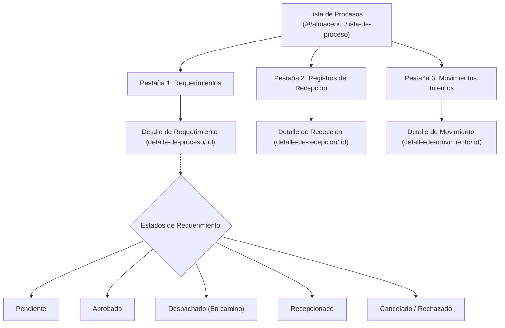
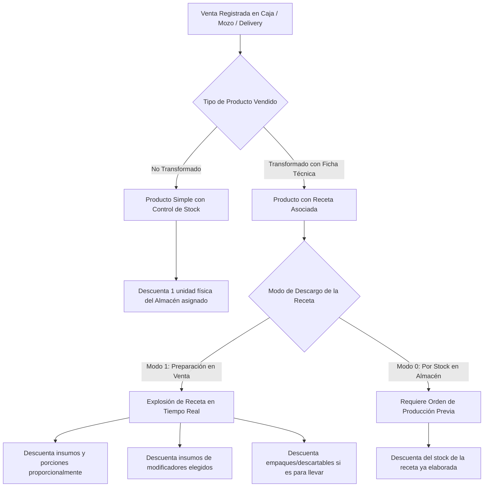
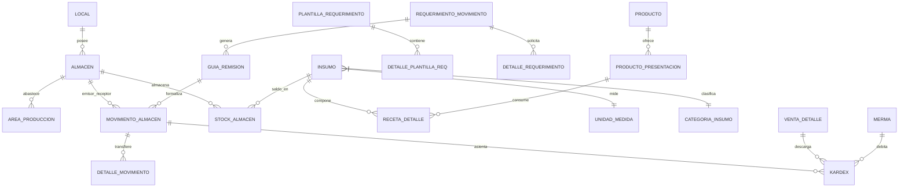

# Módulo de Almacén: Stock, Movimientos Internos, Requerimientos, Recepción y Control de Recetas

**Sistema**: Restaurant.pe (Instancia de Producción: CAPRICHOS - Lima, Perú)  
**URL de Producción**: `https://caprichos.restaurant.pe/restaurant/#!/login`  
**Usuario de Auditoría**: `krosales`  
**Modalidad**: SOLO LECTURA estricto en entorno de PRODUCCIÓN en operación activa.  
**Fecha de Inspección**: 2026-10-13  
**Documento Generado**: `/home/jose/JoseEM/caprichos/web-anterior/administrativo/modulos/almacen.md`  

---

## 1. Resumen Ejecutivo y Alcance del Módulo

El macro-módulo de **Almacén** constituye la columna vertebral de la gestión logística, control de inventarios y costeo operativo de la cafetería CAPRICHOS. Gobierna la trazabilidad completa de los recursos alimentarios y descartables: desde la recepción de mercadería y solicitudes de abastecimiento entre sucursales/cocina central, hasta las transferencias físicas entre almacenes internos, control de mermas, kárdex y el descargo automático de materias primas impulsado por las ventas en el punto de venta (POS) y carta digital según las fichas técnicas/recetas.

El presente reporte consolida la auditoría técnica y estructural de las 5 pantallas prioritarias del módulo y sus componentes complementarios:
1. **Movimiento Interno** (`#!/almacen/requerimientomovimiento/requerimientos/movimiento`)
2. **Requerimiento** (`#!/almacen/requerimientomovimiento/requerimientos/nuevo-requerimiento`)
3. **Recepción** (`#!/almacen/requerimientomovimiento/requerimientos/nuevo-recepcion`)
4. **Lista de Procesos** (`#!/almacen/requerimientomovimiento/requerimientos/lista-de-proceso`)
5. **Stock / Existencias y Stock Bajo** (`#!/almacen/stock`)
6. **Almacenes y Producción (Ajustes)** (`#!/ajustes/produccion`)
7. **Kárdex de Almacén y Mermas** (`#!/almacen/kardex`, `#!/almacen/merma`)

> [!IMPORTANT]
> **Garantía de Solo Lectura y Confidencialidad**: Toda la recolección se efectuó mediante inspección pasiva en vivo con Playwright sobre la sesión de `krosales`, complementada con el análisis estático exhaustivo del frontend bundle minificado (`scripts.9fdb592e.js` / `$templateCache`) y las declaraciones de servicios REST de AngularJS. No se creó, modificó ni eliminó ningún requerimiento, guía, movimiento ni stock. Todos los nombres de clientes, empleados, costos reales y documentos tributarios han sido omitidos o sustituidos por estructuras genéricas.

---

## 2. Pantalla 1: Movimiento Interno (`#!/almacen/requerimientomovimiento/requerimientos/movimiento`)

### 2.1 Propósito
Permite registrar traslados físicos de mercadería entre dos almacenes de la empresa (por ejemplo: del *Almacén Principal / Bodega* hacia el almacén satélite de *Barra*, *Pastelería* o *Cocina*). Para evitar digitaciones manuales repetitivas en cada turno, el sistema opera bajo un **paradigma de plantillas preconfiguradas**: se seleccionan o crean plantillas estándar y luego se procesa el canje formal del movimiento.

### 2.2 Flujo de Uso Paso a Paso
1. **Acceso a la Pantalla**:
   - El usuario ingresa a `#!/almacen/requerimientomovimiento/requerimientos/movimiento`.
   - La pantalla se presenta dividida en dos paneles: panel izquierdo (30% de ancho) con la lista de plantillas y panel derecho (70% de ancho) con el detalle o resumen de la plantilla seleccionada.
2. **Búsqueda o Selección de Plantilla**:
   - En el panel izquierdo, el usuario puede buscar plantillas existentes en el campo `Buscar plantillas registradas`.
   - Cada tarjeta de plantilla muestra: Nombre de la plantilla (`avancemovimiento_nombre`), Almacén Origen con flecha hacia Almacén Destino (`almacenOrigen -> almacendestino`), y botones de acción rápida para *Editar* o *Eliminar*.
3. **Creación de Nueva Plantilla (Opcional)**:
   - Al pulsar el botón azul con icono `+` (`vm.fnModalregistroplantilla()`), se despliega el modal `modal-plantilla-movimiento.view.html`:
     - Se ingresa el **Nombre de plantilla** (ej. "Reabastecimiento Barra Mañana").
     - Se selecciona el **Almacén Origen** (*Desde*) y **Almacén Destino** (*Hacia*).
     - Se ingresa el **Encargado del envío** y **Receptor del envío**.
     - Se pulsa **Agregar ítems**, abriendo el selector multi-pestaña para añadir Productos terminados, Insumos o Recetas base, especificando la cantidad estándar a transferir y su presentación (unidad de medida).
     - Se pulsa **Registrar plantilla**.
4. **Visualización del Resumen**:
   - Al hacer clic sobre una tarjeta de plantilla, el panel derecho carga el `Resumen de movimiento: “[Nombre]”`.
   - Se despliegan 3 bloques según los tipos de ítems que contenga la plantilla:
     - **Productos**: Ítems, Categoría, Cantidad a mover, Presentación.
     - **Insumos**: Ítems, Categoría, Cantidad a mover, Presentación.
     - **Recetas**: Ítems, Categoría, Cantidad a mover, Presentación.
5. **Ejecución del Movimiento**:
   - Con la plantilla activa, se habilita en la esquina inferior derecha el botón **Usar esta plantilla** (`vm.fnModalenviarrequerimiento()`).
   - Abre el modal de canje `modal-canje-movimiento-interno.view.html`:
     - Permite ajustar los encargados de envío/recepción.
     - Muestra la tabla de cantidades prellenadas, permitiendo al operador ajustar las cantidades que efectivamente saldrán en ese despacho.
     - Pulsa **Guardar movimiento**.
   - El sistema descuenta el stock en el almacén de origen e incrementa el stock en el almacén de destino de forma atómica.

### 2.3 Estructura de Interfaz y Formularios

#### A. Panel Principal (`movimientointerno.html`)
| Control / Elemento | Tipo | Modelo Angular | Descripción / Regla |
| :--- | :--- | :--- | :--- |
| **Búsqueda de Plantillas** | `<input type="text">` | `vm.busquedaPlantilla` | Filtro reactivo en el cliente sobre `vm.listaPlantillas`. Placeholder: *"Buscar plantillas registradas"*. |
| **Nueva Plantilla** | `<button class="btn btn-primary">` | `vm.fnModalregistroplantilla()` | Botón cuadrado con icono `fa-plus-circle` para abrir modal de registro. |
| **Tarjeta de Plantilla** | Contenedor repetido | `ng-repeat="plantilla in vm.listaPlantillas"` | Despliega nombre, origen, destino, botón `Editar` y botón papelera `Eliminar`. |
| **Bloque Productos** | Grilla Flexbox | `vm.detalle_productos` | Columnas: `Ítems` (60%), `Categoría` (20%), `Cantidad a mover` (20%), `Presentación` (20%). |
| **Bloque Insumos** | Grilla Flexbox | `vm.detalle_insumos` | Columnas: `Ítems` (60%), `Categoría` (20%), `Cantidad a mover` (20%), `Presentación` (20%). |
| **Bloque Recetas** | Grilla Flexbox | `vm.detalle_recetas` | Columnas: `Ítems` (60%), `Categoría` (20%), `Cantidad a mover` (20%), `Presentación` (20%). |
| **Usar esta plantilla** | `<button class="btn btn-primary">` | `vm.fnModalenviarrequerimiento()` | Botón principal de pie de página para proceder al canje real. |

#### B. Modal de Registro de Plantilla (`modal-plantilla-movimiento.view.html`)
| Campo | Tipo | Modelo Angular | Obligatorio | Opciones / Validación |
| :--- | :--- | :--- | :--- | :--- |
| **Nombre de plantilla** | `<input text>` | `vm.movimientoalmacen.movimiento_nombre` | Sí | Nombre descriptivo del grupo de ítems. |
| **Almacén Origen (Desde)** | `<ui-select>` | `vm.almacenOrigenSeleccionado` | Sí | Lista de almacenes del local emisor. |
| **Almacén Destino (Hacia)** | `<ui-select>` | `vm.almacenDestinoSeleccionado` | Sí | Lista de almacenes del local receptor (no puede ser igual a origen). |
| **Encargado del envío** | `<input text>` | `vm.movimientoalmacen.movimiento_encargado` | No | Nombre del responsable que despacha. |
| **Receptor del envío** | `<input text>` | `vm.movimientoalmacen.movimiento_receptor` | No | Nombre del responsable que recepciona. |
| **Pestañas de Ítems** | Toggle Tabs | Insumo / Producto / Receta | Sí | Clasifica el tipo de recurso que se agregará. |
| **Cantidad** | `<input number>` | `item.detallemovimiento_cantidad` | Sí | Monto numérico mayor a cero. |
| **Presentación** | `<select>` | `item.detallemovimiento_um` | Sí | Unidad de medida base o presentación configurada. |

### 2.4 Endpoints GET y Servicios Asociados
- `GET /restaurant/api/rest/movimiento/obtenerUltimosAvancesMovimientosPorLocal/:localId/:pagina/:registros` (Retorna listado de plantillas/avances de movimiento configurados).
- `GET /restaurant/api/rest/almacen/getAllByLocalId/:localId/1/0/0` (Retorna catálogo de almacenes activos del local).
- `GET /restaurant/api/rest/movimiento/obtenerAvanceMovimiento/:idAvance` (Retorna ítems y cantidades de una plantilla seleccionada).

---

## 3. Pantalla 2: Requerimiento (`#!/almacen/requerimientomovimiento/requerimientos/nuevo-requerimiento`)

### 3.1 Propósito
Permite que un local o área de producción elabore un **pedido formal de abastecimiento** dirigido a otra sucursal o al almacén central. Sigue el mismo modelo ergonómico de dos etapas: configuración de plantillas fijas (ej. "Requerimiento diario de cafetería", "Frutas y verduras fin de semana") y generación periódica del pedido real con fecha de necesidad.

### 3.2 Flujo de Uso Paso a Paso
1. **Acceso**:
   - Navegación a `#!/almacen/requerimientomovimiento/requerimientos/nuevo-requerimiento`.
   - Si no existen plantillas registradas, se exhibe el estado vacío (*empty state*): *"No se encuentran plantillas registradas. Para realizar un requerimiento primero debes registrar una plantilla."* junto al botón central `Registrar plantilla`.
2. **Definición de la Plantilla de Requerimiento**:
   - Al pulsar `Registrar plantilla`, abre `modal-registrar-plantilla.view.html`:
     - Digita el nombre (ej. "Requerimiento Lácteos y Jarabes").
     - **¿A qué sucursal se le solicita el requerimiento?**: Se escoge la sucursal proveedora / almacén central.
     - Se registran nombres de Encargado y Receptor.
     - Se añaden ítems (Productos, Insumos, Recetas) con su cantidad requerida estándar.
3. **Selección y Revisión de Plantilla**:
   - En la vista principal, el usuario hace clic en una plantilla de la lista lateral.
   - En el panel derecho se detalla el listado agrupado:
     - *Productos*: Ítems, Cant. requerida, Presentación.
     - *Insumos*: Ítems, Cant. requerida, Presentación.
     - *Recetas*: Ítems, Cant. requerida, Presentación.
4. **Envío del Requerimiento a Destino**:
   - Se pulsa el botón **Usar esta plantilla**.
   - Se despliega el modal `modal-canjear-requerimiento.view.html`:
     - Se define obligatoriamente la **Fecha de abastecimiento** (fecha estimada en la que se necesita contar con los ítems).
     - Se corroboran las sucursales involucradas.
     - El usuario revisa cada ítem y puede modificar puntualmente las cantidades según la necesidad real del día.
     - Se pulsa **Enviar requerimiento**.
   - El requerimiento queda registrado en estado `Pendiente` en la Lista de Procesos y viaja a la cola de atención del almacén abastecedor.

### 3.3 Estructura de Formularios y Validaciones
| Campo | Tipo | Modelo Angular | Regla de Negocio / Validación |
| :--- | :--- | :--- | :--- |
| **Nombre de plantilla** | `<input text>` | `vm.requerimientomovimiento.requerimientomovimiento_nombreplantilla` | Obligatorio. Identifica el requerimiento rutinario. |
| **Sucursal Destino** | `<ui-select>` | `vm.localDestinoSeleccionado` | Obligatorio. Local al que se remite el pedido. |
| **Fecha de abastecimiento** | `<input date / datepicker>` | `vm.requerimientomovimiento.fecha_abastecimiento` | Obligatorio al enviar requerimiento. No puede ser una fecha pasada. |
| **Encargado del requerimiento** | `<input text>` | `vm.requerimientomovimiento.requerimientomovimiento_encargado` | Opcional / trazabilidad de personal. |
| **Receptor del requerimiento** | `<input text>` | `vm.requerimientomovimiento.requerimientomovimiento_receptor` | Opcional / trazabilidad de entrega. |
| **Cantidad de cada Ítem** | `<input number>` | `item.item_cantidad` | Requerido, mayor a 0. |

### 3.4 Endpoints GET y Servicios Asociados
- `GET /restaurant/api/rest/requerimientomovimiento/obtenerPlantillaRequerimientoPorLocal/:encodedQuery` (Obtiene plantillas de requerimiento para el local logueado).
- `GET /restaurant/api/rest/requerimientomovimiento/obtenerPlantillaFormatoRequerimiento/:idPlantilla` (Retorna desglose de productos/insumos asociados a la plantilla).

---

## 4. Pantalla 3: Recepción (`#!/almacen/requerimientomovimiento/requerimientos/nuevo-recepcion`)

### 4.1 Propósito
Permite al personal del almacén receptor (ej. encargado de cafetería o cocina) dar ingreso formal al inventario cuando llega el pedido físico despachado por el almacén central o sucursal proveedora. La recepción **no se hace a ciegas**: se concilia contra una **Guía Interna de Remisión** vinculada al requerimiento previo que se encuentra en tránsito (*En camino*).

### 4.2 Flujo de Uso Paso a Paso
1. **Acceso**:
   - Navegación a `#!/almacen/requerimientomovimiento/requerimientos/nuevo-recepcion`.
2. **Exploración de Guías Pendientes**:
   - En el panel izquierdo se listan las guías en ruta bajo el formato: `Guía interna [SERIE] - [CORRELATIVO]`.
   - Si no existen envíos pendientes, la interfaz notifica: *"No se encuentran requerimientos pendientes. Verifica que el estado de tus requerimientos estén 'En camino'"*.
3. **Inspección de la Carga Despachada**:
   - Al seleccionar una guía, el panel derecho muestra el `Resumen de la guía: “Guía [ID]”`.
   - Se despliegan 4 categorías exhaustivas:
     - **Productos**
     - **Insumos**
     - **Recetas**
     - **Derivados** (cortes o despieces procesados)
   - Columnas visibles: `Ítems`, `Cantidad a mover` (enviada desde origen), `Cant. recibida` (vacía o sugerida) y `Presentación`.
4. **Cotejo Físico y Registro de Ingreso**:
   - Se pulsa el botón **Realizar registro** (`vm.fnModalCanjearRequerimiento()`).
   - Se abre el modal `modal-canje-guia-remision-mov.view.html`:
     - **Paso 1**: Confirma la **Fecha de abastecimiento** y selecciona el **Almacén de recepción** de destino local.
     - **Paso 2**: Confirmación de ítems recibidos:
       - Incorpora una casilla rápida (*checkbox*): *"Haz clic en las casillas en caso de que la cantidad recibida sea igual a la solicitada"*.
       - Si una cantidad llegó incompleta, dañada o con mermas de transporte, el operador desmarca la casilla y digita la cantidad real que ingresa al almacén.
     - Se pulsa **Finalizar registro**.
   - Al completar el registro, el sistema genera el movimiento de entrada en el kárdex del almacén receptor, cambia el estado del proceso a `Recepcionado` y cierra el ciclo de traslado.

### 4.3 Estructura de Interfaz y Formularios
| Control | Tipo | Modelo Angular | Función |
| :--- | :--- | :--- | :--- |
| **Buscar guías** | `<input text>` | `vm.busquedaRequerimiento` | Filtro reactivo en el listado izquierdo de guías. |
| **Fecha abastecimiento** | `<input date>` | `vm.movimiento.fecha_abastecimiento` | Fecha efectiva de recepción física. |
| **Almacén de recepción** | `<ui-select>` | `vm.almacenRecepcionSeleccionado` | Almacén físico donde ingresará el stock. |
| **Check de Coincidencia**| `<input checkbox>` | Directiva rápida | Setea `item_recibido = item_enviado` automáticamente. |
| **Cantidad Recibida** | `<input number>` | `item.item_cantidad` | Cantidad real que entra a bodega (permite discrepancias). |
| **Finalizar registro** | `<button class="btn btn-primary">` | `vm.guardarRecepcion()` | Confirma el ingreso en almacén. |

### 4.4 Endpoints GET y Servicios Asociados
- `GET /restaurant/api/rest/guia/getAllByLocalIdAndProveedorAndTipoAndFechas/...` (Consulta guías asociadas al local).
- `GET /restaurant/api/rest/requerimientomovimiento/obtenerSoloDetalleRequerimientoPorId/:id/:localId/:estado` (Retorna ítems de la guía para conciliar).

---

## 5. Pantalla 4: Lista de Procesos (`#!/almacen/requerimientomovimiento/requerimientos/lista-de-proceso`)

### 5.1 Propósito
Funciona como el **centro de monitoreo y auditoría histórica** de todo el ciclo de vida logístico. Consolida en una sola pantalla con pestañas dinámicas todos los requerimientos emitidos, las recepciones registradas y las transferencias internas procesadas.

### 5.2 Estructura de Pestañas y Vistas

#### A. Pestaña 1: Requerimientos (`tap-requerimiento.view.html`)
- **Propósito**: Supervisar las solicitudes enviadas a otras sucursales o a cocina central.
- **Barra de Acciones Superior**:
  - `Nuevo requerimiento` (redirección rápida a la creación).
  - `Filtro de búsqueda` (lanza modal `modal-filtro-requerimiento.view.html` con selectores de Rango de Fechas, Local Destino y Estado).
- **Columnas de la Tabla**:
  1. `Requerimiento` (Código `#ID`).
  2. `Solicitado a` (Nombre del local proveedor).
  3. `Fecha de registro` (`DD/MM/YYYY`).
  4. `Cant. de ítems` (Total de líneas solicitadas).
  5. `Estado` (Badge visual según ciclo de vida).
  6. `Acciones` (Botón `Ver detalle`).
- **Estados Visibles del Ciclo de Vida**:
  - `Pendiente`: *"Tu requerimiento se encuentra pendiente. Te notificaremos cuando este sea aprobado."*
  - `Aprobado`: *"Tu requerimiento fue aprobado. Te notificaremos cuando esté en camino."*
  - `Despachado`: *"Tu requerimiento está en camino. Una vez haya llegado, verifica los ítems que solicitaste y añádelos a un registro de entrega."*
  - `Recepcionado`: *"Tu requerimiento fue recepcionado. A continuación se mostrará el registro de entrega realizado para tu requerimiento."*
  - `Cancelado`: *"Tu requerimiento fue cancelado o rechazado. Te recomendamos hablar con un supervisor."*
- **Vista de Detalle (`proceso-detalle.view.html`)**:
  - Muestra cabecera: `# Requerimiento`, `Solicitado a`, `Fecha de abastecimiento`, `Encargado`, `Receptor`.
  - Tablas agrupadas de Ítems solicitados (Productos, Insumos, Recetas) con columnas: `Ítems`, `Cantidad de ingreso` (solicitada) y `Presentación`.

#### B. Pestaña 2: Registros de Recepción (`tab-recepcion.view.html`)
- **Propósito**: Auditoría de los ingresos físicos concretados tras la llegada de guías.
- **Barra de Acciones**: `Nuevo registro`, `Filtro de búsqueda` (Rango de fechas, Local, Almacén Origen, Almacén Destino).
- **Columnas de la Tabla**:
  1. `Registros de recepción` (Número identificador).
  2. `Enviado por` (Local / Almacén remitente).
  3. `Fecha de recepción`.
  4. `Ítems solicitados`.
  5. `Ítems entregados`.
  6. `Acciones` (`Ver detalle`).
- **Vista de Detalle (`recepcion-detalle.view.html`)**:
  - Desglosa Ítems recibidos con: `Ítems`, `Categoría`, `Cantidad movida`, `Presentación` divididos en Productos, Insumos, Recetas y Derivados.

#### C. Pestaña 3: Movimientos Internos (`tab-movimiento.view.html`)
- **Propósito**: Histórico de traslados físicos entre almacenes locales.
- **Barra de Acciones**: `Nuevo movimiento`, `Filtro de búsqueda`.
- **Columnas de la Tabla**:
  1. `Movimiento` (`Movimiento interno #ID`).
  2. `Desde` (Almacén origen).
  3. `Hacia` (Almacén destino).
  4. `Fecha del mov.`.
  5. `Ítems transferidos`.
  6. `Acciones` (`Ver detalle`).

### 5.3 Endpoints GET y Servicios Asociados
- `GET /restaurant/api/rest/requerimientomovimiento/listarporpaginacion/:localId/:estado/:fechaInicio/:fechaFin/:pagina/:registros` (Consulta paginada de requerimientos).
- `GET /restaurant/api/rest/movimiento/obtenerUltimosMovimientosPorLocal/:localId/:pagina/:registros` (Consulta histórica de movimientos y recepciones).
- `GET /restaurant/api/rest/requerimientomovimiento/obtenerResumenProcesoRequerimiento/:idRequerimiento` (Carga la trazabilidad completa del requerimiento para el detalle).

---

## 6. Pantalla 5: Stock / Existencias y Stock Bajo (`#!/almacen/stock`)

### 6.1 Propósito
Es el monitor integral del inventario valorizado y físico en tiempo real. Permite al administrador o jefe de compras monitorear las existencias por almacén, detectar quiebres de inventario mediante el filtro de **Stock Bajo**, identificar excesos sobre el stock máximo y generar automáticamente órdenes de compra hacia proveedores.

### 6.2 Flujo de Uso Paso a Paso
1. **Ingreso**:
   - Navegación directa a `#!/almacen/stock` (notificada en la cabecera del sistema: *"Desde ahora puedes ver los artículos con stock bajo desde Almacén/stock"*).
2. **Aplicación de Filtros**:
   - El usuario puede filtrar por:
     - Texto libre: Campo `Filtrar o buscar un insumo o producto` (`vm.productoFiltro`).
     - Checkbox **Artículos con stock bajo** (`vm.debajoStock = '1'`).
     - Checkbox **Artículos con stock por encima del máximo** (`vm.arribaStock = '1'`).
     - Checkbox **Solo con stock positivo**.
     - Desplegables de **Local** y **Almacén** específico.
3. **Generación del Informe**:
   - Pulsa el botón **Generar informe** (o presiona la tecla `ENTER` en el campo de búsqueda).
   - El sistema realiza la consulta a la API de solo lectura `/restaurant/readonly/rest/stock/obtenerStock/...`.
4. **Interpretación de Columnas**:
   - Analiza el `Stock total`, las cantidades desglosadas por almacén (en CAPRICHOS: *Almacen Principal*), el `Stock Mínimo req.`, `Stock Máximo req.` y la columna calculada de `Faltante`.
5. **Acciones Operativas**:
   - **Generar orden compra**: Al pulsar este botón con ítems bajo stock mínimo, el sistema recopila los faltantes y abre el flujo del módulo de compras para prellenar órdenes de compra a proveedores habituales.
   - **Descargar**: Exporta el listado visible a formatos Microsoft Excel (.xlsx) o CSV.

### 6.3 Columnas de la Tabla de Stock
| Columna | Significado / Comportamiento |
| :--- | :--- |
| **Producto / Insumo** | Denominación del ítem y código asignado. |
| **Tipo** | Distingue entre: `Insumo`, `Producto` (terminado/no transformado), `Receta` o `Descartable`. |
| **Categoría** | Categoría gastronómica o logística (ej. Bebidas, Carnes, Verduras, Empaques). |
| **Almacenes** | Indicador de almacenes donde tiene presencia. |
| **Stock total** | Saldo consolidado sumando todos los almacenes del local. |
| **Almacen Principal** | Saldo físico específico en el almacén principal. |
| **Stock** | Stock actual en la unidad de medida principal (KG, LT, UNID, etc.). |
| **Mínimo req. / Máximo req.**| Umbrales de seguridad fijados en la ficha técnica del insumo o producto. |
| **Faltante** | Diferencia matemática calculada (`Mínimo req. - Stock actual`). Indica la necesidad de compra. |

### 6.4 Botones y Acciones Disponibles
- `Generar informe` (`vm.fnGenerarInformeStock()`): Ejecuta la consulta con los filtros seleccionados.
- `Generar orden compra` (`vm.fnGenerarOrdenCompra()`): Prepara solicitud de reabastecimiento en compras.
- `Descargar` (`vm.fnDescargarStock()`): Exportación del inventario a Excel.
- `Buscar ( ENTER )`: Disparo rápido de consulta.

### 6.5 Endpoints GET y Servicios Asociados
- `GET /restaurant/readonly/rest/stock/obtenerStock/:localId/:almacenId/:categoriaId/:tipoInsumo/:pagina/:tamanoPagina/:debajoStock/:arribaStock/:conStock`  
  *(Endpoint principal optimizado para réplicas de lectura de MariaDB MaxScale. Retorna array de ítems con sus existencias, stocks mínimos/máximos y categorías)*.
- `GET /restaurant/readonly/rest/stock/asignarControlATodosLosInsumosProductos/:localId` (Verifica si todos los insumos tienen bandera de control activa).
- `GET /restaurant/api/rest/logistica/pendienteProcesoStock/:localId/:fechaInicio/:fechaFin` (Consulta si existen órdenes de producción o ventas con cómputo de stock pendiente).

---

## 7. Pantallas Complementarias e Infraestructura de Almacén

### 7.1 Almacenes y Producción en Ajustes (`#!/ajustes/produccion`)
- **Propósito**: Administración de los almacenes físicos y de las áreas de elaboración en cocina/barra.
- **Inspección en Vivo**: La cuenta `krosales` tiene acceso completo a esta pantalla.
- **Estructura Observada**:
  - **Tabla 1: Áreas de Producción**:
    - Columnas: `Nombre`, `Almacén`, `Impresora`, `¿Imprime comandas?`, `Estado`, `Acciones`.
    - Botones: `Nueva área de producción`, `Editar`.
  - **Tabla 2: Almacenes**:
    - Columnas: `Nombre`, `Estado`, `Acciones`.
    - Botones: `Nuevo Almacén` (abre modal `almacen-modal.html` con campo `Nombre`, validación mínima de 3 letras y estado Activo/Inactivo).
- **Endpoints Utilizados**:
  - `GET /restaurant/api/rest/almacen/getAllByLocalYEstadoPaginado/1/-1/1/10`
  - `GET /restaurant/api/rest/areaproduccion/getAllByLocalId/1/-1/1/10`

### 7.2 Kárdex de Almacén (`#!/almacen/kardex/individual`)
- **Propósito**: Libro mayor y trazabilidad cronológica de entradas, salidas y saldos de cada insumo o producto.
- **Variantes de Consulta**:
  - `Kardex individual`: Movimientos detallados de un único insumo seleccionado en un rango de fechas.
  - `Kardex general`: Visión consolidada mensual por almacén y categoría.
  - `Kardex avanzado`: Auditoría profunda con costeo valorizado y discriminación de impuestos.
- **Campos y Filtros**:
  - Rango de fechas (`Del 01 Octubre, 2026 hasta 13 Octubre, 2026`).
  - `Buscar un insumo, descartable o producto`.
  - `Motivo/movimiento` (obtenido vía `GET /restaurant/readonly/rest/movimientoalmaceninsumo/getMotivosKardex`).
  - `Almacén` receptor o emisor.
- **Hallazgo Crítico Detectado en DOM**:
  - En el encabezado del kárdex se renderiza una advertencia operativa:  
    `"Actualmente cuenta con ({{vm.ventasPorProcesar}}) Ventas entre el {{vm.f1}} y el {{vm.f2}} pendientes de procesar para el kardex"`.
  - Esto evidencia que el sistema ejecuta un procesamiento batch/asíncrono de cálculo de salidas por ventas en segundo plano antes de consolidar el kárdex definitivo.

### 7.3 Mermas de Almacén (`#!/almacen/merma`)
- **Propósito**: Registrar y justificar pérdidas de materia prima por descomposición, vencimiento, roturas o manipulación indebida en cocina.
- **Comportamiento en Producción**:  
  Al navegar pasivamente a `#!/almacen/merma`, el sistema redirige automáticamente a `#!/accesorestringido` mostrando *"Hola, krosales"*. Esto confirma que la cuenta de auditoría carece del permiso de seguridad `almacen.movimientoalmacen` necesario para ver o registrar mermas.
- **Estructura Identificada en Plantillas (`merma.html` y `merma-nuevo.html`)**:
  - Columnas de la tabla: `Local`, `Usuario`, `Tipo`, `Razón`, `Fecha registro`, `Fecha`, `Importe`, `Estado`, `Acciones`.
  - Botones: `Registrar salida`, `Generar informe`.
  - Campos de registro: Almacén de salida, Insumo/Producto, Cantidad mermada, Motivo de merma (Vencido, Caído, Mal estado, Merma de elaboración), Costo estimado imputado.

---

## 8. Arquitectura de Insumos, Recetas y Descuento de Stock por Ventas

Uno de los requerimientos centrales para replicar el sistema en CAPRICHOS es modelar cómo interactúan los insumos con las ventas del POS y cocina. A partir de la auditoría combinada del módulo de Almacén y el maestro de Productos, se extraen las siguientes reglas de negocio:

### 8.1 Maestro de Insumos y Unidades de Medida
1. **Tipos de Insumo (`tipoinsumo`)**:
   - `1 - Insumo Directo`: Materia prima pura comprada a proveedores (ej. Café en grano, Leche fresca, Harina, Huevos).
   - `2 - Receta Base / Sub-receta`: Preparaciones intermedias elaboradas en cocina que no se venden solas pero componen platos (ej. Jarabe de goma, Salsa blanca, Masa de queque, Crema chantilly).
   - `3 - Porcionable`: Insumos comprados a granel que se fraccionan en porciones unitarias estandarizadas (ej. Queso en bloques fraccionado en porciones de 50g).
2. **Unidades de Medida y Conversiones**:
   - Cada insumo posee una **Unidad de Medida Base** (`unidadmedidainsumo_id`: KG, LT, UNID, GR, ML).
   - Se admite una matriz de conversiones: el insumo se compra en bolsas de 5 KG, se almacena en KG y las recetas lo consumen en GR o ML.
3. **Mermas en Compras**:
   - El insumo admite `% Merma` automático al registrar compras para ajustar el costo unitario real al rendimiento neto.

### 8.2 Mecánica de Descuento de Stock según Modalidad de Producto

#### Modalidad 1: Descuento Directo (Productos No Transformados)
- Aplicable a bebidas embotelladas, snacks empacados, alfajores comprados listos.
- Parámetro: `producto_controlstock = 1`.
- Regla: La venta de una unidad descuenta directamente 1 unidad física del almacén configurado para el producto. Si `producto_restriccionporstock = 1`, el sistema impide cobrar en el POS si el saldo es cero.

#### Modalidad 2: Explosión de Receta en Tiempo Real (`Modo de descargo = 1`)
- Aplicable a bebidas de cafetería (capuchinos, espressos, jugos) y platos preparados al momento.
- Parámetro en receta: `producto_mododescargo = 1` (*Por preparación en venta*).
- Regla: Al cobrarse el pedido o imprimirse en cocina, el sistema ejecuta la "explosión de la receta" (*Bill of Materials*):
  - Descuenta la cantidad exacta de cada ingrediente del almacén de producción asignado (ej. 1 Capuchino descuenta 18 g de café espresso molido y 180 ml de leche entera).
  - Si el cliente eligió un modificador con costo/insumo (ej. "Leche de almendras"), no descuenta leche entera sino los 180 ml de leche de almendras.
  - Si el pedido es para llevar o delivery, descuenta automáticamente los descartables asignados (vaso térmico, tapa y faja de cartón).

#### Modalidad 3: Descuento por Lote de Producción Previa (`Modo de descargo = 0`)
- Aplicable a repostería, queques, tortas y bases de cocina elaboradas con anticipación.
- Parámetro: `producto_mododescargo = 0` (*Por stock en almacén*).
- Regla:
  1. En el módulo de Almacén se ejecuta previamente la **Preparación de Receta** (`#!/almacen/preparacionreceta/lista` o `OrdenProduccionCtrl`).
  2. Al ejecutar la preparación, se descargan los insumos crudos del almacén y se da de alta un saldo positivo del plato/porción terminado.
  3. En el momento de la venta en cafetería, la venta descuenta las unidades existentes del producto terminado, sin recalcular los insumos crudos.

#### Modalidad 4: Procesamiento Asíncrono de Kárdex
- Las ventas impactan inmediatamente en los saldos lógicos de disponibilidad para evitar sobreventas.
- Sin embargo, la valorización formal de costos y movimientos de kárdex corre mediante una tarea programada (`logistica/pendienteProcesoStock`), permitiendo conciliar costos promedio ponderados sin degradar el rendimiento del POS durante horas pico.

---

## 9. Modelo de Entidades de Datos

A partir de los modelos observados en el bundle AngularJS y las llamadas a la API REST, se infiere el siguiente modelo relacional:

### Campos Clave por Entidad:
1. `almacen`: `almacen_id` (PK), `local_id` (FK), `almacen_nombre`, `almacen_estado`.
2. `areaproduccion`: `areaproduccion_id` (PK), `almacen_id` (FK), `areaproduccion_nombre`, `impresora_id` (FK), `areaproduccion_imprimecomanda`.
3. `insumo`: `insumo_id` (PK), `insumo_nombre`, `insumo_codigo`, `insumo_tipo` (1: Directo, 2: Receta, 3: Porcionable), `unidadmedida_id` (FK), `categoriainsumo_id` (FK), `insumo_merma` (% merma).
4. `plantillarequerimiento` / `avancemovimiento`: `plantilla_id` (PK), `plantilla_nombre`, `local_origen_id`, `local_destino_id`, `almacen_origen_id`, `almacen_destino_id`.
5. `requerimientomovimiento`: `requerimientomovimiento_id` (PK), `local_origen_id`, `local_destino_id`, `requerimientomovimiento_fecha`, `requerimientomovimiento_fecharecepcion`, `requerimientomovimiento_estado` (`Pendiente`, `Aprobado`, `Despachado`, `Recepcionado`, `Cancelado`).
6. `movimientoalmacen`: `movimiento_id` (PK), `almacen_origen_id`, `almacen_destino_id`, `movimiento_fecha`, `movimiento_encargado`, `movimiento_receptor`.
7. `guiaremision`: `guiaremision_id` (PK), `guiaremision_serie`, `guiaremision_correlativo`, `guiaremision_fecha`, `guiaremision_estado`.
8. `merma`: `merma_id` (PK), `local_id`, `usuario_id`, `almacen_id`, `merma_tipo`, `merma_razon`, `merma_fecha`, `merma_importe`, `merma_estado`.
9. `kardex`: `kardex_id` (PK), `insumo_id` / `producto_id`, `almacen_id`, `fecha`, `motivo_id`, `tipo_movimiento` (Entrada/Salida), `cantidad`, `costo_unitario`, `saldo_cantidad`, `saldo_valorizado`.

---

## 10. Relaciones con Otros Módulos

- **Módulo de Productos (`#!/productos`)**: Almacén consume la base de platos, presentaciones y recetas para determinar qué insumos existen, sus unidades de medida y sus relaciones de costo.
- **Módulo de Ventas y Caja (`#!/ventas`, `#!/caja`)**: Cada comanda cerrada en salón, mostrador o delivery detona el descargo de inventario y alimenta la cola de kárdex (`pendienteProcesoStock`).
- **Módulo de Compras (`#!/compras`)**: Cuando el stock baja del umbral mínimo, el botón `Generar orden compra` en Almacén transfiere la lista de faltantes directamente al módulo de compras para generar pedidos a proveedores.
- **Módulo de Cocina / KDS (`#!/ventas/ver-pedidos/estado`)**: Las áreas de producción vinculadas a almacenes reciben las comandas correspondientes para preparación.
- **Ajustes del Sistema (`#!/ajustes/produccion`)**: Define la topología física de almacenes e impresoras de comandas.

---

## 11. Endpoints GET y APIs Observadas

Durante la auditoría pasiva en vivo y el análisis de los controladores, se identificaron los siguientes endpoints esenciales:

| Método | Endpoint | Parámetros / Propósito | Forma de Respuesta Resumida |
| :--- | :--- | :--- | :--- |
| `GET` | `/restaurant/readonly/rest/stock/obtenerStock/...` | `localId/almacenId/categoriaId/tipoInsumo/pagina/limite/debajoStock/arribaStock/conStock` | Array de ítems con `id`, `nombre`, `tipo`, `categoria`, `stock_total`, `stock_almacen`, `stock_minimo`, `stock_maximo`. |
| `GET` | `/restaurant/api/rest/almacen/getAllByLocalId/...` | `localId/estado/todos/orden` | Lista de almacenes del local con su ID y nombre. |
| `GET` | `/restaurant/api/rest/areaproduccion/getAllByLocalId/...` | `localId/estado/pagina/registros` | Lista de áreas de cocina/barra asociadas a almacenes. |
| `GET` | `/restaurant/api/rest/categoriainsumo/categoriainsumo/all` | Catálogo de categorías de materias primas | Array de objetos `{ categoriainsumo_id, categoriainsumo_descripcion }`. |
| `GET` | `/restaurant/api/rest/movimiento/obtenerUltimosAvancesMovimientosPorLocal/...` | `localId/pagina/registros` | Lista de plantillas de movimiento configuradas. |
| `GET` | `/restaurant/api/rest/requerimientomovimiento/listarporpaginacion/...` | `localId/estado/f1/f2/pagina/registros` | Requerimientos filtrados con estado y cantidad de ítems. |
| `GET` | `/restaurant/api/rest/requerimientomovimiento/obtenerResumenProcesoRequerimiento/:id` | `idRequerimiento` | Trazabilidad del requerimiento e ítems solicitados. |
| `GET` | `/restaurant/readonly/rest/movimientoalmaceninsumo/getMotivosKardex` | Catálogo de motivos para filtros de kárdex | Array de motivos: Ventas, Compras, Traslados, Ajustes, Mermas. |
| `GET` | `/restaurant/readonly/rest/merma/listarporpaginacion/...` | `pagina/limite/f1/f2/localId` | Histórico paginado de mermas registradas. |
| `GET` | `/restaurant/api/rest/logistica/pendienteProcesoStock/...` | `localId/f1/f2` | Contador de órdenes o ventas en cola para procesamiento de stock. |

---

## 12. Funcionalidades Imprescindibles para Replicar

Para la nueva versión del sistema de CAPRICHOS, deben considerarse obligatorias las siguientes capacidades:

1. **Gestión Multialmacén y Áreas de Producción**:
   - Capacidad de crear múltiples almacenes lógicos y físicos (Almacén Principal, Barra, Pastelería, Cocina Fría, Cocina Caliente).
   - Asignación obligatoria de cada producto e insumo a su almacén de despacho por defecto.
2. **Motor de Recetas y Fichas Técnicas con Escandallo Multinivel**:
   - Soporte para Insumos puros, Sub-recetas/Bases (recetas que consumen otros insumos) y Porcionables.
   - Conversión automática de unidades de medida (KG a G, L a ML, Unidades a Porciones).
   - Doble modalidad de descargo: en tiempo real con cada venta del POS o por lotes de producción previa.
3. **Mecanismo de Plantillas para Operación Rápida**:
   - Replicar el patrón de plantillas en Requerimientos y Movimientos Internos. En cafeterías, los pedidos entre turnos son altamente estandarizados y el uso de plantillas ahorra decenas de minutos al personal de barra.
4. **Circuito de Traslado y Recepción Controlada**:
   - Requerimiento (Solicitud) $\rightarrow$ Aprobación $\rightarrow$ Despacho (Guía en tránsito) $\rightarrow$ Recepción física en destino.
   - Posibilidad de recepción parcial con registro de faltantes o mermas de traslado.
5. **Monitor Proactivo de Stock Bajo y Reposición**:
   - Filtro dedicado de stock crítico y cálculo de cantidades faltantes según stock de seguridad.
   - Conversión de faltantes en órdenes de compra con un solo clic.
6. **Manejo Riguroso de Mermas**:
   - Formulario de salida por merma con tipificación clara (vencimiento, error de comanda, desecho de preparación).

---

## 13. Mejoras Propuestas respecto al Sistema Actual

1. **Rediseño de la Experiencia de Usuario (UI/UX Moderna)**:
   - En el sistema actual, la interfaz de Requerimientos y Movimientos Internos utiliza paneles rígidos con alto espacio muerto si no hay plantilla seleccionada. Se sugiere una interfaz fluida tipo Kanban o tablas interactivas con filtros reactivos integrados.
2. **Sincronización Inmediata de Kárdex vs Procesamiento en Cola**:
   - El sistema actual acumula ventas sin procesar (`pendienteProcesoStock`) y muestra advertencias en el kárdex hasta que se corre un proceso batch. En la nueva arquitectura (ej. PostgreSQL + microservicios o eventos), el kárdex debe actualizarse transaccionalmente o vía eventos en tiempo casi real sin retrasar las consultas.
3. **Control de Lotes y Fechas de Vencimiento**:
   - El sistema actual tiene una sección incipiente de lotes en compras, pero no exige el control de fechas de vencimiento en el kárdex diario de cafetería (PEPS/FIFO). Incorporar alertas visuales de insumos perecibles próximos a caducar.
4. **Validación de Stock en Tiempo Real en la Carta Digital y Mesas**:
   - Cuando un ingrediente clave llega a stock cero, el sistema debe permitir agotar automáticamente en cascada todos los platos de la carta digital que dependen de ese insumo, evitando que los comensales pidan platos no disponibles.
5. **Recepción con Evidencia Fotográfica / Discrepancias**:
   - En recepciones donde la cantidad entregada difiera de la solicitada, permitir adjuntar una foto o nota obligatoria de discrepancia desde la app móvil o tablet.

---

## 14. Dudas y Preguntas Clave para el Cliente CAPRICHOS

1. **Organización Física de Almacenes**:
   - ¿CAPRICHOS opera con un único almacén físico central y despacha a las barras, o la barra y la cocina manejan sus propios sub-almacenes independientes?
2. **Periodicidad y Responsables de Requerimientos**:
   - ¿Con qué frecuencia se elaboran los requerimientos de insumos (diario por turno, interdiario, semanal)? ¿Quién aprueba los pedidos antes de enviarlos a compras?
3. **Escandallo y Costeo en Barra de Café**:
   - ¿Desean controlar el gramaje exacto de café por taza (ej. 18g para doble espresso) con descargo estricto en kárdex, o prefieren controlar el café por bolsas completas retiradas de almacén a barra?
4. **Manejo de Descartables**:
   - ¿Los vasos, tapas y servilletas se descuentan por receta fija en cada bebida para llevar, o se controlan mediante conteo de inventario físico semanal?
5. **Políticas de Merma**:
   - ¿Qué porcentaje de merma estándar se tolera en productos de pastelería fresca (ej. tortas o sándwiches no vendidos al cierre del día) y cómo se registran actualmente?
