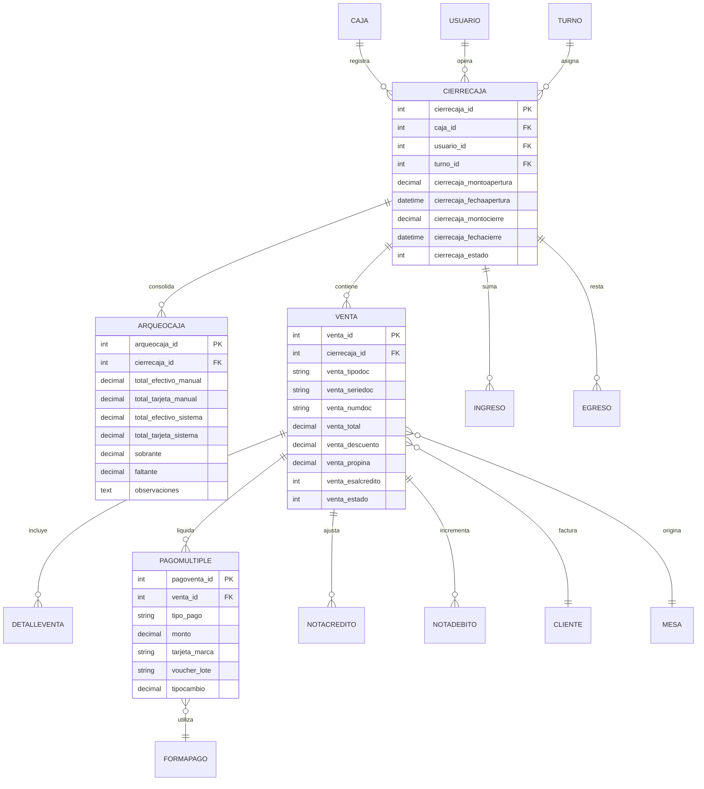

# Módulo de Caja: Cobro, Arqueo, Cierres, Comprobantes Electrónicos y Monitoreo de Ventas

**Sistema**: Restaurant.pe (Instancia de Producción: CAPRICHOS - Lima, Perú)  
**URL de Producción**: `https://caprichos.restaurant.pe/restaurant/#!/login`  
**Usuario de Auditoría**: `krosales`  
**Modalidad**: SOLO LECTURA estricto en entorno de PRODUCCIÓN en operación activa.  
**Fecha de Inspección**: 2026-10-13  
**Documento Generado**: `/home/jose/JoseEM/caprichos/web-anterior/administrativo/modulos/caja.md`  

---

## 1. Resumen Ejecutivo y Alcance del Módulo

El macro-módulo de **Caja** (`#!/caja/cobrar`) es el epicentro financiero y de control fiscal de la cafetería CAPRICHOS. Administra la recaudación monetaria omnicanal (salones, pedidos rápidos en mostrador, delivery y prepagos), la liquidación de cuentas de clientes, la división de consumos, la emisión tributaria de comprobantes electrónicos bajo normativa SUNAT (Boletas, Facturas, Notas de Crédito, Notas de Débito), la conciliación de turnos mediante arqueos ciegos y verificados, y la sincronización con datafonos bancarios e integraciones contables.

El presente reporte consolida la auditoría estructural y técnica de las 10 pantallas y componentes asignados:
1. **Cobrar en Salones** (`#!/caja/cobrar/salones`)
2. **Apertura y Cierre** (`#!/caja/apertura-cierre`)
3. **Cierre Caja Z** (`#!/caja/cierre-caja-z`)
4. **Cierres de Caja / Movimientos** (`#!/caja/movimientos`)
5. **Ingresos de Caja** (`#!/caja/ingresos`)
6. **Egresos de Caja** (`#!/caja/egresos`)
7. **Notas de Crédito** (`#!/caja/Notas-Credito`)
8. **Notas de Débito** (`#!/caja/Notas-Debito`)
9. **Monitor de Ventas** (`#!/caja/monitorcaja`)
10. **Consulta de Precios** (`#!/informes/inventario/productos-con-precio`)

> [!IMPORTANT]
> **Garantía de Solo Lectura y Confidencialidad**: Toda la recolección se efectuó mediante navegación pasiva vía enrutador SPA Hashbang de AngularJS (`#!/`), inspección estática del DOM en vivo y análisis del bundle público de la aplicación (`frontend_bundle.js` / `$templateCache`). No se pulsó ningún botón transaccional ni se ingresaron datos. Todos los montos, nombres, identificadores personales y documentos comerciales reales han sido omitidos o abstraídos a sus estructuras de datos.

---

## 2. Pantalla 1: Cobro en Salones y Gestión de Checkout (`#!/caja/cobrar/salones`)

### 2.1 Propósito
Constituye el punto de venta (POS) principal para el cajero. Su función es listar las mesas con consumos activos o precuenta solicitada, gestionar la partición de cuentas (*split bill*), procesar los medios de pago combinados, capturar datos de cliente para emisión electrónica y emitir los comprobantes finales liberando la mesa.

### 2.2 Flujo de Uso Paso a Paso
1. **Visualización de Mesas Ocupadas**:
   - El cajero ingresa a `#!/caja/cobrar/salones`.
   - A diferencia de la vista de mozo (que muestra mesas libres y ocupadas), en Caja se filtran automáticamente solo aquellas mesas que tienen pedidos cargados o estado *"Por salir"* (con precuenta impresa).
   - Si no hay consumos pendientes, se despliega el aviso: *"No hay mesas ocupadas o por salir. Por favor ingrese pedidos a la mesa para poder cobrarlas desde este módulo"*.
2. **Selección de Mesa**:
   - Al pulsar una mesa con consumo, la pantalla se divide en dos columnas:
     - **Columna Izquierda (Demanda)**: Muestra el listado de ítems consumidos, cantidades, modificadores y precios.
     - **Columna Derecha (Oferta / Estado de Cuenta)**: Detalla el subtotal, impuestos (IGV 18% / Recargo al consumo si aplica), monto amortizado si hubo pago anticipado, tiempo de ocupación, mozo asignado y el botón principal **Cobrar**.
3. **División de Cuenta (Opcional)**:
   - Si los comensales solicitan pagar por separado, el cajero pulsa *"Dividir cuentas"*.
   - Elige entre particionar por productos, por número de cuentas equivalentes, por montos fijos o por porcentajes (ver detalle en sección 2.5).
4. **Lanzamiento del Modal de Pagos**:
   - Se pulsa el botón **Cobrar**, abriendo la interfaz modal integral `scripts/restaurantpe/caja/modals/pagos.html`.
5. **Configuración del Comprobante y Cliente**:
   - Se selecciona el tipo de comprobante: **Boleta**, **Factura**, **Nota de Venta** o **Ticket**.
   - Para Facturas: Se digita el RUC (con validación de 11 dígitos y búsqueda automática de Razón Social y Dirección fiscal).
   - Para Boletas mayores a S/ 700: El sistema exige obligatoriamente DNI/CE y nombres del cliente.
6. **Ingreso de Medios de Pago y Vuelto**:
   - Se ingresa el monto abonado en Efectivo, Tarjeta, Transferencia (Yape/Plin), Vales o Saldo a favor.
   - En efectivo, se puede utilizar el teclado numérico en pantalla o botones de billetes rápidos (S/ 10, 20, 50, 100, 200). El sistema calcula el vuelto en tiempo real.
   - En tarjeta, se selecciona la marca (Visa, Mastercard, etc.) y se ingresa opcionalmente el código de operación/lote del POS físico.
7. **Registro de Propina (Opcional)**:
   - Se especifica si el cliente añade propina voluntaria (en efectivo o cargada a la tarjeta).
8. **Finalización de Venta**:
   - Se pulsa **PAGAR** (o combinación rápida `Ctrl + Enter`).
   - El sistema invoca el backend para numerar el comprobante electrónico, envía la orden de apertura al cajón monedero (gaveta) y envía la orden de impresión térmica del comprobante.
   - La mesa pasa a estado *Libre* y se actualiza el monitor de cocina y salón.

### 2.3 Estructura de Interfaz

#### Botones y Acciones en la Barra Superior (Action Bar)
- `Pagar créditos` (`ui-sref="creditos.ventacreditos"`): Redirige a liquidar cuentas corrientes de clientes.
- `Dividir cuentas` (`ng-click="vm.fnAbrirModalCaja('dividircuentas')"`): Habilitado cuando se selecciona una mesa con pedidos.
- `Mover pedidos` (`ng-click="vm.fnAbrirModalCaja('moverpedidos')"`): Permite trasladar ítems entre mesas.
- `Unir mesas` (`ng-click="vm.fnAbrirModalCaja('unirmesas')"`): Fusiona dos mesas en una sola cuenta consolidada.
- `Anular ventas` (`ng-click="vm.fnAbrirModalCaja('anularventas')"`): Abre el modal para anular ventas emitidas en el turno.
- `Modificar pagos` (`ng-click="vm.fnAbrirModalCaja('anularventas')"`): Permite reclasificar medios de pago de una venta ya cerrada (ej. corregir pago registrado en efectivo que fue con tarjeta).
- `Imprimir mensaje` (`ng-click="vm.fnAbrirModalEnviarMensaje()"`): Envía un ticket de texto libre a ticketeras de cocina/barra.
- `Abre gaveta` (`ng-click="vm.fnAbrirGaveta()"`): Dispara el pulso eléctrico RJ11 a la impresora térmica para abrir la gaveta portabilletes.

#### Pestañas y Filtros
- **Pestaña Salones**: Despliega los salones del restaurante (en CAPRICHOS: "Salon").
- **Ver en la mesa**: Selector `<select>` con opciones `Tiempo` y `Personas`.
- **Badges de Canal de Venta**: `Salones`, `Delivery [Badge con cantidad pendiente]`, `Rápida`, `Manual`, `Prepagos`.

### 2.4 Modal de Cobro y Pagos (`scripts/restaurantpe/caja/modals/pagos.html`)

El modal de checkout es la pieza central del módulo de caja. Se estructura en 4 paneles funcionales:

#### A. Cabecera y Selección de Cliente
| Campo / Control | Tipo | Modelo Angular | Regla / Validación |
| :--- | :--- | :--- | :--- |
| `Búsqueda de Cliente` | Autocomplete / Input | `vm.clienteBusqueda` | Búsqueda reactiva por DNI, RUC, nombre o teléfono. |
| `Tipo Documento` | Toggle / Radio | `vm.cliente.tipo_documento` | DNI (8 dígitos) / RUC (11 dígitos) / Pasaporte / Carnet Extranjería. |
| `Número de Documento` | `<input text>` | `vm.cliente.cliente_dniruc` | Validación de longitud según tipo de documento. Botón de consulta API RENIEC/SUNAT. |
| `Nombres / Razón Social` | `<input text>` | `vm.cliente.cliente_nombres` | Obligatorio para Facturas y Boletas > S/ 700. |
| `Dirección Fiscal` | `<input text>` | `vm.cliente.cliente_direccion` | Obligatorio para Facturas electrónicas. |

#### B. Selección de Tipo de Comprobante
- Botones de selección rápida:
  - **Boleta de Venta Electrónica**: Serie `B###`. Si el monto es menor a S/ 700 puede asignarse a "Clientes Varios".
  - **Factura Electrónica**: Serie `F###`. Exige RUC válido que inicie con 10, 20, 15, 17, etc., activo y habido en SUNAT.
  - **Nota de Venta**: Comprobante de consumo interno sin efectos tributarios SUNAT.
  - **Ticket**: Comprobante para consumos rápidos o exonerados.
- **Detracción SUNAT**: Si una factura excede el umbral reglamentario de S/ 700 (en servicios de restaurante), se habilita el botón `vm.fnAbrirModalDetraccionVenta()` para registrar el % de detracción y constancia bancaria del Banco de la Nación.

#### C. Medios de Pago Disponibles (Pagos Simples y Múltiples)
El sistema soporta división de formas de pago sobre la misma venta:
1. **Efectivo (`pagoventa_tipo = EFECTIVO`)**:
   - Selección de moneda (Soles `PEN` / Dólares `USD`).
   - Botonera de billetes rápidos: `S/ 10`, `S/ 20`, `S/ 50`, `S/ 100`, `S/ 200`.
   - Teclado numérico táctil en pantalla (`0`-`9`, `.`, `C`).
   - Cálculo automático de `Vuelto = Monto Recibido - Total a Pagar`.
2. **Tarjetas (`pagoventa_tipo = TARJETA`)**:
   - Selección de entidad/marca: Visa, Mastercard, American Express, Diners Club.
   - Selección de tipo: Débito o Crédito.
   - Campo para ingresar `Código de Operación / Voucher` del datafono.
   - Soporte de integración con terminales POS inteligentes (Izipay / VendeMás Niubiz) mediante endpoint `vm.consultarTransaccion(idVentaExterno)`.
3. **Billeteras Digitales y Transferencias**:
   - Yape, Plin, Transferencia Bancaria (BCP, BBVA, Interbank, Scotiabank).
4. **Vales de Consumo / Gift Cards**:
   - Modal `ingresovalepago.view.html` para redimir códigos de regalo emitidos previamente.
5. **Canje de Puntos de Lealtad**:
   - Modal `ingresocanjepuntos.view.html` asociado al addon Plaza Puntos.
6. **Cupones de Descuento**:
   - Modal `ingresocupondescuento.view.html` para validar cupones de campaña promocional.
7. **Saldo a Favor / Débito de Cliente**:
   - Modal `ingresodebito.view.html` para descontar saldos a favor acumulados por el cliente.
8. **Venta al Crédito**:
   - Habilita el modal de cuotas `cuotascredito.view.html` especificando fecha de vencimiento, número de cuotas y validación de límite de crédito del cliente.

#### D. Descuentos, Cortesías y Recargos
- Botón `fnSolicitarAutorizacionDescuento()`: Requiere PIN de supervisor/administrador si el cajero no tiene permiso autónomo de descuento.
- Tipos de descuento:
  - Porcentaje global (%).
  - Monto fijo en soles.
  - Por categoría de producto o cortesía del día.
- **Descuento por Redondeo**: Aplicación del redondeo a favor del cliente conforme a ley monetaria peruana (Ley 29571 / BCRP).

### 2.5 Flujo de División de Cuentas (*Split Bill*) (`scripts/restaurantpe/caja/modals/dividircuentas.html`)
El sistema ofrece 4 modalidades avanzadas para particionar la cuenta de una mesa:
1. **Modalidad 1: Por Productos**:
   - El cajero añade subcuentas (`C1`, `C2`, `C3`, etc.).
   - Puede renombrar cada subcuenta (ej. *"Comensal 1"*, *"Carlos"*).
   - Mueve ítems de la cuenta principal a cada subcuenta individual.
   - Cada subcuenta cuenta con su propio botón **Precuenta** (para imprimir ticket borrador) y botón **Pagar** (abre el modal de checkout para liquidar solo esa subcuenta).
2. **Modalidad 2: Por Número de Cuentas Equivalentes**:
   - El cajero define el número de cuentas deseadas mediante botones `+` / `-`.
   - El sistema calcula el cociente exacto `Total / N° Cuentas` para cada una.
3. **Modalidad 3: Distribución por Montos en Soles**:
   - Permite fijar montos específicos pagados por cada comensal hasta completar el 100% de la orden.
   - Muestra alerta indicadora: *"Existe S/ [X] pendiente por distribuir"*.
4. **Modalidad 4: Distribución por Porcentajes**:
   - Asignación de porcentajes personalizados (ej. 50%, 25%, 25%).
   - Alerta visible: *"Existe [X]% pendiente por porcionar"*.
5. **División de un Ítem Individual (Fraccionamiento de Plato/Bebida)**:
   - Permite tomar un producto (ej. una jarra o botella) y fraccionarlo entre cuentas por unidades, por porcentaje o por precio con atajos rápidos `[T]` (Todos a esta cuenta) y `[R]` (Restante a esta cuenta).

### 2.6 Gestión de Propinas (*Tips*) (`scripts/restaurantpe/caja/modals/propinaventa.modal.html`)
- Al momento de cobrar, el cajero puede registrar el monto voluntario de propina dejado por el cliente.
- El sistema diferencia propina en efectivo vs propina en tarjeta.
- **Flujo de Liquidación de Propinas**: Dado que las propinas cobradas con tarjeta ingresan a la cuenta bancaria del restaurante, el cajero cuenta con la vista `propinaventa.modal.html` donde consulta la lista de ventas del turno que contienen propina y presiona el botón **Registrar egreso** (`vm.fnAgregarEgresoPropina()`) para desembolsar el dinero físico al personal de salón de forma justificada.

---

## 3. Pantalla 2: Apertura y Cierre de Caja (`#!/caja/apertura-cierre`)

### 3.1 Propósito
Controla el ciclo de vida operativo de la caja registradora para cada turno de trabajo. Garantiza que exista un fondo fijo inicial (caja chica / sencillo), monitorea el flujo continuo de ingresos y egresos, y formaliza el corte de caja antes de la entrega al siguiente turno.

### 3.2 Estado 1: Caja Cerrada (Formulario de Apertura)
Cuando no hay turno activo, se despliega la plantilla `cerrada.html`:
- **Panel Informativo (Izquierda)**: Indica `"Caja Principal cerrada"`, monto del cierre previo, fecha y hora de corte, o el mensaje `"Caja sin apertura"`.
- **Formulario de Apertura (Derecha)**:
  | Campo | Tipo | Modelo Angular | Opciones / Restricciones | Obligatorio |
  | :--- | :--- | :--- | :--- | :--- |
  | `Turno` | `<select>` | `vm.cierrecaja.turno_id` | `Turno Dia`, `Turno Noche`, etc. | Sí |
  | `Monto` | `<input text>` con dropdown de moneda | `vm.cierrecaja.cierrecaja_monto` | Solo números. Dropdown de selección: Soles (`S/`), Dólares (`$`). | Sí |
  | `Tipo de cambio` | Tabla editable en línea | `vm.monedaList` | Columnas: `Moneda`, `Venta`, `Compra`. Permite editar tipos de cambio vigentes para el día. | Condicional |
- **Botón de Acción**:
  - `Abrir caja` (`<button class="btn btn-primary btn-lg" ng-click="vm.fnExistePreguntaPorCierrecajaRAT()">`): Inicializa el turno en base de datos.

### 3.3 Estado 2: Caja Abierta (Panel de Monitoreo y Cierre)
Cuando el turno está en operación, se despliega la plantilla `abierta.html`:
- **Panel Resumen (Izquierda - Jumbotron)**:
  - Nombre de la caja (ej. `Caja Principal abierta`).
  - `Monto apertura: S/ [X]`.
  - `Usuario: [Nick del cajero]`.
  - `Fecha y hora de apertura`.
  - `Turno: [Turno Dia]`.
  - `Historial de tipo de cambio`.
- **Panel de Arqueo y Verificación (Derecha)**:
  - **Modalidad Normal (`cajaAciegas == 0`)**:
    - Tabla comparativa de saldos acumulados:
      - *En efectivo* (desglosado por monedas).
      - *En tarjetas* (débito y crédito).
      - *Transferencias y otros* (Yape, Plin, bancos).
      - *Vales de pago* (Gift cards).
      - *Pago en línea*.
      - *Cupón Yape*.
      - **Total en caja**: Fórmula matemática visible: `Total en caja = Apertura + Ventas + Ingresos - Egresos`.
    - **Botones de Control**:
      - `Verificar movimientos` / `Volver a verificar movimientos`: Recalcula en tiempo real los comprobantes emitidos.
      - `Registrar arqueo`: Abre el modal de recuento físico de monedas, billetes y vouchers.
      - `Imprimir paloteo`: Genera el reporte físico de productos y platos vendidos durante el turno.
      - `Imprimir reservas`: Imprime las comandas de reservaciones del día.
      - `Ver tips / propinas`: Muestra el acumulado de propinas cobradas para su liquidación.
      - `Cerrar caja`: Botón rojo (`btn-danger btn-lg`). Se encuentra bloqueado (`ng-disabled="!vm.verificado"`) hasta que el cajero pulse primero *Verificar movimientos*.
  - **Modalidad Cierre a Ciegas (`cajaAciegas == 1`)**:
    - Oculta los montos teóricos calculados por el sistema para evitar manipulación.
    - El cajero solo visualiza el aviso *"Verifica los montos para validar el cierre a ciegas"* y el botón `Cuadrar caja a ciegas`, obligándolo a ingresar el recuento físico antes de conocer las diferencias.

---

## 4. Pantalla 3: Cierre Caja Z (`#!/caja/cierre-caja-z`)

### 4.1 Propósito
El **Cierre Z** es el corte fiscal y contable consolidado al finalizar la jornada comercial. A diferencia del cierre de turno ordinario (Cierre X), el Cierre Z liquida todas las transacciones del día de todas las cajas del establecimiento, cierra el libro de ventas diario para efectos de declaración tributaria y genera el reporte final de auditoría.

### 4.2 Flujo y Estructura
- **Barra Superior**: Enlace `Últimos movimientos` (`ui-sref="caja.ultimosmovimientosz"`).
- **Estado Inicial**: Si no se ha efectuado el corte del día, muestra el estado *"Aún no existe un cierre"*.
- **Acciones Disponibles**:
  - `Verificar movimientos`: Ejecuta la consulta de comprobantes y recaudaciones de toda la jornada.
  - `Cerrar caja`: Ejecuta el Cierre Z definitivo.
- **Estructura del Informe Consolidado Generado**:
  - **Bloque Ingresos**: Ventas en Soles, Ingresos extras, Ventas con tarjeta, Ventas por transferencias, Ventas por pago en línea, Créditos cobrados, Propinas en efectivo/tarjeta, Total costo de envío delivery.
  - **Bloque Egresos**: Egresos extras, Compras pagadas en caja, Pago de compras al crédito, Descuentos concedidos.
  - **Bloque Transacciones Hechas y Anuladas**: Resumen cuantitativo agrupado por tipo de comprobante (N° Boletas, N° Facturas, N° Notas de Venta).
  - **Detalle de Movimientos Extras**: Tabla desglosada de ingresos y egresos registrados durante el día.
  - **Ingresos por Ventas**: Separación entre efectivo, tarjetas bancarias y retenciones fiscales.
  - **Ventas por Canal de Delivery**: Cantidad de operaciones, importe total y ticket promedio por canal (Rappi, PedidosYa, Web propia).

---

## 5. Pantalla 4: Cierres de Caja / Movimientos Históricos (`#!/caja/movimientos`)

### 5.1 Propósito
Repositorio histórico de auditoría financiera. Permite al administrador o jefe de caja consultar todos los cierres de turno realizados entre rangos de fechas, revisar las discrepancias entre montos del sistema y montos físicos, auditar transacciones anuladas y reimprimir reportes de liquidación.

### 5.2 Estructura de Interfaz y Filtros
- **Filtro de Fechas**: Selector de rango `date-range-picker` (en la auditoría observado: *"Del 01 Octubre, 2026 hasta 13 Octubre, 2026"*).
- **Botones Disponibles**:
  - `Generar informe` (`ladda-button`): Ejecuta la consulta en la base de datos de lectura.
  - `Eliminar ultimo cierre`: Acción restringida a administradores para reabrir una caja cerrada por error operativo.

### 5.3 Tablas de Auditoría Desplegadas
La pantalla presenta un tablero exhaustivo compuesto por más de 15 sub-tablas especializadas:
1. **Resumen de Ingresos y Egresos**: Comparativa entre ingresos de venta, ingresos manuales y salidas de caja.
2. **Categorías de Descuento y Vales / Gift Cards**: Monto global consumido en promociones.
3. **Correlativos Usados**: Rango de numeración fiscal emitida por cada serie (desde número inicial hasta número final).
4. **Transacciones Hechas vs Anuladas**: Desglose de boletas y facturas emitidas vs documentos cancelados con su respectivo motivo.
5. **Atenciones y Créditos Generados**: Métricas de rotación de comensales y créditos pendientes de cobro.
6. **Impuestos**: Detalle de base imponible, IGV (18%) e impuestos al consumo.
7. **Ingresos y Egresos Extras**: Tablas con fecha, usuario, persona origen/destino, concepto y monto.
8. **Ventas por Canal de Delivery**: Métricas de ventas agrupadas por repartidores propios y plataformas.
9. **Detalle de Ventas Realizadas**:
   - Columnas: `Fecha`, `Tipo doc.`, `Serie/Nro.`, `Cliente`, `Canal delivery`, `Tipo de venta` (Contado/Crédito), `Estado` (Activa/Anulada), `Dscto.`, `Pago`, `Propina`, `Dscto. redondeo`, `Total ventas`, `Opciones` (Ver detalle / Reimprimir ticket).
10. **Ventas al Crédito Cobradas**: Control de cobranzas de cuentas por cobrar.
11. **Historial de Cierres de Caja**: Tabla con columnas `Apertura`, `Cierre` y enlace directo para descargar o reimprimir el `Reporte`.

### 5.4 Modal de Arqueo Físico de Caja (`scripts/restaurantpe/caja/movimientos/modals/arqueocaja.html`)
Es la herramienta más crítica para evitar pérdidas y descuadres en caja:
- **Control de Correlativos Manuales**: Registro de talonarios físicos de contingencia (Tickets Boleta, Factura, Nota de Venta: N° Inicio, N° Final, Total).
- **Control de Moneda Local (Billetes y Monedas)**:
  - Billetes: Entradas independientes para S/ 200, S/ 100, S/ 50, S/ 20, S/ 10. El cajero ingresa la *Cantidad* y el sistema calcula el *Total*.
  - Monedas: Entradas para S/ 5.00, S/ 2.00, S/ 1.00, S/ 0.50, S/ 0.20, S/ 0.10.
  - Totalización automática de Moneda Local.
- **Control de Moneda Extranjera (Dólares u otros)**:
  - Registro de billetes foráneos con conversión automática a Soles según el tipo de cambio oficial del día.
- **Control de Tarjetas y Datafonos (Conciliación de POS)**:
  - Lista de tarjetas habilitadas (Visa, Mastercard, etc.).
  - Comparativa en dos columnas: `Monto por Tarjeta Sistema` vs `Monto por Tarjeta Manual` (tomado del cierre de lote del POS físico).
  - Campo para ingresar el `Nº de Lote` de la liquidación emitida por el datáfono.
- **Cuadratura Final de Arqueo**:
  - Tabla de 2 filas:
    - **Fila MANUAL (Recuento físico)**: Efectivo manual, Tarjeta manual, Total venta manual.
    - **Fila SISTEMA (Teórico informático)**: Efectivo sistema, Tarjeta sistema, Total venta sistema.
  - **Cálculo Automático de Discrepancias**:
    - **Sobrante** (en verde/azul): Si el dinero físico excede el registro de ventas.
    - **Faltante** (en rojo): Si el dinero físico es inferior al registro de ventas.
- **Observaciones de Caja y Documentos**: Campo `<textarea>` para justificar descuadres o incidencias.
- **Botones**: `Cancelar`, `Registrar arqueo` y `Cerrar caja`.

---

## 6. Pantallas 5 y 6: Ingresos y Egresos de Caja (`#!/caja/ingresos` y `#!/caja/egresos`)

### 6.1 Ingresos de Caja (`#!/caja/ingresos`)

#### Propósito
Registra entradas de dinero extraordinarias en la caja física que no provienen de una venta directa de comida o bebida (ej. aportes de sencillo por parte del dueño, devoluciones de préstamos de empleados, cobro de señas de eventos no comandadas, depósitos de saldo a favor de clientes).

#### Estructura de Interfaz y Filtros
- **Botones de Navegación Rápida**: `Ingresos` (activo), `Egresos`.
- **Filtros de Estado**: Botones tipo pill `Todos`, `Anulados`, `Activos`.
- **Acciones Disponibles**: `Actualizar`, `Descargar` (Excel), `Registrar ingreso`, `Registrar Debito`.
- **Columnas de la Tabla**:
  | Columna | Descripción |
  | :--- | :--- |
  | `Fecha de ingreso` | Día y hora exacta con formato `DD/MM/YYYY hh:mm A`. |
  | `Usuario` | Nickname del cajero o administrador que efectuó el registro. |
  | `Categoria` | Clasificación contable del ingreso (ej. Aporte de Capital, Sencillo). |
  | `Recibido de` | Nombre o entidad que entregó el dinero. |
  | `Concepto` | Motivo o justificación descriptiva del movimiento. |
  | `Monto` | Importe en Soles (`S/`) o divisa correspondiente. |

#### Formulario de Registro (`caja/ingresos/registrar.html`)
- `Categoría`: Selector `<select>` con botón `[+] Categorías` para crear nuevas clasificaciones al vuelo.
- `Motivo`: `<textarea>` obligatorio.
- `Recibido de`: `<input text>` obligatorio.
- `Monto`: `<input text>` solo números, con dropdown selector de moneda.
- Botones: `Guardar` (`btn-primary`), `Cancelar`.

---

### 6.2 Egresos de Caja (`#!/caja/egresos`)

#### Propósito
Registra salidas físicas de dinero de la gaveta por conceptos operativos urgentes (compras imprevistas en mercado, pago a proveedores al contado, pago de propinas a mozos, pasajes/movilidad, delivery externo, retiro de ganancias). Evita descuadres al momento del arqueo final.

#### Estructura de Interfaz y Filtros
- **Botones**: `Ingresos`, `Egresos` (activo), `Actualizar`, `Descargar`, `Registrar egreso`.
- **Filtros de Estado**: `Todos`, `Anulados`, `Activos`.
- **Columnas de la Tabla**:
  | Columna | Descripción |
  | :--- | :--- |
  | `Fecha de egreso` | Día y hora con íconos de calendario y reloj. |
  | `Usuario` | Cajero que desembolsó los fondos. |
  | `Categoria` | Clasificación contable (ej. Compras menores, Movilidad, Servicios). |
  | `Entregado a` | Nombre del beneficiario que recibió el dinero. |
  | `Concepto` | Glosa o descripción detallada de la salida. |
  | `Monto` | Importe egresado en moneda local. |

#### Formulario de Registro (`caja/egresos/registrar.html`)
- Botón superior `Egresar debitos` (`vm.fnModalDebitosCliente()`): Permite devolver dinero en efectivo a clientes con saldo a favor.
- Campos idénticos al formulario de ingresos: `Categoría`, `Motivo`, `Entregado a`, `Monto` con dropdown de moneda.
- Botones: `Guardar`, `Cancelar`.

---

## 7. Pantallas 7 y 8: Notas de Crédito y Débito (`#!/caja/Notas-Credito` y `#!/caja/Notas-Debito`)

### 7.1 Notas de Crédito Electrónicas (`#!/caja/Notas-Credito`)

#### Propósito y Normativa SUNAT
Gestiona la emisión de documentos tributarios de anulación, rescisión o ajuste sobre Boletas y Facturas electrónicas emitidas. Cumple con los catálogos de SUNAT (Catálogo 09) para rectificación de comprobantes de pago.

#### Estructura de Tabla
- **Filtros**: Selector de rango de fechas (`Del [Fecha Inicio] hasta [Fecha Fin]`).
- **Botones**: `Nueva nota`, `Externas` (para notas vinculadas a comprobantes no emitidos en el sistema), `Actualizar`.
- **Columnas**:
  | Columna | Descripción |
  | :--- | :--- |
  | `Fecha` | Fecha de generación del comprobante. |
  | `Caja` | Caja registradora de origen. |
  | `Usuario` | Usuario que autorizó la emisión. |
  | `Nº documento` | Serie y correlativo asignado (ej. `FC01-00001234` o `BC01-00005678`). |
  | `¿Es externa?` | Indicador `Sí / No`. |
  | `Total` | Monto total deducido o anulado. |
  | `Motivo` | Código de catálogo SUNAT (ej. Anulación total, Descuento global). |
  | `Motivo largo` | Sustento legal o justificación ingresada por el usuario. |
  | `Opciones` | Reimprimir ticket, ver CDR (Constancia de Recepción SUNAT), descargar XML/PDF. |

#### Formulario de Emisión (`caja/notacredito/registrar.html`)
1. **Búsqueda del Documento Afectado**:
   - Selección de comprobante de origen (Boleta o Factura).
   - Ingreso de Serie y Número correlativo original.
   - Botón `Buscar comprobante`. El sistema recupera el detalle de los platos facturados, datos del cliente e importes.
2. **Selección del Tipo de Motivo SUNAT**:
   - `01`: Anulación de la operación.
   - `02`: Anulación por error en el RUC.
   - `03`: Corrección por error en la descripción.
   - `04`: Descuento global.
   - `05`: Devolución total.
   - `07`: Devolución por ítem (selección casilla por producto a devolver).
3. **Controles Financieros y de Inventario**:
   - `Registrar como egreso de caja` (`vm.notacredito.notacredito_saliodecaja`): Si se activa, genera automáticamente un egreso en la caja registradora para justificar la devolución física del dinero en efectivo al cliente.
   - `Retornar Stock`: Si se activa, devuelve las unidades anuladas al inventario de insumos/almacén.
4. **Validaciones**:
   - Si el documento de identidad es DNI debe contener 8 dígitos; si es RUC debe contener 11 dígitos.
   - Sustento o motivo largo obligatorio.

---

### 7.2 Notas de Débito Electrónicas (`#!/caja/Notas-Debito`)

#### Propósito
Permite emitir comprobantes de ajuste para recuperar cobros omitidos o penalidades contractuales aplicadas a una venta ya facturada, incrementando el valor total del comprobante de origen bajo Catálogo 10 de SUNAT.

#### Estructura y Formulario de Emisión (`caja/notadebito/registrar.html`)
- **Paso 1 - Búsqueda**: Localización previa del comprobante original (Boleta o Factura) por Serie y Número.
- **Paso 2 - Datos del Beneficiario**: Nombres, Apellidos, Tipo de Documento (DNI/RUC) y Número de Documento.
- **Paso 3 - Motivo SUNAT**: Botón selector `Aumento en el valor` (`notadebito_motivo = '2'`).
- **Paso 4 - Sustento**: Campo de texto para la justificación del incremento.
- **Paso 5 - Importe de Aumento**: Campo `notadebito_total` que calcula el nuevo total general a liquidar y pagar.

---

## 8. Pantalla 9: Monitor de Ventas en Tiempo Real (`#!/caja/monitorcaja`)

### 8.1 Propósito
Es el centro de control gerencial y operativo de caja. Proporciona visibilidad en tiempo real del desempeño de ventas del turno, tickets promedio, comparativas contra promedios históricos, volumen de mesas pendientes de cobro y supervisión de pedidos procedentes de plataformas de delivery integradas (Rappi, PedidosYa).

### 8.2 Estructura de Interfaz y Filtros
- **Barra Superior**: Selector de Local (`CAPRICHOS`), botón `Generar informe` con badge de última sincronización en vivo (ej. *Última venta sincronizada: 22:06:06*).
- **Filtros de Segmentación**:
  - `Caja`: Selector de terminal (Caja Principal / Todas).
  - `Comprobante`: Boleta, Factura, Nota de Venta o Todos.
  - `Turno`: Turno Día / Turno Noche.
  - `Filtrar pedidos por fecha`: Checkbox para habilitar rango de horas.
  - `Rango de Fechas`: Selector con hora inicio y fin (`DD MMMM, YYYY hh:mm A`).

### 8.3 Pestañas del Panel Central (Columna Izquierda)

#### Pestaña 1: Lista de Ventas
- **Tarjetas de KPIs Ejecutivos**:
  - `N° de transacciones`: Cantidad de ventas facturadas en el período.
  - `Promedio de ventas`: Total recaudado / N° transacciones.
  - `Número de clientes`: Total de comensales sentados y atendidos.
  - `Ticket Promedio Cliente`: Venta total / Total de personas.
  - `Total en ventas`: Monto global recaudado en Soles.
- **Tabla de Ventas**:
  - Columnas: `Fecha`, `Caja`, `Turno`, `Documento`, `Serie / Número`, `Total`, `Tipo de venta` (Contado / Al Crédito), `Estado` (Activo / Anulado).
  - Paginación dinámica con `<uib-pagination>`.

#### Pestaña 2: Comparativo por Local (Índice IDX)
- Permite comparar las ventas del día contra el comportamiento histórico a la misma hora del mismo día de la semana.
- Filtros: Hora de corte (con componente `clockpicker` y check de actualización continua por segundo) y N° de meses históricos de muestra.
- **Tabla Comparativa**:
  - Columnas: `Módulo / Sucursal`, `Total Pedidos Actual`, `Venta Actual`, `Venta Hist.`, `IDX (%)`.
  - **Semáforo del Índice IDX**:
    - **Verde (`label-primary`)**: Ventas superiores al 110% del promedio histórico.
    - **Naranja (`label-warning`)**: Ventas entre el 90% y 110% (dentro de lo esperado).
    - **Rojo (`label-danger`)**: Ventas inferiores al 90% del promedio histórico (desviación negativa que requiere acción de salón).

#### Pestaña 3: Deliverys Pendientes por Integración
- Monitorea órdenes de delivery externas recibidas por API.
- Columnas: `Código` (ID de delivery), `Integración` (Rappi, PedidosYa, etc.), `Estado`.
- Botón de acción: `Procesar` (`vm.procesarOrdenDeFormaManual()`): Permite forzar el ingreso de una orden atorada o no asignada.

### 8.4 Panel Lateral: Mesas Pendientes de Cobro (Columna Derecha)
- **Tarjetas de Alerta**:
  - `Nº Mesas por cobrar` (en color de alerta naranja).
  - `Número de clientes` en dichas mesas.
  - `Monto pendiente por cobrar` (en azul/destacado).
- **Tabla en Tiempo Real**:
  - Columnas: `Pedido` (Salón y Código de Mesa), `Personas`, `Total`.

---

## 9. Pantalla 10: Consulta de Precios (`#!/informes/inventario/productos-con-precio`)

### 9.1 Propósito
Herramienta de consulta rápida a pie de caja. Permite a los cajeros y anfitriones resolver dudas inmediatas de clientes sobre precios de venta, presentaciones o códigos de platos sin tener que iniciar un pedido en salón ni entrar al catálogo de productos.

### 9.2 Estructura y Operación
- **Botón de Acción**: `Generar informe` (`vm.fnObtenerProductosConPrecioPLP()`): Consulta la lista de productos exportables del local.
- **Buscador en Tiempo Real**: Input `Filtrar o buscar un producto` con debounce y botón `[X]` para limpiar texto.
- **Tabla de Catálogo**:
  | Columna | Tipo / Formato | Descripción |
  | :--- | :--- | :--- |
  | `ID` | Numérico | Identificador interno único del producto. |
  | `Codigo` | Alfanumérico | Código SKU o código de barras asignado. |
  | `Producto` | Texto | Descripción comercial del plato o bebida. |
  | `Precio` | Moneda (`S/ 0.00`) | Precio final de venta al público con impuestos incluidos. |
- **Paginación**: Componente AngularJS `<uib-pagination>` con límite configurable de ítems por página.

---

## 10. Mapa de Entidades de Datos y Modelo de Dominio

A continuación se esquematizan las entidades centrales identificadas en el módulo de Caja y sus relaciones lógicas:

---

## 11. Seguridad, Permisos (ACL) y Roles

El acceso y las acciones críticas dentro del módulo de Caja están estrictamente controlados mediante directivas de seguridad en frontend (`Security.hasAccess(permiso)`):

| Permiso ACL | Descripción / Restricción Asociada |
| :--- | :--- |
| `caja.cobrar` | Permite acceder a la pantalla de cobro de salones y lanzar el modal de checkout. |
| `caja.aperturacierre` | Autoriza la apertura de turno, verificación de saldos y ejecución del Cierre de Caja y Cierre Z. |
| `caja.movimientos` | Autoriza la consulta del historial de cierres de caja y auditoría financiera. |
| `caja.ingresos` | Permite registrar ingresos extras de dinero a la caja. |
| `caja.egresos` | Permite registrar egresos extras y desembolsos de efectivo. |
| `caja.notacreditoventa` | Permite emitir Notas de Crédito sobre comprobantes de venta activos. |
| `caja.notadebitoventa` | Permite emitir Notas de Débito electrónicas. |
| `caja.monitorcaja` | Permite visualizar el panel de métricas en tiempo real y ventas de todas las cajas. |
| `informes.inventario` | Autoriza el acceso a la consulta rápida de precios de productos. |
| `ventas.registro.notacreditodebito.externa` | Permite crear notas de crédito/débito manuales sobre documentos no registrados en el sistema. |
| `configuracion.46` / `usuarioEsAdministrador()` | Controla si el usuario puede ver los montos teóricos o está forzado a operar en modalidad de **Caja a Ciegas**. |

---

## 12. Catálogo de Endpoints REST del Módulo

A continuación se listan las principales rutas del API REST utilizadas por los controladores y servicios del módulo:

### Consultas (GET / Readonly)
- `GET /restaurant/api/rest/cierrecaja/cargarDatos`: Obtiene el estado actual de la caja asignada al usuario (abierta/cerrada, montos, monedas).
- `GET /restaurant/api/rest/cierrecajaz/verificarEstadoCierreCajaz`: Verifica si existen operaciones pendientes para el Cierre Z fiscal.
- `GET /restaurant/readonly/rest/cierrescaja/getCierrecajaListByLocalAndCajaAndTurnoAndFechainicioAndFechafin/:local/:caja/:turno/:inicio/:fin/:pagina/:tamano`: Consulta paginada del historial de cierres.
- `GET /restaurant/api/rest/ingreso/getAllByCajaActual/:local/:tamano/:pagina`: Lista los ingresos registrados en el turno vigente.
- `GET /restaurant/api/rest/egreso/getAllByCajaActual/:local/:tamano/:pagina`: Lista los egresos registrados en el turno vigente.
- `GET /restaurant/api/rest/notacredito/obtenerListaNotasCreditoPaginado/:inicio/:fin/:pagina/:tamano/:caja/:local`: Lista de notas de crédito emitidas.
- `GET /restaurant/api/rest/notadebito/obtenerListaNotasDebitoPaginado/:inicio/:fin/:pagina/:tamano`: Lista de notas de débito emitidas.
- `GET /restaurant/readonly/rest/venta/listarPorPaginacionTurno/:local/:caja/:turno/:inicio/:fin/:pagina/:tamano/:filtro`: Alimenta el Monitor de Ventas.
- `GET /restaurant/readonly/rest/venta/sumatoriaTurno/:caja/:turno/:inicio/:fin/:local/:filtro`: Totales numéricos agregados del turno.
- `GET /restaurant/readonly/rest/venta/obtenerReporteComparativoMonitorCaja/:diaSemana/:hora/:local`: Datos del comparativo de ventas históricas e índice IDX.
- `GET /restaurant/readonly/rest/catalogo/obtenerPaginaCatalagoExportables/30000/1/-1/-1/0`: Catálogo completo para la pantalla de consulta de precios.
- `GET /restaurant/api/rest/impresora/obtenerImpresorasConGaveta/:local/:caja/:modulo/:submodulo`: Lista impresoras habilitadas para disparar pulso de gaveta.
- `GET /restaurant/api/rest/tarjeta/getAllTarjetasByLocalId/:local/:estado/:filtro`: Catálogo de marcas de tarjetas configuradas.

### Operaciones Transaccionales (POST / PUT)
- `POST /restaurant/api/rest/cierrecaja/aperturar`: Realiza la apertura de caja registrando el fondo fijo inicial.
- `POST /restaurant/api/rest/cierrecaja/cerrarCaja/:cierrecajaId`: Cierra formalmente la caja calculando los saldos teóricos.
- `POST /restaurant/api/rest/cierrecaja/cerrarCajaACiegas/:cierrecajaId`: Cierra la caja en modalidad ciega procesando el recuento declarado.
- `POST /restaurant/api/rest/cierrecajaz/cerrarCajaZ`: Ejecuta el Cierre Z consolidado de la sucursal.
- `POST /restaurant/api/rest/arqueocaja/arqueocaja`: Guarda el detalle del arqueo físico de billetes, monedas y lotes POS.
- `POST /restaurant/api/rest/venta/add`: Procesa el cobro y facturación de una mesa completa.
- `POST /restaurant/api/rest/venta/addSubCuenta`: Procesa el cobro de una subcuenta individual.
- `POST /restaurant/api/rest/venta/anularVenta/:ventaId/:motivoId/:flag`: Anula una venta con comunicación de baja SUNAT.
- `POST /restaurant/api/rest/venta/modificarPagos`: Reasigna las formas de pago de una venta ya cobrada.
- `POST /restaurant/api/rest/notacredito/notacredito`: Emite y firma la nota de crédito electrónica.
- `POST /restaurant/api/rest/notadebito/notadebito`: Emite y firma la nota de débito electrónica.
- `POST /restaurant/api/rest/ingreso/add`: Registra un nuevo ingreso extra.
- `POST /restaurant/api/rest/egreso/add`: Registra un nuevo egreso extra.

---

## 13. Matriz de Replicación: Imprescindibles, Mejoras y Dudas

### 13.1 Funcionalidades Imprescindibles para Replicar
1. **Cobro Mixto y Teclado Táctil Ágil**: Capacidad de dividir un cobro en múltiples formas de pago (efectivo + tarjeta + Yape) con cálculo automático de vuelto y botonera de billetes rápidos.
2. **Emisión Electrónica Integral (SUNAT)**: Generación y firma digital inmediata de Boletas y Facturas, validación de RUC contra SUNAT y DNI contra RENIEC, cálculo de IGV y detracción automática para montos superiores a S/ 700.
3. **División de Cuentas Flexible**: Cuatro formas de partición (por platos, equitativa, montos específicos o porcentajes) con precuentas y tickets independientes.
4. **Arqueo Físico y Modo Ciego**: Desglose minucioso por denominación de billetes/monedas y lotes de tarjetas con detección automática de sobrante/faltante, soportando cierre ciego para evitar fraudes.
5. **Control de Propinas Desacoplado**: Captura de propinas voluntarias y generación de egresos de caja controlados para su reparto al personal.
6. **Notas de Crédito y Débito con Efecto en Stock y Gaveta**: Anulación total o parcial vinculada al comprobante original con opciones de reversión de inventario y egreso automático de caja física.

### 13.2 Mejoras Propuestas para el Nuevo Sistema
1. **Integración Nativa con Datafonos / Terminales de Pago (Smart POS)**: En el sistema actual, el cajero debe ingresar el importe manualmente en el POS físico y luego transcribir el número de operación. Proponer una API directa (vía Bluetooth o red local) con terminales Niubiz/Izipay para que el monto viaje solo al POS y se confirme automáticamente.
2. **Conciliación Automatizada de Pagos con Billeteras (Yape / Plin por QR)**: Integrar visualización de QR dinámico en pantalla del cliente con verificación instantánea de webhook para confirmar el abono sin que el cajero tenga que mirar la pantalla del celular del cliente.
3. **Flujo de Cierre sin Trabas**: El sistema actual requiere pulsar obligatoriamente *Verificar movimientos* antes de habilitar el botón de cierre. En el nuevo sistema, este cálculo debe ser reactivo y continuo.
4. **Prevención Proactiva de Mesas Fantasma**: Avisos visuales emergentes antes del cierre de caja si existen mesas con comandas activas o deliverys en tránsito que impedirían el cuadre.
5. **Búsqueda Inteligente de Clientes con Autocompletado**: Integración directa con base de datos unificada de clientes frecuentes con historial de preferencias y comprobantes emitidos previamente.

### 13.3 Dudas para el Cliente
1. *¿Qué políticas de tolerancia existen para sobrantes y faltantes de caja en CAPRICHOS (ej. margen permitido en céntimos por redondeo)?*
2. *¿Las propinas se liquidan diariamente al cerrar el turno en efectivo o se acumulan semanal/mensualmente para pago en planilla?*
3. *¿Trabajan con datafonos integrados por red local o datáfonos independientes estándar?*
4. *¿Se utiliza la modalidad de Cierre a Ciegas de forma obligatoria para los cajeros, reservando la vista de montos únicamente para la gerencia?*
5. *¿Se emiten facturas sujetas a detracción de forma frecuente para eventos corporativos o empresas en la cafetería?*

---

## 14. Registro de Elementos NO OBSERVADOS

| Pantalla / Elemento | Motivo de No Observación | Alternativa Aplicada |
| :--- | :--- | :--- |
| **Impresión Física en Ticketera y Apertura Real de Gaveta** | Modo SOLO LECTURA estricto en PRODUCCIÓN. No se dispararon pulsos de gaveta ni órdenes de impresión en ticketeras físicas para no alterar la operación de la cafetería. | Se documentó la llamada a `vm.fnAbrirGaveta()` y endpoints de configuración de impresoras extraídos del frontend. |
| **Pulsación del Botón Final "Pagar" / Emisión de Venta** | Modo SOLO LECTURA estricto. No se completó ninguna transacción de pago para evitar la emisión de comprobantes reales ante SUNAT. | Se analizaron exhaustivamente las plantillas `pagos.html`, controladores `cobrarCtrl` y métodos `VentaResource.agregarVentaMesa()`. |
| **Cierre Real de Caja y Cierre Z en Producción** | Modo SOLO LECTURA estricto. La caja se encontraba cerrada durante la auditoría y está prohibido abrirla o forzar cierres que alteren la jornada comercial del restaurante. | Se extrajo la estructura completa de las plantillas `abierta.html`, `cierrecajaz/index.html` y los métodos del controlador `CierrecajazCtrl`. |
| **Emisión Final de Nota de Crédito / Débito** | Modo SOLO LECTURA estricto. No se emitieron notas de crédito para no anular comprobantes tributarios reales ni generar comunicaciones de baja ante SUNAT. | Se documentaron todos los formularios, campos y validaciones a partir de `notacredito/registrar.html` y `notadebito/registrar.html`. |
