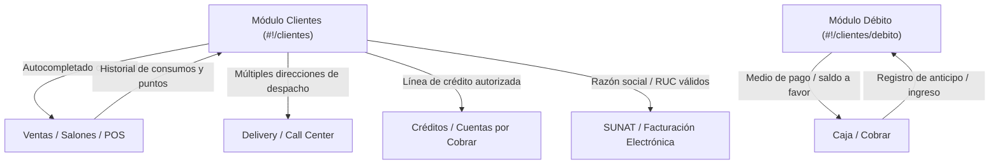

# Módulo de Clientes y Débito: Directorio, Ficha del Cliente, Créditos y Saldos a Favor

**Sistema**: Restaurant.pe (Instancia en Producción: CAPRICHOS - Lima, Perú)  
**URL de Producción**: `https://caprichos.restaurant.pe/restaurant/#!/login`  
**Usuario de Auditoría**: `krosales`  
**Modalidad**: SOLO LECTURA estricto en entorno de PRODUCCIÓN en operación activa.  
**Fecha de Inspección**: 2026-10-13  
**Documento Generado**: `/home/jose/JoseEM/caprichos/web-anterior/administrativo/modulos/clientes.md`

---

## 1. Resumen Ejecutivo y Alcance del Módulo

El macro-módulo de **Clientes** y **Débito** constituye la base de datos central de relaciones comerciales de la cafetería CAPRICHOS. Administra la cartera de clientes (tanto comensales directos como empresas y cuentas corporativas), almacena sus datos fiscales y de contacto, soporta direcciones múltiples para despachos a domicilio (delivery), gestiona políticas de crédito comercial y líneas de financiamiento diferido, y opera el monedero de **Débitos** (saldos a favor generados por anticipos o reembolsos para consumo futuro en caja).

Dentro de este reporte se auditan y documentan estructuralmente las pantallas operativas y subvistas asignadas:
1. **Directorio y Gestión de Clientes** (`#!/clientes`):
   - Directorio segmentado en pestañas: **Personas** (Naturales) y **Empresas** (Jurídicas).
   - Ficha de Detalle de Cliente e Historial de Consumos (`#!/clientes/:idCliente/ver`).
   - Formulario de Registro y Modificación (`#!/clientes/nuevo` y `#!/clientes/:idCliente/editar`).
   - Asistente de Importación Masiva mediante Excel (`#!/clientes/importarclientes`).
   - Modales de reportes y exportación avanzada (consumos, créditos y fidelización).
2. **Gestión de Débito de Clientes** (`#!/clientes/debito`):
   - Registro, auditoría y control de saldos a favor disponibles para canje en caja.
   - Anulación controlada de débitos.

> [!IMPORTANT]
> **Garantía de Solo Lectura**: La inspección se realizó en modo de solo lectura sobre el entorno de producción. No se crearon, modificaron ni anularon clientes ni débitos. Tampoco se extrajeron datos personales reales (nombres de terceros, números de documentos, teléfonos, direcciones o montos de consumo). Toda la estructura técnica documentada proviene de la inspección pasiva del DOM en vivo y del análisis de ingeniería inversa de las plantillas públicas AngularJS (`$templateCache`) y controladores descargados en el navegador (`scripts.426a6ac0.js`).

---

## 2. Arquitectura General y Enrutamiento SPA

El módulo está implementado como una aplicación de una sola página (*Single Page Application*) bajo **AngularJS 1.6.10** y gestionado por el enrutador `ui-router` con prefijo hashbang (`#!/`).

### Mapa de Estados y Rutas

| Estado `ui-router` | Ruta URL | Controlador Angular | Vista Principal | Subvista Lateral (`ui-view="side"`) | Permiso ACL |
| :--- | :--- | :--- | :--- | :--- | :--- |
| `clientes` | `#!/clientes` | `Clientes as vm` | `scripts/restaurantpe/clientes/index.html` | `scripts/restaurantpe/clientes/placeholder.html` | `clientes` |
| `clientes.ver` | `#!/clientes/:idCliente/ver` | `Clientes as vm` (heredado) | (Mantiene `index.html`) | `scripts/restaurantpe/clientes/ver.html` | `clientes` |
| `clientes.nuevo` | `#!/clientes/nuevo` | `Clientes as vm` (heredado) | (Mantiene `index.html`) | `scripts/restaurantpe/clientes/editar.html` | `clientes` |
| `clientes.editar` | `#!/clientes/:idCliente/editar` | `Clientes as vm` (heredado) | (Mantiene `index.html`) | `scripts/restaurantpe/clientes/editar.html` | `clientes` |
| `clientes.importarclientes` | `#!/clientes/importarclientes` | `importarClientes as vm` | (Mantiene `index.html`) | `scripts/restaurantpe/clientes/importarclientes.html` | `clientes` |
| `clientes.debito` | `#!/clientes/debito` | `debitoClientes as vm` | `scripts/restaurantpe/clientes/debitos.html` | `scripts/restaurantpe/clientes/placeholder-debito.html` | `clientes` |

### Patrón Maestro-Detalle Asimétrico (Split-Screen)
La pantalla principal de clientes utiliza una grilla Bootstrap dividida en dos columnas:
- **Columna izquierda (8/12 - `col-sm-8`)**: Mantiene visible el listado paginado de clientes (tabla de personas o empresas), sus filtros de búsqueda y los botones de exportación masiva.
- **Columna derecha (4/12 - `col-sm-4` - `ui-view="side"`)**: Funciona como un visor contextual dinámico. Si no hay cliente seleccionado, muestra una ilustración vacía (`placeholder.html`); al seleccionar un cliente, carga su ficha de consumo (`ver.html`); al hacer clic en nuevo/editar, carga el formulario completo (`editar.html`); y al pulsar importar, renderiza el asistente de subida (`importarclientes.html`). Esto permite al operador trabajar sin perder el contexto de la búsqueda general.

---

## 3. Pantalla 1: Directorio General de Clientes (`#!/clientes`)

### 3.1 Propósito
Centralizar la consulta, segmentación, exportación y administración del padrón de clientes del restaurante, separando conceptualmente a las **Personas Naturales** (consumo individual/familiar con DNI) de las **Empresas** (clientes corporativos que requieren Factura con RUC).

### 3.2 Flujo de Uso Paso a Paso
1. **Acceso al Directorio**: El usuario entra mediante la barra lateral en `Clientes > Clientes` o digitando la ruta `#!/clientes`.
2. **Selección de Segmento (Personas vs. Empresas)**:
   - La pantalla se inicializa por defecto en la pestaña **Personas** (`vm.visualizandoPersonas = true`).
   - Al pulsar la pestaña **Empresas**, el sistema conmuta la vista activa (`vm.visualizandoPersonas = false`), limpia el término de búsqueda actual y ejecuta la consulta del padrón de personas jurídicas.
3. **Búsqueda y Filtrado**:
   - El operador digita en el campo de búsqueda (aplica sobre nombres, documento o teléfono con llamada reactiva `ng-change`).
   - Puede filtrar por local específico o `Todos`.
   - Puede filtrar por estado: `Activos`, `Inactivos` o `Todos`.
   - Puede activar la casilla `Tiene teléfono y/o correo` para aislar clientes con datos de contacto completos.
4. **Inspección de Ficha**: Al hacer clic sobre cualquier fila del listado, la URL se actualiza a `#!/clientes/:idCliente/ver` y el panel lateral derecho despliega la información detallada del cliente, sus observaciones y su historial cronológico de consumos.
5. **Acciones Masivas de Mantenimiento**:
   - Si el filtro de estado está en `Activos`, cada fila presenta una casilla de selección y se habilita un botón rojo con ícono de papelera para anular en lote a los clientes marcados (`vm.anularPersonaList()` / `vm.anularEmpresaList()`).
   - Si el filtro está en `Inactivos`, se habilita un botón azul con ícono de verificación para reactivar en lote (`vm.activarPersonaList()` / `vm.activarEmpresaList()`).
6. **Exportación e Informes**: Mediante el menú desplegable *"Descargar"*, el operador descarga reportes directos en Excel o CSV, segmentaciones por mayor consumo o informes paginados en lotes.

### 3.3 Estructura de Interfaz y Controles

#### Botones y Acciones en Cabecera y Pestañas
- **Nuevo cliente** (`btn-primary` con ícono `fa-plus-circle`): Redirige a `#!/clientes/nuevo` y abre el formulario en blanco en el panel lateral.
- **Importar clientes** (`btn-info` con ícono `fa-upload`): Redirige a `#!/clientes/importarclientes` para subir archivos Excel.
- **Descargar (Menú desplegable `uib-dropdown`)**:
  - `Descargar`: Exportación completa estándar a Excel.
  - `Descargar BATCH`: Exportación procesada en cola en segundo plano.
  - `Descargar por lotes`: Menú anidado con enlaces a lotes de 30,000 registros (`Descargar lote #1`, `#2`, etc.).
  - `Descargar (.csv)`: Archivo de texto delimitado por comas.
  - `Informe de créditos por cliente`: Abre diálogo modal para filtrar por rango de fechas y exportar cartera deudora.
  - `Clientes con línea de crédito`: Exporta clientes con límite de crédito habilitado (`tieneCredito=1`).
  - `Clientes con línea de crédito (.csv)`: Versión CSV.
  - `Clientes con débitos`: Exporta clientes con saldos a favor pendientes (`tieneDebito=1`).
  - `Clientes con débitos (.csv)`: Versión CSV.
  - `200 con Mayor Consumo`: Descarga el ranking de los 200 clientes con mayor volumen histórico de ventas.
  - `Descargar con última venta`: Incluye la fecha y monto del último comprobante emitido.
  - `Clientes según último consumo`: Abre diálogo modal con filtros de fecha de inicio de análisis y corte de último consumo.
  - `Informes Paginados`: Lista de descargas segmentadas por páginas de informe.
- **Recargar datos** (`btn-default` con ícono `fa-refresh`): Reejecuta la consulta con los filtros vigentes.

#### Filtros y Controles de Listado (Presentes en ambas pestañas)
| Control / Etiqueta | Tipo de Control | Modelo Angular | Opciones / Rango | Descripción |
| :--- | :--- | :--- | :--- | :--- |
| `Buscar...` | `<input type="text">` | `vm.valBusquedaPersona` / `vm.valBusquedaEmpresa` | Texto libre | Búsqueda reactiva por nombres, razón social, DNI/RUC o teléfono. |
| `Paginación` | `<ui-select>` | `vm.paginacionSeleccionadaPersona` / `vm.paginacionSeleccionadaEmpresa` | `10`, `20`, `50`, `100`, `Todos` | Controla la cantidad de registros por página devueltos por el backend. |
| `Tiene teléfono y/o correo` | `<input type="checkbox">` | `vm.tieneTelefonoEmail` | `1` (Marcado), `0` (Desmarcado) | Filtra únicamente registros que posean al menos un canal de contacto. |
| `Local` | `<ui-select>` | `vm.localSeleccionado` | `Todos`, Lista de sucursales activas | Restringe la consulta a clientes registrados o con consumos en dicho local. |
| `Estado` | `<ui-select>` | `vm.estadoSeleccionado` | `Activos` (1), `Inactivos` (0), `Todos` (-1) | Conmuta entre clientes vigentes o dados de baja. |

#### Columnas de la Tabla de Clientes (Pestaña "Personas" y "Empresas")
Las tablas se renderizan con estilo de tarjeta compacta interactiva (`table-clickable`):

| Columna / Elemento | Tipo de Contenido | Expresión / Propiedad | Descripción |
| :--- | :--- | :--- | :--- |
| **Casilla de Selección** | Checkbox iCheck | `personanatural.estado` / `empresa.estado` | Solo visible si el filtro de estado no es `Todos`. Permite marcar para anulación o reactivación en lote. |
| **Identidad del Cliente** | Enlace y textos | `personanatural.getNombres()` / `empresa.cliente_nombres` `N° Doc: cliente_dniruc` | Nombre completo o razón social, número de documento de identidad y badge opcional de crédito disponible (`Credito disponible: S/ ...`). |
| **Contacto** | Íconos y textos | `cliente_telefono` `cliente_email` | Muestra ícono de teléfono y sobre de correo si los datos están registrados. |
| **Historial de Ventas** | Texto / Badge | `Utility.roundFormat(numeroVentas, 0) + ' ventas'` | Contador total de transacciones asociadas al cliente en el restaurante. |

---

## 4. Subvistas Laterales del Módulo de Clientes (`ui-view="side"`)

### 4.1 Ficha de Detalle de Cliente e Historial de Consumos (`#!/clientes/:idCliente/ver`)

#### Propósito
Permite al cajero o administrador consultar la información completa del cliente seleccionado sin abandonar el directorio principal, visualizando sus datos de identificación, observaciones internas y la lista cronológica de sus últimos consumos con desglose de comprobantes y puntos.

#### Estructura y Elementos Visibles
- **Cabecera**:
  - Nombre completo o Razón social (`vm.cliente.cliente_nombres`).
  - Botón desplegable **Descargar**:
    - `Consumos` (reporte Excel general de ventas del cliente).
    - `Consumos detallados` (reporte Excel ítem por ítem con platos consumidos).
  - Botón verde **Editar** (`btn-success` con ícono `fa-edit`): Conmuta la subvista a `#!/clientes/:idCliente/editar`.
- **Datos de Identificación**:
  - Tipo y número de documento: Etiqueta dinámica según configuración regional (`DNI:`, `RUC:`, o nombre de documento fiscal configurado) y valor de `cliente_dniruc`.
  - Teléfono (`cliente_telefono`) con ícono de teléfono.
  - Correo electrónico (`cliente_email`) con ícono de sobre.
- **Sección de Observaciones**:
  - Muestra el campo de texto `cliente_observacion` (ej. preferencias de mesa, restricciones alimentarias o notas de facturación).
- **Sección "Últimos consumos"**:
  - Lista scrollable (`height-md overflow-y-auto`) con las últimas transacciones devueltas por `obtenerVentasPorCliente`:
    - **Fecha y Hora**: `venta_fecha` formateada con moment.js (`DD/MM/YYYY` y `h:mm A`).
    - **Local**: Nombre de la sucursal (`local.local_descripcion`).
    - **Comprobante**: Tipo de documento, serie y correlativo (`venta_tipodoc N° venta_seriedoc - venta_numdoc`).
    - **Condición de Venta**: Badge de estado (`Al credito` en amarillo o `Contado` en verde).
    - **Propina**: Monto de propina registrada (`venta_propina`).
    - **Fidelización**: Puntos generados en la venta (`Puntos: venta_totalpuntos`).
    - **Monto Total**: `moneda.moneda_simbolo` + `venta_total`.
  - Si no registra transacciones, muestra el aviso: *"No tiene consumos registrados"*.

---

### 4.2 Formulario de Alta y Edición de Cliente (`#!/clientes/nuevo` y `#!/clientes/:idCliente/editar`)

#### Propósito
Formulario exhaustivo para el registro y actualización de clientes, datos tributarios para facturación electrónica ante SUNAT, asignación de líneas de crédito comercial y parametrización de direcciones para entregas a domicilio.

#### Ficha Técnica de Campos del Formulario

| Sección | Etiqueta / Campo | Control HTML | Modelo Angular (`ng-model`) | Obligatorio | Validaciones / Máscaras | Opciones / Descripción |
| :--- | :--- | :--- | :--- | :--- | :--- | :--- |
| **Tipo de Cliente** | `Tipo de Cliente` | `<ui-select>` | `vm.tipoclienteseleccionado` | Sí | Requerido | `Persona` (ID 0) o `Empresa` (ID 1). Conmuta las reglas de los campos subsiguientes. |
| **Tipo de Documento** | `Tipo de documento` | `<ui-select>` | `vm.tipodocumentoclienteseleccionado` | Sí | Requerido | DNI, RUC, Carnet de Extranjería, Pasaporte, etc., según la tabla de documentos fiscales. |
| **Documento** | `DNI` / `RUC` / `Doc. Identidad` | `<input type="text">` | `vm.cliente.cliente_dniruc` | Sí | - DNI: 8 dígitos exactos (`solo-numeros`). - RUC: 11 dígitos exactos (`solo-numeros`). - Si extranjero/alfanumérico: permite letras según configuración regional. - Aplica `ui-mask` si está definido en el tipo de documento. | Validación en tiempo real con mensajes: *"Campo requerido"* y *"Un documento válido requiere X caracteres"*. |
| **Nombres / Razón Social** | `Nombres` (si Persona) / `Razón social` (si Empresa) | `<input type="text">` | `vm.cliente.cliente_nombres` | Sí | Mínimo 2 caracteres (`ng-minlength="2"`). | Nombre de pila o Denominación social completa según SUNAT. |
| **Apellidos** | `Apellidos` | `<input type="text">` | `vm.cliente.cliente_apellidos` | No | Mínimo 2 caracteres si se ingresa. Solo visible si tipo de cliente es Persona. | Apellidos paterno y materno. |
| **Fecha Nacimiento** | `Fecha de nacimiento` | `<input bs-datepicker>` | `vm.cliente.cliente_fecnac` | No | Formato fecha. Solo visible si tipo de cliente es Persona. | Empleado para campañas de fidelización o saludos de cumpleaños. |
| **Código Interno** | `Código` | `<input type="text">` | `vm.cliente.cliente_codigo` | No | Alfanumérico. | Código interno de cliente o código de actividad económica según país. |
| **Dirección Principal**| `Dirección` | `<textarea>` | `vm.cliente.cliente_direccion` | No | Texto libre multilinea. | Dirección fiscal o principal del cliente. |
| **Teléfonos** | `Teléfono` | `<input type="text">` | `vm.cliente.cliente_telefono` | No | Formato numérico/texto libre. | Teléfono fijo o móvil de contacto principal. |
| **Teléfonos** | `Teléfono alterno` | `<input type="text">` | `vm.cliente.cliente_telefonoalterno` | No | Texto libre. | Teléfono secundario o de referencia. |
| **Correo** | `Email` | `<input type="email">` | `vm.cliente.cliente_email` | No | Formato de correo electrónico. | Dirección para envío de comprobantes electrónicos (XML/PDF). |
| **Crédito** | `Límite de crédito` | `<input type="text">` | `vm.cliente.cliente_limitecredito` | No | `solo-numeros`, min 0. **Deshabilitado si el usuario no tiene permiso `clientes.lineadecreditoclientes` o rol Administrador**. | Monto máximo de crédito autorizado en la moneda del sistema. |
| **Crédito** | `Máximo crédito diario` | `<input type="text">` | `vm.cliente.cliente_maximocreditodiario` | No | `solo-numeros`, validado contra el límite total (`validate-max-value`). | Tope de crédito permitido por día para evitar sobreconsumos. |
| **Crédito** | `Días máximo de crédito` | `<input type="text">` | `vm.cliente.cliente_diascreditomax` | No | `solo-numeros`. Valor 0 significa sin plazo estricto. | Días calendario máximos concedidos para liquidar la deuda. |
| **Crédito** | `Días de inicio cuota` | `<input type="text">` | `vm.cliente.cliente_diascreditoinicia` | No | `solo-numeros`. Valor 0 significa sin carencia. | Plazo de días antes del primer cobro/cuota. |
| **Fidelización** | `Puntos disponibles` | `<input type="text">` | `vm.cliente.cliente_puntosdisponibles` | No | `solo-numeros-sin-decimal`. Oculto si el cliente es *"Público General"*. | Saldo de puntos canjeables por productos o descuentos. |
| **Observaciones** | `Comentario` | `<textarea>` | `vm.cliente.cliente_comentario` | No | Texto libre (3 filas). | Anotaciones internas y gustos del comensal. |
| **Estado** | `Estado` | `<input type="checkbox">` | `vm.cliente.cliente_estado` | Sí | `1` (Activo) / `0` (Inactivo). | Checkbox iCheck *"Cliente activo"*. |

#### Sub-sección: Gestión de Direcciones Alternativas
El formulario permite asociar múltiples domicilios o sucursales al mismo cliente para operaciones de Delivery o Facturación:
- Botón **Dirección Alternativa** (`btn-primary` con ícono `fa-plus-circle`): Agrega una nueva fila al arreglo local de direcciones (`vm.fnNuevaDireccionCliente()`).
- Tabla de Direcciones:
  - `Dirección`: Campo editable `direccioncliente_descripcion`.
  - `Referencia`: Campo editable `direccioncliente_referencia`.
  - Acciones:
    - Botón **Editar** / **Guardar**: Alterna el modo de edición en la fila.
    - Botón **Eliminar** (`btn-danger btn-xs`): Elimina la dirección de base de datos (`fnEliminarDireccionCliente`) o del arreglo local (`fnEliminarDireccionClientefront`).

#### Botones de Acción del Formulario
- **Guardar** (`btn-primary` con spinner Ladda `btnCargandoGuardar`): Visible únicamente en modo nuevo (`clientes.nuevo`). Dispara `vm.fnAgregar()`. Deshabilitado si el formulario es inválido (`form.$invalid`).
- **Modificar** (`btn-success` con spinner Ladda `btnCargandoModificar`): Visible únicamente en modo edición (`clientes.editar`). Dispara `vm.fnActualizar()`.
- **Cancelar** (`btn-default`): Cancela la operación y regresa al estado base `clientes`.
- **Ver últimas actualizaciones** (`btn-default` en la cabecera superior): Solo visible en edición. Invoca `vm.fnObtenerLogtablaPorId()` para consultar la auditoría histórica de cambios sobre el registro del cliente.

---

### 4.3 Asistente de Importación Masiva de Clientes (`#!/clientes/importarclientes`)

#### Propósito
Cargar masivamente carteras de clientes provenientes de hojas de cálculo Excel (.xlsx), facilitando la migración o integración de bases de datos externas.

#### Elementos y Acciones
1. **Descarga de Plantilla**:
   - Checkbox `Incluir a todos los clientes en la plantilla` (`vm.plantillaConTodosLosClientes`): Si está desmarcado, descarga la plantilla en blanco con las cabeceras requeridas (`&sindatos=1`). Si está marcado, descarga la plantilla precargada con los clientes existentes para actualización masiva.
   - Botón **Descargar plantilla** (`btn-primary`): Descarga el formato Excel desde `api/reports/report.php?page=plantillaimportacioncliente_clientes`.
2. **Subida de Archivo**:
   - Botón **Importar clientes** (`btn-info` con Ladda `vm.btnSubiendoExcel` y directiva `ngf-select`): Permite seleccionar el archivo Excel (.xlsx) y enviarlo al script servidor `server/handlerImportacionClientes.php?metodo=importCustomer`.
3. **Botón Atrás** (`btn-warning`): Regresa al directorio general (`clientes`).

---

## 5. Pantalla 2: Módulo de Débitos de Clientes (`#!/clientes/debito`)

### 5.1 Propósito y Concepto de Negocio
En el ecosistema de restaurant.pe, un **Débito de Cliente** funciona como un **saldo a favor, anticipo o depósito en cuenta corriente (monedero virtual)**. Ocurre cuando un cliente deja dinero pagado por adelantado para consumos futuros (ej. convenios empresariales, recarga de saldo de comensales frecuentes, o notas de crédito/reembolsos por anulaciones pasadas).

Este módulo permite auditar todos los débitos emitidos, verificar qué monto disponible le resta a cada cliente, y anular débitos que hayan sido registrados por error o devueltos en efectivo.

### 5.2 Flujo de Uso Paso a Paso
1. **Acceso al Módulo**: El usuario ingresa mediante `Clientes > Debito` o navegando a `#!/clientes/debito`.
2. **Carga Inicial**: El sistema consulta automáticamente los débitos comprendidos entre el inicio del mes actual y la fecha de hoy (`debito/obtenerdebitos/-1/1/1/10/fechaInicio/fechaFin`).
3. **Búsqueda y Filtros**:
   - El operador puede buscar un cliente por nombre en la casilla `Buscar...`.
   - Puede filtrar por estado: `Activos` (débitos con saldo disponible vigente), `Inactivos` (débitos consumidos o anulados), o `Todos`.
   - Puede modificar el rango de fechas mediante el selector de calendario (`date-range-picker`).
4. **Inspección de Saldos**: En la tabla se observa el nombre del cliente, la fecha y hora de emisión del débito y el `Monto disponible` en la moneda local (S/).
5. **Anulación de Débito**:
   - Si un débito está `ACTIVO`, se expone el botón rojo **Anular**.
   - Al pulsarlo, el controlador ejecuta `vm.fnAnularDebito(debito)`, estableciendo `debito_estado = 0` y `monto_disponible = 0`, reportando al backend vía `POST debito/update`.
6. **Descarga de Reporte**: Al hacer clic en el botón de descarga (`vm.fnDescargar()`), se genera un reporte Excel consolidado mediante `ReporteDebito/obtenerdebitosExcel`.

### 5.3 Estructura de Interfaz y Columnas

#### Filtros y Controles Superiores
| Control / Etiqueta | Tipo | Modelo Angular | Descripción |
| :--- | :--- | :--- | :--- |
| `Buscar...` | `<input type="text">` | `vm.valBusquedaPersona` | Filtra los débitos por el nombre del cliente en tiempo real. |
| `Estado` | `<ui-select>` | `vm.estadoSeleccionado` | `Activos` (ID "1"), `Inactivos` (ID "0"), `Todos` (ID "-1"). |
| `Rango de Fechas` | Botón con `date-range-picker` | `vm.rangoDeFechas.fechas` | Selector de fechas con selector de horas (`timePicker: true`), inicializado desde el inicio del mes actual hasta hoy. |
| `Refrescar` | Botón ícono (`fa-refresh`) | `ng-click="vm.buscarDebitosCliente()"` | Recarga la tabla de débitos. |
| `Descargar` | Botón ícono (`fa-download`) | `ng-click="vm.fnDescargar()"` | Descarga el reporte en Excel de débitos filtrados. |

#### Columnas de la Tabla de Débitos
| Columna | Propiedad / Formato | Descripción |
| :--- | :--- | :--- |
| **Fecha de registro** | `debito.debito_fecharegistro` | Muestra fecha en formato `DD/MM/YYYY` con ícono de calendario y hora en formato `h:mm A` con ícono de reloj. |
| **Cliente** (Ancho 30%) | `debito.cliente_nombres` + `debito.cliente_apellidos` | Nombre completo del titular del saldo a favor. |
| **Monto disponible** | `Utility.getSimboloMoneda()` + `debito.debito_montodisponible` | Saldo económico restante que el cliente puede utilizar para pagar consumos. |
| **Estado** | Badge condicional: `debito.debito_estado` | - `ACTIVO`: Etiqueta azul (`label-primary`, valor '1'). - `INACTIVO`: Etiqueta roja (`label-danger`, valor '0'). |
| **Acciones** | Botón `Anular` (`btn-danger`) | Solo visible si `debito_estado == '1'`. Anula el débito e invalida el saldo disponible. |

#### Paginación
Barra inferior `uib-pagination` con control de páginas (`vm.paginaActual`), total de registros (`vm.totalRegistros`) y 10 registros por página.

---

## 6. Segmentación, Reportes y Fidelización

### 6.1 Herramientas de Segmentación de Clientes
1. **Segmentación por Consumo Acumulado ("200 con Mayor Consumo")**:
   - Genera una extracción priorizada (`page=topclienteporconsumo_clientes`) con los 200 clientes que más facturación han aportado al local. Permite diseñar estrategias de atención preferente y programas VIP.
2. **Segmentación por Recencia de Consumo ("Clientes según último consumo")**:
   - Modal interactivo `ModalInformeClientesSegunConsumo`.
   - Permite seleccionar el local, la **Fecha de Inicio de Análisis** y la **Fecha de último consumo**.
   - Genera el reporte CSV `exportableclientesporconsumo_clientes` para detectar clientes en riesgo de abandono (que no han regresado desde cierta fecha) o clientes reactivados recientemente.
3. **Segmentación por Línea de Crédito y Débito**:
   - Filtros booleanos que aíslan clientes que cuentan con saldo a favor (`tieneDebito=1`) o línea de crédito autorizada (`tieneCredito=1`).

### 6.2 Programa de Fidelización y Puntos
- **Modelo de Puntos en la Ficha**: Cada cliente almacena `cliente_puntosacumulados` y `cliente_puntosdisponibles`. En cada comprobante de venta se registra `venta_totalpuntos`.
- **Add-on Comercial de Fidelización**:
  - En la respuesta del endpoint de addons del local (`obtenerAddonsPorToken`), el flag `deboMostrarProgramaFidelizacion` se encuentra en `"0"` (inactivo) para la cuenta de CAPRICHOS.
  - Sin embargo, la infraestructura de backend y las tablas de base de datos soportan nativamente el cómputo y canje de puntos por cliente.

---

## 7. Entidades de Datos Clave y Modelos

### 7.1 Entidad `Cliente`
| Campo | Tipo | Descripción |
| :--- | :--- | :--- |
| `cliente_id` | Integer (PK) | Identificador único del cliente. |
| `cliente_nombres` | String | Nombres o Razón Social (si es empresa). |
| `cliente_apellidos` | String | Apellidos (solo personas naturales). |
| `cliente_dniruc` | String | Número de documento fiscal (DNI, RUC, etc.). |
| `cliente_tipo` | Char('0'/'1') | `0` = Persona Natural, `1` = Persona Jurídica / Empresa. |
| `cliente_estado` | Char('0'/'1') | `1` = Activo, `0` = Inactivo / Anulado. |
| `cliente_direccion` | Text | Dirección física principal. |
| `cliente_telefono` | String | Teléfono principal de contacto. |
| `cliente_telefonoalterno` | String | Teléfono secundario o de referencia. |
| `cliente_email` | String | Correo para facturación y notificaciones. |
| `cliente_limitecredito` | Decimal(10,2) | Límite total de crédito comercial autorizado. |
| `cliente_maximocreditodiario` | Decimal(10,2) | Tope diario permitido en compras al crédito. |
| `cliente_diascreditomax` | Integer | Días máximos para cancelar la deuda. |
| `cliente_diascreditoinicia` | Integer | Días de gracia antes del primer vencimiento. |
| `cliente_puntosacumulados` | Integer | Total histórico de puntos ganados. |
| `cliente_puntosdisponibles` | Integer | Puntos vigentes listos para canje. |
| `cliente_fecnac` | Date | Fecha de nacimiento para promociones. |
| `cliente_codigo` | String | Código interno o de actividad económica. |
| `cliente_observacion` | Text | Notas internas sobre el cliente. |

### 7.2 Entidad `DireccionCliente` (Direcciones Alternativas)
| Campo | Tipo | Descripción |
| :--- | :--- | :--- |
| `direccioncliente_id` | Integer (PK) | Identificador de la dirección alterna. |
| `cliente_id` | Integer (FK) | Vínculo con el cliente titular. |
| `direccioncliente_descripcion` | String | Dirección (calle, número, dpto, urbanización). |
| `direccioncliente_referencia` | String | Referencia de llegada para el repartidor. |
| `direccioncliente_geolocalizacionx` | Decimal | Latitud para mapas / zonificación. |
| `direccioncliente_geolocalizaciony` | Decimal | Longitud para mapas / zonificación. |
| `direccioncliente_zonadelgoid` | Integer (FK) | Vínculo con la zona de reparto/cobertura de delivery. |

### 7.3 Entidad `Debito` (Saldos a Favor / Anticipos)
| Campo | Tipo | Descripción |
| :--- | :--- | :--- |
| `debito_id` | Integer (PK) | Identificador único del saldo a favor. |
| `cliente_id` | Integer (FK) | Cliente propietario del saldo. |
| `usuario_id` | Integer (FK) | Usuario/cajero que registró el débito. |
| `caja_id` | Integer (FK) | Caja donde ingresó el dinero original. |
| `local_id` | Integer (FK) | Sucursal donde se aperturó el débito. |
| `debito_fecharegistro` | DateTime | Marca de tiempo del registro. |
| `debito_montodisponible` | Decimal(10,2) | Saldo vivo remanente disponible para consumo. |
| `debito_montototal` | Decimal(10,2) | Monto original con el que se abrió el débito. |
| `debito_estado` | Char('0'/'1') | `1` = Activo, `0` = Inactivo / Anulado. |

---

## 8. Seguridad, Permisos (ACL) y Roles

El módulo implementa controles basados en listas de control de acceso (*Access Control Lists*):

| Clave ACL / Permiso | Nivel / Ámbito | Regla de Negocio Observada |
| :--- | :--- | :--- |
| `clientes` | Acceso a Rutas | Obligatorio para navegar hacia `#!/clientes` y `#!/clientes/debito`. Si el usuario carece de esta clave, es rechazado por el interceptor del router. |
| `clientes.lineadecreditoclientes` | Control de Campos | Si el usuario **no** tiene el rol de `ADMINISTRADOR`, los campos de crédito (`cliente_limitecredito`, `cliente_maximocreditodiario`, `cliente_diascreditomax` y `cliente_diascreditoinicia`) se renderizan en modo solo lectura (`ng-disabled="vm.permisoLimiteCredito == false"`). Solo usuarios autorizados pueden conceder crédito a clientes. |

---

## 9. Endpoints GET y Microservicios Observados

Todas las consultas del frontend hacia el backend se realizan mediante APIs REST:

| Método y Endpoint | Parámetros Clave | Tipo / Respuesta | Propósito |
| :--- | :--- | :--- | :--- |
| `GET /restaurant/api/rest/cliente/getBusquedaClientePaginado/:b/:t/:e/:p/:c/:o/:l/:te/:cr/:deb` | `:b` = término búsqueda (`-1` todos) `:t` = tipo (`0` persona, `1` empresa) `:e` = estado (`1` activo, `0` inactivo) `:p` = página, `:c` = cantidad (10) `:o` = orden (`desc`) `:l` = local (`1`), `:te` = tiene email (`0`/`1`) `:cr` = tiene crédito (`-1`/`1`), `:deb` = tiene débito | JSON `{ tipo, mensajes, data: [Cliente], totalCount }` | Alimenta las listas paginadas de Personas y Empresas en el directorio. |
| `GET /restaurant/api/rest/cliente/get/:cliente_id` | `:cliente_id` | JSON `{ tipo, data: Cliente }` | Obtiene la ficha completa para visualización o edición. |
| `GET /restaurant/api/rest/debito/obtenerdebitos/:cliente/:estado/:p/:c/:f1/:f2` | `:cliente` = `-1` o texto `:estado` = `1`, `0`, `-1` `:p` = pág, `:c` = cant `:f1` = inicio (YYYY-MM-DD HH:mm:ss) `:f2` = fin | JSON `{ tipo, data: [Debito], totalCount }` | Alimenta la tabla del módulo de débitos entre fechas. |
| `GET /restaurant/api/rest/debito/obtenerDebitosPorClienteDisponible/:cliente_id` | `:cliente_id` | JSON `{ tipo, data: [Debito] }` | Consulta en tiempo real en la pantalla de cobro de caja si el cliente tiene saldo a favor disponible para aplicar como descuento/pago. |
| `GET /restaurant/api/rest/direccioncliente/obtenerTodasDireccionesPorCliente/:cli/:loc/:est` | `:cli` = cliente_id `:loc` = local_id `:est` = estado | JSON `{ tipo, data: [DireccionCliente] }` | Carga las direcciones secundarias asociadas al cliente para delivery. |
| `GET /restaurant/api/rest/cliente/obtenerPaginaClientesExportables/:registros/:local` | `:registros` = 30000 `:local` = 1 | JSON `{ tipo, data: { paginas: N } }` | Calcula cuántos lotes de 30,000 registros existen para la descarga particionada de la base de datos. |
| `GET /chat/public/rest/common/MSconsultaDNI/:dni` | `:dni` (8 dígitos) | JSON `{ nombres, apellidoPaterno, apellidoMaterno }` | Microservicio de consulta rápida hacia padrón RENIEC para autocompletar nombres. |
| `GET /chat/public/rest/common/MSconsultaRuc/:ruc` | `:ruc` (11 dígitos) | JSON `{ razonSocial, direccion, estado, condicion }` | Microservicio de consulta a SUNAT para validar estado de contribuyente (Habido/Activo) y capturar razón social oficial. |
| `GET /restaurant/api/rest/cliente/activarAnularClienteList/:ids/:nuevoEstado` | `:ids` (separados por coma) `:nuevoEstado` (0 o 1) | JSON `{ tipo, mensajes }` | Ejecuta la activación o anulación en bloque de los clientes seleccionados en la grilla. |

---

## 10. Relaciones con Otros Módulos del Sistema

1. **Ventas y Salones (`#!/ventas/hacer-pedidos/salones`)**:
   - Al emitir precuenta o comanda, el mozo puede buscar clientes por DNI/RUC para vincular la venta a su nombre.
2. **Delivery y Call Center (`#!/ventas/callcenter`)**:
   - Cuando entra un pedido por teléfono o web, el operador busca al cliente y selecciona una de sus direcciones pre-registradas (`direccioncliente_id`), calculando automáticamente el costo de envío según la zona.
3. **Caja y Cobranzas (`#!/caja/cobrar`)**:
   - Si una mesa se cobra "Al Crédito", el sistema valida que el monto no sobrepase el `cliente_limitecredito` ni el `cliente_maximocreditodiario`.
   - Si el cliente posee débitos activos, la pasarela de cobro ofrece la opción de pagar consumiendo total o parcialmente su saldo disponible (`obtenerDebitosPorClienteDisponible`).
4. **Facturación Electrónica**:
   - Si el cliente solicita Factura, el sistema exige RUC de 11 dígitos y razón social válida. La integración con el microservicio SUNAT evita errores de tipeo y rechazos por comprobantes con contribuyentes no habidos.

---

## 11. Funcionalidades Imprescindibles para Replicar

Para el nuevo sistema de CAPRICHOS, los siguientes componentes son indispensables desde el día 1:

1. **Doble Padrón (Personas vs Empresas)**:
   - Mantener la separación explícita de clientes B2C (boletas con DNI) y B2B (facturas corporativas con RUC), asegurando que las validaciones de longitud y formato de documento sean estrictas.
2. **Integración Directa con Padrón SUNAT / RENIEC**:
   - La consulta automática al ingresar DNI (8 dígitos) o RUC (11 dígitos) es fundamental para la agilidad en caja y mostrador durante horas punta.
3. **Múltiples Direcciones por Cliente (Delivery)**:
   - Soporte para asociar varias direcciones (casa, oficina, etc.) con sus referencias y coordenadas de geolocalización vinculadas a tarifas de reparto.
4. **Módulo de Anticipos y Débitos (Monedero de Cliente)**:
   - Mecanismo transparente para recibir pagos anticipados en caja, generar saldo en cuenta y permitir que el comensale pague utilizando dicho saldo.
5. **Control de Línea de Crédito Comercial**:
   - Límite global, tope diario y días de crédito con restricción de permisos por rol de usuario para prevenir autorizaciones no supervisadas.
6. **Historial de Consumos en Ficha**:
   - Vista de los últimos consumos y acceso a exportar reportes detallados de lo consumido por cliente.

---

## 12. Mejoras y Oportunidades para el Nuevo Sistema

1. **Unificación de Interfaz (Evitar el patrón de dos pestañas separadas)**:
   - En lugar de forzar al usuario a conmutar entre pestañas de "Personas" y "Empresas", implementar un buscador unificado inteligente con autocompletado en tiempo real que identifique automáticamente si el término es DNI, RUC, nombre o teléfono.
2. **Monedero Virtual Integrado y Trazabilidad de Saldos**:
   - En el sistema actual, la tabla de débitos muestra el monto disponible pero no detalla en la misma pantalla en qué ventas específicas se fue consumiendo el dinero. La nueva versión debe incluir un **kardex de movimientos de saldo** (Entrada por anticipo, Salida por venta #123, Devolución, Saldo remanente).
3. **Programa de Fidelización Moderno (Cashback / Puntos QR)**:
   - Activar un programa de lealtad accesible desde la carta digital o WhatsApp donde el cliente acumule puntos por cada compra y los canjee directamente por postres o cafés mediante un código QR en caja.
4. **Validación Asíncrona de Correos para Facturación**:
   - Implementar validación de sintaxis estricta en el correo electrónico y confirmación de recepción para reducir rebotes de comprobantes electrónicos SUNAT.
5. **Gestión de Etiquetas y Segmentos Dinámicos**:
   - Permitir asignar etiquetas libres (ej. `Vegano`, `Celíaco`, `Cliente VIP`, `Corporativo`, `Cumpleaños Octubre`) para marketing automatizado.

---

## 13. Preguntas y Dudas para el Cliente (CAPRICHOS)

1. **Uso Actual del Crédito de Clientes**:
   - ¿CAPRICHOS otorga crédito comercial actualmente a empresas u oficinas cercanas de Lima, o todas las ventas se cobran al contado en mostrador/delivery?
2. **Políticas de Saldos a Favor y Anticipos (Débitos)**:
   - ¿Con qué frecuencia se utilizan los débitos en la cafetería? ¿Se usan para reservas de eventos, consumo corporativo prepagado o notas de crédito por devoluciones?
3. **Políticas de Puntos y Fidelización**:
   - Aunque en el sistema actual el add-on comercial está apagado, ¿desean lanzar un programa de acumulación de puntos o cashback en la nueva carta digital?
4. **Consumo de Servicios SUNAT/RENIEC**:
   - ¿Tienen contratado un proveedor de API específico para consultas de DNI/RUC o utilizan las consultas provistas por su PSE de facturación?

---

## 14. Lo NO OBSERVADO y Justificación Técnica

- **Formulario de Registro de Débito en Pantalla**: En la ruta `#!/clientes/debito` no existe un botón visible de "Nuevo Débito". El análisis de controladores reveló que la apertura de débitos se origina operativamente desde el módulo de Caja (`caja/ingresos/registrardebito` y `caja/modals/ingresodebito`), registrándose como una entrada monetaria en el arqueo del día.
- **Acciones de Edición o Borrado de Clientes Reales**: No se pulsó ningún botón de guardado ni de anulación en la lista para respetar estrictamente las reglas de **solo lectura** en el entorno de producción.
- **Visualización de Cifras Económicas Reales de Clientes**: Por política de privacidad y protección de datos, todos los nombres, montos de saldos, correos y números telefónicos de clientes reales fueron omitidos y redactados, documentando con precisión únicamente la estructura técnica y de campos del sistema.
