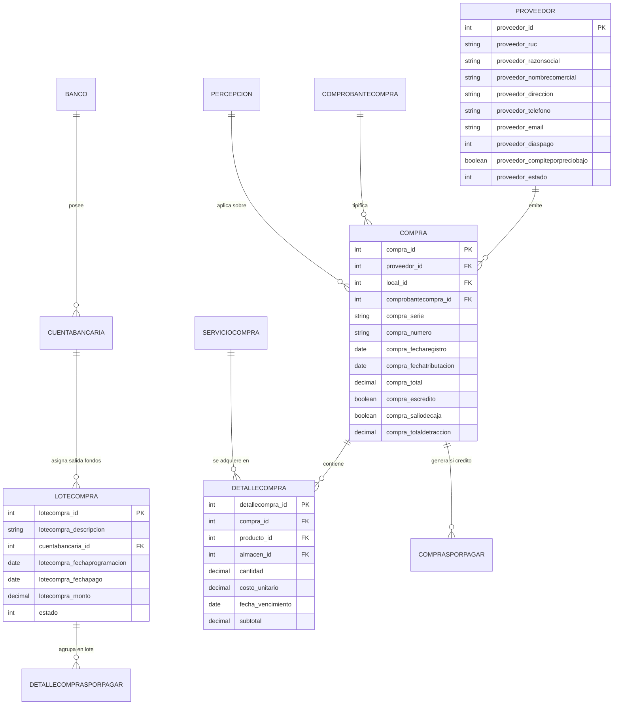

# Módulo de Compras: Documentación Funcional y Técnica de Referencia

**Sistema**: CAPRICHOS (Administrativo / POS restaurant.pe)  
**Ambiente**: Producción (Modo Solo Lectura)  
**Archivo de Entrega**: `modulos/compras.md`  
**Fecha de Auditoría**: Octubre 2026  
**Auditor**: Antigravity Pair-Programming Agent  

---

## 1. Visión General del Módulo de Compras

El módulo de **Compras** de la plataforma administrativa de `restaurant.pe` para la cafetería **CAPRICHOS** tiene como propósito central gestionar el ciclo de abastecimiento, la relación con proveedores comerciales, la programación financiera de pagos a crédito por lotes, y la configuración tributaria y bancaria asociada a las adquisiciones del negocio.

A nivel de arquitectura frontend, el sistema utiliza **AngularJS 1.x con UI-Router (`$state`)**, cargando componentes y plantillas dinámicas agrupadas bajo el estado raíz `modulocompras`. Aunque en el menú lateral principal visible para la cuenta operan los accesos directos a **Proveedores** (`#!/compras/proveedores`), **Lotizar compras** (`#!/compras/lotes`) y **Ajustes** (`#!/compras/ajustes/banco`), el árbol de estados y plantillas del sistema contiene además la funcionalidad completa de **Registro General de Compras / Facturas** (`#!/compras/todas`), **Órdenes de Compra**, **Guías de Remisión**, **Notas de Crédito** y **Cuentas por Pagar a Crédito**.

---

## 2. Pantalla: Proveedores (`#!/compras/proveedores`)

### 2.1 Propósito
Administrar el catálogo de proveedores de insumos, productos comerciales y servicios generales. Permite consultar la información comercial, tributaria (RUC/SUNAT), de contacto y financiera de cada proveedor, así como dar de alta a nuevos suplidores o modificar sus datos.

### 2.2 Flujo de Uso Paso a Paso
1. **Acceso**: El usuario ingresa desde el menú lateral seleccionando `Compras > Proveedores` (ruta `#!/compras/proveedores`).
2. **Exploración**: Se visualiza un diseño *Master-Detail* (maestro-detalle en dos columnas):
   - A la izquierda: lista paginada de proveedores con su razón social, nombre comercial, RUC, teléfono y total de compras históricas.
   - A la derecha: panel de detalle del proveedor seleccionado (`scripts/restaurantpe/compras/proveedor/proveedor-ver.html`) o un marcador de posición inicial (`proveedor-placeholder.html`).
3. **Búsqueda y Paginación**: El usuario puede filtrar en tiempo real escribiendo en la caja de texto "Buscar..." o cambiando la cantidad de registros por página (10, 20, 50, Todos).
4. **Consulta de Detalle**: Al hacer clic sobre cualquier fila del listado, el panel lateral derecho se actualiza mostrando la ficha completa del proveedor (RUC, teléfonos, correos, direcciones, cuentas bancarias, etc.) y un botón `Editar`.
5. **Creación**: Al pulsar el botón `Nuevo proveedor`, el panel lateral o vista cambia al formulario de edición/creación (`modulocompras.proveedores.nuevo`).
6. **Descarga**: El usuario puede desplegar el botón `Descargar` para exportar el listado en formato Excel.

### 2.3 Columnas de la Tabla (Listado Maestro)
La vista presenta las siguientes columnas o bloques de datos por fila:
* **Proveedor / Identificación**: Razón Social (en negrita), Nombre comercial (si aplica) y número de documento fiscal (`PROVEEDOR_RUC`).
* **Teléfono**: Número telefónico con icono identificador.
* **Historial de Compras**: Contador de compras registradas (`_proveedor_totalcompras compras`).

### 2.4 Campos del Formulario (Ficha del Proveedor: Nuevo / Editar)

El formulario (`scripts/restaurantpe/compras/proveedor/proveedor-editar.html`) contiene los siguientes campos:

| Etiqueta | Tipo de Control | Obligatorio | Opciones / Valores / Reglas |
| :--- | :--- | :--- | :--- |
| **Tipo documento proveedor** | `<ui-select>` | Sí (`ng-required="true"`) | Opciones dinámicas: RUC, DNI, Carnet de Extranjería, Pasaporte. En Perú por defecto RUC. |
| **Razón social** | `<input type="text">` | Sí (`required`) | Mínimo 2 caracteres (`ng-minlength="2"`). Valida campo requerido. |
| **Nombre comercial** | `<input type="text">` | No | Mínimo 2 caracteres si se escribe (`ng-minlength="2"`). |
| **RUC / N° Documento** | `<input type="text">` | Sí (`required`) | Longitud validada según tipo de documento (11 dígitos para RUC, 8 para DNI). Botón integrado de consulta/autocompletado SUNAT (`vm.fnConsultarSunat`). |
| **Dirección** | `<input type="text">` | No | Dirección fiscal o principal. |
| **Dirección 2** | `<input type="text">` | No | Dirección secundaria, almacén o sucursal del proveedor. |
| **Teléfono** | `<input type="text">` | No | Teléfono de contacto / comercial. |
| **Email** | `<input type="text">` | No | Correo electrónico para órdenes o comprobantes. |
| **Contacto** | `<input type="text">` | No | Nombre de la persona o ejecutivo de cuenta de contacto. |
| **Cuenta Corriente** | `<input type="text">` | No | Número de cuenta corriente bancaria del proveedor. |
| **Días de pago** | `<input type="text">` | No | Solo números (`solo-numeros`), longitud máxima 2 dígitos (`maxlength="2"`). Plazo de crédito comercial. |
| **Observaciones** | `<textarea>` | No | Notas adicionales sobre el proveedor (`msd-elastic`). |
| **Estado (Proveedor activo)** | `<input type="checkbox">` | No | Checkbox `icheck` (`vm.proveedor.proveedor_estado`, 1: Activo, 0: Inactivo). |
| **Compras - Compite por precio bajo** | `<input type="checkbox">` | No | Tooltip: *"Si marcas el check, este proveedor será tomado en cuenta en la lista de proveedores recomendados por el sistema de manera automática."* |
| **Grupo SN** *(Específico internacional / Condicional)* | `<ui-select>` | No | Visible solo si `Security.esDominioVencindadDelosCuates()`. Grupos de socios de negocio. |
| **Tipo de Socio de Negocio / Tipo RUC / Contribuyente / SRI** | `<ui-select>` | No | Visible solo bajo dominios específicos internacionales (Ecuador/México). |

### 2.5 Filtros Disponibles
* **Búsqueda por texto**: Campo de texto reactivo con placeholder `Buscar...` (`vm.valBusqueda`), filtrado local y remoto vía `vm.buscarPorFiltro()`.
* **Selector de Paginación**: Selector con opciones: `10 registros`, `25 registros`, `50 registros`, `Todos los registros`.
* **Botón de recarga**: Botón de actualización rápida con icono `fa-refresh` (`vm.fnCargarProveedores()`).

### 2.6 Botones y Acciones Disponibles (Solo Nombres)
* `Descargar` (menú desplegable a Excel mediante `/api/reports/report.php?page=all_proveedor`).
* `Nuevo proveedor` (abre formulario de alta).
* `Guardar` (en estado creación, deshabilitado si `form.$invalid`).
* `Modificar` (en estado edición).
* `Cancelar` (retorna al listado principal).
* `Editar` (en panel de detalle del proveedor).
* `Consultar SUNAT` (icono de búsqueda en campo RUC para autocompletar razón social y dirección).

### 2.7 Estados y Reglas Visibles
* **Validaciones**: Si el RUC no cumple con los 11 dígitos requeridos para proveedores con RUC, el formulario marca error de validación visual (`has-error`).
* **Estados del Proveedor**: Activo (`proveedor_estado = '1'`) e Inactivo (`proveedor_estado = '0'`).
* **Mensajes de Validación**: "Campo requerido", "Nombre muy corto (minimo 2 letras)".

### 2.8 Endpoints GET Observados
* `GET /restaurant/api/rest/proveedor/getAll/-1/{pagina}/{limite}`: Obtiene el listado paginado de proveedores con metadata de compras asociadas.
  - *Estructura de respuesta*: Objeto con `tipo`, `data` (arreglo de proveedores con campos `proveedor_id`, `proveedor_razonsocial`, `proveedor_nombrecomercial`, `proveedor_ruc`, `proveedor_telefono`, `_proveedor_totalcompras`, etc.).
* `GET /restaurant/api/rest/proveedor/get/{idProveedor}`: Obtiene la ficha completa de un proveedor individual.

---

## 3. Pantalla: Lotizar Compras (`#!/compras/lotes`)

### 3.1 Propósito
Agrupar y programar deudas y facturas pendientes de compras al crédito en **lotes de pago**. Permite a la tesorería o administración consolidar múltiples cuotas por pagar hacia diversos proveedores en un único lote asociado a una cuenta bancaria, definir una fecha tentativa de desembolso y ejecutar posteriormente el pago unificado o masivo del lote.

> [!NOTE]
> **Aclaración Arquitectónica Crucial**: En este sistema, la opción de menú "Lotizar compras" se refiere a **Lotes Financieros de Pago a Proveedores** (agrupamiento de cuentas por pagar para tesorería), y **no** a lotes de inventario perecedero con trazabilidad física (los cuales se gestionan en Almacén / Detalle de Compra).

### 3.2 Flujo de Uso Paso a Paso
1. **Acceso**: El usuario hace clic en `Compras > Lotizar compras` (`#!/compras/lotes`).
2. **Visualización de Lotes**: Se presenta una tabla con el histórico de lotes creados en el rango de fechas seleccionado, mostrando fechas de programación, cuenta bancaria, estado y monto total.
3. **Filtrado**: El usuario puede ajustar el rango de fechas con el selector de fechas (daterangepicker) y pulsar `Generar informe`.
4. **Registro de un Lote**:
   - Al pulsar `Registrar lote` (`#!/compras/lotes/nuevo`), se abre el formulario `lotecompra-form.html`.
   - Se ingresa un identificador de lote (ej. "LOTE OCTUBRE SEMANA 2").
   - Se selecciona la cuenta bancaria de salida de fondos.
   - Se define la "Fecha en que se programó" y la "Fecha tentativa de pago".
   - Abajo se lista la tabla de cuotas/facturas al crédito pendientes de pago.
   - El usuario marca las cuotas que desea incorporar en el lote; el sistema calcula automáticamente el total acumulado en tiempo real: `Total lote: S/ XX.XX`.
   - Se guarda el lote.
5. **Pago del Lote**: Desde la lista de lotes, un lote pendiente permite acceder a la acción de pago (`#!/compras/lotes/pagar/:idLote`), donde se registra la forma de pago (transferencia, cheque, depósito) y el comprobante u operación bancaria.

### 3.3 Columnas de la Tabla (Listado de Lotes)
1. **Fech. de registro**: Fecha de creación del lote en el sistema.
2. **Fech. de programación**: Fecha para la cual se planificó la gestión del lote.
3. **Fech. de pago**: Fecha efectiva en la que se liquidó el lote.
4. **Día de pago**: Día de la semana o indicador del cronograma.
5. **Lote**: Identificador o descripción asignada al lote.
6. **Cta. Bancaria**: Entidad y número de cuenta desde donde se cubrirá el pago.
7. **Estado**: Estado operativo del lote (ej. *Pendiente*, *Pagado*, *Parcial*).
8. **Total**: Importe monetario total consolidado del lote.
9. **Opciones**: Botones de acción contextual (Ver detalle, Pagar lote, Editar, Eliminar/Anular).

### 3.4 Campos del Formulario de Creación / Edición de Lote (`lotecompra-form.html`)
* **Identificador de lote**: `<input type="text">` (`vm.lotecompra.lotecompra_descripcion`), Obligatorio (`required`).
* **Cta. Bancaria**: `<ui-select>` (`vm.cuentaSeleccionada`), muestra Banco y Número de Cuenta (`item.banco.banco_nombre - item.cuentabancaria_nombre`).
* **Fecha en que se programó**: `<input type="text">` con directiva `bs-datepicker` y botón de calendario, Obligatorio (`required`).
* **Fecha tentativa de pago**: `<input type="text">` con directiva `bs-datepicker` y botón de calendario, Obligatorio (`required`).
* **Buscador de Proveedor para cuotas**: `<ui-select class="customer-selector">` con refresco dinámico por RUC o Razón Social.
* **Tabla de Selección de Cuotas**:
  - Columnas: `Fecha pago`, `Proveedor`, `Comprobante`, `N° comprobante`, `Monto deuda`, `Interés`, `Amortizado`, `Pendiente`, `Agregar a lote` (checkbox de selección).
* **Total Lote**: Indicador de solo lectura con cálculo reactivo (`vm.montoTotalLoteCompra`).

### 3.5 Campos de la Pantalla de Pago del Lote (`lotecompra-pagar.html`)
* **Datos Informativos**: Fecha, Total de compras, Lote, Cuenta bancaria origen, Observaciones.
* **Forma de pago**: Selector (Efectivo, Depósito bancario, Transferencia, Cheque).
* **Monto**: Importe a pagar.
* **Código de operación**: N° de operación bancaria.
* **Cuenta Origen / Destino**: Selectores de cuentas interbancarias.
* **Campos específicos para Cheques**: Entidad bancaria, Fecha de cobro de cheque, Nro. de cheque, Indicador diferido.
* **Observación**: Notas adicionales del asiento de pago.

### 3.6 Filtros Disponibles
* **Rango de Fechas**: Botón con Date Range Picker (ej. *Del 01 Octubre, 2026 hasta 13 Octubre, 2026*).
* **Búsqueda por texto**: `<input placeholder="Buscar...">` (`vm.valBusqueda`).
* **Paginación**: Selector UI de cantidad de registros (`10, 25, 50, Todos`).

### 3.7 Botones y Acciones Disponibles (Solo Nombres)
* `Generar informe` (`vm.fnGenerarInforme()`).
* `Registrar lote` (acceso a creación).
* `Pagar lote` (acceso a liquidación).
* `Regresar a la lista`.
* `Registrar pago`.
* `Aplicar` / `Cancelar` (en selector de rango de fechas).

### 3.8 Endpoints GET Observados
* `GET /restaurant/api/rest/lotecompra/obtenerLotecomprasListByRangoFechasAndEstadoAndBusqueda/{fechaInicio}/{fechaFin}/{estado}/{pagina}/{limite}/{idBusqueda}`: Consulta los lotes en un rango de fechas determinado con estado y paginación.
* `GET /restaurant/api/rest/cuentabancaria/obtenerCuentasBancariasListByEstado/1`: Obtiene las cuentas bancarias activas disponibles para asociar al lote.
* `GET /restaurant/api/rest/compracredito/...`: Consulta de cuotas al crédito pendientes de incorporar a lotes.

---

## 4. Pantalla: Ajustes de Compras (`#!/compras/ajustes/banco`)

### 4.1 Propósito
Configurar todas las entidades maestras que soportan el circuito de compras, cuentas bancarias, medios de pago, fiscalidad y servicios tercerizados.

### 4.2 Estructura de Pestañas / Subsecciones
La pantalla contiene un encabezado de pestañas de navegación (`scripts/restaurantpe/compras/ajustes/ajustesselector.html`):
1. **Bancos** (`#!/compras/ajustes/banco`)
2. **Cuentas bancarias** (`#!/compras/ajustes/cuentabancaria`)
3. **Comprobantes de compra** (`#!/compras/ajustes/comprobantecompra`)
4. **Percepciones** (`#!/compras/ajustes/percepcion`)
5. **Transportistas** (`#!/compras/ajustes/transportistas`)
6. **Categorías de servicios** (`#!/compras/ajustes/categoriaserviciocompra`)
7. **Servicios** (`#!/compras/ajustes/serviciocompra`)
8. *(Impuestos de compra: estado `modulocompras.ajustes.impuestoscompra`)*

---

### 4.3 Detalle por Pestaña

#### A. Bancos (`scripts/restaurantpe/creditos/banco/`)
* **Propósito**: Catálogo de entidades financieras en las que opera la empresa.
* **Columnas de la tabla**: `Nombre`, `Dirección`, `Observaciones`, `Estado`, `Acciones`.
* **Campos del formulario (Nuevo / Editar)**:
  - `Nombre`: `<input type="text">` (`vm.banco.banco_nombre`), Obligatorio (`required`).
  - `Identificador tributario`: `<input type="text">` (`vm.banco.banco_identificadortributario`), Opcional.
  - `Dirección`: `<input type="text">` (`vm.banco.banco_direcciones`), Obligatorio (`required`).
  - `Observación`: `<input type="text">` (`vm.banco.banco_otros`), Opcional.
* **Botones**: `Nuevo banco`, `Guardar`, `Modificar`, `Cancelar`, `Eliminar/Desactivar`.
* **Endpoint GET**: `GET /restaurant/api/rest/banco/obtenerTodoslosBancosPorBusquedaPaginado/-1/-1/{pagina}/{limite}`.

#### B. Cuentas Bancarias (`scripts/restaurantpe/creditos/cuentabancaria/`)
* **Propósito**: Registro de cuentas corrientes, de ahorros o detracción ligadas a los bancos configurados.
* **Columnas de la tabla**: `Banco`, `Número Cta.`, `Propietario`, `Cod. Interbancario (CCI)`, `Cuenta contable`, `Estado`, `Acciones`.
* **Campos del formulario (Nuevo / Editar)**:
  - `Banco`: `<ui-select>` (`vm.bancoSeleccionado`), Obligatorio.
  - `Número Cta.`: `<input type="text">` (`vm.cuentabancaria.cuentabancaria_nombre`), Obligatorio.
  - `Propietario`: `<input type="text">` (`vm.cuentabancaria.cuentabancaria_propietario`), Obligatorio.
  - `Cod. Interbancario`: `<input type="text">` (`vm.cuentabancaria.cuentabancaria_codigointerbancario`), Obligatorio.
  - `Cuenta contable`: `<input type="text">` (`vm.cuentabancaria.cuentabancaria_cuentacontable`), Opcional (código de plan de cuentas contables).
  - `Estado (Cuenta activa)`: `<input type="checkbox">` (`vm.cuentabancaria.cuentabancaria_estado`).
* **Botones**: `Nueva cuenta bancaria`, `Guardar`, `Modificar`, `Cancelar`.
* **Endpoint GET**: `GET /restaurant/api/rest/cuentabancaria/obtenerCuentasBancariasListByEstado/1`.

#### C. Comprobantes de Compra (`scripts/restaurantpe/compras/comprobantecompra/`)
* **Propósito**: Tipología de documentos comerciales y fiscales admitidos en el registro de adquisiciones (Facturas, Boletas de venta, Recibos por honorarios, Guías, Liquidaciones de compra, Notas de débito/crédito).
* **Columnas de la tabla**: `Descripción`, `Abreviatura`, `Código interno`, `Genera Impuesto`, `Predeterminado`, `Estado`, `Acciones`.
* **Campos del formulario (Nuevo / Editar)**:
  - `Descripción`: `<input type="text">` (`vm.comprobantecompra.comprobantecompra_descripcion`), Obligatorio.
  - `Abreviatura`: `<input type="text">` (`vm.comprobantecompra.comprobantecompra_abreviatura`), Obligatorio (ej. "FT", "BV", "RH").
  - `Código interno`: `<input type="text">` (`vm.comprobantecompra.comprobantecompra_codigointerno`), Obligatorio (código SUNAT ej. "01", "03").
  - `Impuestos`: `<input type="checkbox">` (`vm.comprobantecompra.comprobantecompra_generaimpuesto`), define si el documento da derecho a crédito fiscal / IGV.
  - `Predeterminado`: `<input type="checkbox">` (`vm.comprobantecompra.comprobantecompra_predeterminado`).
  - `Estado`: `<input type="checkbox">` (`vm.comprobantecompra.comprobantecompra_estado`).
* **Botones**: `Nuevo comprobante`, `Guardar`, `Modificar`, `Cancelar`.

#### D. Percepciones (`scripts/restaurantpe/compras/percepcion/`)
* **Propósito**: Configurar las tasas del régimen de Percepciones del IGV aplicables a compras en Perú (ej. 2% combustible, 0.5% operaciones con agente de percepción).
* **Columnas de la tabla**: `Descripción`, `Porcentaje %`, `Estado`, `Acciones`.
* **Campos del formulario (Nuevo / Editar)**:
  - `Descripción`: `<input type="text">` (`vm.percepcion.percepcion_descripcion`), Obligatorio.
  - `Porcentaje %`: `<input type="text">` (`vm.percepcion.percepcion_porcentaje`), Obligatorio.
  - `Estado`: `<input type="checkbox">` (`vm.percepcion.percepcion_estado`).
* **Botones**: `Nueva percepción`, `Guardar`, `Modificar`, `Cancelar`.

#### E. Transportistas (`scripts/restaurantpe/ajustes/transportistas/`)
* **Propósito**: Catálogo de empresas de transporte de carga y unidades para recepción de insumos con Guías de Remisión Remitente/Transportista.
* **Columnas de la tabla**: `Razón social`, `RUC`, `Dirección`, `Placa`, `Marca`, `Licencia`, `Teléfono`, `Estado`, `Acciones`.
* **Campos del formulario (Nuevo / Editar)**:
  - `Razón social`: `<input type="text">` (`vm.transportista.transportista_razonsocial`), Obligatorio.
  - `RUC`: `<input type="text">` (`vm.transportista.transportista_ruc`), Obligatorio.
  - `Dirección`: `<input type="text">` (`vm.transportista.transportista_direccion`), Obligatorio.
  - `Placa del vehículo`: `<input type="text">` (`vm.transportista.transportista_placa`).
  - `Marca del vehículo`: `<input type="text">` (`vm.transportista.transportista_marca`).
  - `Certificado`: `<input type="text">` (`vm.transportista.transportista_certificado`).
  - `Licencia de conducir`: `<input type="text">` (`vm.transportista.transportista_licencia`).
  - `Teléfono`: `<input type="text">` (`vm.transportista.transportista_telefono`).
* **Botones**: `Nuevo transportista`, `Guardar`, `Modificar`, `Cancelar`.

#### F. Categorías de Servicios de Compra (`scripts/restaurantpe/compras/categoriaserviciocompra/`)
* **Propósito**: Agrupar los tipos de gastos o servicios no inventariables (ej. Servicios Básicos, Mantenimiento, Publicidad, Honorarios Profesionales).
* **Campos**: Descripción (`categoriaserviciocompra_descripcion`), Estado.

#### G. Servicios de Compra (`scripts/restaurantpe/compras/serviciocompra/`)
* **Propósito**: Catálogo de ítems de gasto o servicios adquiridos que no ingresan a stock físico pero forman parte de las compras o costos de la cafetería.
* **Columnas de la tabla**: `Descripción`, `Categoría`, `Costo Referencial`, `Tiene IGV`, `Estado`, `Acciones`.
* **Campos del formulario (Nuevo / Editar)**:
  - `Descripción`: `<input type="text">` (`vm.serviciocompra.serviciocompra_descripcion`), Obligatorio.
  - `Costo`: `<input type="text">` (`vm.serviciocompra.serviciocompra_costo`), Obligatorio.
  - `Observación`: `<input type="text">` (`vm.serviciocompra.serviciocompra_referencia`).
  - `Tiene impuesto`: `<input type="checkbox">` (`vm.serviciocompra.serviciocompra_tieneigv`).
  - `Estado`: `<input type="checkbox">` (`vm.serviciocompra.serviciocompra_estado`).

---

## 5. Registro de Compras y Facturas de Proveedor

Aunque no figura como botón directo en el menú lateral colapsado, el sistema dispone de la arquitectura completa para la gestión de adquisiciones en producción bajo las rutas `#!/compras/todas` y `#!/compras/todas/nuevo/`.

### 5.1 Estructura del Registro de Compra (`compra-form.html`)

El formulario de compra (`scripts/restaurantpe/compras/compra/compra-form.html`) es uno de los componentes más completos del ERP, estructurado en tres áreas:

#### 1. Cabecera del Comprobante de Compra
* **Fecha de compra**: Fecha de emisión comercial del documento (`compra_fecharegistro`).
* **Fecha de tributación**: Periodo tributario para crédito fiscal (`compra_fechatributacion`).
* **Proveedor**: Selector modal con autocompletado por RUC/Razón Social y botón de creación rápida de proveedor al vuelo (`vm.proveedorSeleccionado`).
* **Establecimiento / Local**: Selección de la sucursal receptora (`vm.localSeleccionado`).
* **Documento de la compra**: Factura, Boleta de Venta, Recibo por Honorarios, etc. (`vm.comprobanteSeleccionado`).
* **Serie y Correlativo**: Campos de texto (`compra_serie` y `compra_numero`).
* **Moneda del comprobante**: Soles (S/) o Dólares ($) (`vm.monedaSeleccionada`).
* **Tipo de Cambio (T.C.)**: Valor de cambio oficial SUNAT para la fecha (`compra_tipocambio`).
* **Generar impuestos a partir del total**: Checkbox que define si los precios ingresados incluyen IGV o si el IGV se calcula sobre la base imponible.

#### 2. Detalle de Ítems Comprados (Insumos, Productos y Servicios)
Permite agregar dos tipos de líneas de detalle:
* **Insumos / Productos de Almacén**:
  - Buscador predictivo de productos e insumos de la cafetería.
  - **Almacén de destino**: Selección del almacén físico específico (ej. Cocina, Barra, Almacén Central).
  - **Cantidad** y **Unidad de Medida (UM)** / Presentación de compra (ej. Kilos, Cajas, Litros, Unidades).
  - **Precio Unitario** e **Importe total**.
  - **¿Afecto a impuestos?**: Indicador de afectación al IGV (Gravado, Exonerado, Inafecto).
  - **Fecha de Vencimiento (`Fecha Venc.`)**: Campo fundamental donde se asocia la caducidad al lote de insumos ingresado.
* **Servicios Adquiridos**:
  - Buscador de servicios vía botón "Buscar servicios".
  - Costo unitario, Afectación a impuesto y Total de la línea.

#### 3. Liquidación, Pagos y Fiscalidad Peruana
* **Condición de Compra**:
  - **Contado**: Desglosa medios de pago:
    - *Monto en efectivo* (`compra_montoefectivo`).
    - *Monto con tarjeta* (`compra_montotarjeta`).
    - *Otro tipo de pago / Cheque* (`compra_montocheque`).
    - *Registrar como egreso de caja*: Checkbox (`compra_saliodecaja`) que descuenta el efectivo automáticamente del turno de caja activo en el POS.
  - **Compra al Crédito**: Genera una cuenta por pagar (`comprasporpagar`), permitiendo configurar cuotas, fechas de vencimiento y programación posterior mediante **Lotizar compras**.
* **Régimen de Percepciones**: Checkbox `Aplicar percepción`, selección de tasa configurada y cálculo automático del sobrecargo del comprobante.
* **Régimen de Detracciones (SPOT SUNAT)**: Checkbox `Aplicar detracción`, selección del tipo/porcentaje de detracción (ej. 4%, 10%, 12%), cálculo del monto retenido a depositar en el Banco de la Nación (`compra_totaldetraccion`).
* **Monto Descuento Global**: Descuento comercial general sobre la factura.
* **Cuenta Contable**: Identificador de subcuenta contable para integración externa.

---

## 6. Lotes: Trazabilidad y Fechas de Vencimiento

Del análisis exhaustivo del código fuente y plantillas públicas se constata la siguiente distinción técnica:

1. **Lotes Financieros (`Lotecompra`)**:
   - Administrados en `#!/compras/lotes`.
   - Propósito: Control de tesorería y programación de pagos a proveedores de facturas emitidas a crédito.
   - Datos clave: `lotecompra_fechaprogramacion`, `lotecompra_fechapago`, `lotecompra_monto`, `cuentabancaria_id`.
2. **Lotes de Almacén y Vencimiento de Insumos**:
   - Se capturan en la recepción física o factura de compra en el campo `Fecha Venc.` por cada línea de insumo/producto (`scripts/restaurantpe/compras/compra/compra-form.html`).
   - Impactan directamente en:
     - El Kardex valorizado individual (`scripts/restaurantpe/almacen/kardex/individual.html`).
     - El informe de inventario de **Productos por vencer** (`scripts/restaurantpe/informes/inventario/productosporvencer.html`).
     - El procesamiento de requerimientos y movimientos internos entre áreas de producción (`almacen/requerimientomovimiento`).

---

## 7. Relaciones con Otros Módulos

El módulo de Compras interactúa de manera estrecha con los siguientes módulos del sistema:
* **Almacén e Inventario**: Cada compra de insumos/productos genera una entrada de stock en el almacén de destino seleccionado, actualizando el costo promedio ponderado y registrando la fecha de vencimiento en el Kardex.
* **Caja Chica / Egresos**: Si la compra se marca con `Registrar como egreso de caja (Solo efectivo)`, se genera un movimiento automático de egreso en el turno de caja abierto (`#!/caja/egresos`).
* **Créditos (Cuentas por Pagar)**: Las compras registradas con condición crédito alimentan directamente el submódulo `Créditos > Pago de compras` (`#!/creditos/compracreditos`) y el submódulo de `Lotizar compras`.
* **Facturación y Tributación**: Almacena comprobantes de proveedores con series, RUCs, IGV, Detracciones y Percepciones para la exportación de libros electrónicos de compras (PLE SUNAT / Sire).

---

## 8. Entidades de Datos Clave (Modelo ER Inferido)

---

## 9. Permisos Asociados

El sistema valida permisos a nivel de usuario en cada carga de vista mediante:
* Endpoint: `GET /restaurant/api/rest/usuario/obtenerPermisosPorUsuarioValidado/1`.
* Los identificadores de permisos observables en el código para compras corresponden a:
  - `PERMISO_COMPRAS_VER`
  - `PERMISO_COMPRAS_REGISTRAR`
  - `PERMISO_COMPRAS_ANULAR`
  - `PERMISO_PROVEEDORES_EDITAR`
  - `PERMISO_LOTES_PAGAR`
  - `PERMISO_AJUSTES_COMPRAS`

---

## 10. Resumen de Endpoints GET del Módulo

| Módulo / Pantalla | Endpoint GET Observado | Propósito / Respuesta Resumida |
| :--- | :--- | :--- |
| **Proveedores** | `/restaurant/api/rest/proveedor/getAll/-1/{pag}/{lim}` | Lista paginada de proveedores con métricas de compras. |
| **Proveedores** | `/restaurant/api/rest/proveedor/get/{id}` | Ficha técnica y datos de contacto de un proveedor. |
| **Lotes** | `/restaurant/api/rest/lotecompra/obtenerLotecomprasListByRangoFechasAndEstadoAndBusqueda/{f1}/{f2}/{est}/{pag}/{lim}/{q}` | Lotes financieros creados en rango de fechas con estado. |
| **Bancos** | `/restaurant/api/rest/banco/obtenerTodoslosBancosPorBusquedaPaginado/-1/-1/{pag}/{lim}` | Catálogo de entidades bancarias configuradas. |
| **Bancos** | `/restaurant/api/rest/banco/obtenerBancosListByEstado/1` | Lista de bancos activos para selectores. |
| **Cuentas Bancarias** | `/restaurant/api/rest/cuentabancaria/obtenerCuentasBancariasListByEstado/1` | Lista de cuentas bancarias asociadas para pagos y lotes. |
| **Comprobantes** | `/restaurant/api/rest/comprobantecompra/obtenerComprobantecomprasListByEstado/1` | Tipos de comprobante válidos para compra (FT, BV, etc.). |
| **Percepciones** | `/restaurant/api/rest/percepcion/obtenerPercepcionesListByEstado/1` | Tasas porcentuales de percepción activas. |
| **Compras General** | `/restaurant/api/rest/compra/getAll/-1/-1/-1/{pag}/{lim}` | Listado maestro de compras registradas. |
| **Créditos / Deudas**| `/restaurant/api/rest/compracredito/obtenerInformeDeudasComprasCredito` | Cuotas pendientes de pago disponibles para lotizar. |

---

## 11. Funcionalidades Imprescindibles para Replicar

Para el nuevo sistema de **CAPRICHOS**, las siguientes funcionalidades del módulo de compras son de carácter crítico y no pueden omitirse:
1. **Catálogo de Proveedores con Búsqueda SUNAT**: Registro de proveedores con validación de RUC de 11 dígitos y autocompletado en línea vía API de SUNAT (indispensable para evitar errores de digitación en facturas).
2. **Registro Integral de Compras / Facturas**:
   - Cabecera con serie/correlativo, proveedor, fecha de emisión y fecha de tributación.
   - Detalle multialmacén: asignación de insumos directamente al almacén correspondiente (Barra, Cocina, Depósito).
   - Captura de **Fecha de Vencimiento** por insumo en la misma línea de compra para alimentar el semáforo de insumos perecederos.
3. **Manejo Tributario Peruano**:
   - Soporte para IGV (precios con IGV incluido o más IGV).
   - Soporte para régimen de Percepciones (sumado al comprobante).
   - Soporte para Detracciones (SPOT SUNAT) con cálculo automático del porcentaje y generación del saldo neto a pagar al proveedor.
4. **Vínculo Directo Compra - Caja Chica**: Posibilidad de marcar compras al contado en efectivo como egreso directo de la caja del turno activo para que el cuadre de caja coincida al cierre del día.
5. **Programación Financiera de Lotes de Pago**: Agrupamiento de facturas a crédito por fecha y cuenta bancaria para pago masivo.

---

## 12. Oportunidades de Mejora para el Nuevo Sistema

1. **UX/UI Moderna y Unificada**: El sistema actual dispersa la gestión entre "Proveedores", "Lotizar compras", "Ajustes", "Almacén" y "Créditos > Pago de compras". En el nuevo sistema se debe unificar en un único **Hub de Abastecimiento**: `Compras > Facturas`, `Proveedores`, `Pagos Programados` y `Configuración`.
2. **Carga Masiva de Facturas Electrónicas (XML / UBL 2.1)**: Actualmente el usuario debe ingresar manualmente cada campo, serie, correlativo y línea de detalle. Una mejora de alto impacto es permitir arrastrar el archivo `XML` de la factura del proveedor para que el sistema autocomplete el RUC, razón social, serie, número, montos e incluso empareje los insumos automáticamente.
3. **Validación Automática del Estado del Comprobante en SUNAT**: Verificar en tiempo real mediante el API de SUNAT si el comprobante del proveedor se encuentra en estado *Aceptado*, *Anulado* o *Rechazado*.
4. **Alerta Temprana de Caducidad de Insumos**: Al vincular la fecha de vencimiento capturada en la compra con el inventario, generar notificaciones push / correo al jefe de cocina cuando un lote de lácteos, carnes o pastelería esté a 3 o 5 días de expirar.

---

## 13. Dudas y Preguntas para el Cliente (CAPRICHOS)

1. **Uso de Órdenes de Compra**: ¿El personal de CAPRICHOS emite primero una Orden de Compra previa autorización de gerencia antes de que llegue la mercadería, o registran directamente la Factura/Guía al momento de la entrega de insumos?
2. **Frecuencia de Compras a Crédito y Pagos por Lote**: ¿Qué porcentaje aproximado de sus proveedores se cancela al contado desde la caja de la cafetería vs. mediante transferencias bancarias programadas en lotes semanales/quincenales?
3. **Cuentas Bancarias de Pago**: ¿Desde cuántas cuentas bancarias distintas (BCP, BBVA, Interbank) ejecutan pagos a proveedores habitualmente?
4. **Tratamiento de Detracciones**: Para servicios de mantenimiento, limpieza o compras sujetas a detracción, ¿requieren que el nuevo sistema genere el archivo plano para pago masivo de detracciones del Banco de la Nación?
