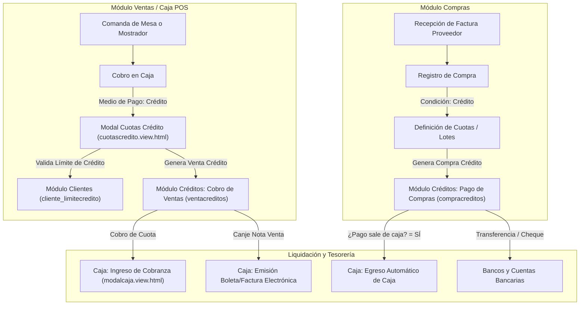

# Módulo de Créditos: Cobro de Ventas y Pago de Compras

**Sistema**: Restaurant.pe (Instancia en Producción: CAPRICHOS - Lima, Perú)  
**URL de Producción**: `https://caprichos.restaurant.pe/restaurant/#!/login`  
**Usuario de Auditoría**: `krosales`  
**Modalidad**: SOLO LECTURA estricto en entorno de PRODUCCIÓN en operación activa.  
**Fecha de Inspección**: 2026-10-13  
**Documento Generado**: `/home/jose/JoseEM/caprichos/web-anterior/administrativo/modulos/creditos.md`  

---

## 1. Resumen Ejecutivo y Alcance del Módulo

El módulo de **Créditos** administra el ciclo financiero diferido de la cafetería CAPRICHOS. Se divide operativamente en dos grandes ramas complementarias:

1. **Cuentas por Cobrar (Cobro de Ventas)** (`#!/creditos/ventacreditos`):
   - Monitoreo, gestión y amortización de ventas efectuadas al crédito a clientes individuales o clientes corporativos/empresas con línea de financiamiento.
   - Liquidación de cuotas individuales, amortización parcial o pago consolidado de múltiples cuotas.
   - Regularización y canje tributario de Notas de Venta emitidas al crédito hacia comprobantes fiscales electrónicos oficiales (Boletas de Venta o Facturas electrónicas).
   - Conciliación de amortizaciones por medio de efectivo, tarjetas, transferencias con registro de código de operación y subida de comprobantes digitales (vouchers).

2. **Cuentas por Pagar (Pago de Compras)** (`#!/creditos/compracreditos`):
   - Control de obligaciones comerciales pendientes frente a proveedores de mercadería, insumos, packaging y servicios de cafetería.
   - Amortización y cancelación de facturas y documentos de compra a crédito.
   - Desglose multicanal de pago: Contado/Efectivo, Transferencia bancaria, Depósito en cuenta, Emisión de Cheques (comunes o diferidos) y Otros.
   - Vinculación directa con tesorería y **Caja**: capacidad de sincronizar automáticamente el egreso físico de dinero de la caja del turno activo o imputarlo a cuentas bancarias externas de la empresa.
   - Soporte para compras lotizadas y edición retroactiva compensatoria de pagos efectuados.

> [!IMPORTANT]
> **Garantía de Solo Lectura**: Toda la auditoría se realizó en modo estricto de solo lectura sobre el entorno de producción en vivo. No se crearon ni guardaron amortizaciones, cobros, pagos, egresos ni anulaciones. No se extrajeron datos personales reales ni montos de clientes o proveedores de la base de datos viva. Toda la especificación técnica aquí contenida se deriva de la inspección pasiva del DOM y del análisis estático de las plantillas públicas AngularJS (`$templateCache`), controladores y servicios de la arquitectura SPA.

---

## 2. Arquitectura General y Enrutamiento SPA

El frontend opera como una SPA (*Single Page Application*) desarrollada sobre **AngularJS 1.6.10**, estructurada con `ui-router` (rutas con hashbang `#!/`) y Bootstrap 3.

### 2.1 Mapa de Estados y Rutas

| Estado `ui-router` | Ruta URL | Controlador Angular | Plantilla Vista | Breadcrumb | Permiso ACL Requerido |
| :--- | :--- | :--- | :--- | :--- | :--- |
| `creditos` | `#!/creditos` | `CreditosIndexCtrl as vm` | `scripts/restaurantpe/creditos/index.html` | `creditos-breadcrumb.html` | `creditos` |
| `creditos.ventacreditos` | `#!/creditos/ventacreditos` | `VentareditoCtrl as vm` | `scripts/restaurantpe/creditos/ventacredito/ventacredito-lista.html` | `breadcrumb-ventacredito-lista.html` | `creditos.ventacreditos` |
| `creditos.ventacreditos.nuevo` | `#!/creditos/ventacreditos/:ventaporcobrarId/nuevo` | `PagarVentaCreditoCtrl as vm` | `scripts/restaurantpe/creditos/ventacredito/ventacredito-registrar.html` | `breadcrumb-ventacredito-registrar.html` | `creditos.ventacreditos` |
| `creditos.compracreditos` | `#!/creditos/compracreditos` | `CompracreditosCtrl as vm` | `scripts/restaurantpe/creditos/compracredito/compracredito-lista.html` | `breadcrumb-compracredito-lista.html` | `creditos.compracreditos` |
| `creditos.compracreditos.nuevo` | `#!/creditos/compracreditos/:compraporcobrarId/nuevo` | `PagarCompraCreditoCtrl as vm` | `scripts/restaurantpe/creditos/compracredito/compracredito-registrar.html` | `breadcrumb-compracredito-nuevo.html` | `creditos.compracreditos` |
| `creditos.compracreditos.editar`| `#!/creditos/compracreditos/:compraporcobrarId/:detallecompraId/editar` | `EditarCompraCreditoCtrl as vm` | `scripts/restaurantpe/creditos/compracredito/compracredito-editar.html` | `breadcrumb-compracredito-editar.html` | `creditos.compracreditos` (y `Security.hasAccess('creditos.compracreditos.editar')`) |

### 2.2 Dependencias e Inyecciones Principales

- **Módulo AngularJS**: `angular.module("restaurantpe.creditos", [...])`
- **Modelos**: `model.ventacredito`, `model.ventasporcobrar`, `model.comprasporpagar`, `model.banco`, `model.cuentabancaria`.
- **Colecciones y Recursos**: `collection.ventacredito`, `collection.comprasporpagar`, `collection.local`, `collection.venta`, `collection.cliente`, `collection.configuracion`, `collection.banco`, `collection.cuentabancaria`, `collection.caja`.
- **Servicios transversales**: `SecurityService` (control de sesión, IDs de local, caja, turno y usuario), `UtilityService` (formato de moneda, fechas, alertas), `$uibModal` (modales Bootstrap), `$state` (enrutamiento de estados).

---

## 3. Pantalla 1: Cobro de Ventas (`#!/creditos/ventacreditos`)

### 3.1 Propósito
Visualizar de forma consolidada o segmentada todas las transacciones de ventas otorgadas bajo la condición de crédito comercial. Permite auditar saldos adeudados, intereses generados, montos ya cobrados (amortizados), ejecutar la cobranza individual o masiva mediante el punto de cobro de caja, y canjear notas de venta acumuladas en comprobantes de pago formales.

```
+----------------------------------------------------------------------------------------------------+
| Local: [ CAPRICHOS v ]                                                                             |
| [Rango Fechas] [Reiniciar Limite] [Generar Informe] [Pagar varias] [Pagar seleccionadas] [Descargar]|
| Todas las ventas al crédito                                                                        |
+----------------------------------------------------------------------------------------------------+
| [Buscar Cliente / Código]   [ ] Filtrar código   [ ] Agrupar cliente   [ ] Por fecha  [Tipo fecha v]|
| [Tipo Deuda v]   Serie: [ B001 ]   Nro: [ 00000123 ]   Caja: [ Principal v ] [ ] Canjear Notas Venta|
+----------------------------------------------------------------------------------------------------+
| DEUDA: S/. 70.79    |    INTERES: S/. 0.00    |    AMORTIZADO: S/. 0.00    |    TOTAL: S/. 70.79    |
+----------------------------------------------------------------------------------------------------+
| Sel | Fecha pago | Fecha venta | Cliente | Comprobante | N° Comprobante | Total | Deuda | Amort | Pend | Acciones |
| [ ] | 15/10/2026 | 13/10 10:15 | Juan P. | Boleta      | B001-000045    | 70.79 | 70.79 |  0.00 | 70.79| [Det][Pag]|
+----------------------------------------------------------------------------------------------------+
```

### 3.2 Flujo de Uso Paso a Paso
1. **Acceso al listado**: El operador ingresa a través del menú lateral en `Créditos > Cobro de ventas` (`#!/creditos/ventacreditos`).
2. **Definición de filtros de contexto**:
   - Selecciona el **Local** en la cabecera (por defecto el local activo del cajero).
   - Por defecto, la pantalla consulta las **Deudas pendientes** (`tipodeudabusqueda_id = 1`).
   - El operador puede filtrar por un **Cliente específico** digitando nombre, DNI o RUC en el buscador predictivo (`ui-select`), o activar la casilla `Filtrar por código` e ingresar el código corporativo de la empresa.
   - Puede filtrar por **Serie y Número de comprobante** para auditar una venta específica.
   - Puede activar `Filtrar por fecha` y definir el intervalo con el selector de rango de calendario, indicando si el corte es por *Fecha registro de venta* o *Fecha pago de cuota*.
3. **Revisión de tarjetas de totales**:
   - En deudas pendientes se despliegan 4 tarjetas: **Deuda**, **Interés**, **Amortizado** y **Total**.
   - En deudas pagadas o amortizadas se visualiza la tarjeta resumen de **Total Amortizado** o **Total Anulado**.
4. **Cobro de cuota individual**:
   - El cajero ubica la cuota y presiona el botón azul **Pagar**.
   - El sistema invoca `vm.fnPagarCredito(ventacredito, 0, 0)`, que abre la pasarela de cobro del modal de caja (`modalcaja.view.html`) en la pestaña de `"pagos"`.
   - Se selecciona el medio de cobro (Efectivo, Tarjeta, etc.) y se procesa. Al culminar, la vista se refresca automáticamente recalculando saldos.
5. **Cobro de múltiples cuotas en bloque**:
   - **Pagar varias cuotas**: Si se ha seleccionado un cliente específico o código de empresa, se habilita `Pagar varias cuotas`, liquidando todo el saldo consolidado en una sola transacción de cobro.
   - **Pagar seleccionadas**: El operador marca las casillas de verificación de las cuotas específicas que el cliente abonará y presiona `Pagar seleccionadas`. El sistema totaliza el monto de las cuotas marcadas y abre el modal de cobro de caja con la suma exacta (`idsAPagar`).
   - *Regla de validación*: Estos botones se inhabilitan automáticamente si las cuotas seleccionadas pertenecen a diferentes monedas (`vm.totalesObj.tieneDistintaMoneda == '1'`).
6. **Canje de Notas de Venta por Boleta o Factura**:
   - Cuando está habilitada la configuración de canje (`configuracionCanjeNotaVenta = true`), el operador activa el checkbox `Canjear notas de venta`.
   - Se despliega una columna con casillas de verificación para marcar las notas de venta al crédito que serán regularizadas tributariamente.
   - Al presionar **Canjear Notas de venta por Boleta/Factura**, el sistema consolida los consumos mediante `obtenerDetalleParaCanje()` y abre el modal de cobro de caja para emitir la Boleta o Factura electrónica oficial de cancelación.
7. **Consulta de detalle y auditoría**:
   - Al pulsar **Detalles**, se abre el diálogo modal `ModalVerDetalleVentaCredito` (`detalleventa-modal.html`), mostrando las cuotas amortizadas históricas, fechas, medios de pago, voucher y el desglose de productos y adicionales consumidos.
8. **Exportación de reportes**:
   - Mediante el botón desplegable **Descargar**, se genera el archivo en formatos: **Excel**, **Excel Detallado** y **Excel V2**.

### 3.3 Filtros y Controles de la Pantalla

| Control / Etiqueta | Tipo de Control | Modelo Angular | Opciones / Valores | Comportamiento / Regla |
| :--- | :--- | :--- | :--- | :--- |
| `Local` | `<ui-select>` | `vm.localSeleccionado` | Locales permitidos del usuario + "Todos los locales" | Al cambiar, recarga la lista de cajas y ejecuta la consulta de deudas. |
| `Busqueda de clientes` | `<ui-select>` con búsqueda AJAX | `vm.clienteSeleccionado` | Padrón de clientes (`cliente_dniruc`, nombres, apellidos) | Búsqueda reactiva a partir de 1 caracter. Si está vacío, aplica "Todos los clientes" (`id = -1`). |
| `Filtrar por código` | `<input type="checkbox">` | `vm.filtrarVentasPorCodigoEmpresa` | `'1'` (Sí) / `'0'` (No) | Oculta el buscador por nombre y despliega un campo de texto para código de empresa. |
| `Ingresar código` | `<input type="text">` | `vm.codigoEmpresa` | Texto alfanumérico libre | Código corporativo para convenios empresariales. |
| `Agrupar por cliente` | `<input type="checkbox">` | `vm.agruparPorCliente` | `'1'` (Sí) / `'0'` (No) | Conmuta la grilla a un modo resumido: una fila por cliente con su límite de crédito y deuda total. |
| `Filtrar por fecha` | `<input type="checkbox">` | `vm.filtrarVentasPorCobrar` | `'1'` (Sí) / `'0'` (No) | Habilita el selector de rango de calendario y el combo de tipo de fecha. |
| `Rango de fechas` | Botón con directiva `date-range-picker` | `rangoDeFechas.fechas` | Fecha inicial a Fecha final (con hora) | Dispara la recarga de datos al pulsar "Aplicar". |
| `Tipo de filtro fecha`| `<ui-select>` | `vm.tipoFiltroFecha` | `0`: Por fecha registro de venta<br>`1`: Por fecha pago de cuota | Define sobre qué marca temporal aplica el intervalo de fechas. |
| `Tipo de deuda` | `<ui-select>` | `vm.tipobusquedaSeleccionada` | `1`: Ver deudas pendientes<br>`0`: Ver deudas pagadas<br>`2`: Ver amortizaciones<br>`3`: Ver anuladas | Altera drásticamente la estructura de columnas y las acciones de la tabla. |
| `Serie` | `<input type="text">` | `vm.serieComprobante` | Texto (ej. `B001`, `F001`, `NV01`) | Filtro exacto por serie de comprobante. |
| `Nro` | `<input type="text">` | `vm.numeroComprobante` | Numérico (ej. `00000123`) | Filtro exacto por correlativo de comprobante. |
| `Caja` | `<ui-select>` | `vm.cajaSeleccionada` | Lista de cajas del local + "Todas" | Permite aislar ventas generadas en un punto de cobro específico. |
| `Canjear notas de venta` | `<input type="checkbox">` | `vm.filtrarVentasPorCanjeNotacredito` | `'1'` (Sí) / `'0'` (No) | Solo visible si hay cliente seleccionado y la configuración general del restaurante lo autoriza. |

### 3.4 Estructura de la Tabla de Cobro de Ventas

La tabla adopta dos modos principales de visualización: **Modo Deudas Pendientes/Anuladas** (`tipodeuda = 1 | 3`) y **Modo Pagadas/Amortizadas** (`tipodeuda = 0 | 2`), además del modificador `Agrupar por cliente`.

#### Tabla en Modo Deudas Pendientes (`tipodeudabusqueda_id = 1`)
| Columna | Condición de Visibilidad | Expresión / Origen de Datos | Descripción |
| :--- | :--- | :--- | :--- |
| **Seleccionar** | Solo si hay cliente seleccionado | `<input type="checkbox" ng-model="ventacredito.seleccionada">` | Casilla para pago masivo de cuotas seleccionadas. |
| **Fecha pago** | Solo si `agruparPorCliente == '0'` | `ventacredito.ventasporcobrar_diapago` | Fecha límite estipulada para el pago de la cuota. |
| **Fecha venta** | Solo si `agruparPorCliente == '0'` | `ventacredito.venta_fecha` | Fecha y hora de emisión del comprobante original. |
| **Cliente** | Siempre visible | `ventacredito.cliente_nombres + ' ' + ventacredito.cliente_apellidos` | Nombre o razón social del deudor. |
| **Doc.** | Solo si `agruparPorCliente == '1'` | `ventacredito.cliente.cliente_dniruc` | Número de documento fiscal (DNI o RUC). |
| **Crédito disponible** | Solo si `agruparPorCliente == '1'` | `ventacredito.moneda_simbolo + ' ' + ventacredito.cliente.cliente_limitecredito` | Monto de la línea de crédito autorizada al cliente. |
| **Comprobante** | Solo si `agruparPorCliente == '0'` | `ventacredito.venta_tipodoc` | Boleta, Factura o Nota de Venta. |
| **N° comprobante** | Solo si `agruparPorCliente == '0'` | `ventacredito.venta_seriedoc - ventacredito.venta_numdoc` | Serie y correlativo (con soporte internacional de Folio/Ticket). |
| **Total venta** | Siempre visible | `ventacredito.venta_total` | Importe total original de la comanda de venta. |
| **Monto deuda** | Siempre visible | `ventacredito.ventasporcobrar_totalcuota` | Monto base pactado para esta cuota específica. |
| **Interés** | Siempre visible | `ventacredito.ventasporcobrar_interes` | Recargo financiero por pago aplazado. |
| **Amortizado** | Siempre visible | `ventacredito.ventasporcobrar_amortizacion` | Sumatoria de pagos parciales ya abonados a esta cuota. |
| **Pendiente** | Siempre visible | `ventasporcobrar_totalcuota - ventasporcobrar_amortizacion` | Saldo neto que resta pagar para extinguir la cuota. |
| **Canjear** | Solo si `filtrarVentasPorCanjeNotacredito == 1` | Checkbox `canjearNotacredito` o etiqueta con datos del nuevo documento emitido | Permite incorporar esta nota al lote de canje por Factura/Boleta. |
| **Acciones** | Siempre visible | Botones `Detalles` y `Pagar` | `Detalles` abre el modal con desglose; `Pagar` abre la caja para cobrar. |

#### Tabla en Modo Deudas Pagadas / Amortizaciones (`tipodeudabusqueda_id = 0 | 2`)
- Incorpora la columna **Datos de operación**, desglosando si el abono se recibió:
  - En **Efectivo** (`label-primary`).
  - En **Tarjeta** (`label-success`).
  - En **Otros** (`label-info`).
  - Indicador de voucher adjunto (`fa-photo: Con voucher`).
  - Texto de **Observación** registrada por el cajero.
- Columna **Pago con**: monto recibido en el acto del pago.
- En clientes de franquicia específica (`esQchurros`), muestra además la columna **Nota de crédito** si la venta fue anulada o corregida tributariamente.

### 3.5 Botones y Acciones de la Pantalla
- **Generar informe** (`btn-success`): Ejecuta la consulta de totales y listado en el servidor según los filtros vigentes.
- **Pagar varias cuotas** (`btn-primary`): Disponible al filtrar por cliente; liquida todas las cuotas pendientes del cliente. Se deshabilita si hay cuotas en diferentes monedas.
- **Pagar seleccionadas** (`btn-primary`): Liquida la suma de las cuotas marcadas en los checkboxes individuales.
- **Canjear Notas de venta por Boleta/Factura** (`btn-primary`): Procesa el canje fiscal agrupado.
- **Reiniciar límite créditos** (`btn-primary`): Abre un cuadro de diálogo SweetAlert pidiendo el código de empresa para restablecer el límite de crédito disponible de un convenio.
- **Descargar** (Menú desplegable):
  - `Excel`: Descarga directa del reporte estándar en hoja de cálculo.
  - `Excel Detallado`: Incluye el detalle de cada amortización y cuota.
  - `Excel V2`: Estructura analítica optimizada.
- **Detalles** (por fila): Abre el modal `detalleventa-modal.html`.
- **Pagar** (por fila): Abre el modal de caja para abonar a la cuota individual.

---

## 4. Subpantalla y Modales del Cobro de Ventas

### 4.1 Pantalla de Registro de Pago Directo (`#!/creditos/ventacreditos/:ventaporcobrarId/nuevo`)
*Controlador*: `PagarVentaCreditoCtrl as vm` | *Plantilla*: `scripts/restaurantpe/creditos/ventacredito/ventacredito-registrar.html`

Utilizada como alternativa directa al modal de caja para registrar pagos manuales de cuotas individuales.

#### Estructura y Campos del Formulario
1. **Cabecera de solo lectura**:
   - Título del comprobante: Tipo de documento y numeración (`vm.deudaObj.documento: vm.deudaObj.numero`).
   - Nombre del cliente: `vm.deudaObj.cliente`.
   - Monto total de la deuda restante: `vm.total`.
2. **Campos de captura**:
   - **Moneda** (`<ui-select>`): Obligatorio. Permite abonar en Soles (PEN) u otra divisa configurada. Aplica el tipo de cambio (`moneda_tipocambio`).
   - **Monto** (`<input type="text" name="pagocon" solo-numeros>`): Obligatorio. Valida que el monto ingresado sea mayor a 0. Posee directiva reactiva `ng-change="vm.actualizarPago()"` que recalcula en tiempo real el saldo:
     - Si el monto recibido supera la deuda: muestra etiqueta verde `Vuelto: X.XX` (y su equivalente en moneda extranjera si aplica).
     - Si el monto es menor: muestra etiqueta informativa `Falta: X.XX`.
   - **Observación** (`<textarea>`): Opcional. Permite registrar notas de referencia, banco o motivo del abono.
3. **Acciones**:
   - **Registrar pago** (`btn-success`): Guarda el abono mediante `Ventacredito.agregar(vm.deudaObj)` y redirige a la lista.
   - **Regresar a la lista** (`btn-default`): Cancela sin guardar cambios.

### 4.2 Modal de Detalle de Venta (`detalleventa-modal.html`)
*Controlador*: `ModalVerDetalleVentaCredito as vm`

Despliega una vista 360° de la transacción comercial y financiera:

1. **Sección Cuotas amortizadas** (Historial de abonos):
   - Tabla con: *Forma de pago* (Efectivo / Tarjeta / Otros), *Datos de operación* (fecha de operación, observación), *Fecha de pago* (Caja emisora, fecha y hora), *Monto amortizado*.
   - **Acción Anular amortización** (`btn-danger`): Abre confirmación SweetAlert exigiendo el ingreso de un **motivo de anulación** (`detalleventasporcobrar_motivoanulacion`). Al confirmar, llama al backend a través de `CierrecajaCollection.anularCuotaPagoVentaCredito()` y marca la cuota como `Anulada`.
   - **Descarga de comprobante**: Botón con ícono `fa-download` que abre el voucher o comprobante escaneado en nueva pestaña si existe `detalleventasporcobrar_urlimagen`.
2. **Sección Detalle de la venta**:
   - Tabla completa de ítems facturados: *Cantidad*, *Producto*, combos y adicionales dependientes, *Precio unitario* e *Importe total*.
   - Resumen financiero al pie: Total venta, Total Amortizado acumulado, Propina y Saldo Deuda restante.
3. **Acciones del pie**:
   - **Imprimir una copia**: Consulta al usuario si desea imprimir una copia simple térmica del ticket de venta a través de la impresora de comanda local.
   - **Cerrar**: Cierra el diálogo modal sin alteraciones.

---

## 5. Pantalla 2: Pago de Compras (`#!/creditos/compracreditos`)

### 5.1 Propósito
Gestionar las cuentas por pagar comerciales contraídas con los proveedores de insumos e ingredientes de CAPRICHOS. Permite visualizar vencimientos de facturas de compra, amortizar deudas mediante múltiples instrumentos financieros (efectivo, bancos, cheques), conciliar automáticamente con la caja del turno activo y controlar cuotas lotizadas.

```
+----------------------------------------------------------------------------------------------------+
| Local: [ CAPRICHOS v ]                                                                             |
|                                                      [Generar informe]   [Descargar v (Excel)]     |
| Todas las compras al crédito                                                                       |
+----------------------------------------------------------------------------------------------------+
| [Buscar Proveedor (RUC/Nombre) v]   Tipo: [Ver deudas pendientes v]   [ ] Entre fechas [Rango...]  |
| Serie: [ F001 ]   Número: [ 0004521 ]                                                              |
+----------------------------------------------------------------------------------------------------+
| DEUDA: S/. 0.00    |    INTERES: S/. 0.00    |    AMORTIZADO: S/. 0.00    |    PENDIENTE: S/. 0.00  |
+----------------------------------------------------------------------------------------------------+
| Fecha pago | Proveedor          | Comprobante | N° Comprobante | Monto deuda | Interés | Amort | Pend | Acciones |
| 20/10/2026 | Lácteos Gloria SA  | Factura     | F001-0004521   | 1,250.00    |    0.00 |  0.00 | 1,250| [Det][Pago]|
+----------------------------------------------------------------------------------------------------+
```

### 5.2 Flujo de Uso Paso a Paso
1. **Acceso al módulo**: Menú lateral en `Créditos > Pago de compras` (`#!/creditos/compracreditos`).
2. **Filtrado de cuentas por pagar**:
   - Selección del **Local** operativo.
   - Búsqueda de **Proveedor** por razón social o RUC mediante el selector asistido.
   - Selección del estado en **Tipo de deuda**: *Ver deudas pendientes* (`1`), *Ver deudas pagadas* (`0`), *Ver deudas amortizadas* (`2`) o *Ver deudas anuladas* (`3`).
   - Opción de acotar `Entre fechas` con calendario de inicio y fin.
   - Búsqueda por `Serie` y `Número` de la factura del proveedor.
3. **Lectura de tarjetas de resumen financiero**:
   - Indicadores consolidados de la cartera proveedora: **Deuda**, **Interés**, **Amortizado** y **Pendiente**.
4. **Registro de pago de cuota**:
   - En la fila deseada, el operador presiona **Pago**.
   - El sistema transiciona al estado `creditos.compracreditos.nuevo` enviando el identificador `compraporcobrarId`.
   - Se llena el formulario con el importe y la vía de pago. Si se marca `¿Pago sale de caja?`, el sistema descontará el monto del saldo físico de la caja de la cafetería.
5. **Edición o rectificación de un pago ya efectuado**:
   - En el modo deudas pagadas (`tipodeudabusqueda_id = 0`), los usuarios con permiso `creditos.compracreditos.editar` visualizan el botón verde **Editar**.
   - Permite corregir el monto pagado, la cuenta bancaria o la observación.
   - *Regla de ajuste de caja*: Si el monto corregido es menor, el sistema reingresa la diferencia a caja mediante un `Ingreso extraordinario`; si es mayor, genera un `Egreso complementario`.
6. **Inspección de detalle de compra**:
   - El botón **Detalles** abre el modal `detallecompra-modal.html`, exhibiendo los insumos comprados, costos unitarios, totales y el historial de pagos con opción de anulación individual.
7. **Exportación**:
   - Botón **Descargar** en formatos **Excel** (consolidado) y **Excel Detallado**.

### 5.3 Filtros y Controles de la Pantalla

| Control / Etiqueta | Tipo de Control | Modelo Angular | Opciones / Valores | Comportamiento |
| :--- | :--- | :--- | :--- | :--- |
| `Local` | `<ui-select>` | `vm.localSeleccionado` | Locales asignados al colaborador | Recarga las deudas al conmutar. |
| `Busqueda de proveedores` | `<ui-select>` con búsqueda AJAX | `vm.proveedorSeleccionado` | Padrón de proveedores (`proveedor_ruc`, razón social) | Búsqueda reactiva. Si se borra, aplica "Todos los proveedores" (`id = -1`). |
| `Tipo` | `<ui-select>` | `vm.tipobusquedaSeleccionada` | `1`: Pendientes<br>`0`: Pagadas<br>`2`: Amortizadas<br>`3`: Anuladas | Conmuta las columnas y habilita opciones de edición o pago. |
| `Entre fechas` | `<input type="checkbox">` | `vm.filtrarComprasPorCobrar` | `'1'` (Sí) / `'0'` (No) | Despliega el selector de rango de calendario. |
| `Rango de fechas` | Botón con `date-range-picker` | `rangoDeFechas.fechas` | Rango de fechas inicio a fin | Filtra por fecha de pago de la cuota. |
| `Serie` | `<input type="text">` | `vm.serieComprobante` | Texto alfanumérico (ej. `F001`) | Filtro por serie de la factura de compra. |
| `Número` | `<input type="text">` | `vm.numeroComprobante` | Texto numérico (ej. `0004521`) | Filtro por número de la factura de compra. |

### 5.4 Estructura de la Tabla de Pago de Compras

#### Tabla en Modo Deudas Pendientes (`tipodeudabusqueda_id = 1`)
| Columna | Expresión Angular | Tipo de Dato | Descripción |
| :--- | :--- | :--- | :--- |
| **Fecha pago** | `compracredito.comprasporpagar_diapago` | Fecha (`DD/MM/YYYY`) | Vencimiento estipulado de la cuota con el proveedor. |
| **Proveedor** | `compracredito.proveedor_razonsocial` | Texto + Badge | Razón social del proveedor. Si tiene lote asignado, muestra badge azul `Cuota lotizada`. |
| **Comprobante** | `compracredito.compra_tipodoc` | Texto | Factura, Recibo, Guía o Nota. |
| **N° comprobante** | `compra_seriedoc - compra_nrodoc` | Texto | Numeración del documento del proveedor. |
| **Monto deuda** | `compracredito.comprasporpagar_totalcuota` | Moneda + Decimal | Monto pactado de la cuota de compra (`label-danger`). |
| **Interés** | `compracredito.comprasporpagar_interes` | Moneda + Decimal | Interés o recargo aplicado a la compra. |
| **Amortizado** | `compracredito.comprasporpagar_amortizacion` | Moneda + Decimal | Suma de pagos ya efectuados a esta cuota. |
| **Pendiente** | `totalcuota - amortizacion` | Moneda + Decimal | Saldo restante por pagar al proveedor (`label-warning`). |
| **Acciones** | Botones contextuales | Botones | `Detalles`: abre modal de compra. `Pago`: abre pantalla de registro de abono. Deshabilitado si la cuota pertenece a un lote en proceso. |

#### Tabla en Modo Deudas Pagadas (`tipodeudabusqueda_id = 0`)
- **Datos de operación**: Desglose financiero según instrumento:
  - Si es Transferencia (`formapago = 2`): Banco, Fecha de pago y Código de operación bancaria (OP).
  - Si es Depósito (`formapago = 3`): Fecha de transacción y Código de operación.
  - Si es Cheque (`formapago = 4`): Banco, Número de cheque, ID diferido y Fecha de transacción.
  - Observaciones adicionales registradas.
- **Forma de pago**: Etiquetas de colores (`Efectivo`, `Transacción/Transferencia`, `Depósito`, `Cheque`, `Otros`).
- **Acciones**: Botones `Detalles` y `Editar` (si el usuario tiene el permiso ACL de edición).

---

## 6. Subpantallas y Modales de Pago de Compras

### 6.1 Pantalla de Registro de Pago a Proveedor (`#!/creditos/compracreditos/:compraporcobrarId/nuevo`)
*Controlador*: `PagarCompraCreditoCtrl as vm` | *Plantilla*: `scripts/restaurantpe/creditos/compracredito/compracredito-registrar.html`

Diseño dividido en dos paneles (*split view*):
- **Panel izquierdo (Columna 5/12)**: Ficha resumen del documento de compra (Tipo y número, Deuda total, Fecha y hora de compra, Importe total, Razón social, RUC y Dirección fiscal del proveedor).
- **Panel derecho (Columna 7/12)**: Formulario dinámico de desembolso y tesorería.

#### Campos del Formulario de Pago a Proveedores

| Etiqueta | Control | Modelo Angular | Obligatorio | Opciones / Comportamiento |
| :--- | :--- | :--- | :--- | :--- |
| **Forma de pago** | `<ui-select>` | `vm.formapagoSeleccionada` | Sí | `1`: Contado / Efectivo<br>`2`: Transferencia<br>`3`: Depósito bancario<br>`4`: Cheque<br>`5`: Otros |
| **Moneda** | `<ui-select>` | `vm.monedaSeleccionada` | Sí (Bloqueado) | Hereda la moneda de la compra para evitar inconsistencias cambiarias. |
| **Monto** | `<input type="text">` | `vm.pagocon` | Sí | Restringido a números (`solo-numeros`). Calcula reactivamente si falta saldo o cubre el total. |
| **¿Pago sale de caja?** | `<input type="checkbox">` | `vm.dinerosaledecaja` | Opcional | Casilla vital: Si se activa (`"1"`), genera en segundo plano un **Egreso de Caja** vinculante. |
| **Observación** | `<textarea>` | `vm.deudaObj.detallecomprasporpagar_observacion` | No | Comentarios, justificación o glosa del pago. |

#### Campos Dinámicos Condicionales según la Forma de Pago
1. **Si Forma de Pago es Transferencia (`formapago_id == 2`)**:
   - `Fecha de operación`: Selector de fecha (`bs-datepicker`).
   - `Entidad bancaria`: Campo de texto (`detallecomprasporpagar_banco`).
   - `Código de operación`: Campo de texto para número de transacción bancaria (`detallecomprasporpagar_codigooperacionbanco`).
2. **Si Forma de Pago es Depósito bancario (`formapago_id == 3`)**:
   - `Fecha de operación`: Selector de fecha.
   - `Cod. operación`: Campo de texto (`detallecomprasporpagar_deposito`).
   - `Cuenta Origen`: `<ui-select>` de cuentas bancarias propias de la empresa (`vm.cuentabancariaOrigenList`).
   - `Cuenta Destino`: `<ui-select>` de cuentas corrientes del proveedor (`banco_nombre - cuentabancaria_nombre`).
3. **Si Forma de Pago es Cheque (`formapago_id == 4`)**:
   - `Fecha de operación`: Fecha de emisión del cheque.
   - `Entidad bancaria`: Selector de bancos del catálogo de tesorería (`BancoCollection`).
   - `Fecha cobro cheque`: Selector de fecha para cheques diferidos/posdatados (`detallecomprasporpagar_fechacobrocheque`).
   - `Nro. cheque`: Número impreso en el talonario.
   - `Id. diferido`: Identificador de diferimiento financiero.

### 6.2 Pantalla de Edición de Pago de Compra (`#!/creditos/compracreditos/:compraporcobrarId/:detallecompraId/editar`)
*Controlador*: `EditarCompraCreditoCtrl as vm` | *Plantilla*: `scripts/restaurantpe/creditos/compracredito/compracredito-editar.html`

Permite corregir una amortización previamente asentada.

#### Mecanismo de Conciliación Automática con Caja
Cuando la casilla `¿Pago sale de caja?` está activa, el controlador aplica una compensación matemática contra la caja física:
- **Si el nuevo monto es MENOR al original** (`pagocon < pagoconAux`): Significa que se pagó menos de lo reportado; por tanto, sobró efectivo. El sistema genera automáticamente un **Ingreso en Caja** (`categoriaingreso_id = 1`) con el motivo: `"Modificación de compra al crédito [Documento]"`.
- **Si el nuevo monto es MAYOR al original** (`pagocon > pagoconAux`): Significa que se desembolsó más dinero; por tanto, falta efectivo en caja. El sistema genera automáticamente un **Egreso en Caja** (`categoriaegreso_id = 1`) con el motivo: `"Modificación de compra al crédito [Documento]"`.

### 6.3 Modal de Detalle de Compra (`detallecompra-modal.html`)
*Controlador*: `ModalVerDetalleCompra as vm`

- **Cuotas amortizadas**: Historial de abonos con forma de pago, datos bancarios (banco, fecha, OP), fecha de pago y monto. Incluye botón **Anular** amortización con diálogo de confirmación que invoca `Compra.anularCuotaPagoCompraCredito()`.
- **Detalle de la compra**: Tabla con insumos/productos adquiridos, cantidad, costo unitario e importe total.
- **Totales**: Amortizado y Total de la orden de compra.

---

## 7. Generación del Crédito en el Origen (Relaciones Intermódulos)

El módulo de Créditos no es un silo aislado; es el receptor de las transacciones generadas en los módulos operativos de **Ventas/Caja**, **Compras** y **Clientes**.



### 7.1 Cómo nace una Venta al Crédito en Caja (`cuotascredito.view.html`)
Cuando en el POS de Caja se selecciona el medio de pago "Crédito":
1. El sistema verifica que el cliente seleccionado tenga línea de crédito habilitada y crédito disponible (`cliente_limitecredito >= total_venta`).
2. Se abre el modal `ModalCuotasCreditoInstanceCtrl`:
   - Configura el **Interés %** (`ventacredito_porcentajeinteres`).
   - Configura el **N° de cuotas** (`ventacredito_numerocuotas`).
   - Opción de **Redondear cuotas a favor del cliente** (`redondeoCuotas`).
   - Genera una tabla de cuotas donde el cajero puede editar manualmente el monto individual de cada cuota, el interés y la fecha de vencimiento (`cuota_fechapago`).
   - *Regla*: Si está activo el canje de notas de venta por factura/boleta, el sistema restringe a una sola cuota sin interés.
3. Al finalizar, la comanda se cierra en el salón y la deuda ingresa al módulo de `Cobro de ventas`.

### 7.2 Cómo nace una Compra al Crédito en Compras
Al registrar una compra de insumos a un proveedor con condición de pago al crédito:
1. Se establecen las cuotas pactadas y sus fechas de vencimiento.
2. Si la compra forma parte de una compra agrupada por lotes, se asigna el identificador `comprasporpagar_loteid`.
3. La cuenta por pagar queda disponible en `Pago de compras`.

---

## 8. Entidades de Datos y Modelo Relacional

A partir del código fuente de los modelos AngularJS (`model.ventacredito`, `model.ventasporcobrar`, `model.comprasporpagar`, etc.), se deduce la siguiente estructura de base de datos relacional:

```
+-------------------------------------------------------------------------------------------------+
|                                     MODELO RELACIONAL DE CRÉDITOS                               |
+-------------------------------------------------------------------------------------------------+

  [cliente] 1 ──── * [ventacredito] 1 ──── * [ventasporcobrar] 1 ──── * [detalleventasporcobrar]
                           │                         │                             │
                     [venta] (1:1)             [moneda] (N:1)                 [caja] (N:1)

  [proveedor] 1 ─── * [compra] 1 ─── * [comprasporpagar] 1 ──── * [detallecomprasporpagar]
                                                │                              │
                                          [lotecompra] (N:1)              [egreso] (1:1 condicional)
                                                                          [banco / cuentabancaria]
```

### 8.1 Tablas y Atributos Clave

#### Entidad: `ventacredito` (Cabecera de Crédito en Ventas)
- `ventacredito_id` (PK, int): Identificador único del crédito.
- `venta_id` (FK, int): Venta asociada en el POS.
- `cliente_id` (FK, int): Cliente deudor.
- `usuario_id` (FK, int): Usuario/cajero que autorizó el crédito.
- `moneda_id` (FK, int): Divisa original del crédito.
- `ventacredito_total` (decimal): Importe total adeudado.
- `ventacredito_interes` (decimal): Interés total calculado.
- `ventacredito_porcentajeinteres` (decimal): Tasa porcentual pactada.
- `ventacredito_numerocuotas` (int): Cantidad de cuotas pactadas.
- `ventacredito_amortizado` (decimal): Importe acumulado pagado.
- `ventacredito_deuda` (decimal): Saldo pendiente residual.
- `ventacredito_estado` (tinyint): Estado del crédito (1: Activo, 0: Cancelado, 2: Anulado).

#### Entidad: `ventasporcobrar` (Cuotas de Venta)
- `ventasporcobrar_id` (PK, int): Identificador de la cuota.
- `ventacredito_id` (FK, int): Crédito matriz.
- `ventasporcobrar_totalcuota` (decimal): Monto exigible de esta cuota.
- `ventasporcobrar_interes` (decimal): Interés correspondiente a la cuota.
- `ventasporcobrar_amortizacion` (decimal): Monto amortizado de esta cuota.
- `ventasporcobrar_diapago` (datetime): Fecha de vencimiento de la cuota.
- `ventasporcobrar_estado` (tinyint): 1: Pendiente, 0: Cancelada.

#### Entidad: `detalleventasporcobrar` (Transacciones de Amortización / Cobranza)
- `detalleventasporcobrar_id` (PK, int): Identificador del abono.
- `ventasporcobrar_id` (FK, int): Cuota que amortiza.
- `caja_id` (FK, int): Caja donde se recibió el dinero.
- `usuario_id` (FK, int): Cajero receptor.
- `moneda_id` (FK, int): Moneda en que se pagó.
- `detalleventasporcobrar_diapago` (datetime): Marca de tiempo del cobro.
- `detalleventasporcobrar_fechaoperacion` (date): Fecha contable de la operación bancaria.
- `detalleventasporcobrar_pagoefectivo` (decimal): Monto aportado en efectivo.
- `detalleventasporcobrar_pagotarjeta` (decimal): Monto aportado con tarjeta.
- `detalleventasporcobrar_pagotros` (decimal): Monto aportado por otros medios (transferencias, billeteras).
- `detalleventasporcobrar_tipocambio` (decimal): Tipo de cambio aplicado.
- `detalleventasporcobrar_observacion` (varchar): Comentario de la operación.
- `detalleventasporcobrar_urlimagen` (varchar): Ruta o URI del comprobante/voucher escaneado.
- `detalleventasporcobrar_estado` (tinyint): 1: Válido, 0: Anulado.
- `detalleventasporcobrar_motivoanulacion` (varchar): Causal en caso de anulación.

#### Entidad: `comprasporpagar` (Cuotas de Compras a Proveedores)
- `comprasporpagar_id` (PK, int): Identificador de la cuota por pagar.
- `compra_id` (FK, int): Factura o documento de compra origen.
- `proveedor_id` (FK, int): Proveedor acreedor.
- `comprasporpagar_loteid` (FK, int, nullable): Identificador de lote si la compra fue agrupada.
- `comprasporpagar_totalcuota` (decimal): Monto exigible de la cuota.
- `comprasporpagar_interes` (decimal): Interés por financiamiento.
- `comprasporpagar_amortizacion` (decimal): Suma ya pagada al proveedor.
- `comprasporpagar_diapago` (date): Fecha de vencimiento convenida con el proveedor.
- `comprasporpagar_estado` (tinyint): 1: Pendiente, 0: Cancelada.

#### Entidad: `detallecomprasporpagar` (Transacciones de Pago a Proveedores)
- `detallecomprasporpagar_id` (PK, int): Identificador del desembolso.
- `comprasporpagar_id` (FK, int): Cuota amortizada.
- `detallecomprasporpagar_diapago` (datetime): Fecha y hora del registro.
- `detallecomprasporpagar_formapago` (int): 1: Contado/Efectivo, 2: Transferencia, 3: Depósito, 4: Cheque, 5: Otros.
- `detallecomprasporpagar_pagoefectivo` (decimal): Monto cancelado.
- `detallecomprasporpagar_banco` (varchar): Entidad bancaria utilizada.
- `detallecomprasporpagar_fechapagobanco` (date): Fecha de la operación bancaria.
- `detallecomprasporpagar_codigooperacionbanco` (varchar): Código de operación / OP.
- `detallecomprasporpagar_fechatransaccion` (date): Fecha de transacción de depósito.
- `detallecomprasporpagar_cheque` (varchar): Número del cheque emitido.
- `detallecomprasporpagar_indicadordiferidocheque` (varchar): Identificador de cheque diferido.
- `detallecomprasporpagar_fechacobrocheque` (date): Fecha para cobro en ventanilla del cheque.
- `detallecomprasporpagar_dinerosalecaja` (tinyint): 1: Salió de la caja del turno activo, 0: Fondos externos bancarios.
- `detallecomprasporpagar_observacion` (varchar): Glosa explicativa.
- `detallecomprasporpagar_estado` (tinyint): 1: Vigente, 0: Anulado.
- `egreso_detallecomprasporpagarid` (FK, int, nullable): ID del registro en la tabla `egreso` de caja física.

---

## 9. Endpoints de Backend Identificados

A continuación se resumen los endpoints HTTP REST consumidos por el módulo de Créditos:

### 9.1 Cobro de Ventas (`ventacredito`)

| Método | Endpoint REST | Parámetros de Ruta / Query | Propósito | Forma Resumida de la Respuesta JSON |
| :--- | :--- | :--- | :--- | :--- |
| `GET` | `/restaurant/readonly/rest/ventacredito/getInformeDeudasPorLocal/{clienteId}/{tipoBusqueda}/{localId}/{pagina}/{cantidad}/{fechaIni}/{fechaFin}/{tipoFiltroFecha}/{agrupar}/{codigoEmpresa}/{canjeNota}/{serie}/{numero}/{cajaId}` | 14 parámetros posicionales en URL | Obtiene el listado paginado de deudas por ventas con todos sus filtros aplicados. | `{ tipo: "SUCCESS", data: [ { ventasporcobrar_id, venta_total, ventasporcobrar_totalcuota, ventasporcobrar_amortizacion, deuda, cliente_nombres, venta_seriedoc, venta_numdoc, ... } ], totalregistros: 15 }` |
| `GET` | `/restaurant/api/rest/ventacredito/getTotalInformeDeudasPorLocal/{clienteId}/{tipoBusqueda}/{localId}/{fechaIni}/{fechaFin}/{tipoFiltroFecha}/{codigoEmpresa}/{canjeNota}/{serie}/{numero}/{cajaId}` | 11 parámetros posicionales | Obtiene los consolidados para las tarjetas superiores de métricas. | `{ tipo: "SUCCESS", data: { totalDeuda: "70.79", totalInteres: "0.00", totalAmortizado: "0.00", total: "70.79", tieneDistintaMoneda: "0" } }` |
| `GET` | `/restaurant/api/rest/ventacredito/obtenerCuotaPorCobrarDeudaCliente/{ventaporcobrarId}` | `ventaporcobrarId` | Obtiene el saldo adeudado y datos para la pantalla de registro de abono. | `{ tipo: "SUCCESS", data: { deuda: { ventasporcobrar_id, ventasporcobrar_totalcuota, ventasporcobrar_amortizacion, cliente, documento, numero, ... } } }` |
| `POST`| `/restaurant/api/rest/ventacredito/obtenerDetalleParaCanje` | Body: `[ { venta_id: 123 }, ... ]` | Obtiene los ítems consumidos de varias notas de venta para consolidar en boleta/factura. | `{ tipo: "SUCCESS", data: [ { detalleventa_id, producto_id, cantidad, precio, importe, ... } ] }` |
| `POST`| `/restaurant/api/rest/ventacredito/reiniciarCreditos/{codigoEmpresa}` | `codigoEmpresa` en URL | Restablece el límite de crédito disponible de un convenio corporativo. | `{ tipo: "SUCCESS", mensajes: "Límite reiniciado exitosamente" }` |
| `POST`| `/restaurant/api/rest/cierrecaja/anularCuotaPagoVentaCredito` | Body: `{ detalleventasporcobrar_id, detalleventasporcobrar_motivoanulacion }` | Anula una amortización previamente cobrada con justificación obligatoria. | `{ tipo: "SUCCESS", mensajes: "Pago anulado" }` |
| `GET` | `/restaurant/api/rest/venta/obtenerPagosPorCuotas/{ventacreditoId}` | `ventacreditoId` | Devuelve el historial cronológico de cuotas amortizadas en el modal de detalle. | `{ tipo: "SUCCESS", data: [ { detalleventasporcobrar_id, detalleventasporcobrar_pagoefectivo, detalleventasporcobrar_pagotarjeta, caja, ... } ] }` |

### 9.2 Pago de Compras (`compracredito`)

| Método | Endpoint REST | Parámetros de Ruta / Query | Propósito | Forma Resumida de la Respuesta JSON |
| :--- | :--- | :--- | :--- | :--- |
| `GET` | `/restaurant/api/rest/compra/getInformeDeudasPorLocalProveedorTipoPaginado/{localId}/{proveedorId}/{tipoBusqueda}/{pagina}/{cantidad}/{fechaIni}/{fechaFin}/{serie}/{numero}` | 9 parámetros posicionales | Obtiene el listado de compras al crédito con estados y filtros. | `{ tipo: "SUCCESS", data: [ { comprasporpagar_id, compra_id, proveedor_razonsocial, compra_tipodoc, compra_seriedoc, compra_nrodoc, comprasporpagar_totalcuota, comprasporpagar_amortizacion, ... } ], totalregistros: 10, totalResumen: { totalDeuda, totalInteres, totalAmortizado, total } }` |
| `GET` | `/restaurant/api/rest/compra/obtenerDetalleDeCompraPorCompraId/{compraId}` | `compraId` | Obtiene los insumos y costos de una compra para el modal de detalle. | `{ tipo: "SUCCESS", data: { result_dcompra: [ { detallecompra_cantidad, detallecompra_descripcion, detallecompra_costo, ... } ] } }` |
| `GET` | `/restaurant/api/rest/compra/obtenerPagosPorCuotas/{comprasporpagarId}` | `comprasporpagarId` | Obtiene el historial de amortizaciones pagadas al proveedor. | `{ tipo: "SUCCESS", data: [ { detallecomprasporpagar_id, detallecomprasporpagar_formapago, detallecomprasporpagar_banco, ... } ] }` |
| `POST`| `/restaurant/api/rest/compracredito/agregar` | Body: Objeto `detallecomprasporpagar` | Registra el abono o cancelación de la cuota del proveedor. | `{ tipo: "SUCCESS", data: id_detalle_generado }` |
| `POST`| `/restaurant/api/rest/compracredito/modificar/{detalleId}/{compraPorPagarId}` | Body: Objeto modificado | Edita una amortización y ajusta automáticamente la caja si varió el monto. | `{ tipo: "SUCCESS", mensajes: "Modificado con éxito" }` |
| `POST`| `/restaurant/api/rest/compra/anularCuotaPagoCompraCredito/{detallecomprasporpagarId}` | `detallecomprasporpagarId` | Anula una amortización pagada a proveedor. | `{ tipo: "SUCCESS", mensajes: "Amortización anulada" }` |

### 9.3 Endpoints de Reportes y Exportación (PHP Backend)

- **Ventas al crédito**:
  `GET {CDN_BASE}/api/reports/report.php?page=informedeudas_informedeudas&name=InformeDeudas&type={excel}&or=L&cliente={id}&tipobusqueda={tipo}&local={localId}&fechainicial={fIni}&fechafinal={fFin}&codigoEmpresa={cod}&tipofiltro={filtro}&detallado={0|1}&token={token}`
- **Compras al crédito**:
  `GET {CDN_BASE}/api/reports/report.php?page=informeporpagar_informeporpagar&name=InformePorPagar&type={excel}&or=L&proveedor={id}&tipobusqueda={tipo}&local={localId}&fechainicial={fIni}&fechafinal={fFin}&detallado={0|1}&token={token}`

---

## 10. Funcionalidades Imprescindibles para Replicar

Para que el nuevo sistema reemplace a la perfección la operativa actual de CAPRICHOS, es obligatorio replicar las siguientes características clave:

1. **Flujo de Cobro Unificado desde Caja**:
   - El cobro de cuotas no debe requerir que el cajero digite datos a ciegas; debe integrarse de forma natural con la pasarela de cobro del POS (`modalcaja`), soportando pagos mixtos (parte efectivo, parte Yape/Plin, parte POS).
2. **Cobranza de Cuotas Múltiples y en Bloque**:
   - Capacidad de seleccionar varias facturas de un mismo cliente empresarial y pagarlas en un solo asiento contable, con validación de coincidencia de divisa.
3. **Canje de Notas de Venta por Comprobantes Electrónicos (Boleta/Factura)**:
   - Funcionalidad imprescindible en la gastronomía peruana: muchos clientes consumen diariamente con vales o notas de venta internas, y a fin de mes la empresa solicita una sola Factura Electrónica por todo el acumulado. El sistema debe agrupar los ítems, calcular base imponible e IGV y emitir el documento ante SUNAT extinguiendo las notas previas.
4. **Vínculo Automatizado entre Pagos a Proveedores y la Caja Física**:
   - La casilla `¿Pago sale de caja?` resuelve la conciliación del día a día: cuando el administrador le paga al proveedor de leche o café con billetes de la caja registradora, ese pago debe descontarse del arqueo de caja inmediatamente bajo la categoría de Egreso Operativo para que el cuadre de caja al final del turno sea exacto.
5. **Auditoría Estricta de Anulaciones**:
   - Tanto en cobros como en pagos, una amortización no se puede eliminar discretamente: exige confirmación, registro obligatorio del motivo de anulación y preservación del historial con estado `Anulada`.
6. **Soporte de Instrumentos Bancarios Completos para Proveedores**:
   - Soporte para cheques comunes y diferidos, transferencias con registro de código de operación, cuenta de cargo y cuenta de abono.

---

## 11. Oportunidades de Mejora y Modernización

Al rediseñar y construir el nuevo sistema, se identifican las siguientes oportunidades de mejora sobre la base actual:

1. **Arquitectura Reactiva y SPA Moderna (Next.js / React / Tailwind)**:
   - Sustituir la navegación pesada con parámetros posicionales en URL (`/.../-1/1/1/1/75/-1/-1/...`) por APIs REST limpias con query params estándar (`?cliente_id=12&estado=pendiente&page=1`) o GraphQL.
2. **Gestión Documental Digital de Vouchers y Facturas**:
   - En la actualidad, la URL del voucher es un campo de texto plano. Se debe implementar carga directa de imágenes con previsualización inmediata (drag-and-drop), compresión en el cliente y almacenamiento en S3/Cloud Storage.
3. **Notificaciones y Cobranza Automatizada (WhatsApp / Email)**:
   - Envío automático de estados de cuenta y recordatorios de vencimiento a clientes corporativos a través de WhatsApp Business API cuando una cuota esté por vencer o vencida.
4. **Panel de Antigüedad de Deuda (Aging Report)**:
   - Incorporar métricas visuales con semaforización de saldos: *Corriente (0-15 días)*, *Vencido (16-30 días)*, *Moroso (+30 días)*, permitiendo al administrador priorizar cobranzas críticas.
5. **Conciliación Bancaria Automática**:
   - Integración con extractos bancarios (formato OFX/Excel) o APIs de banca empresa (BCP/BBVA) para conciliar automáticamente códigos de operación de transferencias sin digitación manual.

---

## 12. Preguntas y Dudas Clave para el Cliente (CAPRICHOS)

Para afinar las reglas de negocio durante la fase de desarrollo, se deben levantar las siguientes consultas con la administración de CAPRICHOS:

1. **Políticas de Crédito a Clientes**:
   - ¿Qué porcentaje de clientes cuenta con línea de crédito autorizada y bajo qué criterios se define su límite de crédito?
   - ¿Se aplican intereses por mora en la cafetería o todas las ventas a crédito se financian a tasa 0%?
2. **Uso del Canje de Notas de Venta**:
   - ¿Con qué frecuencia se realiza el canje de notas de venta por factura/boleta? ¿Existe un plazo máximo en días dentro del mismo mes para realizar dicho canje según su asesoría contable?
3. **Pagos a Proveedores en Turnos Operativos**:
   - ¿Quién tiene autorización para marcar `¿Pago sale de caja?`? ¿Cualquier cajero o únicamente el administrador/jefe de tienda?
   - ¿Cuál es el tope máximo de efectivo que se permite desembolsar de caja para el pago de un proveedor antes de exigir transferencia bancaria?
4. **Manejo de Monedas**:
   - ¿Se manejan compras o ventas a crédito en Dólares Americanos (USD) o el 100% de la cartera de CAPRICHOS opera estrictamente en Soles (PEN)?

---

## 13. Elementos Marcados como NO OBSERVADO

En cumplimiento de las reglas de auditoría y seguridad:

1. **Comportamiento en Vivo del Envío de Formularios de Cobro y Pago**:
   - **Motivo**: Marcado como **NO OBSERVADO en ejecución en vivo** debido a la regla estricta de **SOLO LECTURA** en el entorno de producción en explotación activa. No se ejecutó ningún clic sobre botones de `Registrar pago`, `Pagar cuotas`, `Anular` ni `Canjear` para evitar generar alteraciones transaccionales en la contabilidad o en las cajas reales de la cafetería. Toda la lógica de guardado y validaciones fue extraída mediante análisis estático de los controladores AngularJS y las plantillas HTML vinculadas.
2. **Configuración Multipaís en Operación (Costa Rica, Chile, México, Colombia, Guatemala)**:
   - **Motivo**: Marcado como **NO OBSERVADO en ejecución viva** debido a que la instancia auditada de CAPRICHOS opera exclusivamente bajo la configuración de Perú (cálculo de IGV en Soles con series electrónicas SUNAT). El código fuente contiene adaptaciones para otros países (folios chilenos, consecutivos de Costa Rica, etc.), pero estos componentes permanecen latentes e inactivos en el runtime de esta sede.
3. **Módulo de Lotes de Compra (`comprasporpagar_loteid`)**:
   - **Motivo**: Marcado como **NO OBSERVADO en datos reales** porque la base de datos viva no arrojó cuotas de compras asociadas a lotes en el período inspeccionado. Su estructura fue documentada a partir de las referencias cruzadas del controlador `CompracreditosCtrl` y las directivas de plantilla.
