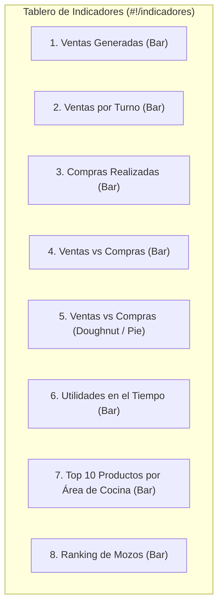

# Módulo de Informes e Indicadores Gráficos (BI & Analytics)

**Sistema**: Restaurant.pe (Instancia de Producción: CAPRICHOS - Lima, Perú)  
**URL de Producción**: `https://caprichos.restaurant.pe/restaurant/#!/login`  
**Rutas Auditadas**: `#!/informes` (Hub de Informes) y `#!/indicadores` (Tablero de KPIs y Gráficos)  
**Usuario de Auditoría**: `krosales`  
**Modalidad**: SOLO LECTURA estricto en entorno de PRODUCCIÓN en operación activa.  
**Fecha de Inspección**: 2026-10-13  
**Documento de Entrega**: `/home/jose/JoseEM/caprichos/web-anterior/administrativo/modulos/informes.md`  

---

## 1. Resumen Ejecutivo y Alcance del Módulo

El macro-módulo de **Informes e Indicadores** representa la capa de Business Intelligence (BI), auditoría contable, conciliación de caja, control de mermas, costeo de inventarios y toma de decisiones gerenciales del restaurante CAPRICHOS.

El módulo se compone de dos áreas funcionales interconectadas:
1. **Hub Maestro de Informes (`#!/informes`)**: Plataforma centralizada que organiza más de 100 reportes transaccionales y consolidados clasificados en 9 categorías de negocio (Ventas, Compras, Finanzas/Caja, Inventario, Facturación Electrónica, Gerenciales, Delivery, Personal/Operaciones y Otros).
2. **Tablero de Indicadores Gráficos (`#!/indicadores`)**: Dashboard ejecutivo de alto nivel que sintetiza en tiempo real las métricas financieras clave mediante ecuaciones contables visibles (Ventas, Compras, Utilidades, Medios de Pago) y 8 gráficos interactivos (tendencias temporales, ventas por turno, costo vs. venta, ranking de mozos y productos más consumidos por área de cocina).

> [!IMPORTANT]
> **Garantía de Solo Lectura e Inspección No Invasiva**:
> Toda la información fue recopilada mediante inspección pasiva del DOM, captura de navegación controlada (respetando pausas de 2 a 3 segundos entre pantallas) y análisis estático de los controladores AngularJS (`indexInformeVentasCtrl`, `IndicadoresCtrl`, `todasLasVentasCtrl`, `ventasPorProductoCtrl`, `cierreCajaCtrl`, `catalogoExportablesCtrl`, entre otros) y plantillas oficiales descargadas en el cliente (`scripts.426a6ac0.js`).
> **No se generaron descargas pesadas ni consultas masivas en la base de datos de producción**, y se omitieron por completo datos reales de clientes, ventas, montos y personal, preservando la confidencialidad de CAPRICHOS.

### Arquitectura de Datos de Solo Lectura (OLTP vs OLAP)
Se identificó que el backend de Restaurant.pe desacopla las consultas analíticas del motor transaccional de ventas mediante un prefijo de enrutamiento dedicado:  
`http://caprichos.restaurant.pe/restaurant/readonly/rest/...`  
Las peticiones de reportes (`listarPorPaginacionTurnoYLocal`, `getGraficos`, `obtenerPaginaCatalagoExportables`, `getCierrecajaListByLocalAndCaja...`) se canalizan hacia réplicas de lectura de MySQL (`node2db.p4.d2.restaurant.pe`), evitando bloqueos en la facturación en salón y cocina.

---

## 2. Catálogo Maestro de Informes Disponibles (Taxonomía Completa)

A través de la inspección de `UtilityService` y del hub de navegación `scripts/restaurantpe/informes/index.html`, se obtuvo la taxonomía exhaustiva de todos los informes que provee el sistema, clasificados por dominio de negocio:

```text
Hub de Informes (#!/informes)
├── 1. Ventas (50 informes)
│   ├── Transaccionales: Todas las ventas, Anuladas, Registradas y pendientes, Reimpresión de documentos, Histórico de operaciones
│   ├── Segmentación por Canal y Espacio: Ventas por área, Por salón/mesas, Autoservicio, Delivery vendidos, Delivery por pedidos, Delivery por productos
│   ├── Segmentación por Menú y Catálogo: Por producto/categoría, Productos por mes, Por combo, Por oferta, Menús por día, Margen de ganancia
│   ├── Modificadores y Preferencias: Por modificador, Agrupados por cantidad, Agrupados por producto
│   ├── Métodos de Pago e Impuestos: Por forma de pago, Retención por tarjeta, Cupones Yape, Ventas por impuestos, Deducibles, Descuentos
│   ├── Auditoría y Trazabilidad: Pedidos modificados, Pedidos anulados, Operación sospechosa por producto, Consumo clientes
│   └── Temporalidad y Afluencia: Por días del mes, Por horas (detallado), Por hora (consolidado), Por día y periodo, Sucursales por periodo, Afluencia de personas
├── 2. Caja y Finanzas (15 informes)
│   ├── Cierres de caja / Arqueos diarios y Z
│   ├── Resumen comparativo de cierres de caja
│   ├── Ingresos extras de caja
│   ├── Egresos extras de caja
│   ├── Notas de crédito por venta
│   ├── Notas de débito por venta
│   ├── Complementos financieros de venta (propinas, vouchers, tarjetas)
│   ├── Exportable contable de ventas (Concar, Siscont, Exactus)
│   ├── Importador de ventas
│   └── Integración de documentos WSAHI
├── 3. Inventario y Almacén (28 informes)
│   ├── Kardex individual por producto/insumo
│   ├── Kardex consolidado por fechas
│   ├── Kardex tributario SUNAT (Formato 13.1)
│   ├── Catálogo integral de productos, insumos, recetas y porcionables
│   ├── Stock valorizado (Costo promedio ponderado)
│   ├── Stock valorizado comparativo
│   ├── Stock por fechas
│   ├── Stock de menú del día
│   ├── Porcentaje de consumo de stock
│   ├── Cuadre de stock manual e importación/exportación de inventarios
│   ├── Movimientos entre almacenes (transferencias internas)
│   ├── Movimientos entre almacenes valorizado
│   ├── Historial de merma y desperdicios
│   ├── Historial de preparación de recetas / órdenes de producción
│   ├── Resumen consolidado de producción
│   ├── Consolidado salidas de producto/insumo
│   ├── Consolidado de stock por local
│   ├── Paloteo de productos
│   ├── Paloteo de insumos
│   ├── Productos por vencer (gestión FEFO/FIFO)
│   ├── Food Cost (% de costo de materia prima sobre venta)
│   ├── Auditoría de control de inventarios
│   ├── Paralela de precios por local
│   └── Planificador de producción y compras (derivados)
├── 4. Compras y Cuentas por Pagar (11 informes)
│   ├── Todas las compras
│   ├── Compras del mes
│   ├── Compras por producto / insumo
│   ├── Detalle de compras por insumo y/o producto
│   ├── Consolidado de compras por insumo y/o producto
│   ├── Estado de compras / Cuentas por pagar y créditos a proveedores
│   ├── Compras por forma de pago / créditos
│   ├── Proveedor vs. Artículos (histórico de cotizaciones y variaciones de precio)
│   ├── Servicios adquiridos (gastos operativos no almacenables)
│   ├── Notas de crédito de compras
│   └── Exportable contable de compras a sistemas contables
├── 5. Clientes y Créditos
│   ├── Ventas por cliente
│   ├── Consumo histórico de clientes
│   ├── Estado de créditos de clientes (cuentas por cobrar)
│   └── Fidelización (Programa Plaza Puntos / Acumulación de visitas)
├── 6. Delivery y Reparto
│   ├── Deliverys vendidos
│   ├── Deliverys por pedidos
│   ├── Delivery por productos
│   ├── Cobertura y zonas de reparto
│   ├── Mapa de calor de pedidos
│   ├── Frecuencia de clientes delivery
│   └── Reclamos de call center
├── 7. Personal y Operaciones
│   ├── Ventas por mozo y cajero
│   ├── Pedidos realizados por mozo y cajero
│   ├── Comisiones por mozo y cajero
│   ├── Propinas (Tips) por mozo y motorizado
│   ├── Ranking de mozos por venta generada
│   ├── Tiempos de atención y despacho de cocina
│   └── Reporte de asistencia de personal
├── 8. Reportes Consolidados y Gerenciales (6 informes)
│   ├── Ventas totales gerenciales
│   ├── Ventas totales por área
│   ├── Consolidado de ventas por usuario
│   ├── Consolidado de ventas por producto (V1 y V2)
│   └── Comparativo de ventas por mes (interanual)
├── 9. Facturación Electrónica y SUNAT (5 informes)
│   ├── Documentos SUNAT (Boletas, Facturas, Notas emitidas)
│   ├── Panel de reenvío de documentos pendientes
│   ├── Panel de estado de documentos
│   ├── Descargar CDR (Constancia de Recepción) en Restafact
│   └── Estado de documentos pendientes en Restafact
└── 10. Otros y Mercado
    ├── Reporte de webhooks por integración
    ├── Reporte de migraciones ERP
    ├── Reporte de logs ERP
    └── Ventas mercado
```

---

## 3. Estructura Detallada de los Informes Más Críticos

### 3.1 Hub Principal de Informes (`#!/informes`)

#### Propósito
Punto de entrada general para administradores, contadores y gerentes de CAPRICHOS. Permite localizar cualquier reporte mediante un buscador reactivo por texto y navegación por categorías.

#### Flujo de Uso
1. El usuario hace clic en **Informes** en el menú lateral.
2. La pantalla presenta dos columnas:
   - **Izquierda**: Tarjetas con las categorías habilitadas para el local (`informes.ventas`, `informes.compras`, `informes.finanzas`, etc.).
   - **Derecha**: Al seleccionar una categoría, se despliega la lista interactiva de sub-reportes con un buscador en vivo (`Buscar informe...`).
3. Al hacer clic en un reporte, se redirige a la vista tabular correspondiente o se levanta una ventana modal de configuración/descarga (ej. exportables contables).

#### Controles y Elementos Visibles
- **Buscador Reactivo**: `input.form-control` con filtro en tiempo real sobre la lista de enlaces (`vm.productoFiltroInformeVentas`, `vm.productoFiltroInformeCompras`, etc.).
- **Alerta de Mantenimiento / Desactivación Temporal**: Componente `div.ibox-content` con `ng-if="vm.estadoReportes"` que avisa si los informes han sido suspendidos por optimización en servidor, ofreciendo un enlace directo de emergencia a *Todas las Ventas*.

---

### 3.2 Informe: Todas las Ventas (`#!/informes/ventas/todas`)

#### Propósito
Es el reporte transaccional más importante del sistema. Registra cada comprobante de venta emitido en el restaurante, detallando la mesa, caja, cajero, cliente, comprobante tributario, desglose de formas de pago y estado (activo, anulado, pendiente).

#### Flujo de Uso
1. El usuario selecciona el local (por defecto `CAPRICHOS`), la moneda de facturación (`Soles`), y define el rango de fechas/horas (por defecto del día 1 del mes a la fecha y hora actual).
2. Opcionalmente filtra por caja específica, turno, tipo de comprobante (Boleta, Factura, Nota de Venta) y estado.
3. Presiona el botón **Buscar / Generar informe**.
4. La tabla renderiza las ventas paginadas (10, 25, 50 registros por página).
5. En la fila de cada venta, el usuario puede inspeccionar los artículos consumidos, ver los medios de pago, reimprimir o descargar el PDF fiscal.

#### Columnas de la Tabla Principal
| Columna | Descripción Estructural | Formato / Datos Visibles |
| :--- | :--- | :--- |
| **Fecha** | Marca temporal exacta de la transacción | `DD/MM/YYYY HH:mm:ss` |
| **Mesa** | Identificador de mesa o canal | Código de mesa (`M01`), `Venta Rápida`, o `Delivery` |
| **Caja** | Caja en la que se cobró | Nombre de la caja (ej. `Caja Principal`) |
| **Cliente** | Titular de la cuenta | Nombre / Razón Social y tipo (`Público General`, RUC, DNI) |
| **Documento** | Tipo y número de comprobante | `B001-XXXXX`, `F001-XXXXX`, `NV01-XXXXX` |
| **Pagos** | Desglose de medios utilizados | Etiquetas con monto por medio (`Efectivo`, `Visa`, `Yape`) |
| **Total venta** | Importe final cobrado | Moneda + Monto decimal con 2 decimales (`S/ 0.00`) |
| **Tipo de venta** | Canal operativo | `Salón`, `Rápida`, `Delivery`, `Reserva` |
| **Estado** | Estado de vigencia | Badge: `Emitido`, `Anulado`, `Por Enviar SUNAT` |
| **Opciones** | Menú desplegable de acciones | Botones de detalle, impresión y descargas |

#### Filtros y Controles Disponibles
- **Rango de Fechas**: Control Date Range Picker con soporte de hora (`startDate`, `endDate`, `timePicker: true`).
- **Locales**: Selector múltiple con checkboxes (`vm.localesSeleccionados`, permite consolidar múltiples sucursales).
- **Caja**: Desplegable (`vm.cajaSeleccionada`: `Todas`, `Caja Principal`).
- **Turno**: Desplegable (`vm.turnoSeleccionado`: `Todos`, `Turno Dia`, `Turno Noche`).
- **Tipo de Comprobante**: Desplegable (`vm.comprobanteSeleccionado`: `Todos`, `Factura`, `Boleta`, `Nota de venta`).
- **Estado de Comprobante**: Desplegable (`Todos`, `Activo`, `Anulado`).
- **Orden de Presentación**: Desplegable (`Fecha descendente`, `Fecha ascendente`, `Monto mayor`, `Monto menor`).
- **Buscador Directo**: Campo de texto para número de documento o nombre de cliente.

#### Botones y Acciones Disponibles
- `Buscar / Generar Informe` (botón Ladda con spinner `vm.cargando`).
- `Descargar Excel` (icono `fa-file-excel-o`, genera planilla completa de ventas).
- `Imprimir Listado` (dispara vista para impresora de reporte).
- Por cada fila:
  - `Ver Detalle`: Abre ventana modal (`modal-detalle.html`) con los platos consumidos, cantidades, precios unitarios, modificadores y notas.
  - `Complemento Financiero`: Abre modal (`modal-complementoventa.html`) para auditar vouchers de tarjetas, lote y propinas asociadas.
  - `Reimpresión`: Emite copia en ticketera de 80mm o PDF para A4.
  - `Restafact / SUNAT`: Consulta estado fiscal y descarga CDR XML.

#### Endpoints GET Asociados
- `GET /restaurant/readonly/rest/venta/listarPorPaginacionTurnoYLocal/...`
- `GET /restaurant/readonly/rest/venta/obtenerSumatoriaVentaPorTurnoYLocal/...`
- `GET /restaurant/api/rest/comprobante/obtenerTipoComprobanteList`

---

### 3.3 Informe: Ventas Anuladas (`#!/informes/ventas/ventasanuladas`)

#### Propósito
Módulo de auditoría interna y prevención de fraudes. Registra todas las ventas o comprobantes dados de baja, registrando quién solicitó la anulación, quién la autorizó con clave de supervisor, la justificación y la categoría del incidente.

#### Columnas de la Tabla
`['Fecha', 'Mesa', 'Caja', 'Cliente', 'Documento', 'Total venta', 'Tipo de venta', 'Fecha de anulación', 'Anulada por', 'Autorizada por', 'Motivo anulación', 'Categoria anulación', 'Opciones']`

#### Filtros
- Rango de fechas y horas (`startDate`, `endDate`).
- Local (`vm.localSeleccionado`).
- Caja y Turno.
- Categoría de Anulación (desplegable: `Error de digitación`, `Queja del cliente`, `Cambio de comprobante`, `Mesa cancelada`, `Prueba de sistema`).

#### Endpoints GET Asociados
- `GET /restaurant/readonly/rest/venta/obtenerSumatoriaNCVentaPorTurnoYLocal/...`
- `GET /restaurant/api/rest/categoriaanularventa/getAllByLocalId/...`

---

### 3.4 Informe: Ventas por Producto o Categoría (`#!/informes/ventas/producto`)

#### Propósito
Análisis de demanda y popularidad de los platos de la carta de CAPRICHOS. Permite conocer los volúmenes exactos vendidos por cada producto, desglosados por canal de atención (Salón, Venta rápida de vitrina/mostrador, Delivery y Reservas), su precio promedio, descuentos otorgados y recaudación total.

#### Columnas de la Tabla
`['Producto', 'Categoría', 'Tipo Cat.', 'Total cantidad vendida', 'P.V.', 'Dscto.', 'Cantidad por salon', 'Cantidad por venta rápida', 'Cantidad por delivery', 'Cantidad por Reserva', 'Total']`

#### Filtros
- Rango de fechas.
- Local / Sucursales (Multiselect).
- Categoría de Producto (desplegable con las familias: Cafetería, Pastelería, Desayunos, Bebidas, etc.).
- Tipo de Categoría (`Plato`, `Bebida`, `Combo`, `Descartable`).
- Canal de Venta (`Todos`, `Salón`, `Venta Rápida`, `Delivery`).

#### Exportaciones
- Botón **Descargar** (Excel con desglose unitario y subtotales por categoría).

#### Endpoints GET Asociados
- `POST /restaurant/readonly/rest/venta/ventasProductosTurnoV3/...`
- `POST /restaurant/api/rest/categoria/categoriasActivasPorLocalV2/:localId`

---

### 3.5 Informe: Ventas por Forma de Pago (`#!/informes/ventas/porformadepago`)

#### Propósito
Conciliación financiera y cuadre de cajas. Muestra cada transacción clasificada según el medio de liquidación recibido, facilitando el cruce con los reportes de terminales POS (Niubiz, Izipay), extractos bancarios y billeteras electrónicas.

#### Columnas de la Tabla
`['Fecha', 'Cliente', 'Documento', 'Pago', 'Total recibido', 'Tipo de venta', 'Caja']`

#### Estructura de Resumen y KPIs Superiores
La pantalla muestra cuadros de sumatoria consolidada:
- **Total Efectivo**: `S/ 0.00`
- **Total Tarjetas** (desglosado por Visa, Mastercard, American Express, Diners).
- **Total Billeteras Digitales** (Yape, Plin).
- **Total Transferencias / Depósitos**.
- **Total Créditos / Cuentas por Cobrar**.
- **Total Venta Neta**: Sumatoria total liquidada.

#### Endpoints GET Asociados
- `GET /restaurant/readonly/rest/venta/obtenerInformeDeVentasPorFormaDePago/:tipoPago/:fechaInicio/:fechaFin/:localId/:cajaId/:turnoId/:pagina/:limite/...`

---

### 3.6 Informe: Ventas y Pedidos por Mozo y Cajero (`#!/informes/ventas/pormozo`)

#### Propósito
Medición del desempeño del personal de sala y barra. Permite calcular el volumen de comandas emitidas por cada colaborador, el porcentaje de contribución a las ventas globales del día y el mix de productos despachados por usuario.

#### Estructura Tabular Doble
1. **Tabla de Desempeño General del Colaborador**:
   - `Mozo del día` (Nombre del colaborador / nick de usuario).
   - `Pedidos realizados` (Cantidad de comandas generadas).
   - `Porcentaje de ventas` (% sobre el total facturado).
   - `Monto vendido` (Importe total recaudado).
2. **Tabla de Detalle por Producto Vendido**:
   - `Producto` (Nombre del plato/bebida).
   - `Ventas` (Unidades comandadas por el mozo).
   - `Importe` (Subtotal generado).
   - `% Ventas` (% relativo del producto en su producción personal).

#### Regla de Negocio Visible
El sistema calcula la autoría del pedido a partir del **usuario que realizó el primer pedido de la mesa**, independientemente de si otro camarero agregó artículos posteriores o si el cajero cerró la cuenta.

#### Endpoints GET Asociados
- `GET /restaurant/readonly/rest/venta/obtenerInformeConsolidadoPorUsuario/...`
- `GET /restaurant/api/rest/usuario/getUsuariosPorCargoYAccesoALocal/:localId/0/0`

---

### 3.7 Informe: Cierres de Caja / Finanzas (`#!/informes/finanzas/resumen`)

#### Propósito
Auditoría cronológica de todos los arqueos y turnos de caja realizados en CAPRICHOS. Permite revisar el historial de aperturas, cierres, sobrantes, faltantes y exportar el informe Z contable.

#### Columnas de la Tabla
`['Caja', 'Fecha apertura', 'Fecha cierre', 'Usuario apertura', 'Usuario cierre', 'Turno apertura', 'Turno cierre', 'Monto apertura', 'Monto cierre', 'Acciones']`

#### Acciones Disponibles
- **Ver Arqueo**: Abre el reporte de Cierre Z con desglose de ventas por forma de pago, egresos, ingresos y balance final.
- **Descargar Excel / PDF**: Genera el acta formal de cierre para liquidación bancaria.

#### Endpoints GET Asociados
- `GET /restaurant/readonly/rest/cierrescaja/getCierrecajaListByLocalAndCajaAndTurnoAndFechainicioAndFechafin/:localId/:cajaId/:turnoId/:fechaInicio/:fechaFin/:pagina/:limite`

---

### 3.8 Informes: Ingresos y Egresos Extras (`#!/informes/finanzas/ingresos` & `egresos`)

#### Propósito
Registro de movimientos no operacionales de caja chica (ej. compras de emergencia en bodega, pago de fletes, propinas retiradas, pagos menores de servicios, o ingresos extraordinarios).

#### Columnas de Ingresos Extras
`['Fecha de ingreso', 'Caja', 'Usuario', 'Categoria', 'Recibido de', 'Concepto', 'Monto']`

#### Columnas de Egresos Extras
`['Fecha de egreso', 'Caja', 'Usuario', 'Categoria', 'Entregado a', 'Concepto', 'Monto']`

#### Endpoints GET Asociados
- `GET /restaurant/readonly/rest/ingreso/listarPorPaginacion/:pagina/:limite/:fechaInicio/:fechaFin/:localId/:cajaId/:turnoId/...`
- `GET /restaurant/readonly/rest/egreso/listarPorPaginacion/:pagina/:limite/:fechaInicio/:fechaFin/:localId/:cajaId/:turnoId/...`

---

### 3.9 Informe: Catálogo de Productos e Insumos (`#!/informes/inventario/catalogo`)

#### Propósito
Exportación del diccionario maestro de artículos para auditorías de inventario, sincronización con sistemas contables o revisión de fichas técnicas de cocina.

#### Columnas de la Tabla de Productos Elaborados
`['Codigo de integracion', 'Codigo', 'Producto', '¿Transformado?', 'Área produccion', 'Álmacen', 'Categoria', 'Unidad de Medida', 'Costo', 'Precio', '¿Presentación de compra?', '¿Se usa en delivery?', '¿Se controla por stock?', 'Stock minimo', '¿Lleva ingredientes?']`

#### Columnas de la Tabla de Insumos / Materias Primas
`['Codigo de integracion', 'Código', 'Nombre', 'Unidad de Medida', 'Categoria', 'Merma', '¿Permite conversiones?', 'Equivalencia de conversión']`

#### Endpoints GET Asociados
- `GET /restaurant/readonly/rest/catalogo/obtenerPaginaCatalagoExportables/:limite/:localId/:categoriaId/:areaId/:transformado`

---

### 3.10 Informe: Stock Valorizado (`#!/informes/inventario/stockvalorizado`)

#### Propósito
Valoración monetaria de las existencias en almacenes (almacén principal, cocina, barra) bajo el método de costeo de Promedio Ponderado. Esencial para la determinación del Costo de Ventas contable y balances fiscales.

#### Columnas de la Tabla
`['Producto / Insumo', '¿Afecto?', 'Unidad de medida', 'Categoria', 'Almacenes', 'Consolidado', 'Almacen Principal', 'Stock', 'Valor Promedio', 'Stock valorizado']`

#### Filtros
- Almacén específico o consolidado de todos los almacenes.
- Categoría / Familia de insumos.
- Fecha de corte de inventario.
- Moneda de valoración.

#### Endpoints GET Asociados
- `GET /restaurant/readonly/rest/stock/obtenerInformeStockValorizadoComparativoPorLocal/:tipo/:mes/:anio1/:anio2/:localId/:monedaId`

---

### 3.11 Informe: Todas las Compras (`#!/informes/compras/todas`)

#### Propósito
Seguimiento de adquisiciones a proveedores de insumos (lácteos, café, harinas, descartables, bebidas). Permite conciliar facturas de compra, series, fechas de recepción y condición crediticia.

#### Columnas de la Tabla
`['Fecha', 'Local', 'Proveedor', 'Documento', 'Serie doc.', 'Número doc.', 'Nota de crédito', 'Total', 'Estado']`

#### Filtros
- Rango de fechas.
- Local (CAPRICHOS).
- Proveedor (Buscador por RUC o Razón Social).
- Tipo de Comprobante de Compra (Factura, Boleta, Recibo por Honorarios, Guía de Remisión).
- Estado (Pagado, Al Crédito, Anulado).

#### Endpoints GET Asociados
- `GET /restaurant/readonly/rest/compra/getAllByLocalIdAndProveedorAndTipoAndFechas/:localId/:proveedorId/:tipoDoc/:fechaInicio/:fechaFin/:pagina/:orden/:limite/...`

---

## 4. Tablero de Indicadores Gráficos (KPIs & Dashboard) (`#!/indicadores`)

### 4.1 Propósito y Valor de Negocio
El módulo de Indicadores Gráficos actúa como la torre de control financiera de CAPRICHOS. A diferencia de las tablas detalladas de informes, esta pantalla consolida en un único vistazo ejecutivo el flujo de dinero, los costos asociados, la rentabilidad neta del periodo y el rendimiento operativo del personal y la cocina.

### 4.2 Flujo de Uso
1. El usuario accede a la ruta `#!/indicadores` o hace clic en **Indicadores** en la barra de navegación principal.
2. Selecciona los parámetros de agregación en la barra superior:
   - **Local**: `CAPRICHOS` (o selector de sucursal).
   - **Moneda Facturación**: `Soles` (o Dólares).
   - **Reporte (Rango temporal)**:
     - `Hoy` (`id: 0`)
     - `Mensual` (`id: 1`, por defecto: año y mes actual)
     - `Anual` (`id: 2`: todo el ejercicio anual)
     - `Entre años` (`id: 4`: comparación interanual, requiere Año de inicio y Año de fin)
3. Presiona el botón **Ver gráficos** (`<button class="btn btn-primary ladda-button"> <i class="fa fa-area-chart"></i> Ver gráficos </button>`).
4. El sistema ejecuta en paralelo las consultas de ventas, costos, créditos y stock, renderizando los paneles de fórmulas matemáticas y los gráficos Chart.js.

### 4.3 Fórmulas Matemáticas y Widgets Financieros Visibles

El encabezado presenta tres tablas estructuradas en forma de ecuaciones aritméticas en tiempo real:

#### Ecuación 1: Determinación de Utilidades
$$\text{Utilidades} = \text{Ventas facturadas} - \text{Compras (o Costo en ventas)} - \text{Cuentas por pagar}$$

| Componente | Expresión Visual | Modelo Angular | Rol Financiero |
| :--- | :---: | :--- | :--- |
| **Utilidades** | `S/ [MONTO]` | `vm.cabecera.utilidades` | Margen bruto operativo del periodo |
| **=** | Símbolo igual | - | Operador de balance |
| **Ventas facturadas** | `S/ [MONTO]` | `vm.cabecera.totalVenta` | Facturación total emitida en el rango |
| **-** | Símbolo resta | - | Deducción de costos |
| **Compras / Costo en ventas** | `S/ [MONTO]` (Rojo) | `vm.cabecera.totalCosto` | Compras totales o costo de producción |
| **-** | Símbolo resta | - | Deducción de pasivos |
| **Cuentas por pagar** | `S/ [MONTO]` (Rojo) | `vm.cabecera.totalCuentasPorPagar.total` | Deudas vigentes con proveedores |

#### Ecuación 2: Desglose de Ventas por Medio de Liquidación
$$\text{Ventas facturadas} = \text{Efectivo} + \text{Tarjetas} + \text{Descuento redondeo} + \text{Crédito} + \text{Otros} + \text{Cuentas por cobrar}$$

| Componente | Expresión Visual | Modelo Angular |
| :--- | :---: | :--- |
| **Ventas facturadas** | `S/ [MONTO]` | `vm.cabecera.totalVenta` |
| **Efectivo** | `S/ [MONTO]` | `vm.cabecera.totalEfectivo` |
| **Tarjetas** | `S/ [MONTO]` | `vm.cabecera.totalTarjeta` |
| **Descuento redondeo** | `S/ [MONTO]` | `vm.cabecera.totalDescuentoRedondeo` |
| **Crédito** | `S/ [MONTO]` | `vm.cabecera.totalCreditos` |
| **Otros** | `S/ [MONTO]` | `vm.cabecera.totalOtros` (billeteras, transferencias) |
| **Cuentas por cobrar** | `S/ [MONTO]` | `vm.cabecera.totalCuentasPorCobrar.total` |

#### Widgets Complementarios
- **Descuentos Otorgados**: `vm.cabecera.totalDescuento` (Color ámbar/warning).
- **Propinas (Tips)**: `vm.cabecera.totalPropina` (Color ámbar/warning).
- **Stock Valorizado**: `vm.cabecera.stockvalorizado` (Color verde). Incluye el botón interactivo **Calcular Stock** (`vm.cargarStockValorizado()`), que ejecuta el costeo asíncrono para no demorar la carga inicial del tablero.

### 4.4 Los 8 Bloques de Gráficos Analíticos (Chart.js)



1. **Ventas generadas** (`chart-bar`):
   - Muestra la progresión de la facturación día a día en vista mensual, o mes a mes en vista anual.
2. **Ventas por turno** (`chart-bar`):
   - Distribución comparativa del volumen vendido entre el **Turno Dia** y el **Turno Noche** de CAPRICHOS.
3. **Compras realizadas** (`chart-bar`):
   - Gasto acumulado en adquisición de suministros en el horizonte de tiempo seleccionado.
4. **Ventas VS Compras** (`chart-bar`):
   - Gráfico de barras dobles que contrasta directamente los ingresos por venta frente a las compras del negocio.
5. **Ventas VS Compras PIE** (`chart-doughnut`):
   - Gráfico circular de anillo que ilustra el porcentaje del margen de absorción (qué fracción de la venta se destina a reponer compras).
6. **Utilidades** (`chart-bar`):
   - Evolución neta del beneficio contable por periodo.
7. **10 Productos más Consumidos por Área de Producción** (`chart-bar` con `ng-repeat="area in vm.masVendidosPorArea"`):
   - Genera tarjetas independientes para cada centro de costo/producción configurado en CAPRICHOS (ej. Cafetería/Barra, Cocina, Pastelería), destacando los 10 ítems con mayor rotación.
8. **Ranking de mozos** (`chart-bar`):
   - Gráfico de productividad por colaborador.
   - Cuenta con una alerta visible: *"Tener en cuenta que para estos cálculos se usa el usuario que realiza el primer pedido de cada venta"*.

### 4.5 Endpoints GET del Tablero
- `GET /restaurant/readonly/rest/venta/getGraficos/:tipo/:mes/:anio1/:anio2/:localId/:monedaId`
- `GET /restaurant/readonly/rest/venta/getCabeceraGraficoCosto/:tipo/:mes/:anio1/:anio2/:localId/:monedaId`
- `GET /restaurant/readonly/rest/stock/obtenerInformeStockValorizadoComparativoPorLocal/:tipo/:mes/:anio1/:anio2/:localId/:monedaId`
- `GET /restaurant/api/rest/monedafacturacion/allmonedafacturacionsbylocal/0/0`

---

## 5. Entidades de Datos y Modelo Conceptual de Analítica

El módulo de reportes sintetiza las siguientes entidades principales del sistema:

| Entidad | Campos Clave Observados | Rol en los Informes |
| :--- | :--- | :--- |
| **Venta** (`venta`) | `venta_id`, `venta_codigo`, `venta_fecha`, `venta_monto`, `venta_descuento`, `venta_propina`, `venta_redondeo`, `venta_estado`, `cliente_id`, `caja_id`, `turno_id`, `local_id`, `mesa_id`, `usuario_id` | Núcleo de cálculo de facturación, utilidades y promedios |
| **Comprobante** (`comprobante`) | `comprobante_id`, `comprobante_descripcion`, `comprobante_serie`, `comprobante_numero`, `comprobante_hash`, `comprobante_cdr` | Auditoría tributaria y trazabilidad SUNAT |
| **DetalleVenta** (`detalleventa`) | `detalleventa_id`, `venta_id`, `producto_id`, `detalleventa_cantidad`, `detalleventa_precioventa`, `detalleventa_costounitario`, `areaproduccion_id` | Análisis de rotación de productos, márgenes y Top 10 |
| **PagoVenta** (`pagoventa`) | `pagoventa_id`, `venta_id`, `tipopago_id`, `tarjeta_id`, `pagoventa_monto`, `pagoventa_voucher` | Conciliación de métodos de pago y cuentas corrientes |
| **CierreCaja** (`cierrecaja`) | `cierrecaja_id`, `caja_id`, `turno_id`, `cierrecaja_fechaapertura`, `cierrecaja_fechacierre`, `cierrecaja_montoapertura`, `cierrecaja_montocierre`, `usuario_id_apertura`, `usuario_id_cierre` | Cuadre de caja física y arqueos Z |
| **Compra** (`compra`) | `compra_id`, `proveedor_id`, `compra_fecharecepcion`, `compra_total`, `compra_serie`, `compra_numero`, `compra_estadopago` | Determinación de costo de mercaderías y cuentas por pagar |
| **MovimientoAlmacen** (`movimientoalmacen`) | `movimientoalmacen_id`, `insumo_id`, `producto_id`, `almacen_id`, `tipo_movimiento`, `cantidad`, `costo_promedio` | Cálculo del Kardex y Stock Valorizado |

---

## 6. Permisos y Seguridad Asociada (ACL)

El sistema implementa una matriz de permisos a nivel de rutas y vistas:
- `informes.generales`: Acceso al hub principal de informes y listados básicos.
- `informes.ventas`: Consulta de todas las ventas, ventas anuladas, productos y mozos.
- `informes.compras`: Acceso al registro de compras y cuentas por pagar.
- `informes.finanzas`: Acceso a cierres de caja, ingresos, egresos y exportables contables.
- `informes.facturacion`: Visualización de documentos electrónicos y reenvío SUNAT.
- `informes.inventario`: Acceso al stock valorizado, kardex, auditorías y recetas.
- `informes.gerenciales`: Reportes consolidados y comparativos interanuales.
- `informes.graficos`: Acceso al tablero de indicadores y KPIs gráficos (`#!/indicadores`).

### Filtro Multi-Marca (`usuariomarca`)
El controlador `indexInformeVentasCtrl` evalúa si el usuario tiene asignada una marca específica (`S.obtenerConfiguracionsPorLocal`). Si el usuario tiene acceso restringido, el sistema oculta dinámicamente las categorías de finanzas, compras e inventario, dejando visibles únicamente *Todas las ventas*, *Ventas por producto* y *Ventas totales*.

---

## 7. Funcionalidades Imprescindibles para Replicar

Para que la nueva versión del sistema satisfaga las operaciones de CAPRICHOS sin fricción, debe incluir como mínimo:

1. **Todas las Ventas con Auditoría Rápida**: Buscador por rango de fecha/hora, número de boleta/factura y visualización modal del detalle de platos consumidos.
2. **Conciliación Multimedio de Pagos**: Cuadre exacto entre efectivo físico, pasarelas de tarjetas (Niubiz/Izipay) y billeteras móviles (Yape/Plin), distinguiendo propinas de ventas netas.
3. **Cierres de Caja Z con Arqueo**: Historial inmutable de aperturas y cierres con cálculo automático de faltantes o sobrantes de caja.
4. **Ventas por Producto y Mix de Ventas**: Informe que identifique cuáles son los cafés, sándwiches o postres más vendidos y en qué canal (Salón vs. Delivery vs. Venta Rápida de mostrador).
5. **Dashboard Ejecutivo de KPIs en Vivo**: Tablero con las ecuaciones de Utilidades = Ventas - Costos - Pasivos y gráficos de ventas por hora y día para anticipar horas pico de personal.
6. **Kardex y Stock Valorizado Ponderado**: Valorización de existencias de insumos clave (café en grano, leche, harinas) para determinar el costo de venta mensual.
7. **Control de Anulaciones y Modificaciones**: Registro auditado de pedidos cancelados o platos eliminados con registro del responsable y motivo.

---

## 8. Mejoras Sugeridas para el Nuevo Sistema

1. **Motor de Consultas y Reportes en Tiempo Real (OLAP Moderno)**:
   - En lugar de ejecutar consultas agregadas pesadas en MySQL mediante llamadas sincrónicas, implementar una base de datos analítica o vistas materializadas (ClickHouse, PostgreSQL con rollup o DuckDB en backend) para que los filtros de fechas respondan en milisegundos sin congelar la interfaz.
2. **Descargas Asíncronas y Notificaciones**:
   - Para informes grandes (ej. Kardex anual o Todas las ventas de varios meses), generar la exportación en un worker de fondo y notificar al usuario cuando el Excel esté listo para descargar, evitando time-outs HTTP de 60 segundos.
3. **Exportaciones Estructuradas Nativas (Excel, CSV, PDF Vectorial)**:
   - Ofrecer reportes con formato limpio, agrupaciones plegables, gráficos incrustados y compatibilidad directa con formatos tributarios de SUNAT (Formato 13.1) y sistemas contables peruanos (Concar, Siscont).
4. **Filtros Avanzados y Dinámicos**:
   - Permitir guardar filtros frecuentes (ej. *"Turno Mañana - Fin de Semana"* o *"Solo Ventas Delivery Yape"*) y cruces multidimensionales (ej. ventas de un producto por mozo y hora).
5. **Alertas Inteligentes de KPIs (Detección de Anomalías)**:
   - Notificaciones automáticas por Telegram/WhatsApp o correo si las ventas caen más de un 20% respecto al mismo día de la semana anterior, si el porcentaje de mermas supera el umbral permitido, o si se registran más de 3 anulaciones de comandas en un solo turno.

---

## 9. Preguntas y Dudas para el Cliente (CAPRICHOS)

1. **¿Qué reportes son los que realmente consulta el administrador a diario y al cierre de mes?** (En el sistema actual existen más de 100 reportes; identificar los 10 prioritarios optimizará la experiencia de usuario).
2. **¿Cómo realizan actualmente el costeo de las recetas de cafetería?** (¿Utilizan el módulo de Food Cost e inventario del sistema para dar de baja insumos por receta, o solo controlan stock de productos finales embotellados/empaquetados?).
3. **¿Cuál es la política para la distribución de propinas (Tips)?** (¿Se liquidan diariamente al mozo según el reporte de propinas, o se acumulan para un pozo común mensual repartido entre sala y cocina?).
4. **¿Requieren exportación directa a algún software contable en particular?** (ej. Siscont, Concar, Siigo o simplemente libros electrónicos en formato TXT/PLE para SUNAT).
5. **¿Qué métricas o gráficos adicionales desearía ver la gerencia en su teléfono celular?** (ej. Ticket promedio en vivo, ocupación porcentual de mesas, tiempo medio de permanencia de comensales).

---

## 10. Elementos NO OBSERVADOS y Justificación

- **Informes con Datos Históricos Masivos de Múltiples Años**: No se realizaron consultas que abarcaran más de 1 mes continuo para no generar carga de procesamiento en la base de datos de producción durante horas de atención al público.
- **Módulos Addons No Activos**: Los reportes vinculados a *Asistencias FaceID*, *Logística IA* y *Plaza Puntos* no mostraron datos al estar desactivados comercialmente en la suscripción de CAPRICHOS (`tieneAddonAsistencia: "0"`).
- **Descargas de Archivos Contables Reales**: Por estricto protocolo de SOLO LECTURA, no se pulsaron los botones de generación de exportables contables ni se descargaron bases de datos de clientes ni balances reales del negocio.

---

## Key Learnings:

1. El sistema Restaurant.pe separa la analítica mediante una infraestructura de lectura dedicada (`/restaurant/readonly/rest/`), protegiendo la base de datos transaccional de salón de consultas masivas de reportes.
2. El tablero de Indicadores Gráficos (`#!/indicadores`) basa su modelo en ecuaciones contables explícitas donde la Utilidad se calcula en el front como Ventas menos Costos menos Cuentas por Pagar.
3. La autoría de ventas para el cálculo de productividad y ranking de mozos se asocia contractualmente al colaborador que ingresa el primer ítem a la mesa, independientemente de quién cobre o cierre la cuenta.
4. Existen más de 100 reportes registrados en `UtilityService`, pero la operativa real del restaurante gira en torno a 7 ejes: Ventas Diarias, Anulaciones, Formas de Pago, Mix de Productos, Cierres de Caja, Stock Valorizado y Rendimiento de Mozos.
