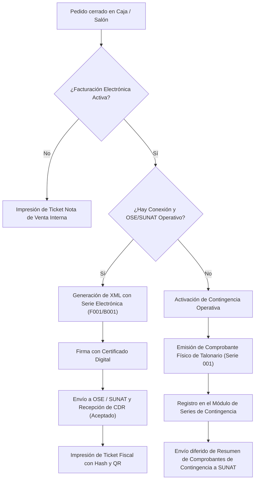

# Documentación Técnica y Funcional: Módulo "Mi restaurant"

**Sistema**: Restaurant.pe (Instancia en producción de Cafetería CAPRICHOS, Lima)  
**Usuario auditado**: `krosales`  
**Modo de auditoría**: Solo lectura e inspección estática y dinámica de interfaz, templates AngularJS y bundles frontend públicos.  
**Rutas cubiertas**:
1. **Mi empresa** (`#!/mirestaurante/miempresa`)
2. **Facturación Electrónica** (`#!/ajustes/facturacionelectronica` y consulta en `#!/mirestaurante/facturacion-electronica`)
3. **Series de contingencia** (`#!/ajustes/serie-contingencia`)
4. **Integraciones** (`#!/ajustes/integraciones`)
5. **Integración POS** (`#!/ajustes/pos`)  
*(Pantallas excluidas por instrucción: Pagos del sistema y Contrato)*.

---

## 1. Resumen Ejecutivo del Módulo "Mi restaurant"

El módulo **Mi restaurant** comprende el núcleo de identidad corporativa, fiscal y de conectividad del sistema. Administra la razón social de la empresa, la arquitectura de emisión de comprobantes de pago electrónicos ante la SUNAT (vía PSE/OSE), las series físicas de contingencia para continuidad operativa ante fallas técnicas, la vinculación de terminales físicos de tarjetas (POS Izipay / Niubiz-Vendemás) con las cajas registradoras, y el ecosistema de integraciones con plataformas externas (Delivery, Pagos Online, ERP Contable, SMS/WhatsApp y Geolocalización).

---

## 2. Pantalla 1: Mi empresa (`#!/mirestaurante/miempresa`)

### Propósito
Configurar la identidad corporativa y fiscal matriz de la cuenta del restaurante. Define los datos generales de la empresa propietaria y el logotipo oficial que se sincroniza con el sistema central de facturación/suscripción (`billing.restaurant.pe`) y plataformas satélite (como la carta digital).

### Flujo de uso paso a paso
1. El usuario ingresa a la barra lateral en **Mi restaurant > Mi empresa**.
2. El sistema consulta mediante la API los datos de la razón social registrada.
3. Se despliegan dos paneles principales:
   - Panel izquierdo: Datos formales de la empresa (Razón social, Nombre comercial, RUC, Dirección, Teléfono, Email).
   - Panel derecho: Visualización y carga del logotipo comercial.
4. El usuario edita la información en los campos habilitados.
5. Si desea actualizar el logo, pulsa *"Elegir una imágen para mi empresa"*, selecciona un archivo JPG/PNG y el sistema procesa la subida (a CDN o Cloudinary).
6. El usuario pulsa el botón **Modificar**. El sistema solicita confirmación mediante un diálogo SweetAlert (*"¿Desea modificar los datos de su empresa?"*).
7. Al confirmar, los cambios se persisten en base de datos y se sincronizan en segundo plano con el servicio de suscripción y facturación matriz.

### Tablas y Listados
Esta pantalla no cuenta con tablas de datos tabulares; está estructurada en un formulario de dos columnas (`ibox` responsive).

### Campos del Formulario
*Todos los campos de datos fiscales señalan explícitamente en su etiqueta: "(No usado para impresion)", ya que la cabecera de las comandas e impresiones operativas se parametriza por sucursal en el módulo de Locales/Comprobantes.*

| Etiqueta | Nombre / Modelo | Tipo de Control | Obligatorio | Validación / Opciones |
| :--- | :--- | :--- | :---: | :--- |
| **Razón social (No usado para impresion)** | `razonsocial_nombrecomercial` (`vm.miempresa.razonsocial_nombrecomercial`) | Input Texto | Sí | Texto libre, `required`. |
| **Nombre comercial (No usado para impresion)** | `razonsocial_nomrazonsocial` (`vm.miempresa.razonsocial_nomrazonsocial`) | Input Texto | Sí | Texto libre, `required`. |
| **RUC (No usado para impresion) (X Dígitos)** | `razonsocial_ruc` (`vm.miempresa.razonsocial_ruc`) | Input Texto | Sí | Validación de longitud máxima configurable (`vm.cantidadMaximaCaracteres`, típicamente 11 dígitos para Perú). Filtro `solo-numeros` salvo que esté activa la nomenclatura alfanumérica. Admite máscara (`ui-mask`). |
| **Dirección (No usado para impresion)** | `razonsocial_direccion` (`vm.miempresa.razonsocial_direccion`) | Input Texto | Sí | Texto libre, `required`. |
| **Teléfono** | `razonsocial_telefono` (`vm.miempresa.razonsocial_telefono`) | Input Teléfono (`tel`) | Sí | Formato telefónico numérico, `required`. |
| **Email** | `razonsocial_email` (`vm.miempresa.razonsocial_email`) | Input Email | No | Formato de correo electrónico estándar. |
| **Logo de la empresa** | `formImg` (`vm.miempresa.razonsocial_logo`) | Input Archivo (`ngf-select`) | No | Admite JPG y PNG. Tamaño sugerido: 120x30 px. |

### Filtros
No aplica (formulario estático de entidad única).

### Botones y Acciones Disponibles
- **Modificar** (`vm.fnActualizarDatosEmpresa()`): Botón primario verde con ícono de guardado (`fa-save`). Se deshabilita (`ng-disabled`) si el formulario es inválido.
- **Atrás** (`ui-sref="mirestaurante"`): Botón secundario con ícono de retorno (`fa-arrow-left`).
- **Elegir una imágen para mi empresa** (`vm.fnSubirImagenV2($file)`): Botón selector de archivo con indicador de carga Ladda.

### Estados y Reglas Visibles
- **Validación en tiempo real**: Muestra textos de ayuda *"Campo requerido"* (`help-block`) bajo cada campo cuando `$dirty` y `$invalid`.
- **Regla de RUC**: Mensaje dinámico *"El RUC debe tener como máximo 11 caracteres"*.
- **Almacenamiento de imagen**: Admite integración híbrida: Cloudinary (`cl-image` con calidad 80, crop fit, auto-format) o CDN interno de Restaurant.pe.
- **Sincronización externa**: Al guardar exitosamente, dispara una llamada asíncrona a `Facturacion.sincronizarInformacionSuscripcionlBilling` para reflejar la razón social y logo en los recibos de la plataforma.

### Relaciones con otros Módulos
- **Ajustes > Locales**: Hereda datos fiscales base cuando se crea un nuevo local.
- **Ajustes > Configuración Regional**: Determina la longitud máxima del RUC y la validación numérica/alfanumérica según el país.
- **Delivery > Menú Online**: Utiliza el logo corporativo subido aquí para la cabecera de la carta digital de la marca.
- **Facturación Billing**: Mantiene consistencia de facturación mensual del servicio de software.

### Entidad de Datos Principal
**Razón Social / Mi Empresa (`razonsocial`)**:
- Campos clave: `razonsocial_id`, `razonsocial_nombrecomercial`, `razonsocial_nomrazonsocial`, `razonsocial_ruc`, `razonsocial_direccion`, `razonsocial_telefono`, `razonsocial_email`, `razonsocial_logo`, `razonsocial_estado`.

### Permisos Asociados (ACL)
- Ruta protegida por permiso de navegación: `acl: "mirestaurante"`.

### Endpoints Identificados
- `GET /restaurant/api/rest/razonsocial/obtenerRazonsocialMiEmpresa/:empresaActual`
  - Responde: Objeto JSON con el registro de la razón social matriz.
- `GET /restaurant/api/rest/configuracionregional/obtenerConfiguracionregionalsPorLocal/:local_id/0/0`
  - Responde: Lista de configuraciones regionales del local (código tributario, máscara, longitud de documento).
- `POST /restaurant/api/rest/imagen/uploadIMGtoRestpe`
  - Responde: `{ tipo: "SUCCESS", file_path: "logos/..." }`.
- `POST http://billing.restaurant.pe/billing/m/rest/suscripcion/sincronizarInformacionSuscripcionlBilling`
  - Responde: Confirmación de sincronización de suscripción.

---

## 3. Pantalla 2: Facturación Electrónica (`#!/ajustes/facturacionelectronica`)

### Propósito
Configurar, monitorear y gestionar los proveedores de Facturación Electrónica (PSE/OSE) por sucursal, la vinculación de cajas y comprobantes (Boletas, Facturas, Notas de Crédito, Notas de Débito), la fecha de caducidad del Certificado Digital Tributario (CDT) y el entorno de homologación/validación inicial de ventas para emisión fiscal.

### Flujo de uso paso a paso
1. El usuario navega a **Ajustes > Facturación Electrónica** (o mediante la ruta directa `#!/ajustes/facturacionelectronica`).
2. **Control de Seguridad de Soporte**: El sistema verifica si la sesión cuenta con autorización de soporte técnico (`validarSuport`).
   - Si no cuenta con el PIN de soporte activo, la pantalla se bloquea mostrando el mensaje de seguridad: *"Oops, ocurrió un problema. Usted no cuenta con Permiso para acceder a este modulo."* y ofrece el enlace numérico para validar el PIN de soporte (`vm.fnAbrirValidacionPin()`).
   - Tras ingresar el PIN de soporte autorizado, el controlador carga los locales y el proveedor de facturación asignado.
3. El usuario visualiza la barra superior de acciones:
   - Selector de Razón Social / RUC (`ui-select`).
   - Acciones de Notas de Crédito/Débito: *"Notas Independientes"* y *"Notas Agrupadas"*.
4. Se presentan dos columnas de diagnóstico y gestión:
   - **Columna izquierda (Locales asociados a la F.E.)**: Muestra la jerarquía del RUC seleccionado: Locales vinculados -> Cajas de cada local -> Comprobantes electrónicos configurados con su serie y correlativo actual.
   - **Columna derecha (Proveedores de facturación electrónica)**: Tabla por sucursal con el proveedor asignado, interruptor de opciones avanzadas, estado activo/inactivo y botón para inspeccionar credenciales de API.
5. **Si la facturación está inactiva en el local**:
   - Se muestra un panel de activación con selector de proveedor.
   - Para el proveedor nativo (Restafact - Perú), exige un flujo de validación inicial: seleccionar un cliente con RUC válido, generar una venta de prueba de mínimo S/ 1.00, indicar si es NRUS y validar la venta contra SUNAT.

### Tablas y Listados

#### Tabla 1: Locales y Comprobantes Asociados (Columna Izquierda)
Estructura tipo árbol/lista:
- Nivel 1: Local (`local_descripcion`) y Nombre del Proveedor FE (`proveedorfe_nombre`).
- Nivel 2: Caja (`caja_descripcion`).
- Nivel 3: Comprobante (`comprobante_tipo`, `comprobante_serie`, `comprobante_numero`, indicador predeterminado con check azul e indicador de inactivo/pendiente de configurar con ícono de advertencia).

#### Tabla 2: Proveedores de Facturación Electrónica por Local (Columna Derecha)
| Columna | Tipo de Contenido | Propósito |
| :--- | :--- | :--- |
| **Local** | Texto y enlace | Nombre del local (`local_descripcion`), RUC asociado (`local_ruc`) y código de establecimiento SRI si aplica. |
| **Proveedor** | Select desplegable | Permite conmutar el proveedor asignado al local entre los habilitados en la plataforma. |
| **Avanzado** | Switch On/Off | Activa parámetros avanzados de facturación para la sucursal (`proveedorfe_opcionesavanzadas`). |
| **Activo** | Badge / Etiqueta | Muestra etiqueta verde con check si está activo (`configuracionlocal_valor == '1'`) o roja si está inactivo. |
| **Opciones** | Botón de acción | Botón verde *"Ver"* con ícono de ojo para abrir el modal de llaves API y configuración de accesos. |

### Campos de Formularios y Modales

#### Modal: Actualización de Credenciales y Llaves API (`modal-actualizakeyapi.html`)
- **Proveedor FE**: Nombre del proveedor seleccionado.
- **Rango de fechas de inicio**: Fecha/hora desde la cual rige la integración.
- **Rango de fechas de resolución**: Fecha/hora de resolución SUNAT (si aplica).
- **Parámetros tributarios específicos por proveedor/país**:
  - Parámetros para Perú (Restafact, TCI, Nubefact, Digiflow, Bizlinks): Token API, URL de endpoint, Usuario SOL, Clave SOL (en proveedores que emiten directo o vía PSE).
  - Régimen simplificado: Selector Si/No (`proveedorfe_regimensimplificado`).
  - Representación gráfica: Selector Si/No (`proveedorfe_representaciongrafica`).
  - Parámetros para otros países: Datos auxiliares SRI (Ecuador), Taxxa (Colombia), Infile/Digifact (El Salvador), DGII (República Dominicana).
- **Código de confirmación**: Al guardar cambios, el sistema solicita un código de usuario/encargado para auditoría en el log.

#### Modal: Configuración de Comprobante Electrónico (`modal-actualizacomprobante.html`)
- **Tipo de comprobante**: Factura, Boleta de Venta, Nota de Crédito, Nota de Débito.
- **Serie**: Serie electrónica (ej. F001, B001, FC01, BC01).
- **Correlativo**: Número actual de inicio/continuación.
- **Comprobante predeterminado**: Switch booleano para asignación prioritaria en caja.

### Filtros
- **Selector de RUC / Razón Social**: Desplegable `ui-select` para filtrar las sucursales asociadas a un RUC específico en empresas con múltiples razones sociales.

### Botones y Acciones Disponibles
- **Notas Independientes** (`vm.fnCrearDocumentosIndependientesByNotas()`): Crea series y correlativos separados de Nota de Crédito/Débito para Boletas y Facturas.
- **Notas Agrupadas** (`vm.fnConsolidarDocumentosByNotas()`): Unifica la serie de notas para ambos tipos de comprobante.
- **Ver** (`vm.fnActualizarApiKeyBySucursal(sucursal)`): Abre el modal de configuración de credenciales del proveedor.
- **Desactivar Facturación electrónica** (`vm.fnPreActivacionFacturacion('0')`): Deshabilita la emisión fiscal en el local (requiere código de encargado).
- **Generar Venta para Validación**: En Restafact, emite el comprobante de prueba de S/ 1.00.
- **Validar Venta**: En Restafact, verifica la recepción ante SUNAT de la venta de prueba.

### Pantalla Complementaria: Consulta de Documentos F.E. (`#!/mirestaurante/facturacion-electronica`)
El módulo incluye una pantalla de consulta pública/administrativa para verificar comprobantes ya emitidos:
- **Campos de búsqueda**:
  - `Documento`: Select de tipo de comprobante (Boleta / Factura).
  - `Serie`: Input texto obligatorio.
  - `Número`: Input texto obligatorio.
  - `Código único`: Código hash o identificador único del comprobante.
- **Resultados presentados**:
  - Cabecera: Fecha de emisión, Nombre/Razón social del cliente, Documento de identidad, Firma digital (hash resumen).
  - Totales: Total descuento, Operación Gravada, IGV, Total a pagar.
  - Detalle de ítems: Ítem, Cantidad, Producto, Precio Unitario, Subtotal, IGV, Importe.
  - Acción: Botón **Descargar XML** (`vm.documento.urlXML`).

### Relaciones con otros Módulos
- **Caja > Cobrar / Ventas**: Determina si al presionar "Cobrar" se emite ticket de venta interno o comprobante electrónico fiscal con envío automático al PSE/OSE.
- **Caja > Notas de Crédito / Débito**: Utiliza las series configuradas aquí para anular o corregir operaciones.
- **Ajustes > Comprobantes**: Las series y correlativos definidos aquí impactan directamente el catálogo general de comprobantes.
- **Informes > Facturación Electrónica**: Alimenta los monitores de reenvíos, CDR pendientes y descargas masivas de XML/PDF.

### Entidades de Datos
- **Configuración Local de Facturación (`configuracionlocal`)**: `configuracionlocal_id`, `local_id`, `configuracion_id` (31 = F.E.), `configuracionlocal_valor` (1=activa, 0=inactiva), `configuracionlocal_valoraux1` (ID del proveedor FE), `configuracionlocal_valoraux2` (JSON serializado con accesos, credenciales, tokens y opciones avanzadas).
- **Proveedor FE (`proveedorfe`)**: `proveedorfe_id`, `proveedorfe_nombre`, `proveedorfe_estado`.
- **Comprobante (`comprobante`)**: `comprobante_id`, `local_id`, `caja_id`, `comprobante_tipo`, `comprobante_serie`, `comprobante_numero`, `comprobante_predeterminado`, `comprobante_emisionerp`.

### Permisos Asociados (ACL)
- `acl: "ajustes"` (más control de PIN de soporte técnico).

### Endpoints Identificados
- `GET /restaurant/api/rest/configuracion/obtenerConfiguracionFacturacion`
- `GET /restaurant/api/rest/proveedorfe/obtenerTodoslosProveedoresFEv2/:ruc`
- `GET /restaurant/api/rest/local/obtenerLocalesFormatoFE/:ruc`
- `GET http://microservices.restaurant.pe/backendrestaurantpe/public/rest/localbi/obtenerFechaRenovacionCertificadoValidar/:ruc`
- `GET http://billing.restaurant.pe/billing/m/rest/suscripcion/obtenerPermisosPorPlan/:subdominio/:local_id`
- `POST /restaurant/api/rest/proveedorfe/validarCodigoPersonal`
- `POST /restaurant/api/rest/proveedorfe/actualizarConfiguracionLocal`
- `POST /restaurant/api/rest/comprobante/crearCorrelativosIndependientesByNotas`
- `POST /restaurant/api/rest/comprobante/controlCorrelativoConjuntoByNotas`

---

## 4. Pantalla 3: Series de contingencia (`#!/ajustes/serie-contingencia`)

### Propósito
Gestionar las series autorizadas de comprobantes físicos preimpresos de contingencia (Boletas y Facturas de contingencia ante SUNAT). Permite registrar las series emitidas manualmente en papel cuando ocurren fallas de internet, fluido eléctrico o caídas del servicio de facturación electrónica, para su posterior regularización y envío al sistema tributario.

### Flujo de uso paso a paso
1. El usuario ingresa a **Mi restaurant > Series de contingencia** (o ruta `#!/ajustes/serie-contingencia`).
2. La pantalla carga el listado de series registradas para el local actual.
3. El usuario puede buscar por texto o paginar los resultados.
4. Para dar de alta una nueva serie:
   - Hace clic en el botón lateral **Nueva serie de contingencia**.
   - Se abre el panel lateral derecho con el formulario de creación.
   - Selecciona el Tipo (Boleta o Factura).
   - Escribe el número de la Serie física (3 dígitos numéricos).
   - Selecciona la Fecha de alta mediante el calendario.
   - Activa el estado (Activo/Inactivo).
   - Pulsa **Guardar**.
5. Para modificar una serie existente:
   - Hace clic en el botón verde **Editar** en la fila correspondiente.
   - Se carga la información en el panel lateral.
   - Corrige los campos y pulsa **Modificar**.

### Tablas y Listados
**Tabla: Todas las Series de contingencia**:
| Columna | Tipo de Dato | Propósito |
| :--- | :--- | :--- |
| **RUC** | Texto | Número de RUC de la empresa emisora (`seriemanualfe_ruc`). |
| **Comprobante** | Texto | Denominación del tipo de comprobante (`BOLETA` o `FACTURA`). |
| **Serie** | Texto / Numérico (3 dígitos) | Serie física preimpresa autorizada por SUNAT (`seriemanualfe_serie`, ej. `001`). |
| **Fecha de alta** | Fecha (`DD/MM/YYYY`) | Fecha en que la imprenta / SUNAT autorizó la serie (`seriemanualfe_fechadealta`). |
| **Fecha de registro** | Fecha (`DD/MM/YYYY`) | Fecha en que se ingresó al sistema (`seriemanualfe_fecharegistro`). |
| **Estado** | Badge | `Activo` (label azul/primario) o `Inactivo` (label rojo/peligro). |
| **Acciones** | Botón | Botón verde *"Editar"* (`fa-edit`) que transiciona al subestado `ajustes.seriemanualfe.editar`. |

### Campos del Formulario (Panel Lateral Derecho)
| Etiqueta | Nombre / Modelo | Tipo de Control | Obligatorio | Validación / Opciones |
| :--- | :--- | :--- | :---: | :--- |
| **Tipo** | `tipoSeriemanualfeSeleccionado` | Selector `ui-select` | Sí | Opciones: `BOLETA` (id: 2) y `FACTURA` (id: 1). |
| **Serie de contingencia** | `seriemanualfe_serie` | Input Texto | Sí | Máscara numérica obligatoria de 3 dígitos (`ui-mask="999"`). Campo requerido. |
| **Fecha de alta** | `seriemanualfe_fechadealta` | Selector de Fecha (`bs-datepicker`) | Sí | Formato de fecha con botón de calendario auxiliar. Ejecuta validación `vm.fnValidarFecha()`. |
| **Estado** | `seriemanualfe_estado` | Checkbox iCheck | No | Valor booleano/cadena: `'1'` (Activo) / `'0'` (Inactivo). Muestra texto descriptivo dinámico. |

### Filtros
- **Búsqueda por texto libre** (`vm.valBusqueda`): Filtra en vivo sobre la tabla por RUC, comprobante o serie.
- **Paginación** (`vm.paginacionSeleccionada`): Desplegable `ui-select` con opciones de 10, 25, 50 registros o *Todos*.
- **Recargar** (`fa-refresh`): Botón para refrescar la lista desde el servidor.

### Botones y Acciones Disponibles
- **Nueva serie de contingencia**: Botón azul superior en la columna derecha para iniciar el formulario de alta.
- **Guardar** (`vm.fnAgregar()`): Registra la nueva serie (sólo visible en estado nuevo).
- **Modificar** (`vm.fnActualizar()`): Guarda los cambios de una serie existente (sólo visible en estado editar).
- **Cancelar**: Regresa a la vista principal cerrando el panel de edición.

### Estados y Reglas Visibles
- **Regla SUNAT para serie de contingencia física**: A diferencia de las series electrónicas que inician con letra (Fxxx, Bxxx), las series de contingencia física en Perú se rigen por numeración de imprenta autorizada con máscara de 3 dígitos numéricos (ej. `001`).
- **Validación de fechas**: La fecha de alta no puede ser posterior a la fecha actual.

### Relaciones con otros Módulos
- **Caja > Cobrar**: Cuando el punto de venta entra en modalidad de contingencia, los comprobantes emitidos en talonario manual se registran asociándolos a las series definidas aquí para no duplicar correlativos.
- **Informes > Facturación Electrónica**: Permite generar el resumen de comprobantes impresos de contingencia para su declaración agrupada ante SUNAT.

### Entidades de Datos
**Serie Manual / Contingencia (`seriemanualfe`)**:
- Campos: `seriemanualfe_id`, `local_id`, `seriemanualfe_ruc`, `seriemanualfe_comprobantetipo` (1=Factura, 2=Boleta), `seriemanualfe_serie` (char 3), `seriemanualfe_fechadealta`, `seriemanualfe_fecharegistro`, `seriemanualfe_estado`.

### Permisos Asociados (ACL)
- `acl: "ajustes.comprobantes"`.

### Endpoints Identificados
- `GET /restaurant/api/rest/local/obtenerSeriemanualfeByLocal/:local_id/:busqueda/:pagina/:cantidad`
- `GET /restaurant/api/rest/local/obtenerSeriemanualfeById/:idSeriemanualfe`
- `POST /restaurant/api/rest/local/guardarSeriemanualfe`
- `POST /restaurant/api/rest/local/actualizarSeriemanualfe`

---

## 5. Pantalla 4: Integraciones (`#!/ajustes/integraciones`)

### Propósito
Centralizar la configuración de pasarelas, canales de venta y plataformas externas que se conectan con Restaurant.pe. Administra credenciales (API keys, webhooks, credenciales OAuth), el catálogo de agregadores de delivery, sistemas de cobro en línea, mensajería y la sincronización contable/ERP.

### Flujo de uso paso a paso
1. El usuario ingresa a **Mi restaurant > Integraciones** (o `#!/ajustes/integraciones`).
2. El sistema consulta a la API y despliega la tabla de **Empresas que trabajan con restaurant.pe** (34 proveedores homologados).
3. En la tabla se observa el nombre del proveedor, su rubro y su estado actual (**Activa** en verde o **Inactiva** en rojo).
4. El usuario localiza el proveedor que desea configurar y pulsa el botón **Integrar**.
5. Se abre en la mitad derecha de la pantalla (o mediante sub-estado `#!/ajustes/integraciones/:integracion_id`) el panel de configuración específico de esa plataforma.
6. Se configuran las llaves públicas, privadas, identificadores de tienda o mapeos de menús según corresponda.
7. Desde la barra superior, el usuario puede acceder a:
   - *"Configurar carta por integración"*: Para mapear productos, categorías y modificadores hacia agregadores (Uber Eats, Rappi, PedidosYa).
   - *"Ver últimas actualizaciones"*: Para auditar la traza histórica de cambios (`Logtabla`).

### Tablas y Listados

#### Tabla Principal: Empresas que trabajan con Restaurant.pe
| Columna | Tipo de Contenido | Propósito |
| :--- | :--- | :--- |
| **Proveedor** | Enlace / Texto | Nombre comercial de la plataforma externa (`integracion_nombre`). |
| **Rubro** | Etiqueta de texto | Categoría funcional de la integración (`integracion_tipo`). |
| **Estado** | Badge | `Activa` (label primario) o `Inactiva` (label danger). |
| **Opciones** | Botón | Botón azul *"Integrar"* con ícono `fa-external-link` para abrir la configuración del proveedor. |

### Rubros de Integración Identificados en el Código
1. `Tipo 1`: **Toma de pedidos** (Cartas digitales externas interactivas).
2. `Tipo 2`: **Delivery** (Agregadores de pedidos y marketplaces).
3. `Tipo 3`: **ERP** (Sistemas contables y financieros empresariales).
4. `Tipo 4`: **Integración restaurant** (Interconexión entre sucursales o franquicias).
5. `Tipo 5`: **Pago online** (Pasarelas de cobro para comercio electrónico).
6. `Tipo 8`: **Envío SMS** (Mensajería de texto transaccional).
7. `Tipo 9`: **Búsqueda direcciones** (Servicios de geocodificación de direcciones).
8. `Tipo 10`: **Acortar links SMS** (Servicios de acortamiento de URLs para SMS).
9. `Tipo 11`: **Courier** (Operadores logísticos de última milla).
10. `Tipo 12`: **Envío de Emails** (Servicios de correo transaccional).
11. `Tipo 13`: **Gestión de talento** (Sistemas de RRHH, marcación y control de personal).

### Inventario Completo de los 34 Proveedores Disponibles
| # | Proveedor | Rubro | Función Principal en el Sistema |
| :-: | :--- | :--- | :--- |
| 1 | **Uber Eats** | Delivery | Recepción automática de pedidos delivery e inyección a comanda de cocina. Sincronización de menú. |
| 2 | **Glovo** | Delivery | Canal de delivery para recepción de órdenes y sincronización de catálogo. |
| 3 | **Smart Menu** | Toma de pedidos | Carta interactiva y autoservicio en mesa. |
| 4 | **Chaty delivery** | Delivery | Canal de recepción de pedidos por mensajería conversacional. |
| 5 | **Bocadio delivery** | Delivery | Plataforma de delivery externa. |
| 6 | **Restaurant.pe** | Integración restaurant | Interconexión entre cuentas y locales de la misma red. |
| 7 | **PayU** | Pago online | Pasarela de pagos con tarjeta de crédito/débito para compras online. |
| 8 | **Tulivery** | Delivery | Agregador y gestor de pedidos delivery. |
| 9 | **Justo** | Delivery | Plataforma de e-commerce propia para restaurantes con logística integrada. |
| 10 | **Restaurant GO** | Delivery | Plataforma propia de canal digital de Restaurant.pe. |
| 11 | **Didi Food** | Delivery | Marketplace de delivery de comida. |
| 12 | **Delivery GO** | Delivery | Módulo propio de delivery web. |
| 13 | **Culqi** | Pago online | Pasarela de cobro peruana con tarjeta y billeteras digitales. |
| 14 | **Restaurant.pe Menú en línea** | Delivery | Carta web oficial para autoservicio y delivery de la marca. |
| 15 | **MiPos** | Delivery | Integración con sistema de pedidos móviles. |
| 16 | **Rappi** | Delivery | Integración bidireccional de pedidos, menú y estados de cocina con Rappi. |
| 17 | **Cornershop** | Delivery | Marketplace de compras y delivery. |
| 18 | **WhatsApp** | Envío SMS / Mensajes | Notificaciones automáticas de estado de pedido al cliente final por WhatsApp. |
| 19 | **Shopify** | Delivery / E-commerce | Conexión con tienda online en Shopify para sincronizar ventas y stock. |
| 20 | **PedidosYa** | Delivery | Integración oficial con la API de PedidosYa para despacho y comandeo automático. |
| 21 | **Mercado Pago** | Pago online | Cobros con checkout QR, link de pago y tarjeta. |
| 22 | **Twilio** | Envío SMS | Proveedor global de telefonía y SMS para alertas de despacho y autenticación. |
| 23 | **Google API** | Búsqueda direcciones | Google Maps Places API para autocompletado y validación de cobertura de direcciones delivery. |
| 24 | **Bitly** | Acortar links SMS | Generación de enlaces cortos para inclusión en SMS de seguimiento de motorizado. |
| 25 | **FPay** | Pago online | Billetera digital y pasarela de cobro (Falabella). |
| 26 | **Transbank** | Pago online | Pasarela de procesamiento de tarjetas (especialmente para Chile). |
| 27 | **Paymentez** | Pago online | Pasarela internacional de pagos con tarjeta. |
| 28 | **VTEX** | Delivery / E-commerce | Conector enterprise para catálogo y ventas de restaurantes en VTEX. |
| 29 | **Central GO** | Courier | Despacho y asignación automática de flota de motorizados courier. |
| 30 | **Contifico** | Pago online / ERP | Conexión con ERP contable y facturación Contifico. |
| 31 | **Emails** | Envío SMS / Mensajes | Servidor SMTP / API transaccional para envío de confirmaciones de compra. |
| 32 | **WAVA** | Pago online | Pasarela de procesamiento de pagos online. |
| 33 | **Restaurant.pe ERP** | ERP | Módulo empresarial de contabilidad: asientos de ventas, compras, caja y almacenes. |
| 34 | **Gestión de Talento** | Gestión de talento | Marcaciones FaceID, asistencia y control de personal del restaurante. |

### Subpantalla: Mapeo y Configuración ERP Contable (`#!/ajustes/integracionerp`)
El sistema cuenta con una arquitectura avanzada para ERP contable (`modal-cajascanales-erpcontable.html` y controller `integracionCtrl`), que mapea:
- **Fiscal**: Impuestos de venta (IGV, Exonerado, Inafecto), Impuestos de compra, Comprobantes de venta/compra y Motivos de Nota de Crédito/Débito.
- **Cobros**: Formas de pago (Efectivo), Tarjetas (con recaudador asignado: Izipay, Niubiz), Cuentas de transferencia (banco destino) y Otros medios de POS.
- **Canales**: Agregadores de delivery vs. Modalidades de salón/llevar.
- **Catálogo**: Unidades de medida, Categorías de ingreso y Categorías de egreso.
- **Cajas y Almacenes**: Vinculación de cajas POS con centros de costo del ERP y almacenes locales con almacenes del ERP.

### Filtros
- En la tabla de integraciones la lista se presenta completa sin paginación rígida (filtro por texto en frontend).

### Botones y Acciones Disponibles
- **Integrar**: Botón en cada fila para abrir los parámetros del proveedor.
- **Configurar carta por integración** (`ui-sref="ajustes.cartaporintegracion"`): Pantalla para publicar y despublicar platos o mapear códigos SKU hacia Uber Eats, Rappi o PedidosYa.
- **Ver últimas actualizaciones** (`vm.fnObtenerLogtablaPorId`): Auditoría de cambios en integraciones.

### Relaciones con otros Módulos
- **Ventas > Pedidos en caja y Pantalla de cocina**: Las órdenes de Rappi, PedidosYa y Uber Eats entran directamente a la cola de pedidos de cocina sin re-digitación manual.
- **Delivery > Menú Online**: Utiliza las integraciones de pasarela (Culqi, Mercado Pago, PayU) para cobrar el pedido web.
- **Caja > Ingresos y Egresos**: Mapeados directamente con el ERP contable.

### Entidades de Datos
**Integración (`integracion`)**:
- Campos: `integracion_id`, `integracion_nombre`, `integracion_tipo`, `integracion_estaintegrada`, `integracion_logo`, `integracion_configuracion` (JSON con API keys, secrets, webhooks, IDs de sucursal).

### Permisos Asociados (ACL)
- `acl: "ajustes"`.

### Endpoints Identificados
- `GET /restaurant/api/rest/integracion/obtenerTodoslosProveedoresParaIntegracion/-1/1/0/0`
- `GET /restaurant/api/rest/integracion/integracion/:id`
- `GET /restaurant/api/rest/integracion/obtenerCajasCanalesErpContable`
- `POST /restaurant/api/rest/integracion/guardarCajasCanalesErpContable`
- `GET /restaurant/api/rest/canaldelivery/obtenerTodoslosCanaldeliverysPorBusquedaPaginado/-1/1/-1/-1`

---

## 6. Pantalla 5: Integración POS (`#!/ajustes/pos`)

### Propósito
Gestionar la integración con terminales electrónicos físicos de punto de venta (dispositivos POS Izipay y Niubiz-Vendemás). Permite vincular el hardware del POS bancario con las cajas registradoras del restaurante para que al cobrar con tarjeta, el importe de la venta se envíe automáticamente por WebService/API a la pantalla del dispositivo físico, capturando la confirmación del cobro sin errores de tipeo manual.

### Flujo de uso paso a paso
1. El usuario navega a **Mi restaurant > Integración POS** (o ruta `#!/ajustes/pos`).
2. El sistema muestra la tabla con los terminales POS configurados para el local.
3. Para registrar un nuevo terminal:
   - Hace clic en **Nueva Integración POS** (columna derecha).
   - Se despliega el formulario de alta.
   - Ingresa el Nombre descriptivo del terminal (ej. *"POS Salón 1"*).
   - Selecciona el Tipo de dispositivo (IZIPAY o VENDEMAS).
   - Escribe el Número de Serie físico del equipo.
   - Escribe el Nombre del Proveedor.
   - Ingresa las credenciales del servicio web: **Usuario WS** y **Clave WS**.
   - Ingresa opcionalmente las credenciales de la app: **Usuario APP** y **Clave APP**.
   - Marca las Cajas del restaurante que tendrán permitido comunicarse con este terminal.
   - Pulsa **Guardar**.
4. Al cobrar una mesa o pedido en el módulo de Ventas/Caja, el cajero puede elegir enviar la transacción directamente al POS configurado.

### Tablas y Listados

#### Tabla Principal: Todas los POS
| Columna | Tipo de Contenido | Propósito |
| :--- | :--- | :--- |
| **Nombre** | Texto | Nombre identificador del POS (`pos_nombre`). |
| **Tipo** | Texto | Tipo de protocolo / proveedor (`IZIPAY` o `VENDEMAS`). |
| **Serie** | Texto | Número de serie o identificador del hardware (`pos_serie`). |
| **Proveedor** | Texto | Proveedor del servicio adquirente (`pos_proveedor`). |
| **Acciones** | Botón | Botón verde *"Editar"* (`fa-edit`) para modificar la configuración. |

### Campos del Formulario (Panel Lateral Derecho: Nuevo / Editar)
| Etiqueta | Nombre / Modelo | Tipo de Control | Obligatorio | Validación / Opciones |
| :--- | :--- | :--- | :---: | :--- |
| **Nombre** | `pos_nombre` | Input Texto | Sí | Mínimo 3 caracteres (`minlength="3"`), validación de unicidad `uniqueNombrecaja`. |
| **Tipo** | `tipoPosSeleccionado` | Selector `ui-select` | Sí | Opciones nativas: `IZIPAY` y `VENDEMAS`. |
| **Serie** | `pos_serie` | Input Texto | Sí | Serie del dispositivo físico provisto por el operador. |
| **Proveedor** | `pos_proveedor` | Input Texto | Sí | Nombre de la entidad proveedora. |
| **Usuario WS** | `pos_usuariows` | Input Texto | Sí | Usuario para la autenticación en el WebService del POS. |
| **Clave WS** | `pos_clavews` | Input Contraseña/Texto | Sí | Llave o clave de autenticación para el WebService. |
| **Usuario APP** | `pos_usuarioapp` | Input Texto | No | Usuario de la aplicación cliente del POS (mínimo 3 caracteres). |
| **Clave APP** | `pos_claveapp` | Input Contraseña/Texto | No | Clave de la aplicación cliente del POS (mínimo 3 caracteres). |
| **Estado** | `pos_estado` | Checkbox iCheck | No | Valor booleano: `'1'` (Activo) / `'0'` (Inactivo). |
| **Cajas vinculadas** | `caja.agregar` | Tabla con checkboxes | No | Lista las cajas del local (`cajasList`). Permite asociar el terminal a una o más cajas activas. Incluye buscador rápido (`valBusquedaLocal`). |

### Filtros
- **Buscador general** (`vm.valBusqueda`): Filtra por nombre, tipo, serie o proveedor.
- **Paginación** (`vm.paginacionSeleccionada`): Desplegable de 10 registros hasta *Todos*.
- **Recargar** (`fa-refresh`): Actualiza la lista desde la API.
- **Buscador de cajas en formulario** (`vm.valBusquedaLocal`): Filtra las cajas mostradas para vinculación.

### Botones y Acciones Disponibles
- **Nueva Integración POS**: Inicia el formulario limpio en el panel lateral.
- **Guardar** (`vm.fnAgregar()`): Registra el terminal.
- **Modificar** (`vm.fnActualizar()`): Actualiza los datos del terminal.
- **Cancelar**: Cierra el panel lateral volviendo a la lista.

### Relaciones con otros Módulos
- **Caja > Cobrar**: Al seleccionar pago con tarjeta, se ofrece enviar la orden al POS vinculado; el POS se enciende, muestra el monto exacto, lee la tarjeta/chip y devuelve el código de autorización a la caja.
- **Ajustes > Cajas**: Las cajas registradoras deben existir previamente para poder vincularlas.
- **Ajustes > Tarjetas**: Mapea los cobros del POS con las marcas de tarjeta (Visa, Mastercard, Amex).

### Entidades de Datos
**Integración POS (`pos`)**:
- Campos: `pos_id`, `local_id`, `pos_nombre`, `pos_tipo` (IZIPAY/VENDEMAS), `pos_serie`, `pos_proveedor`, `pos_usuariows`, `pos_clavews`, `pos_usuarioapp`, `pos_claveapp`, `pos_estado`.
- Relación: `pos_cajas` (`pos_id`, `caja_id`).

### Permisos Asociados (ACL)
- `acl: "mirestaurant.integracionespos"`.

### Endpoints Identificados
- `GET /restaurant/api/rest/local/obtenerPOSPorByLocal/:local_id/:busqueda/:pagina/:cantidad`
- `GET /restaurant/api/rest/local/obtenerPOSById/:idPos`
- `POST /restaurant/api/rest/local/guardarPOS`
- `POST /restaurant/api/rest/local/actualizarPOS`
- `POST /restaurant/api/rest/caja/getCajaListByLocal/:local_id`

---

## 7. Arquitectura de Facturación Electrónica ante SUNAT (Guía Explicativa)

### 7.1. Modelo PSE/OSE y Proveedores Soportados
En el modelo peruano de comprobantes de pago electrónicos (CPE), un contribuyente puede emitir directamente a SUNAT o utilizar un Proveedor de Servicios Electrónicos (PSE) y un Operador de Servicios Electrónicos (OSE).

Restaurant.pe soporta una arquitectura multi-proveedor definida mediante la constante `PROVEEDORFE`:
1. **Restafact (ID 1 - Propio de Restaurant.pe)**: Actúa como PSE nativo. El sistema genera el JSON de venta, firma el XML con el certificado digital de la empresa, lo transmite al OSE/SUNAT y procesa la Constancia de Recepción (CDR).
2. **PSE/OSE Terceros Homologados en Perú**:
   - **TCI** (ID 2): Transporte Confidencial de Información.
   - **Facele** (ID 6).
   - **Nubefact** (ID 7): Emisión mediante API REST simple.
   - **Bizlinks** (ID 14).
   - **Digiflow** (ID 18).
3. **Proveedores Internacionales**: SRI (Ecuador), Taxxa/Siigo (Colombia), Infile/Digifact (El Salvador), DGII (República Dominicana), Facturita/BSale (Chile).

### 7.2. Certificado Digital Tributario (CDT)
- La empresa debe contar con un Certificado Digital (software `.pfx` o `.p12`) emitido por una entidad de certificación acreditada (o el CDT gratuito de SUNAT).
- El sistema monitorea la fecha de caducidad del certificado a través del microservicio:
  `GET /backendrestaurantpe/public/rest/localbi/obtenerFechaRenovacionCertificadoValidar/:ruc`
- Si la fecha está próxima a vencer o caducada, el sistema dispara banners de alerta preventiva en la barra de navegación superior (`topnavbar.html`) advirtiendo al administrador para evitar la interrupción de la facturación legal.

### 7.3. Series Electrónicas vs. Series de Contingencia Física
| Aspecto | Serie Electrónica (F.E.) | Serie de Contingencia (Física) |
| :--- | :--- | :--- |
| **Nomenclatura SUNAT** | Alfanumérica de 4 caracteres: inicia con **F** para facturas (ej. `F001`, `F002`), **B** para boletas (ej. `B001`), **FC/BC** para notas. | Numérica de 3 dígitos (ej. `001`, `002`), preimpresa en imprenta autorizada por SUNAT. |
| **Soporte** | Archivo digital XML firmado + CDR + PDF ticket. | Talonario físico en papel autocopiativo con leyenda *"Comprobante de Pago Emitido en Contingencia"*. |
| **Cuándo se usa** | Operación ordinaria continua con conexión a internet y sistema activo. | Caídas de internet, cortes de luz prolongados, fallas de hardware en caja o caídas masivas del OSE/SUNAT. |
| **Flujo posterior** | Transmisión en tiempo real (o máximo en el plazo legal de 3 días calendario). | Regularización manual: se ingresan las ventas al sistema indicando serie y correlativo del papel para envío agrupado mediante resumen de contingencias. |

### 7.4. Flujo de Emisión y Manejo de Contingencias

---

## 8. Catálogo de Integraciones Externas y su Funcionalidad

1. **Agregadores de Delivery (Rappi, PedidosYa, Uber Eats, Didi Food)**:
   - *Qué hacen*: Conexión vía Webhook y API para recibir automáticamente pedidos generados por clientes en las aplicaciones de delivery.
   - *Beneficio*: Elimina la necesidad de tener múltiples tablets y re-digitar pedidos; la comanda sale directamente en la impresora o pantalla de cocina correspondiente.
   - *Carta y Menú*: Sincronizan precios, disponibilidad de stock y horarios de atención desde Restaurant.pe hacia las plataformas.

2. **Pasarelas de Cobro en Línea (Culqi, Mercado Pago, PayU, FPay, Transbank)**:
   - *Qué hacen*: Procesan pagos con tarjetas de débito/crédito, transferencias y billeteras digitales (Yape, Plin) en el Menú Online / Carta Digital.
   - *Beneficio*: Cobro anticipado de pedidos para delivery o recojo en tienda (pickup).

3. **Terminales POS Físicos (Izipay, Niubiz-Vendemás)**:
   - *Qué hacen*: Comunicación local/WebService entre la caja de Restaurant.pe y el datáfono físico.
   - *Beneficio*: Al cobrar, el sistema envía el monto exacto al terminal, eliminando el error humano de digitación y cuadrando el arqueo de caja con el voucher del banco.

4. **ERP y Contabilidad (Restaurant.pe ERP, Contifico)**:
   - *Qué hacen*: Asientan contablemente las ventas del día, el detalle de impuestos (IGV), las compras, los ingresos/egresos y los movimientos de almacén en el plan contable oficial.

5. **Mensajería y Notificaciones (WhatsApp, Twilio, Bitly, Emails)**:
   - *Qué hacen*: Envían notificaciones automáticas al teléfono del comensal (*"Tu pedido ha sido recibido"*, *"Tu pedido está en camino con el motorizado [Link]"*).
   - *Bitly*: Acorta los links de geolocalización del repartidor para economizar caracteres en los SMS de texto.

6. **Geolocalización (Google API)**:
   - *Qué hacen*: Autocompleta y valida direcciones en el módulo de Delivery y Call Center, calculando la distancia en kilómetros hacia la sucursal para determinar el costo del flete y verificar si la dirección está dentro del polígono de cobertura.

7. **Recursos Humanos y Asistencias (Gestión de Talento)**:
   - *Qué hacen*: Integración con cámaras y tablets de marcación biométrica FaceID para control de turnos, puntualidad y asistencia del personal del restaurante.

---

## 9. Resumen Consolidado de Endpoints y Contratos de Datos

| Módulo / Pantalla | Método | Ruta del Endpoint | Parámetros / Payload Resumido |
| :--- | :---: | :--- | :--- |
| **Mi empresa** | `GET` | `/restaurant/api/rest/razonsocial/obtenerRazonsocialMiEmpresa/:empresaActual` | Param: `empresaActual` (`1`). Retorna objeto `razonsocial`. |
| **Mi empresa** | `POST` | `/restaurant/api/rest/razonsocial/actualizar` | Body: campos fiscales y logo de la empresa. |
| **Mi empresa** | `POST` | `/restaurant/api/rest/imagen/uploadIMGtoRestpe` | Form-data: archivo binario (`logos`). Retorna ruta del archivo. |
| **Facturación Electrónica** | `GET` | `/restaurant/api/rest/configuracion/obtenerConfiguracionFacturacion` | Consulta estado activo/inactivo general de F.E. y lista de RUCs. |
| **Facturación Electrónica** | `GET` | `/restaurant/api/rest/proveedorfe/obtenerTodoslosProveedoresFEv2/:ruc` | Param: `ruc`. Retorna catálogo de proveedores disponibles por sucursal. |
| **Facturación Electrónica** | `GET` | `/restaurant/api/rest/local/obtenerLocalesFormatoFE/:ruc` | Param: `ruc`. Retorna árbol de locales, cajas y comprobantes con series. |
| **Facturación Electrónica** | `GET` | `/backendrestaurantpe/public/rest/localbi/obtenerFechaRenovacionCertificadoValidar/:ruc` | Param: `ruc`. Retorna fecha de vencimiento del certificado digital CDT. |
| **Facturación Electrónica** | `POST` | `/restaurant/api/rest/proveedorfe/validarCodigoPersonal` | Body: `{ clave_acceso: string }`. Valida código de encargado. |
| **Facturación Electrónica** | `POST` | `/restaurant/api/rest/proveedorfe/actualizarConfiguracionLocal` | Body: objeto `configuracion` con JSON de accesos y opciones avanzadas. |
| **Facturación Electrónica** | `POST` | `/restaurant/api/rest/venta/crearVentaVerificacionFE` | Body: `cliente_id`. Emite factura de prueba de S/ 1.00 para Restafact. |
| **Facturación Electrónica** | `POST` | `/restaurant/api/rest/venta/validarVentaVerificacionFE` | Body: `cliente_id`, `nrus`. Verifica recepción ante SUNAT. |
| **Series de contingencia** | `GET` | `/restaurant/api/rest/local/obtenerSeriemanualfeByLocal/:local_id/:busqueda/:pagina/:cantidad` | Retorna lista paginada de series manuales registradas. |
| **Series de contingencia** | `POST` | `/restaurant/api/rest/local/guardarSeriemanualfe` | Body: `{ seriemanualfe_comprobantetipo, seriemanualfe_serie, seriemanualfe_fechadealta, seriemanualfe_estado }`. |
| **Series de contingencia** | `POST` | `/restaurant/api/rest/local/actualizarSeriemanualfe` | Body: objeto completo de serie manual modificado. |
| **Integraciones** | `GET` | `/restaurant/api/rest/integracion/obtenerTodoslosProveedoresParaIntegracion/-1/1/0/0` | Retorna los 34 proveedores con ID, nombre, rubro y estado de integración. |
| **Integraciones** | `GET` | `/restaurant/api/rest/integracion/integracion/:id` | Retorna credenciales y configuración del proveedor específico. |
| **Integraciones ERP** | `GET` | `/restaurant/api/rest/integracion/obtenerCajasCanalesErpContable` | Param: `local_id`. Retorna catálogos de cajas, canales y cuentas del ERP. |
| **Integraciones ERP** | `POST` | `/restaurant/api/rest/integracion/guardarCajasCanalesErpContable` | Body: vínculos entre cajas/canales del POS y entidades del ERP. |
| **Integración POS** | `GET` | `/restaurant/api/rest/local/obtenerPOSPorByLocal/:local_id/:busqueda/:pagina/:cantidad` | Retorna lista paginada de terminales POS físicos vinculados. |
| **Integración POS** | `GET` | `/restaurant/api/rest/local/obtenerPOSById/:idPos` | Retorna detalle del terminal POS y lista de cajas asociadas. |
| **Integración POS** | `POST` | `/restaurant/api/rest/local/guardarPOS` | Body: `{ pos_nombre, pos_tipo, pos_serie, pos_proveedor, pos_usuariows, pos_clavews, detalle: [...] }`. |
| **Integración POS** | `POST` | `/restaurant/api/rest/local/actualizarPOS` | Body: datos modificados del terminal POS. |

---

## 10. Funcionalidades Imprescindibles para Replicar

1. **Gestión de Identidad de Marca y Razón Social Matriz**:
   - Campos de Razón Social, Nombre Comercial, RUC, Dirección, Teléfono, Correo y Logotipo.
   - Sincronización transparente con el frontend de la carta digital y módulos de suscripción.
2. **Arquitectura Multi-Proveedor de Facturación Electrónica**:
   - Soporte nativo para emitir mediante PSE/OSE o API directa (Restafact, Nubefact, etc.).
   - Mapeo jerárquico de comprobantes: Sucursal -> Caja -> Tipo de Comprobante -> Serie -> Correlativo.
   - Manejo independiente o agrupado de series para Notas de Crédito y Débito.
   - Monitoreo automatizado de la vigencia del Certificado Digital Tributario (CDT) con alertas preventivas.
3. **Módulo de Regularización de Series de Contingencia**:
   - Catálogo de series físicas preimpresas (3 dígitos numéricos) para Boleta y Factura.
   - Marcado de fecha de alta autorizada por imprenta y estado activo.
   - Asociación durante las ventas cuando el sistema o la red operan en modo fuera de línea.
4. **Hub Central de Integraciones (Delivery y Pagos)**:
   - Conectores estandarizados para agregadores de pedidos (Rappi, PedidosYa, Uber Eats) con inyección a cocina.
   - Integración con pasarelas de pago online (Culqi, Mercado Pago, PayU) para venta web/QR.
   - Sincronización de catálogo y carta por canal de venta.
5. **Driver / Integración de POS Bancario en Caja**:
   - Soporte para protocolos de terminales Izipay y Niubiz (Vendemás).
   - Asignación flexible de terminales POS a cajas específicas.
   - Envío de importe directo al terminal y confirmación desatendida del cobro.

---

## 11. Oportunidades de Mejora y Modernización

1. **Eliminar el bloqueo por PIN de Soporte en Facturación Electrónica**:
   - *Situación actual*: El cliente o administrador no puede ver ni auditar su propio estado de facturación electrónica sin solicitar la intervención de un técnico con PIN de soporte.
   - *Mejora*: Diseñar una vista de usuario con permisos basados en roles (RBAC) donde el administrador del restaurante pueda visualizar diagnósticos, vigencia de certificados, consumo de comprobantes y errores de envío a SUNAT sin requerir soporte externo.
2. **Unificación de Pantallas de Facturación**:
   - *Situación actual*: Coexisten dos rutas (`#!/ajustes/facturacionelectronica` y `#!/mirestaurante/facturacion-electronica`), generando confusión sobre dónde se configura el proveedor y dónde se consultan los XML emitidos.
   - *Mejora*: Centralizar en un único módulo integral de "Facturación Electrónica" con pestañas: *1. Emisión y Monitoreo*, *2. Documentos y XML/CDR*, *3. Series y Correlativos*, *4. Proveedor y Certificado*.
3. **Automatización de Contingencia con Sincronización Automática (Offline-First)**:
   - *Situación actual*: El cajero debe recordar usar el talonario manual y luego el administrador debe registrar las series.
   - *Mejora*: Implementar arquitectura PWA / IndexedDB con capacidad de emitir comprobantes electrónicos en cola local firmados sin internet, sincronizándolos automáticamente con SUNAT cuando la conexión retorne, reduciendo al mínimo el uso de talonarios de papel.
4. **Monitoreo en Tiempo Real del Estado de Integraciones**:
   - *Situación actual*: La lista de integraciones muestra sólo un indicador binario de Activa/Inactiva sin indicar si el webhook o token expiró.
   - *Mejora*: Incorporar un panel de salud (*Health Check*) con estado de ping/latencia, conteo de órdenes recibidas hoy por agregador y visualizador de logs de error en caso de rechazo de pedidos de Rappi o PedidosYa.
5. **Modernización de la Integración POS**:
   - *Situación actual*: Soporta principalmente llamadas WS de escritorio legacy.
   - *Mejora*: Añadir soporte para terminales Android POS Smart (ej. Izipay Smart, Niubiz Smart POS) mediante comunicación por red local (LAN/Wi-Fi WebSocket) o Bluetooth, permitiendo que mozos cobren en la mesa directamente desde una tablet o smartphone.

---

## 12. Preguntas y Dudas para el Cliente (CAPRICHOS)

1. **Operación Fiscal y SUNAT**:
   - ¿Qué proveedor de facturación electrónica tienen actualmente contratado en CAPRICHOS (Restafact directo de Restaurant.pe u otro PSE/OSE como Nubefact o TCI)?
   - ¿La empresa cuenta con Certificado Digital propio (.pfx) o utilizan el certificado del PSE? ¿Cuál es la fecha de vencimiento actual de su certificado?
   - ¿En situaciones de corte de luz o internet en el local de Lima, utilizan talonarios físicos de contingencia autorizados por imprenta o aguardan el restablecimiento del servicio?
2. **Canales de Delivery y Pasarelas**:
   - ¿Cuáles de las 34 integraciones disponibles tienen actualmente contratadas y operativas en CAPRICHOS (ej. Rappi, PedidosYa, WhatsApp, Uber Eats)?
   - ¿Utilizan la carta digital / menú online de Restaurant.pe con cobro mediante Culqi o Mercado Pago, o únicamente operan con venta presencial en salón y teléfono?
3. **Hardware de POS en Cajas**:
   - ¿Cuántos equipos POS físicos tienen en el local y de qué marcas/operadores son (Izipay, Niubiz)?
   - ¿Están integrados por cable/red a la computadora de caja o el cajero digita manualmente el monto en el POS al momento del cobro?
4. **Contabilidad y ERP**:
   - ¿Utilizan algún software contable o ERP externo (ej. Concar, Contasis, Siigo) para el cual requieran exportar los comprobantes diarios, o su contador descarga los reportes en Excel directamente desde el sistema?

---
*Fin de la documentación técnica del módulo Mi restaurant.*
