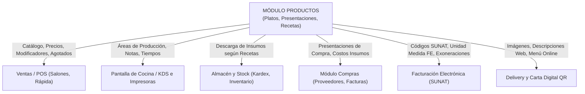
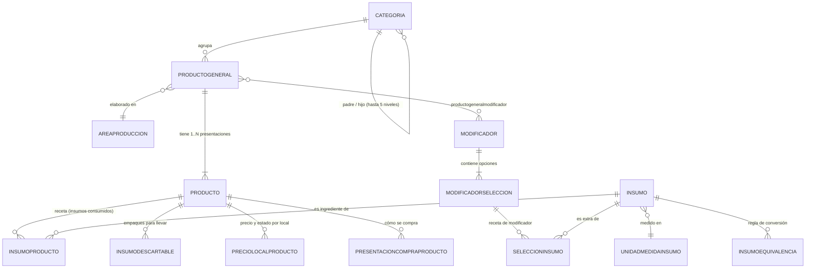

# Módulo: Productos (`#!/productos/platos/categoria/All`)

Documentación técnica y funcional exhaustiva del módulo de **Productos, Catálogo de Carta, Recetas e Insumos** del sistema de gestión administrativa y POS de **CAPRICHOS** (`https://caprichos.restaurant.pe/restaurant/#!/login`). Elaborada mediante auditoría pasiva en modo estricto de solo lectura sobre el entorno de producción, complementada con el análisis estructural de las plantillas públicas AngularJS, directivas, controladores y contratos de API REST.

---

## 1. Propósito General del Módulo

El módulo de **Productos** constituye el núcleo de configuración gastronómica, operativa y comercial del restaurante. Su objetivo principal es:
1. **Definir la Carta y Catálogo Comercial**: Estructurar la oferta comercial jerárquicamente en Categorías multinivel y Productos Generales con sus variantes (Presentaciones).
2. **Controlar Precios y Modalidades de Venta**: Establecer precios diferenciados por sucursal, canal de venta (Salón, Venta Rápida, Delivery, QR / Autoservicio) y monitorear comisiones de mozos y puntos de fidelización.
3. **Dirigir la Producción en Cocina y Barra**: Asignar cada plato a su Área de Producción correspondiente (Cocina Fría, Cocina Caliente, Cafetería, Barra de Bebidas, etc.) para el correcto enrutamiento e impresión de comandas físicas o visualización en la Pantalla de Cocina (KDS).
4. **Gestionar la Ficha Técnica, Escandallo y Recetas**: Registrar los insumos, sub-recetas base y porcionables necesarios para la elaboración de cada plato, permitiendo el cálculo automatizado de costeos teóricos y la descarga automática de inventario por almacén al momento de registrar ventas.
5. **Configurar Adicionales y Modificadores**: Permitir la personalización de platos (términos de cocción, tipos de leche para café, salsas, guarniciones, extras con o sin costo) con descarga vinculada de insumos.
6. **Administrar Disponibilidad Operativa (Agotados)**: Marcar productos y presentaciones como agotados de forma inmediata con políticas temporales (solo por hoy, por una semana o indefinido) para evitar comandar artículos sin existencias en los puntos de venta.

---

## 2. Mapa de Navegación y Submódulos

El módulo se compone de una barra de navegación superior (tabs principales) y un panel lateral jerárquico de categorías:

```text
Productos (#!/productos/platos/categoria/All)
├── [Panel Lateral Izquierdo]
│   └── Árbol Jerárquico de Categorías (hasta 5 niveles de anidación)
├── [Barra de Selector Superior]
│   ├── 1. Platos/Bebidas (#!/productos/platos/categoria/:idCategoria)
│   │   ├── Vista Maestro-Detalle (Productos Generales y Presentaciones)
│   │   ├── Formulario de Edición Rápida
│   │   └── Edición Avanzada Full (#!/productos/platos/editar-full/:idProductoGeneral/:modoAvanzado)
│   │       ├── Ficha General de Producto
│   │       ├── Gestión de Agrupadores/Modificadores asignados
│   │       ├── Pestañas de Presentaciones (Precios, Restricciones, Calendario)
│   │       ├── Ficha Técnica de Receta (Insumos, Sub-recetas, Medidas, Costos)
│   │       └── Descartables y Empaques para Llevar
│   ├── 2. Combos (#!/productos/combos/categoria/:idCategoria)
│   │   ├── Lista de combos
│   │   ├── Nuevo combo / Edición
│   │   └── Combos por equivalencias (alternativas dinámicas)
│   ├── 3. Modificadores (#!/productos/modificadores/:pagina/:orden)
│   │   ├── Lista de Agrupadores (Selección única o múltiple)
│   │   ├── Lista de Opciones / Selecciones (Precios extras y orden)
│   │   └── Recetas de Insumos por Modificador
│   ├── 4. Insumos (#!/productos/insumos/categoria/:idCategoriaInsumo/:tipoinsumo/:pagina/:orden)
│   │   ├── Sub-tab Insumos (Materia prima pura, mermas, presentaciones de compra)
│   │   ├── Sub-tab Recetas Base (Preparaciones intermedias / sub-recetas)
│   │   └── Sub-tab Porcionables (Fraccionamiento de insumos mayores)
│   ├── 5. Menús (#!/productos/menus/:idCategoria)
│   │   ├── Categorías y Fases del menú (Entradas, Segundos, Postres)
│   │   └── Programación semanal por calendario (FullCalendar)
│   ├── 6. Descartables (#!/productos/descartable)
│   │   └── Catálogo de envases, tapas, bolsas y cubiertos
│   └── 7. Productos Sugeridos (#!/productos/productosugerido)
│       └── Reglas de venta cruzada (cross-selling) por categoría o producto
└── [Herramientas Globales]
    ├── Importadores masivos Excel (Precios, Insumos, Modificadores, Zonas, Stock)
    ├── Subir carta desde imagen (OCR / Digitalización)
    ├── Exportador de catálogo (Excel / CSV)
    └── Matriz de productos
```

---

## 3. Pantalla 1: Catálogo Principal y Categorías (`#!/productos/platos/categoria/All`)

### Propósito
Es la pantalla de inicio del catálogo. Permite explorar el menú completo mediante un árbol de categorías a la izquierda y una tabla maestra de productos con su panel de variantes (presentaciones) a la derecha.

### Flujo de Uso Paso a Paso
1. **Visualización de categorías**: El usuario observa a la izquierda el árbol de categorías del local activo. Puede filtrar categorías escribiendo en el buscador superior o marcar `Ver Anuladas`.
2. **Selección de categoría**: Al pulsar sobre una categoría del árbol, el panel derecho se actualiza mostrando únicamente los productos generales pertenecientes a esa categoría. Si pulsa `All`, visualiza todo el catálogo.
3. **Gestión de categorías**: El usuario puede pulsar `Añadir nueva categoría` para desplegar el formulario embebido en el panel izquierdo, o hacer clic en el icono de lápiz sobre cualquier categoría para editarla.
4. **Búsqueda de producto**: En la tabla derecha, escribe en `Filtrar producto` para encontrar artículos por nombre sin recargar la página.
5. **Inspección de variantes**: Al hacer clic sobre una fila de producto general, se carga en la columna contigua la lista de sus presentaciones (ej. Personal, Mediano, Grande), mostrando su precio de venta, costo y código.
6. **Acceso a edición**: El usuario puede pulsar el botón verde con icono de lápiz para edición rápida en línea, o seleccionar `Edición avanzada del producto` para ingresar a la configuración integral.

### Estructura de Tablas y Columnas

#### A. Tabla de Productos Generales (Panel Central)
| Columna | Alineación | Tooltip / Significado | Datos Mostrados |
| :--- | :--- | :--- | :--- |
| **Producto** | Izquierda | Nombre comercial del producto general | Nombre con enlace sin subrayar |
| **Cód.** | Centro | Identificador único del producto para integraciones | Código `#{{productogeneral_id}}` |
| **¿Transformable?** | Centro | ¿Lo preparas tú mismo o lo compraste listo? | Icono verde `Sí` (Transformado) o rojo `No` (No transformado) |
| **¿Activo?** | Centro | ¿Está disponible para la venta en el sistema? | Icono verde `Sí` o rojo `No` |
| **Acciones** | Derecha | Acceso a edición | Botón verde con icono de lápiz |

*Paginación*: Componente `<uib-pagination>` con botones *Primera*, *Anterior*, *Siguiente*, *Último* (por defecto 10 a 20 registros por página).

#### B. Tabla de Presentaciones (Panel Derecho / Colapsable)
| Columna / Bloque | Alineación | Significado |
| :--- | :--- | :--- |
| **Nombre de Presentación** | Izquierda | Nombre de la variante (ej. "Taza", "Jarra 1L", "Porción"). Si está anulada, aparece tachada y con icono de prohibición. |
| **Código** | Izquierda | ID numérico `#{{producto_id}}` para integraciones. |
| **Precio de Venta** | Derecha | Importe en moneda local formateado con decimales. |
| **Costo** | Izquierda | Costo calculado o ingresado manualmente. |
| **Comisión** | Izquierda | Monto de comisión asignado al mozo/vendedor. |
| **Botones de Acción** | Derecha | Botón `Editar presentación`, `Marcar como agotado`, `Anular`. |

### Campos del Formulario: Crear / Editar Categoría (`categoria.form.view.html`)
| Etiqueta | Tipo de Control | Obligatorio | Opciones / Valores | Variable Angular |
| :--- | :--- | :--- | :--- | :--- |
| **Nombre** | `input[text]` | **Sí** | Texto libre | `vm.categoriaForm.categoria_descripcion` |
| **¿Es categoría principal?** | `checkbox` (iCheck) | No | Si/No. Si se desmarca, habilita selector de categoría padre | `vm.categoriaForm.esCategoriaPadre` |
| **Categoría superior** | `ui-select` | Condicional | Lista de categorías activas existentes (requerido si no es padre) | `vm.categoriaSeleccionada` |
| **¿Delivery?** | `checkbox` | No | Activa si la categoría se envía a carta digital / delivery | `vm.categoriaForm.categoria_delivery` |
| **¿Se vende en salón?** | `checkbox` | No | Disponible para ventas de salón | `vm.categoriaForm.categoria_salon` |
| **¿Se vende en venta rápida?** | `checkbox` | No | Disponible para caja rápida / paso | `vm.categoriaForm.categoria_ventarapida` |
| **¿Se aplica en Food-Cost?** | `checkbox` | No | Incluye en cálculos de costo de alimentos | `vm.categoriaForm.categoria_controlfoodcost` |
| **¿Se aplica en Self Service?** | `checkbox` | No | Muestra en kioskos de autoservicio | `vm.categoriaForm.categoria_selfservice` |
| **¿Es categoría principal de Self Service?** | `checkbox` | No | Cabecera destacada en kiosko | `vm.categoriaForm.categoria_escategoriaprincipalselfservice` |
| **¿Se escanea?** | `checkbox` | No | Búsqueda por escáner de código | `vm.categoriaForm.categoria_seescanea` |
| **¿Se muestra en carta?** | `checkbox` | No | Visibilidad en menú general | `vm.categoriaForm.categoria_semuestraencarta` |
| **Color** | `input[text]` + `colorpicker` | No | Selector de color hexadecimal (muestra preview) | `vm.categoriaForm.categoria_color` |
| **Cuenta** | `input[text]` | No | Cuenta contable | `vm.categoriaForm.categoria_cuenta` |
| **Código familia** | `input[text]` | No | Clasificador contable/ERP | `vm.categoriaForm.categoria_codigofamilia` |
| **Código de existencia** | `input[text]` | No | Código tributario de tipo de existencia | `vm.categoriaForm.categoria_codigoexistencia` |
| **Puntos** | `input[text]` (solo números) | No | Puntos otorgados al cliente por consumo | `vm.categoriaForm.categoria_puntos` |
| **Cantidad máxima por pedido** | `input[text]` (solo números) | No | Límite por comanda/orden | `vm.categoriaForm.categoria_limitepedido` |
| **Número de orden** | Input numérico con botones `+` / `-` | No | Posición de la categoría en integraciones delivery | `vm.categoriaForm.categoria_orden` |
| **Orden POS** | Input numérico con botones `+` / `-` | No | Posición en la interfaz táctil del POS | `vm.categoriaForm.categoria_ordenpos` |
| **Orden Self Service** | Input numérico con botones `+` / `-` | No | Posición en kiosko | `vm.categoriaForm.categoria_ordenselfs` |
| **Activa** | `checkbox` | No | 1 (Activa) / 0 (Inactiva) | `vm.categoriaForm.categoria_estado` |
| **Generar código automático** | `checkbox` | No | Autoincrementa código de productos dentro | `vm.categoriaForm.categoria_codigoautoincrement` |
| **Prefijo del código** | `input[text]` | Condicional | Prefijo de código (ej. "BEB-") | `vm.categoriaForm.categoria_codigoprefijo` |
| **Correlativo inicial** | `input[number]` | Condicional | Número inicial (ej. 1001) | `vm.categoriaForm.categoria_codigocorrelativo` |
| **Descripción web** | `input[text]` | No | Subtítulo para la carta digital online | `vm.categoriaForm.categoria_descripcionweb` |
| **Gestión de impuestos** | Enlace / Botón | No | Abre modal de impuestos asociados | `fnActualizarImpuestosCategoria` |
| **Mostrar en sucursales** | Tabla multi-check | No | Checkbox `categoria_local` por cada local | `vm.categoriaForm.listaSucursales` |
| **Mostrar en marcas** | Tabla multi-check | No | Checkbox por cada marca (en entornos multimarca) | `vm.categoriaForm.marcaList` |
| **Imagen de la categoría** | Botón archivo (`ngf-select`) | No | Sube imagen (350x263 px) a Cloudinary o local | `vm.categoriaForm.categoria_urlimagen` |

### Filtros Visibles
- **Local / Sucursal**: `ui-select` desplegable superior (`vm.localSeleccionado`).
- **Marca**: `ui-select` desplegable (si aplica a la cadena).
- **Filtrar mis categorías**: `input[text]` con búsqueda predictiva instantánea.
- **Ver Anuladas (Categorías)**: `checkbox` para revelar categorías desactivadas.
- **Filtrar producto**: `input[text]` con icono de lupa para búsqueda reactiva por nombre.
- **Ver Anulados (Productos)**: `checkbox` para listar productos desactivados.

### Botones y Acciones Disponibles (Solo Nombres)
- `Importadores` (menú desplegable)
- `Descargar` (menú desplegable)
- `Nuevo producto`
- `Recorrido guiado`
- `Añadir nueva categoría`
- `Cancelar`
- `Guardar` / `Actualizar` (en categorías)
- `Editar` (icono lápiz en tabla de productos)
- `Agregar presentación`
- `Ver producto completo`
- `Edición avanzada del producto`

---

## 4. Pantalla 2: Edición Completa y Avanzada de Producto (`productos.editar-full`)

### Propósito
Es el formulario integral donde se parametriza técnica, contable y operativamente el Producto General y todas sus variantes/presentaciones, incluyendo fichas de recetas, empaques y áreas de producción.

### Flujo de Uso Paso a Paso
1. **Acceso**: Se ingresa desde la tabla de productos pulsando `Edición avanzada del producto` (ruta `#!/productos/platos/editar-full/:idProductoGeneral/true`).
2. **Edición del Producto General**: Se define el nombre, si es transformado o comprado listo, su área de producción en cocina/barra, almacén emisor, notas rápidas y reglas fiscales.
3. **Asignación de Modificadores / Agrupadores**: En el panel lateral, el usuario asigna qué grupos de modificadores aplican al plato (ej. salsas, guarniciones, extras), indicando cantidades mínimas y máximas requeridas.
4. **Configuración de Presentaciones**: En el panel derecho con pestañas dinámicas por variante, edita o agrega presentaciones definiendo precios de venta, comisiones, códigos y restricciones de stock o calendario.
5. **Armado de la Ficha Técnica / Receta**: Si el producto es transformado, activa `Tiene receta` y busca insumos, sub-recetas o porcionables, especificando cantidades y unidades de medida.
6. **Configuración de Descartables**: Activa `Descontar descartables para llevar` para asociar envases y empaques según canal de venta.
7. **Guardado**: Pulsa `Guardar presentación` y luego `Guardar` en el producto general.

---

### Campos del Formulario: Ficha de Producto General (`platos.editar.rapido.html`)
| Etiqueta | Tipo de Control | Obligatorio | Opciones / Descripción | Variable Angular |
| :--- | :--- | :--- | :--- | :--- |
| **Nombre del producto** | `input[text]` | **Sí** | Nombre principal del plato (incluye icono estrella de favorito) | `vm.productogeneral.productogeneral_descripcion` |
| **Tipo de Producto** | Grupo botones bi-estado | **Sí** | **Transformado** (se prepara o sirve antes de vender: platos, tragos, ensaladas) vs **No transformado** (comprado listo para vender: gaseosas, galletas, cerveza) | `vm.productogeneral.productogeneral_tranformado` |
| **Área de producción** | `ui-select` | **Sí** | Desplegable de áreas activas (ej. Cocina Caliente, Horno, Cafetería, Barra) | `vm.areaProduccionSeleccionada` |
| **Almacén** | Solo lectura (`p.form-control-static`) | Auto | Almacén por defecto vinculado al área de producción | `vm.almacen.almacen_descripcion` |
| **Notas rápidas** | `ui-select multiple` con tagging | No | Notas predefinidas para comanda (ej. "Término medio", "Sin cebolla", "Bien caliente", "Para llevar") | `vm.notasSeleccionadas` |
| **Descripción del producto** | `textarea` (2 filas) | No | Descripción comercial del plato | `vm.productogeneral.productogeneral_descripcionplato` |
| **Descripción para integraciones** | `textarea` (máx. 200 caracteres) | No | Texto descriptivo transmitido a plataformas externas (Rappi, PedidosYa, DiDi Food) | `vm.productogeneral.productogeneral_descripcionweb` |
| **Descripción para API de restaurant** | `textarea` (máx. 200 caracteres) | No | Descripción técnica para canal API | `vm.productogeneral.productogeneral_descripcionadicional` |
| **Categoría** | `ui-select` | **Sí** | Categoría gastronómica a la que pertenece | `vm.categoriaSeleccionada` |
| **Proveedor** | `ui-select` con buscador de RUC | Condicional | Búsqueda por RUC o Razón Social (solo visible en no transformados) | `vm.proveedorSeleccionado` |
| **Código Marca** | `input[text]` | No | Identificador de marca | `vm.productogeneral.productogeneral_marca` |
| **Clasificación ABC** | `ui-select` | No | Opciones: `A`, `B`, `C` para gestión de inventarios | `vm.clasificacionabcSelected` |
| **Insumo / Granel** | `checkbox` | No | "¿Este producto es utilizado para una receta?" (en no transformados) | `vm.productogeneral.productogeneral_esinsumo` |
| **Unidad de Medida** | `ui-select` | Condicional | Unidad para recetas (ej. Kilos, Litros, Unidades) si se usa como insumo | `vm.unidadInsumoSeleccionado` |
| **No agrupar en cocina** | `checkbox` | No | Evita agrupar unidades idénticas en una sola línea en la comanda | `vm.productogeneral.productogeneral_noagruparencocina` |
| **Inafecto a impuestos** | `checkbox` | No | Producto inafecto a IGV (requiere configuración previa del local) | `vm.productogeneral.productogeneral_inafectoimpuestos` |
| **Exonerado a impuestos** | `checkbox` | No | Producto exonerado de IGV | `vm.productogeneral.productogeneral_exoneradoimpuestos` |
| **Afecto a ley del país** | `checkbox` + `ui-select` | No | Leyes especiales (ej. Ley de Amazonía / Selva peruana) con selector `leysunat` | `vm.productogeneral.productogeneral_afectoley` |
| **Imprimir en otras áreas de producción** | `checkbox` + tabla multi-check | No | Permite imprimir comandas duplicadas en áreas auxiliares (ej. emitir ticket tanto en Cocina como en Parrilla) | `vm.productogeneral.imprimirEnOtrasAreas` |
| **Afecto a detracción (Retail)** | `checkbox` + 3 inputs | No | Código de servicio, porcentaje de detracción y monto mínimo de detracción | `vm.productogeneral.productogeneral_afectodetraccion` |
| **Afecto a percepción (Retail)** | `checkbox` + input % | No | Porcentaje de percepción para compras | `vm.productogeneral.productogeneral_afectopercepcion` |
| **Tiene instrucciones** | `checkbox` | No | Habilita captura de instrucciones especiales en pedidos | `vm.productogeneral.productogeneral_discoteca` |
| **Orden Self Service** | Control numérico `+` / `-` | No | Posición en pantalla de autoservicio | `vm.productogeneral.productogeneral_ordenselfs` |
| **Imagen del producto** | Botón archivo (`ngf-select`) | No | Imagen de catálogo online (350x263 px) | `vm.productogeneral.productogeneral_icon` |

---

### Campos del Formulario: Presentación / Variante (`presentacion.full.editar.view.html`)
Cada producto puede tener una o múltiples presentaciones (ej. Vaso, Jarra, 1/4 Pollo, 1/2 Pollo, Entero):

| Etiqueta | Tipo de Control | Obligatorio | Opciones / Descripción | Variable Angular |
| :--- | :--- | :--- | :--- | :--- |
| **Nombre** | `input[text]` | **Sí** | Nombre de la presentación (ej. "Personal", "Grande") | `presentacion.producto.producto_presentacion` |
| **Descripción para integraciones** | `input[text]` | No | Texto enviado a apps de delivery para esta variante | `presentacion.producto.producto_presentacionweb` |
| **Precio de venta** | `input[text]` (numérico 2 dec.) | **Sí** | Precio final de venta al público en soles (PEN) | `presentacion.producto.producto_precio` |
| **Precio unitario** | `input[text]` | No | Precio base unitario sin recargos | `presentacion.producto.producto_preciounitario` |
| **Precio sin oferta** | `input[text]` | No | Precio tachado para eCommerce / Delivery Web | `presentacion.producto.producto_precioreferencial` |
| **Costo** | `input[text]` (numérico 2 dec.) | **Sí** | Costo estimado de la variante (o calculado desde receta) | `presentacion.producto.producto_costo` |
| **Código tributario SUNAT** | `input[text]` | No | Código estándar de producto SUNAT | `presentacion.producto.producto_codigosunat` |
| **Código WSAHI** | `input[text]` | No | Código de enlace para ERP contable externo | `presentacion.producto.producto_wsahi` |
| **UM para FE** | `input[text]` (máx. 4 char) | No | Unidad de medida para Facturación Electrónica (ej. "NIU", "KGM") | `presentacion.producto.producto_umparafe` |
| **Código / Barras** | `input[text]` | No | Código interno o código de barras para lector óptico | `presentacion.producto.producto_codigo` |
| **Comisión** | `input[text]` (numérico 2 dec.) | No | Monto de comisión abonado al mozo por cada venta | `presentacion.producto.producto_comision` |
| **Puntos** | `input[text]` | No | Puntos sumados al monedero del cliente | `presentacion.producto.producto_puntos` |
| **Color** | `input[text]` + `colorpicker` | No | Color distintivo de botón en la comanda del mozo | `presentacion.producto.producto_color` |
| **Delivery** | `checkbox` | No | ¿Mostrar esta presentación en ventas por Delivery? | `presentacion.producto.producto_delivery` |
| **Activo** | `checkbox` | No | Estado operativo (1: Activo, 0: Anulado) | `presentacion.producto.producto_estado` |
| **Venta al peso** | `checkbox` | No | ¿Requiere captura de peso en balanza antes de registrar? | `presentacion.producto.producto_ventaalpeso` |
| **Self Service y QR** | `checkbox` | No | Disponible para pedidos desde QR en mesa o kiosko | `presentacion.producto.producto_selfservice` |
| **Mostrar en dashboard** | `checkbox` | No | Incluir en rankings de más vendidos y rentabilidad | `presentacion.producto.producto_verendashboard` |
| **Control de stock** | `checkbox` | No | Activa control de inventario por almacén (no transformados) | `presentacion.producto.producto_controlstock` |
| **Restringir ventas sin stock** | `checkbox` | No | Bloquea la venta en POS si el stock en almacén es <= 0 | `presentacion.producto.producto_restriccionporstock` |
| **Restringir fecha de venta** | `checkbox` | No | Habilita restricciones temporales | `presentacion.restringirfechaventa` |
| **Rango de fechas** | `date-range-picker` | Condicional | Venta habilitada solo entre fecha inicio y fin | `presentacion.rangoDeFechas.fechas` |
| **Restricción por días** | `ui-select multiple` | Condicional | Días de la semana permitidos (Lunes a Domingo) | `presentacion.diaSemanaSeleccionadoList` |
| **Restricción por horas** | 2 inputs `clockpicker` | Condicional | Hora inicio y hora fin de disponibilidad en el día | `presentacion.hora1`, `presentacion.hora2` |
| **Configurar ventas en sucursales**| Tabla multi-check | No | Define si se vende en cada local (`preciolocalproducto_debemostrarse`) | `presentacion.listaPreciosPorLocal` |
| **Imagen de la presentación** | Botón archivo (`ngf-select`) | No | Imagen específica de la variante | `presentacion.producto.producto_urlimagen` |

---

### Formulario de Ficha Técnica / Receta (`presentacion.full.ingredientes.view.html`)
Permite definir el escandallo de la presentación.

#### Tipos de Componentes que se pueden agregar a la receta:
1. **(Insumo)**: Materia prima directa (ej. café en grano, leche entera, azúcar, harina).
2. **(Receta / Receta base)**: Preparación intermedia previa (ej. jarabe de vainilla, salsa boloñesa, masa de queque).
3. **(Derivado)**: Insumo derivado de un proceso secundario.
4. **(Porcionable)**: Insumo fraccionado desde una pieza mayor (ej. pechuga fileteada, bloque de queso cortado).
5. **(Producto)**: Otro producto terminado del catálogo utilizado como insumo.

#### Columnas de la Tabla de Receta:
| Columna | Control / Comportamiento | Significado |
| :--- | :--- | :--- |
| **Cant.** | Input numérico con botones `+` / `-` | Cantidad requerida para elaborar una unidad de la presentación. Muestra equivalencia calculada en la UM base y valorización monetaria. |
| **Medida** | `ui-select` desplegable | Unidad de medida de consumo en receta (ej. Gramos, Mililitros, Unidades, Onzas) con validación automática de factor de conversión. |
| **Producto / Insumo** | Badge informativo de tipo + Nombre | Muestra badge distintivo: Insumo (azul), Receta (naranja), Porcionable (rojo), Producto (celeste). Alerta si el insumo está anulado. |
| **Descuenta de** | `ui-select` desplegable | Presentación de compra del almacén de la cual se rebajará el stock físico (ej. "Saco x 50kg", "Caja x 12 unidades"). |
| **Acciones** | Botón rojo con icono papelera | Elimina el insumo de la receta. |

#### Totales y Cálculos de la Receta:
- **Costo total de la receta**: Sumatoria en tiempo real de todos los insumos valorizados al costo promedio del almacén.
- **Costo total sin impuestos**: Valorización neta antes de IGV.
- **Almacén de descarga**: Identifica el almacén del cual se restará el stock al venderse el plato.
- **Modalidades de receta**: Si está activo el parámetro del sistema, permite definir recetas distintas para **Salón**, **Venta Rápida** o **Delivery** (ej. menor guarnición o empaques diferentes).

---

### Descartables y Empaques para Llevar (`presentacion.full.productos.llevar.view.html`)
- **Checkbox activador**: `Descontar descartables para llevar` (`producto_llevadescartable`).
- **Selector de modo**: *Buscar solo descartables* vs *Posibles descartables dentro de insumos*.
- **Tabla de empaques asignados**:
  * Cantidad de empaque con botones `+` / `-`.
  * Nombre del descartable (ej. Vaso térmico 12oz, Tapa domo, Servilletas, Bolsa kraft).
  * Canales de aplicación (checkboxes independientes):
    - **Rápidas** (`insumodescartable_canalventarapida`)
    - **Salones** (`insumodescartable_canalventasalon`)
    - **Delivery** (`insumodescartable_canalventadelivery`)
    - **Para Llevar** (`insumodescartable_descontarsoloparallevar`)
  * Costo total de descartables calculado automáticamente.

---

## 5. Pantalla 3: Modificadores y Adicionales (`#!/productos/modificadores`)

### Propósito
Permite crear agrupadores de opciones (modificadores) y vincularlos a los platos para gestionar elecciones de clientes (ej. "Tipo de leche", "Término de carne", "Salsas", "Extras").

### Flujo de Uso Paso a Paso
1. **Creación de Agrupador**: Se pulsa `Nuevo agrupador` en el submódulo de modificadores. Se define el nombre (ej. "Elige tu leche"), el tipo (Única vs Múltiple) y canales donde aplica.
2. **Creación de Opciones / Modificadores**: Se agregan las opciones individuales (ej. "Leche entera" [S/ 0.00], "Leche de almendras" [S/ 3.00], "Leche sin lactosa" [S/ 1.50]).
3. **Asignación de Insumos al Modificador (Escandallo de adicional)**: En `Insumos del modificador`, se vinculan insumos para que al cobrar el adicional se descuente stock (ej. 200 ml de leche de almendras).
4. **Vinculación con el Producto General**: Dentro de la edición avanzada del plato, se busca el agrupador y se asigna con:
   - Orden de aparición en comanda.
   - Cantidad mínima requerida (si es >= 1, el mozo está obligado a seleccionar antes de enviar comanda).
   - Cantidad máxima permitida.
   - Opción marcada por defecto.
   - Instrucciones personalizadas.

### Campos de Agrupador (`agrupador-nuevo.html`)
| Campo | Tipo | Obligatorio | Descripción |
| :--- | :--- | :--- | :--- |
| **Nombre** | `input[text]` | **Sí** | Nombre del grupo (ej. "Salsas a elegir") |
| **Tipo de selección** | `ui-select` | **Sí** | **Única** (radio button) vs **Múltiple** (checkbox) |
| **Estado** | `checkbox` | No | Activo / Anulado |
| **Modalidad de venta** | 3 checkboxes | No | Venta por salón, venta rápida, delivery |
| **Mostrar en sucursales** | Tabla multi-check | No | Locales donde estará disponible |
| **Imagen** | Botón archivo | No | Imagen representativa |

### Campos de Opción / Modificador (`modificador-nuevo.html`)
| Campo | Tipo | Obligatorio | Descripción |
| :--- | :--- | :--- | :--- |
| **Nombre** | `input[text]` | **Sí** | Nombre del extra (ej. "Salsa Huancaína") |
| **Precio** | `input[text]` numérico | **Sí** | Monto adicional (S/ 0.00 si está incluido) |
| **Imp. en comanda** | `checkbox` | No | ¿Imprime en comanda de cocina/barra? |
| **Estado** | `checkbox` | No | Activo / Anulado |
| **Orden** | Flechas `+` / `-` | No | Orden de posición en la lista |
| **Área de producción** | `ui-select` | No | Área de cocina donde se elabora |
| **Mostrar en sucursales** | Tabla multi-check | No | Sucursales con acceso |
| **Imagen** | Botón archivo | No | Imagen de la opción |

---

## 6. Pantalla 4: Insumos, Recetas Base y Porcionables (`#!/productos/insumos`)

### Propósito
Controlar el maestro de ingredientes y preparaciones base para abastecimiento, compras y costeo.

### Sub-tabs Disponibles:
1. **Insumos (`tipoinsumo: 1`)**:
   - Columnas: `Código`, `Nombre`, `Unidad`, `Merma (%)`, `Presentaciones (compra)`, `¿Activo?`, `Acciones` (Editar, Anular).
   - Campos de Formulario (`insumos-nuevo.html`):
     * `insumo_nombre` (Requerido)
     * `insumo_codigo`
     * `unidadmedidainsumo` (UM base: KG, LT, UNID, GR, ML)
     * `categoriainsumo` (Categoría de insumo, ej. Lácteos, Carnes, Verduras)
     * `insumo_codigointerno`
     * `clasificacionabcSelected` (A, B, C)
     * `insumo_afectoigv` (Afecto a impuestos Sí/No)
     * **Conversiones de UM**: Checkbox `Permitir conversiones` (ej. 1 Kilo equivale a 1000 Gramos).
     * **Merma**: `% Merma` e indicador `Generar merma automática al comprar` (calcula el rendimiento útil real al ingresar compras).
     * **Stock de Apertura e Inventarios**: Tabla por almacén con stock inicial, costo unitario y stock mínimo.
     * **Proveedor recomendado**: Búsqueda por RUC.
2. **Recetas Base (`tipoinsumo: 2`)**:
   - Preparaciones previas (sub-recetas) que se usan en múltiples platos (ej. salsa madre, jarabes, bases de repostería).
   - Árbol de ingredientes interactivo (`ui-tree`) donde se añaden insumos y cantidades.
   - Selector de **Modo de descargo**:
     * `1`: **Por preparación en venta** (descargo en tiempo real al vender cada plato).
     * `0`: **Por Stock en almacén** (se registra una orden de producción previa que genera stock de la receta base; la venta descuenta ese stock producido).
   - Campo de rendimiento: "La combinación genera X [Unidad]".
3. **Porcionables (`tipoinsumo: 3`)**:
   - Insumos de compra en volumen que se fraccionan en porciones estandarizadas antes de su uso.

---

## 7. Pantalla 5: Combos y Menús del Día

### A. Combos (`#!/productos/combos`)
- Permite crear ofertas compuestas por varios platos.
- Soporta combos fijos y **Combos por equivalencias** (el cliente elige 1 plato de un grupo A, 1 guarnición de un grupo B y 1 bebida de un grupo C).
- Campos: Nombre, Descripción, Código, Categoría, Puntos, Código SUNAT, WSAHI y tabla de productos vinculados.

### B. Menús y Programación Semanal (`#!/productos/menus`)
- Estructuración de menú ejecutivo o del día.
- Fases del menú: Entrada, Segundo / Fondo, Postre, Bebida.
- Calendario interactivo (`FullCalendar` / `ui-calendar`): Permite programar qué platos están disponibles cada día de la semana (Lunes a Domingo) para que el POS filtre automáticamente los platos vigentes en el día.

---

## 8. Modales y Operaciones Clave

### A. Modal: Marcar Producto como Agotado (`modalSelectorModoProductoAgotado.html`)
Se activa al pulsar `Marcar como agotado` en una presentación:
- **Título**: *¿Cuánto tiempo estará agotado el producto?*
- **Opciones (Radio Buttons)**:
  1. `Agotarlo sólo por hoy.` (se reactiva automáticamente al cambio de fecha de turno).
  2. `Agotarlo por una semana.`
  3. `Agotarlo para siempre.`
- **Acciones**: `Cancelar`, `Continuar`.

### B. Modal: Formatos e Importadores Masivos (`modalFormatoActualizarPrecios.html`)
Desplegable en la barra superior con descargas y cargas de plantillas Excel:
1. Formato para agregar productos (Excel)
2. Formato para actualizar precios (Excel)
3. Formato para actualizar precios por zonas (Excel)
4. Formato para actualizar productos existentes (Excel)
5. Formato para actualizar stock mín/máx (Excel)
6. Formato para actualizar insumos y recetas (Excel)
7. Formato para agregar combos (Excel)
8. Agregar modificadores masivos
9. **Subir carta desde una imagen**: Asistente de digitalización OCR que extrae platos y precios a partir de fotografías de cartas físicas.

---

## 9. Reglas de Negocio y Validaciones Visibles

1. **Jerarquía Producto General vs Presentación**: Ningún producto puede venderse sin al menos una presentación registrada. El Producto General agrupa metadatos y categorías; la Presentación define el precio, código de barra y stock.
2. **Doble factor en Control de Stock**: Si un producto está marcado como no transformado y tiene activo `Control de stock`, el sistema habilita el switch `Restringir ventas sin stock`. Si está encendido, el POS bloquea la comanda en caso de saldo cero.
3. **Conversión Estricta de Unidades de Medida**: Al agregar insumos a recetas, el sistema valida que la unidad de medida seleccionada pertenezca a la misma magnitud (masa con masa, volumen con volumen) o que exista una regla explícita de equivalencia (ej. 1 Botella = 750 ml). Si la conversión falla, la UI muestra `Error de Conversión`.
4. **Afectación Fiscal y SUNAT**: Los productos inafectos o exonerados requieren que la configuración tributaria global del local lo permita. La unidad de medida para Facturación Electrónica debe cumplir el estándar SUNAT (ej. `NIU` para unidades, `KGM` para kilos).
5. **Comisiones y Rentabilidad**: Los campos de costo, precio y comisión validan formato decimal de 2 dígitos. La rentabilidad teórica se calcula restando el costo de receta del precio de venta antes de impuestos.
6. **Agotado Inteligente**: Si un producto se marca como agotado por hoy, el servidor actualiza el registro en `preciolocalproducto` y lo oculta del POS local sin afectar otras sucursales.

---

## 10. Relaciones con Otros Módulos



- **Ventas / POS**: Provee la carta, precios, combinaciones de modificadores y estado de agotados.
- **Cocina / KDS / Impresoras**: Enruta cada plato a su impresora comanda o pantalla de cocina correspondiente según `areaproduccion_id` y áreas auxiliares.
- **Almacén / Stock**: Cada venta realizada descuenta los insumos de la receta del almacén vinculado al área de producción.
- **Compras**: Los insumos y productos no transformados son el catálogo que se adquiere a proveedores mediante órdenes de compra.
- **Facturación Electrónica**: Suministra los códigos tributarios SUNAT, tipo de IGV y unidades de medida fiscales para la emisión de boletas y facturas.
- **Delivery / Menú QR**: Provee descripciones breves, imágenes optimizadas en Cloudinary y precios para la carta digital interactiva.

---

## 11. Entidades de Datos Clave (Modelo Relacional Deducido)



### Entidades y Campos Principales:
1. **`categoria`**:
   - `categoria_id` (PK), `categoria_descripcion`, `categoria_padre_id` (FK auto-referencial), `categoria_color`, `categoria_orden`, `categoria_ordenpos`, `categoria_ordenselfs`, `categoria_estado`, `categoria_delivery`, `categoria_salon`, `categoria_ventarapida`, `categoria_puntos`, `categoria_urlimagen`, `categoria_codigoautoincrement`, `categoria_codigoprefijo`, `categoria_codigocorrelativo`, `categoria_descripcionweb`.
2. **`productogeneral`**:
   - `productogeneral_id` (PK), `productogeneral_descripcion`, `categoria_id` (FK), `areaproduccion_id` (FK), `almacen_id` (FK), `productogeneral_tranformado` (1/0), `productogeneral_esinsumo` (1/0), `productogeneral_escombo` (1/0), `productogeneral_esfavorito` (1/0), `productogeneral_estado` (1/0), `productogeneral_descripcionplato`, `productogeneral_descripcionweb`, `productogeneral_descripcionadicional`, `productogeneral_marca`, `productogeneral_clasificacionabc`, `productogeneral_inafectoimpuestos` (1/0), `productogeneral_exoneradoimpuestos` (1/0), `productogeneral_afectoley` (1/0), `leysunat_id` (FK), `productogeneral_noagruparencocina` (1/0), `productogeneral_icon`, `proveedor_id` (FK).
3. **`producto`** (Presentación):
   - `producto_id` (PK), `productogeneral_id` (FK), `producto_presentacion`, `producto_presentacionweb`, `producto_codigo`, `producto_precio`, `producto_preciounitario`, `producto_precioreferencial`, `producto_costo`, `producto_comision`, `producto_puntos`, `producto_estado` (1/0), `producto_delivery` (1/0), `producto_ventaalpeso` (1/0), `producto_selfservice` (1/0), `producto_verendashboard` (1/0), `producto_controlstock` (1/0), `producto_restriccionporstock` (1/0), `producto_color`, `producto_urlimagen`, `producto_codigosunat`, `producto_umparafe`, `producto_skudeliverygo`, `producto_llevaingredientes` (1/0), `producto_llevadescartable` (1/0).
4. **`preciolocalproducto`**:
   - `preciolocalproducto_id` (PK), `producto_id` (FK), `local_id` (FK), `preciolocalproducto_precio`, `preciolocalproducto_agotado` (1/0), `preciolocalproducto_debemostrarse` (1/0).
5. **`insumo`**:
   - `insumo_id` (PK), `insumo_codigo`, `insumo_nombre`, `unidadmedidainsumo_id` (FK), `categoriainsumo_id` (FK), `insumo_codigointerno`, `insumo_afectoigv` (1/0), `insumo_mermaporcentaje`, `insumo_mermaautomaticaalcomprar` (1/0), `insumo_estado` (1/0), `insumo_recetabase` (1/0), `insumo_porcionable` (1/0), `insumo_descargoreceta` (1/0).
6. **`insumoproducto`** (Receta / Escandallo):
   - `insumoproducto_id` (PK), `producto_id` (FK), `insumo_id` (FK), `insumoproducto_cantidad`, `unidadmedidainsumo_id` (FK), `insumoproducto_producto_id_descontar` (FK), `insumoproducto_modalidad` (1: Salón, 2: Rápida, 3: Delivery).
7. **`modificador`** (Agrupador) y **`modificadorseleccion`** (Opciones):
   - `modificador_id` (PK), `modificador_nombre`, `modificador_tipo` (0: Única, 1: Múltiple), `modificador_estado` (1/0), `modificador_modalidadsalon`, `modificador_modalidadventarapida`, `modificador_modalidaddelivery`.
   - `modificadorseleccion_id` (PK), `modificador_id` (FK), `modificadorseleccion_nombre`, `modificadorseleccion_precio`, `modificadorseleccion_imprimircomanda` (1/0), `modificadorseleccion_estado` (1/0), `modificadorseleccion_orden`.
8. **`productogeneralmodificador`**:
   - `productogeneralmodificador_id` (PK), `productogeneral_id` (FK), `modificador_id` (FK), `productogeneralmodificador_orden`, `productogeneralmodificador_cantidadminima`, `productogeneralmodificador_cantidadmaxima`, `productogeneralmodificador_default` (1/0), `productogeneralmodificador_instrucciones`.

---

## 12. Permisos Asociados Detectados

En el código de la aplicación se verifican los siguientes permisos específicos vía `Security.hasAccess(...)`:
- `productos.combos`: Habilita la pestaña y administración de Combos.
- `productos.modificadores`: Acceso a la gestión de modificadores y adicionales.
- `ingredientes` / `productos.recetas` / `productos.porcionables`: Acceso al módulo de Insumos, escandallo de recetas y porcionables.
- `productos.menus`: Habilita la estructuración de menús y fases.
- `productos.descartables`: Habilita el catálogo y vinculación de empaques para llevar.
- `Security.esUsuarioSistemas()` / `Security.esUsuarioReseller()`: Acceso a importadores avanzados de Excel, configuración de local y soporte en línea.
- `Security.deboUsarCartaJson()`: Habilita el componente de sincronización masiva offline mediante JSON local.

---

## 13. Endpoints GET Detectados

A continuación se listan los endpoints HTTP GET consumidos por este módulo:

| Endpoint GET | Parámetros / Path | Propósito | Estructura Resumida de Respuesta |
| :--- | :--- | :--- | :--- |
| `/restaurant/readonly/rest/catalogo/obtenerPaginacionCatalogoAllProductoGeneral/{limit}` | `limit=100`, `readonly=true` | Obtiene el catálogo paginado de productos generales | `{ tipo, mensajes, data: [{ tipo, titulo, paginas, totalregistros }], diff, server }` |
| `/restaurant/api/rest/categoria/arbolCategoriasPorLocalSalon/{localId}/{salonId}` | `localId`, `salonId` | Obtiene el árbol completo de categorías con hijos | `{ tipo, data: [{ categoria_id, categoria_descripcion, conHijos, hijos: [...] }] }` |
| `/restaurant/api/rest/categoria/obtenerTodasLasCategoriasActivas` | Ninguno | Listado plano de todas las categorías activas | `{ tipo, data: [{ categoria_id, categoria_descripcion }] }` |
| `/restaurant/api/rest/productogeneral/obtenerTodosLosDatosPorIdProductoGeneral/{id}` | `idProductoGeneral` | Carga ficha integral del producto general y presentaciones | `{ tipo, data: { productogeneral, listaPresentaciones, modificadorProductogeneralList, ... } }` |
| `/restaurant/api/rest/productogeneral/obtenerModificadoresCategoriaPorProductogeneralId/{id}/{catId}/{p1}/{p2}` | `id`, `catId` | Obtiene los modificadores vinculados al producto | `{ tipo, data: [{ modificador, modificadorseleccionList, ... }] }` |
| `/restaurant/api/rest/productogeneral/obtenerAreasProductosLocales` | Ninguno | Lista las áreas de producción disponibles en el local | `{ tipo, data: [{ areaproduccion_id, areaproduccion_descripcion, ... }] }` |
| `/restaurant/api/rest/categoriainsumo/categoriainsumo/all` | Ninguno | Lista de categorías de insumos de almacén | `{ tipo, data: [{ categoriainsumo_id, categoriainsumo_descripcion }] }` |
| `/restaurant/api/rest/unidadmedidainsumo/unidadmedidainsumo/all` | Ninguno | Catálogo maestro de unidades de medida (KG, LT, etc.) | `{ tipo, data: [{ unidadmedidainsumo_id, unidadmedidainsumo_descripcion, unidadmedidainsumo_sigla }] }` |
| `/restaurant/api/rest/modificadorseleccion/obtenerModificadorseleccionPorModificadorid/{id}` | `modificadorId` | Obtiene opciones asignadas a un grupo modificador | `{ tipo, data: [{ modificadorseleccion_id, modificadorseleccion_nombre, ... }] }` |
| `/restaurant/api/rest/local/validarConfiguracioCartaJson` | Ninguno | Verifica si el local tiene activada la sincronización JSON | `{ tipo, data, mensajes }` |

---

## 14. Funcionalidades Imprescindibles para Replicar

1. **Arquitectura Producto General vs Presentación**:
   - Indispensable para cafeterías como CAPRICHOS: Un producto como "Capuccino" o "Café Americano" debe admitir presentaciones (8 oz, 12 oz, 16 oz, Frío, Caliente) con precios y recetas independientes sin duplicar el producto en la carta.
2. **Ficha Técnica y Escandallo de Receta**:
   - Descuento automático en almacén de insumos por cada venta. En una cafetería, cada venta de café debe descontar granos (gr), leche (ml), jarabe (ml) y empaque descartable (vaso + tapa).
3. **Agrupadores de Modificadores con Reglas Mín/Máx**:
   - Vital para la toma de pedidos: Obligar al mozo o cliente web a elegir al menos 1 tipo de leche (min=1, max=1) o permitir extras opcionales (min=0, max=3).
4. **Modificadores con Receta Propia**:
   - Que un extra (ej. "Leche de almendras + S/ 3.00") descuente automáticamente del inventario el insumo correspondiente.
5. **Enrutamiento por Área de Producción**:
   - Direccionamiento de comandas a impresoras o KDS específicos (Bebidas/Barra vs Cocina Caliente vs Repostería) y capacidad de imprimir comandas espejo en áreas secundarias.
6. **Manejo de Estados de Agotado Rápido**:
   - Política de desactivación temporal ("Agotado sólo por hoy") para que al día siguiente el producto reaparezca automáticamente sin intervención manual.
7. **Precios y Visibilidad por Canal y Local**:
   - Posibilidad de habilitar un plato solo para Salón, solo para Delivery o restringir horarios (ej. desayunos solo de 8:00 a 11:30 am).

---

## 15. Mejoras Propuestas para el Nuevo Sistema

1. **Gestión de Ficha Técnica Simplificada y Gráfica**:
   - En el sistema actual, la edición de recetas requiere múltiples pasos y modales. Se sugiere un diseñador visual de recetas tipo "recetario digital" con cálculo inmediato de margen bruto y costo porcentual sobre precio de venta (*Cost of Goods Sold* - COGS).
2. **Sincronización Automática de Stock por Agotamiento de Insumos**:
   - Si se acaba el café en grano en el almacén de cafetería, que el sistema sugiera o marque automáticamente como agotados todos los platos derivados de ese insumo crítico.
3. **Optimización de Interfaz (SPA Moderna)**:
   - Reemplazar las tablas extensas y recargas parciales de AngularJS 1.6 por una interfaz moderna y reactiva (Next.js / Vue / React) con búsqueda instantánea en memoria y caché local offline-first.
4. **Manejo Dinámico de Alérgenos y Valores Nutricionales**:
   - Incorporar en la ficha de producto etiquetas de alérgenos (Gluten, Lactosa, Frutos secos) y sellos nutricionales (Vegano, Sin azúcar) para exhibición directa en la Carta Digital QR y Delivery.
5. **Historial de Cambios y Auditoría de Precios**:
   - Registro de quién modificó el precio de un plato, cuándo y con qué motivo, con gráfico histórico de evolución del costo de insumos vs precio de venta.
6. **Digitalización Asistida por Inteligencia Artificial**:
   - Asistente IA para importar cartas escaneadas o fotos de menús generando automáticamente la estructura de categorías, productos, variantes y modificadores sugeridos.

---

## 16. Dudas para el Cliente (CAPRICHOS)

1. **¿Qué recetas y escandallos manejan actualmente en el sistema?**: ¿Se descuenta el stock de café, leches y pastelería mediante recetas en el sistema actual, o se maneja el control de stock únicamente a nivel de insumos globales en almacén?
2. **¿Manejan productos porcionables o preparaciones intermedias?**: ¿Elaboran bases previas (jarabes, salsas, masas de pasteles) que ingresen al inventario antes de ensamblar los platos finales?
3. **¿Tienen políticas de comisiones a mozos por platos específicos?**: ¿Utilizan el campo de comisión por venta de presentaciones de productos o el personal de servicio tiene esquemas de incentivo distintos?
4. **¿Existen diferencias de precios o catálogo entre sucursales?**: ¿Todas las cafeterías de CAPRICHOS manejan exactamente la misma carta y precios, o hay variaciones según ubicación (ej. locales en centros comerciales vs locales a puerta de calle)?
5. **¿Qué integraciones de delivery tienen activas?**: ¿Utilizan el menú online propio, PedidosYa, Rappi o carta QR en mesa con sincronización automática de productos?

---

## 17. Registro de Aspectos NO OBSERVADOS

- **NO OBSERVADO: Ejecución en vivo de guardado o actualización de productos/recetas**:  
  *Motivo*: Por directriz estricta de **solo lectura en producción**, no se pulsaron botones de guardar, actualizar, anular ni eliminar registros para evitar cualquier alteración en la base de datos operativa de CAPRICHOS. La totalidad de los campos, validaciones y reglas se documentaron mediante la inspección exhaustiva del código fuente de las plantillas públicas HTML, directivas y controladores JavaScript del bundle oficial de la aplicación.
- **NO OBSERVADO: Respuesta en vivo del servicio de digitalización de carta por imagen OCR**:  
  *Motivo*: No se cargaron archivos ni imágenes de prueba en los importadores para no generar archivos temporales en los servidores de producción ni llamadas a APIs de reconocimiento externas.
- **NO OBSERVADO: Catálogo de descartables exclusivo en vivo si está restringido por plan**:  
  *Motivo*: En la sesión actual, la visibilidad de ciertos submódulos complementarios como descartables y matriz avanzada está condicionada por parámetros de plan comercial (`Security.hasAccess`), de modo que su estructura se extrajo del código cliente y plantillas en caché.
