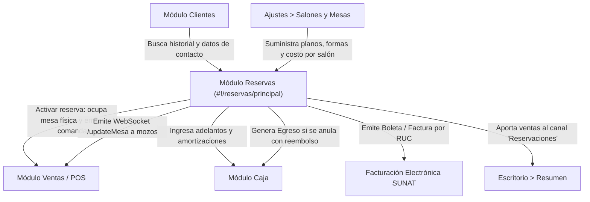

# Módulo: Reservas (`#!/reservas/principal`)

Documentación técnica y funcional del módulo de **Reservas** de mesas y pedidos del sistema de gestión comercial y POS para **CAPRICHOS** (https://caprichos.restaurant.pe/restaurant/). Realizada mediante auditoría pasiva de solo lectura sobre el entorno de producción, inspección de interfaz en vivo mediante Playwright y análisis estático del frontend AngularJS v1.6.10, plantillas HTML, servicios REST y modelos de datos.

---

## 0. Estado de Activación y Comportamiento del Add-on

> [!NOTE]
> **Hallazgo sobre el Add-on de Reservas:**  
> En la respuesta oficial del endpoint de autenticación `/restaurant/api/rest/usuario/obtenerAddonsPorToken`, el atributo correspondiente a reservas retorna en cero:  
> `deboMostrarReservas: "0"`  
> A pesar de este valor, **el módulo de Reservas está completamente activo y funcional en la cuenta**:
> 1. El enlace directo `Reservas (#!/reservas/principal)` está presente y visible en el menú de navegación lateral.
> 2. La ruta carga exitosamente la interfaz SPA (`reservas.view.html`) bajo el controlador `ReservasCtrl`.
> 3. Los endpoints de backend (`/restaurant/api/rest/reservacion/*`) responden con código HTTP `200 OK`, procesando consultas paginadas de reservas pendientes, en curso y cerradas.
> 4. Los salones y mesas responden con la disponibilidad para vincular reservas.

---

## 1. Arquitectura de Navegación y Rutas del Módulo

El módulo opera como una Single Page Application (SPA) bajo el módulo Angular `restaurantpe.reservas`, gestionado por `ui-router` con las siguientes subrutas y estados:

| Estado UI-Router | Ruta URL (Hashbang) | Título de Pantalla | Plantilla HTML (`templateUrl`) | Controlador Angular | Permiso Requerido (ACL) |
| :--- | :--- | :--- | :--- | :--- | :--- |
| `reservas` (Abstract) | `#!/reservas` | - | `scripts/common/content/content.html` | - | - |
| `reservas.principal` | `#!/reservas/principal` | **Visor de reservas** | `scripts/restaurantpe/reservas/reservas.view.html` | `ReservasCtrl as vm` | `ventas.generarreservas` |
| `reservas.selectorfecha`| `#!/reservas/calendario/:clienteId` | **Selector de fecha** | `scripts/restaurantpe/reservas/reservas.selectorfecha.html` | `SelectorDeFechaCtrl as vm` | `ventas.generarreservas` |
| `reservas.registrar` | `#!/reservas/registro/:clienteId/:diaReserva` | **Registro de reserva** | `scripts/restaurantpe/reservas/reservas.registro.html` | `ReservasRegistroCtrl as vm` | `ventas.generarreservas` |
| `reservas.resumen` | `#!/reservas/resumen/:reservaId` | **Resumen** | `scripts/restaurantpe/reservas/reservas.resumen.html` | `ReservasResumenCtrl as vm` | `ventas.generarreservas` |
| `reservas.resumen.card`| `#!/reservas/:estadoreserva/:pagina` | **Resumen** | `scripts/restaurantpe/reservas/reservas.resumen.html` | `ReservasResumenCtrl as vm` | `ventas.generarreservas` |
| `reservas.edicionavanzada`| `#!/reservas/reservas/edicionavanzada/:idReserva`| **Editar reserva** | `scripts/restaurantpe/reservas/reservas.registro.html` | `ReservasRegistroCtrl as vm` | `ventas.generarreservas` |
| `reservas.editarbasico`| `#!/reservas/reservas/editar/:idReserva`| **Editar reserva rápida**| `scripts/restaurantpe/reservas/modals/editarcamposbasicos.html`| `ModalEditarReservaMesaCtrl as vm`| `ventas.generarreservas` |

---

## 2. Pantalla 1: Visor Principal de Reservas (`#!/reservas/principal`)

### 2.1. Propósito
Centralizar la visualización y gestión en tiempo real del ciclo de vida de las reservas del restaurante. Permite al anfitrión, recepcionista, mozo o administrador consultar las reservas del día agrupadas por su estado operativo (pendientes de llegada, comensales en mesa o reservas concluidas), buscar clientes para iniciar una nueva reserva y activar la llegada del cliente ocupando inmediatamente la mesa en el plano de salones del POS.

### 2.2. Flujo de Uso Paso a Paso
1. **Acceso al módulo**: El usuario pulsa en el menú lateral `Reservas` o ingresa a `#!/reservas/principal`.
2. **Revisión de pestañas de estado**:
   - Pestaña 1 (**Reservas pendientes**): Muestra reservas programadas próximas a su activación.
   - Pestaña 2 (**Reservas en curso**): Muestra comensales que ya llegaron y tienen la reserva activa en salón.
   - Pestaña 3 (**Reservas finalizadas**): Muestra historial de reservas concluidas o anuladas.
3. **Filtrado y consulta**:
   - El usuario selecciona la **Sucursal** (`vm.localSeleccionado`) para aislar las reservas de un local o ver "Todas las sucursales".
   - Si está en la pestaña de finalizadas, define un rango de fechas mediante el control `date-range-picker`.
   - Utiliza el buscador rápido (`vm.valBusqueda`) para localizar una reserva por cliente, teléfono, local o código.
4. **Acción sobre una reserva existente**:
   - Si el cliente acaba de llegar: Pulsa el botón **Activar** en la tarjeta. El sistema actualiza el estado de la mesa física a ocupada, notifica a los terminales por WebSocket y emite las comandas si había pedidos precargados.
   - Si el cliente cancela: Pulsa el botón **Anular**. Si hubo adelanto monetario en caja, el sistema solicita confirmación para emitir un egreso de devolución.
   - Si desea ver el detalle completo o editar: Hace clic sobre cualquier parte de la tarjeta y el sistema lo redirige a la pantalla de **Resumen** (`#!/reservas/resumen/:reservaId`).
5. **Inicio de una nueva reserva**:
   - Escribe en el buscador unificado superior (Omnibox) el nombre, DNI, RUC o teléfono del cliente.
   - Si el cliente aparece en el desplegable, hace clic sobre su nombre y el sistema lo transfiere al **Selector de fecha** (`#!/reservas/calendario/:clienteId`).
   - Si el cliente no existe, pulsa el botón **Registra un nuevo cliente** para crearlo mediante ventana modal sin abandonar el flujo.

### 2.3. Estructura de Tarjetas (`card-reserva.html`)
Las reservas se presentan en una cuadrícula responsive de tarjetas (`col-sm-6 col-md-4 col-lg-3`). Cada tarjeta contiene:

| Elemento Visual | Origen de Datos | Descripción / Regla |
| :--- | :--- | :--- |
| **Nombre del Cliente** | `cliente_nombres + cliente_apellidos` | Texto destacado en mayúsculas con recorte `text-overflow`. |
| **Código y Estado** | `#{{reservacion_id}}` + `<i class="fa fa-circle">` | Badge circular coloreado por clase CSS `reservacion-status-{estado}`. |
| **Monto Amortizado** | `reservacion_amortizacion` | Ícono `fa-money`. Pago adelantado recibido como garantía. |
| **Monto Consumible** | `reservacion_montoconsumible` | Ícono `fa-money`. Saldo disponible a consumir por el cliente en carta. |
| **Teléfono de Referencia**| `reservacion_telefonoreferencia` | Ícono `fa-phone`. Si está vacío muestra `"Sin teléfono"`. |
| **Fecha Programada** | `reservacion_fechainicio` | Formato `DD/MM/YYYY` con tooltip `"Día programado para la reserva"`. |
| **Local Asignado** | `local_descripcion` | Tooltip: `"Solo se puede activar desde este local"`. |
| **Texto de Estado** | `reservacion_estado` | Etiquetas: `0`: Anulada, `1`: Pendiente, `2`: En curso, `3`: Finalizada. |
| **Modalidad de Reserva** | `reservacion_tipo` | `1`/`null`: Mesa, `2`: Mesa/Pedidos, `3`: Solo pedidos. |
| **Hora de Inicio** | `reservacion_fechainicio` | Formato `h:mm A` (ej. `8:30 PM`). |
| **Cantidad de Personas** | `reservacion_numeropersonas` | Ícono `fa-users` (PAX). |
| **Botón "Anular"** | `vm.fnAnularReservacion()` | Botón gris (`btn-default btn-xs`). Visible solo en estado `1` (Pendiente) y con permiso `ventas.generarreservas`. |
| **Botón "Activar"** | `vm.ocuparMesaPorResevacion()` | Botón azul (`btn-primary btn-xs`). Visible en estado `1` si `tipo != 3`. Activa mesa en el POS. |

### 2.4. Filtros y Controles del Visor
- **Omnibox de Búsqueda de Clientes**: Input tipo `search`, placeholder `Ingresa un nombre, DNI, RUC o teléfono para buscar...` (`CALLCENTER_PLACEHOLDER_BUSCAR_CLIENTE`), vinculado a `vm.omniboxKeywords`.
- **Selector de Sucursal**: Dropdown `ui-select`, vinculado a `vm.localSeleccionado`. Opciones provenientes de `vm.sucursalList` más la opción `"Todas las sucursales"`. Al cambiar dispara `vm.fnCargarListaReservaciones()`.
- **Filtro de Rango de Fechas**: Control interactivo `date-range-picker` (`rangoDeFechas.fechas`). Solo se muestra visible cuando el usuario selecciona la pestaña de **Reservas finalizadas** (`vm.tabActivo == '2'`).
- **Filtro de Texto Rápido**: Input `input#filtrar-pedidos`, placeholder `Filtrar resultados...`, vinculado a `vm.valBusqueda`. Filtra localmente por ID, teléfono, nombres, apellidos, dirección, DNI/RUC y local.
- **Botón Recargar**: Botón con ícono `fa-refresh` que restablece paginadores a la página 1 y recarga datos del servidor (`vm.fnCargarListaReservaciones()`).
- **Paginador**: Control `uib-pagination` con botones Primera, Anterior, Siguiente y Último (`vm.cantidadPorPagina = 12`).

---

## 3. Pantalla 2: Selector de Fecha y Calendario (`#!/reservas/calendario/:clienteId`)

### 3.1. Propósito
Permitir la selección interactiva del día en que se llevará a cabo la reserva para el cliente seleccionado, visualizando la saturación y eventos de reservas ya existentes sobre un calendario mensual.

### 3.2. Flujo de Uso Paso a Paso
1. **Entrada**: El usuario llega tras seleccionar o crear un cliente desde el visor principal. La URL contiene el parámetro `:clienteId`.
2. **Selección de Local**: El selector de cabecera permite cambiar el local para consultar la agenda de reservas correspondiente (`vm.fnCargarDatosPorLocal`).
3. **Inspección del Calendario**: Visualiza el mes en curso (`FullCalendar`). Cada día con reservas muestra etiquetas con el formato:  
   `Inicia: HH:mm | R: [Nombre Cliente] / PAX: [N°]`
4. **Selección del Día**: El usuario hace clic sobre una celda del calendario (`dayClick` o `eventClick`).
5. **Validación de Fecha**: El sistema verifica que la fecha elegida sea mayor o igual a la fecha actual (`YYYY-MM-DD`). Si es una fecha pasada, bloquea el paso con una notificación de error.
6. **Definición de Horario**: Si la fecha es válida, se abre automáticamente la ventana modal **Disponibilidad de la reserva** (`modal-seleccionDeHora.html`).
7. **Confirmación**: Al especificar hora de inicio y hora fin y pulsar `Continuar`, el sistema transfiere al usuario a la pantalla de registro (`#!/reservas/registro/:clienteId/:diaReserva`).

### 3.3. Modal Auxiliar: Disponibilidad de Horario (`modal-seleccionDeHora.html`)
- **Controlador**: `ModalSeleccionHoraReservaCtrl as vm`.
- **Campos**:
  - `Desde` (`reservacion_horainicio`): Input de solo lectura con selector de reloj Bootstrap ClockPicker (`lng-clockpicker`).
  - `Hasta` (`reservacion_horafin`): Input con selector de reloj (`lng-clockpicker`).
- **Botones**:
  - `Cancelar` (`vm.cancelar()`): Cierra el modal y mantiene al usuario en el calendario.
  - `Continuar` (`vm.seleccionarHoraReserva()`): Valida las horas y redirige al registro.

---

## 4. Pantalla 3: Registro y Edición Avanzada de Reserva (`#!/reservas/registro/:clienteId/:diaReserva`)

### 4.1. Propósito
Formulario integral y asistente (wizard) para parametrizar todos los aspectos de la reserva: facturación, contacto de referencia, asignación gráfica de mesas físicas en planos de salones, cantidad de comensales, tiempo de tolerancia de llegada, costo de reserva, selección anticipada de platos/bebidas de la carta y recepción de pagos de garantía/amortización en caja.

Se reutiliza con idéntica lógica para la edición avanzada (`#!/reservas/reservas/edicionavanzada/:idReserva`).

### 4.2. Flujo de Uso Paso a Paso
El formulario se divide en una columna lateral de perfil de cliente y un cuerpo central de 3 etapas secuenciales:

#### Columna Lateral Izquierda (Perfil del Cliente)
- Botón **Volver y seleccionar otra fecha** (o **Volver a la lista principal** en edición).
- Tarjeta de identidad: Nombres completos, tipo de documento y número.
- Acciones rápidas:
  - Botón **Últimas reservas**: Abre modal con histórico de reservas previas del cliente.
  - Botón **Editar cliente**: Abre modal para actualizar datos generales del cliente.
  - Campos clicables: Edición rápida de **Email** y **Teléfono principal**.
  - Enlace externo: **Ver perfil completo** (`clientes.ver`).
- Bloque **Anulaciones**: Muestra contador de reservas anuladas por este cliente en los últimos 3 meses y botón **Ver todas las anulaciones**.
- Bloque **Sobre el consumo del cliente**: Indicadores financieros históricos del cliente:
  - Consumo **Promedio** (en divisa base).
  - Consumo **Máximo** registrado.
  - Consumo **Mínimo** registrado.

#### Cuerpo Central - Paso 1: Comprobante de Pago
- Grupo de botones tipo toggle: **Boleta**, **Factura**, **Nota de venta**.
- Regla condicional si se selecciona **Factura**:
  - Se despliega el selector de empresa (`customer-finder`).
  - Permite buscar por RUC o Razón Social mediante `ui-select`.
  - Botón **Editar**: Modifica la empresa seleccionada.
  - Botón **Nuevo RUC**: Abre modal para registrar una nueva persona jurídica ante SUNAT.

#### Cuerpo Central - Paso 2: Datos de la Reserva
Grilla de 8 cuadrículas configurables mediante modales emergentes:
1. **Reserva de**: Nombre del titular. Clic abre modal para reasignar la reserva a otro cliente.
2. **Teléfono**: Teléfono de contacto de la reserva (`reservacion_telefonoreferencia`). Clic abre modal para ingresar número específico de coordinación.
3. **Mesas**: Muestra cantidad de mesas elegidas. Clic abre el modal gráfico de salones y mesas (`modal-seleccionDeMesas.html`).
4. **Cant. personas / Tiempo de espera**: Número de personas (PAX) y minutos de tolerancia asignados (`modal-numeroPersonas.html`).
5. **Disponibilidad**: Fechas y horas de inicio y fin (`modal-fechayhorareserva.html`).
6. **Costo**: Monto por concepto de alquiler de mesa o derecho de reserva (`modal-cambiarCostoReserva.html`).
7. **Local**: Sucursal asignada a la reserva.
8. **Tipo de reserva**: Muestra la modalidad: *Solo mesas*, *Mesas y productos* o *Solo productos*.
- Campo inferior: **Observación de reserva**: Área de texto libre (`reservacion_observaciongeneral`) para notas de alergias, decoración, cumpleaños, solicitudes especiales, etc.

#### Cuerpo Central - Transición y Paso 3: Productos y Caja
El usuario elige entre dos alternativas operativas:
- **Alternativa A ("Añadir productos")**:
  - Despliega el catálogo completo de productos del restaurante (`ProductSelectorCtrl` / `selectorproductos.view.html`).
  - Permite agregar platos, guarniciones, términos, combos y modificadores a la comanda previa.
  - Muestra el visor de cuenta y subtotal acumulado (`pedidosycuenta.view.html`).
- **Alternativa B ("Continuar sin productos")**:
  - Omite la selección de comida y avanza directamente al cobro o confirmación.
- **Subsección de Caja / Amortización (`reservas.caja.html`)**:
  - Se activa si hay pagos que registrar.
  - Si `dineroingresacaja == '1'`, muestra alerta: *"El dinero ingresará a caja. Recuerda que posteriormente no podrás realizar modificaciones en los montos de pago"*.
  - Desglosa medios de pago:
    - **Efectivo**: Monto recibido y referencia de pago.
    - **Tarjeta**: Selección de tarjeta (Visa, Mastercard, Amex, etc.), monto y código de voucher / operación.
    - Manejo de divisas extranjeras si aplica (con tipo de cambio).
  - Alerta de crédito a favor: Si el monto recibido supera el costo de la reserva, el sistema emite notificación de crédito a favor del cliente para su consumo posterior.

#### Pantalla de Revisión Previa (`reservas.revision.html`)
Antes de finalizar la creación, el sistema expone un resumen ejecutivo de confirmación con los datos del titular, fechas, mesas, comprobante, comanda y anticipos, con botón final para guardar la reserva en base de datos.

---

## 5. Modales Específicos del Módulo de Reservas

### 5.1. Modal: Lista de Mesas Disponibles (`modal-seleccionDeMesas.html`)
- **Controlador**: `ModalSeleccionMesaReservaCtrl as vm`.
- **Estructura y Reglas**:
  - **Pestañas superiores**: Una pestaña por cada salón activo del local (`uib-tab` con `salon.salon_descripcion`).
  - **Gráfico de distribución**: Representación visual de cada mesa del salón:
    - Forma geométrica dinámica: Cuadrada (`resttable`) o circular (`resttable-round`).
    - Estado de ocupación: `free` (verde/libre si `mesa.reservaciones.length == 0`) o `reserved` (rojo/reservada si tiene reservas activas, mostrando badge con el número de reservas: `1 R`, `2 R`).
    - Selección interactiva: Al hacer clic, la mesa se marca en estado `active`.
  - **Costo por reserva del salón**: Cada salón posee configurado `salon_costoporreserva`. Al seleccionar una mesa de dicho salón, el costo se añade automáticamente al total de la reserva (`m.costoPorReserva += salon_costoporreserva`).
  - **Panel lateral "Mesas elegidas"**: Lista las mesas seleccionadas con su salón y botón de descarte (`fa-close`).

### 5.2. Modal: Personas y Tiempo de Espera (`modal-numeroPersonas.html`)
- **Controlador**: `ModalNumeroPersonasReservaCtrl as vm`.
- **Campos**:
  - **Cantidad de personas**: Selector numérico con botones `-` y `+` (`reservacion_numeropersonas`), solo números enteros.
  - **Controlar la llegada del cliente**: Casilla de verificación (checkbox iCheck `vm.reservacion.contiempoespera`).
  - **Tiempo de espera**: Selector numérico (`reservacion_tiempoespera`) con etiqueta *"minutos, como máximo"*.

### 5.3. Modal: Disponibilidad y Fechas (`modal-fechayhorareserva.html`)
- **Controlador**: `ModalFechaYHoraReservaCtrl as vm`.
- **Campos**:
  - **Reservado desde**: Fecha inicial (`bs-datepicker`) y hora inicial (`lng-clockpicker`).
  - **Reservado hasta**: Fecha fin (`bs-datepicker`) y hora fin (`lng-clockpicker`).

### 5.4. Modal: Costo de Reserva (`modal-cambiarCostoReserva.html`)
- **Controlador**: `ModalCambiarCostoReservaCtrl as vm`.
- **Campos**:
  - **Costo**: Input numérico monetario (`vm.costo_reserva`) con longitud máxima de 12 dígitos.

### 5.5. Modal: Histórico de Últimas Reservas (`modal-ultimasReservas.html`)
- **Controlador**: `ModalUltimasReservasCtrl as vm`.
- **Tabla de historial del cliente**:
  - Columnas: `Fecha`, `Tipo` (Solo mesa, Mesa/Pedidos, Solo pedidos), `Local`, `Total` (importe valorizado).
  - Al hacer clic en una fila, expande el detalle completo de mesas y productos consumidos.

### 5.6. Modal: Reservas Canceladas (`modal-reservasAnuladas.html`)
- **Controlador**: Lista las últimas cancelaciones del cliente en los últimos 3 meses, mostrando fecha de inicio, tipo de reserva, local y motivos.

### 5.7. Modal: Detalle de Pedidos Originales (`modal-detallepedidooriginal.html`)
- **Controlador**: `ModalDetallePedidoOriginalController as vm`.
- **Propósito**: Muestra la comanda inicial congelada al momento de la reserva antes de que el mozo realice modificaciones en el salón.
- **Tabla**: Columnas `Producto`, `Cantidad`, `P.U.` (Precio Unitario) y `Total`, con sumatoria final.

---

## 6. Pantalla 4: Resumen y Liquidación de Reserva (`#!/reservas/resumen/:reservaId`)

### 6.1. Propósito
Ficha técnica, financiera y operativa de una reserva registrada. Permite auditar el estado del servicio, verificar los montos cobrados por anticipado versus el saldo pendiente, descargar el voucher en PDF y ejecutar la activación física en el salón.

### 6.2. Estructura de la Pantalla
- **Cabecera**:
  - Ícono y título según estado:
    - Estado 1: `¡La reserva #{id} está pendiente!`
    - Estado 2: `¡La reserva #{id} está en curso!`
    - Estado 3: `¡La reserva #{id} ha finalizado!`
  - Metadatos de auditoría: `Registrada por {usuario_nick}, el {fecha} a las {hora}`.
- **Ficha Descriptiva (`dl-horizontal`)**:
  - Reserva de (cliente), Inicio, Fin, Teléfono, Cantidad de personas, Tipo de reserva, Sucursal, Tipo de comprobante, N° Documento, Razón social / Nombres, Dirección, Observación general.
  - Enlace: `Ver registro original de los pedidos` (abre modal de comanda original).
- **Tabla 1: Mesas Seleccionadas**:
  - Columnas:
    1. `#`: Índice secuencial.
    2. `Mesa`: Nombre descriptivo de la mesa (`mesa_descripcion`).
    3. `Salón`: Nombre del salón al que pertenece (`salon_descripcion`).
- **Tabla 2: Productos Solicitados / Detalle de Venta**:
  - Si la reserva está pendiente o en curso: Muestra el ticket de comanda (`ticket.html`).
  - Si la reserva finalizó (Estado 3): Muestra el comprobante electrónico emitido con IGV y desglose de venta (`ticketdetalleventa.html`).
- **Bloque de Liquidación Financiera (`extra-amounts`)**:
  - `Subtotal en productos`: Monto de platos y bebidas (`montoconsumible - costo`).
  - `Costo por reserva`: Tarifa fija de reserva (`reservacion_costo`).
  - `Total`: Importe bruto de la reserva.
  - `Pagado en efectivo`: Importe adelantado en caja chica.
  - `Pagado con tarjeta`: Importe cobrado con POS digital, indicando la tarjeta.
  - `Total pendiente de pago`: Saldo restante a cancelar por el cliente al llegar al salón (`vm.fnGetTotalFaltante()`).
- **Botones y Acciones Disponibles**:
  - **Editar reserva** (`btn-default`): Solo visible si estado es `1` (Pendiente) y no se ha cerrado la caja original. Abre `reservas.edicionavanzada`.
  - **Imprimir** (`btn-warning`): Lanza impresión de ticket/voucher físico de reserva (`vm.fnReimprimir`).
  - **Descargar PDF** (`btn-info`): Enlace directo al generador de PDF:  
    `api/reports/report.php?page=formatodescargareservas_reservas&reserva_id={id}&type=pdf&or=P&token={token}`
  - **Activar** (`btn-primary`): Ocupa la mesa física en el salón de ventas y comanda los platos en cocina.
  - **Iniciar una nueva reserva** (`btn-default`): Retorna al visor principal (`reservas.principal`).

---

## 7. Entidades de Datos y Campos Clave

A partir del modelo `model.reservacion` y la clase base `ReservacionBase`, se identifican los siguientes campos persistidos en base de datos:

### Entidad: `reservacion`
| Campo | Tipo | Requerido | Descripción |
| :--- | :--- | :--- | :--- |
| `reservacion_id` | `INT` (PK) | Sí | Identificador único de la reserva. |
| `cliente_id` | `INT` (FK) | Sí | Referencia al cliente titular (`cliente.cliente_id`). |
| `mesa_id` | `INT` (FK) | No | Identificador de la mesa principal asignada. |
| `local_id` | `INT` (FK) | Sí | Local/sucursal donde se ejecutará la reserva. |
| `usuario_id` | `INT` (FK) | Sí | Usuario/colaborador que registró la reserva. |
| `turno_id` | `INT` (FK) | No | Turno operativo en el que se creó. |
| `caja_id` | `INT` (FK) | No | Caja física donde ingresó el dinero de la reserva. |
| `moneda_id` | `INT` (FK) | Sí | Moneda base de la transacción. |
| `reservacion_fecharegistro` | `DATETIME` | Sí | Timestamp de creación en sistema. |
| `reservacion_fechainicio` | `DATETIME` | Sí | Fecha y hora programada de inicio. |
| `reservacion_fechafinal` | `DATETIME` | Sí | Fecha y hora programada de culminación. |
| `reservacion_tiempoespera` | `INT` | No | Minutos de tolerancia de llegada (ej. 15, 30 min). |
| `reservacion_costo` | `DECIMAL(10,2)`| Sí | Costo fijo por concepto de reserva / alquiler. |
| `reservacion_montoconsumible`| `DECIMAL(10,2)`| Sí | Monto amortizado destinado a consumos de comida. |
| `reservacion_amortizacion` | `DECIMAL(10,2)`| Sí | Suma total adelantada por el cliente. |
| `reservacion_pagoefectivo` | `DECIMAL(10,2)`| No | Adelanto cancelado en efectivo. |
| `reservacion_pagotarjeta` | `DECIMAL(10,2)`| No | Adelanto cancelado con tarjeta. |
| `reservacion_tarjetaid` | `INT` (FK) | No | ID de la entidad/franquicia de tarjeta (Visa, etc.). |
| `reservacion_tipopago` | `VARCHAR` | No | Modalidad de cobro. |
| `reservacion_observacionpago`| `VARCHAR` | No | Referencia o voucher de la transacción financiera. |
| `reservacion_observaciongeneral`| `TEXT` | No | Notas especiales, alergias o peticiones del cliente. |
| `reservacion_telefonoreferencia`| `VARCHAR` | No | Teléfono de contacto directo para la cita. |
| `reservacion_numeropersonas`| `INT` | Sí | Cantidad de personas / comensales esperados. |
| `reservacion_tipo` | `TINYINT` | Sí | `1`: Solo mesas, `2`: Mesas y pedidos, `3`: Solo pedidos. |
| `reservacion_tipodoc` | `VARCHAR` | Sí | Tipo de comprobante (`Boleta`, `Factura`, `Nota de venta`). |
| `personajuridica_id` | `INT` (FK) | No | ID de la empresa vinculada si se emite Factura. |
| `reservacion_estado` | `TINYINT` | Sí | `0`: Anulada, `1`: Pendiente, `2`: En curso, `3`: Finalizada. |
| `venta_id` | `INT` (FK) | No | Venta POS generada al facturar la mesa. |

### Entidades Relacionadas:
- `salon`: Contiene el atributo `salon_costoporreserva` que define el cobro base por mesa en ese ambiente.
- `mesa`: Mantiene el array `mesa.reservaciones` para indicar gráficamente en el mapa del salón el número de reservas activas.
- `pedidoreservacion`: Detalle de platos y bebidas precargados a la reserva (`pedido_productoid`, `pedido_cantidad`, `pedido_precio`, `pedido_importe`).
- `egreso`: Registro financiero generado en caja cuando se anula una reserva con devolución de dinero.

---

## 8. Relaciones con Otros Módulos

1. **Salones y Mesas**:
   - Cada salón puede tener una tarifa configurada (`salon_costoporreserva`).
   - Al seleccionar mesas, el sistema lee su forma geométrica (`cuadrada` o `circular`).
   - En el POS de mozos, las mesas reservadas muestran un badge de reserva activa.
   - Al pulsar **Activar**, el sistema actualiza la mesa a estado ocupada y emite un evento WebSocket en tiempo real (`/updateMesa` y `/updateMesas`) para sincronizar inmediatamente a todos los terminales y tablets de los mozos.
2. **Ventas y Cocina**:
   - Al activar una reserva con pedidos precargados (`reservacion_tipo == 2`), el backend emite automáticamente las comandas a las impresoras o pantallas de cocina correspondientes (`imprimirComandas`).
3. **Caja y Tesorería**:
   - Las amortizaciones y costos de reserva pueden ingresar directamente a la caja activa del usuario (`dineroingresacaja == 1`).
   - Si la reserva se anula y el usuario confirma la devolución, el sistema genera automáticamente un **Egreso de caja** con concepto `"ANULACIÓN DE RESERVA MESA [N°]"`.
   - Si la caja del día ya cerró, el sistema bloquea la edición de montos de pago para proteger el cuadre de arqueo.
4. **Clientes**:
   - Utiliza el buscador unificado tipo Omnibox para consultar clientes por DNI, RUC, teléfono o nombres.
   - Registra el historial de reservas y cancelaciones del cliente, y calcula sus métricas de consumo (promedio, máximo y mínimo).
5. **Escritorio y Reportes**:
   - En `Escritorio > Resumen`, una de las métricas de canal de venta consolida los ingresos provenientes de **Reservaciones** (`totalReservacion`).

---

## 9. Catálogo de Endpoints de Backend

Todos los endpoints responden en formato JSON con la estructura estándar `{ tipo: 1, mensajes: [], data: [...] }` (donde `tipo: 1` representa éxito):

| Método | Endpoint REST | Descripción Funcional |
| :--- | :--- | :--- |
| `GET` | `/restaurant/api/rest/reservacion/obtenerListaPendientes/:localId/:pagina/:limite/:busqueda` | Obtiene lista paginada de reservas en estado pendiente (`1`). |
| `GET` | `/restaurant/api/rest/reservacion/obtenerListaEnCurso/:localId/:pagina/:limite/:busqueda` | Obtiene lista paginada de reservas en curso / comensales en mesa (`2`). |
| `GET` | `/restaurant/api/rest/reservacion/obtenerListaCerradas/:fechaInicio/:fechaFin/:localId/:pagina/:limite/:busqueda` | Obtiene lista de reservas finalizadas (`3`) o anuladas (`0`) filtradas por fechas. |
| `GET` | `/restaurant/api/rest/reservacion/reservacion/:id` | Retorna el objeto completo de una reserva por su ID para visualización o edición. |
| `GET` | `/restaurant/api/rest/reservacion/reservacionByCliente/:clienteId` | Historial de reservas de un cliente específico. |
| `GET` | `/restaurant/api/rest/reservacion/reservacionByMesa/:mesaId` | Lista de reservas asignadas a una mesa específica. |
| `GET` | `/restaurant/api/rest/reservacion/getReservacionesSinMesaByLocal/:localId` | Obtiene reservas que aún no tienen mesa física asignada (solo pedidos). |
| `GET` | `/restaurant/api/rest/reservacion/obtenerReservacionesCercanas/:localId/:fechaInicio/:fechaFin/:mesaId` | Valida colisiones o traslapes de horario para una mesa determinada. |
| `GET` | `/restaurant/api/rest/reservacion/obtenerReservacionesProximasByLocal` | Alerta de reservas próximas a iniciarse en el local actual. |
| `GET` | `/restaurant/api/rest/reservacion/obtenerListaAnuladasPorCliente/:clienteId`| Conteo y detalle de cancelaciones de un cliente. |
| `GET` | `/restaurant/api/rest/reservacion/obtenerConsumoPromedioPorCliente/:clienteId`| Métrica de ticket promedio histórico del cliente. |
| `GET` | `/restaurant/api/rest/reservacion/obtenerConsumoMinMaxPorCliente/:clienteId` | Métrica de consumos máximos y mínimos del cliente. |
| `GET` | `/restaurant/api/rest/reservacion/getImpresionByReservacion/:id` | Genera la trama de texto para la ticketera de comanda/reserva. |
| `GET` | `/restaurant/api/rest/salon/getAllByLocalAndReservas/:localId/:estado/:fechaInicio/:fechaFin/:p5/:p6` | Retorna salones y mesas con su estado de reservación para un rango horario. |
| `POST`| `/restaurant/api/rest/reservacion/reservacion` | Crea una nueva reserva con sus mesas, pedidos y cobros asociados. |
| `POST`| `/restaurant/api/rest/reservacion/actualizacionAvanzada` | Actualiza de forma atómica todos los componentes de una reserva existente. |
| `POST`| `/restaurant/api/rest/reservacion/anularReservacion/:id/:devolucion` | Anula una reserva y procesa la devolución en caja chica si aplica. |
| `POST`| `/restaurant/api/rest/reservacion/cargarCalendarioMesDeReservaciones` | Retorna los eventos agregados de reservas para renderizar en FullCalendar. |
| `POST`| `/restaurant/api/rest/mesa/actualizarMesaPorReserva` | Activa la reserva, ocupando la mesa física y vinculándola a la venta. |
| `POST`| `/restaurant/api/rest/reservacion/imprimirComandas` | Envía la orden de impresión de comanda a las áreas de cocina. |
| `GET` | `/restaurant/api/reports/report.php?page=formatodescargareservas_reservas&reserva_id=:id` | Descarga el comprobante oficial de reserva en formato PDF. |

---

## 10. Funcionalidades Imprescindibles para Replicar

Para que el nuevo sistema de CAPRICHOS posea paridad operativa completa con este módulo, es obligatorio implementar:

1. **Gestión Integral del Ciclo de Vida de la Reserva**: Estados claramente diferenciados: *Pendiente*, *En curso*, *Finalizada* y *Anulada*.
2. **Asignación Gráfica sobre el Plano de Mesas**: Selección visual interactiva de mesas con indicador de reservas preexistentes (`1 R`, `2 R`) y detección de solapamiento horario.
3. **Cobro de Garantía / Amortización con Ingreso a Caja**: Capacidad de registrar pagos adelantados en efectivo o tarjeta, vinculados a la caja del turno activo y reflejados como créditos de consumo.
4. **Activación Inmediata con Sincronización en Tiempo Real**: Al presionar "Activar", la mesa física pasa inmediatamente a estado ocupada en todos los terminales y tablets de mozos mediante WebSockets sin necesidad de recargar la página.
5. **Modalidad Híbrida de Reserva**: Soporte para reservar únicamente el espacio físico (mesa), o reservar mesa con selección previa de platos de la carta que se despachan automáticamente a cocina al llegar el cliente.
6. **Historial de Cliente y Control de Inasistencias (No-Show)**: Visor de comportamiento del cliente con conteo de reservas canceladas en los últimos 90 días y ticket promedio de consumo.
7. **Integración con Comprobantes SUNAT**: Preconfiguración de Boleta o Factura con validación de RUC ante SUNAT para reservas corporativas.
8. **Impresión y Exportación**: Generación de tickets de reserva y descarga de comprobante en PDF.

---

## 11. Mejoras Propuestas para el Nuevo Sistema

1. **Portal Público de Reservas Web y Carta Digital**:
   - Actualmente las reservas deben ser registradas manualmente por el personal del restaurante. Se recomienda habilitar un widget en la carta digital pública para que los clientes reserven en línea con confirmación inmediata.
2. **Pasarela de Pago Online para Señas / Garantías**:
   - Integración directa con pasarelas de pago (Niubiz, Culqi, MercadoPago, Yape/Plin con QR dinámico) para que el cliente abone la seña desde su celular al reservar en la web.
3. **Notificaciones Automatizadas por WhatsApp y SMS**:
   - Envío de recordatorios automáticos al cliente 24 horas y 2 horas antes de la reserva, con botón de confirmación o cancelación rápida para reducir la tasa de inasistencia (*No-Show*).
4. **Política de Liberación Automática por Tolerancia**:
   - Si el cliente no llega transcurridos los minutos de espera configurados (`reservacion_tiempoespera`), sugerir automáticamente al anfitrión la liberación de la mesa para comensales de paso.
5. **Timeline / Vista Gantt de Mesas**:
   - Además de la vista mensual de calendario, implementar una vista horizontal tipo Gantt para visualizar en una sola pantalla los turnos y horas de ocupación de cada mesa a lo largo del día.

---

## 12. Preguntas para el Cliente (CAPRICHOS)

1. **Uso Actual del Módulo**: ¿La cafetería utiliza actualmente este módulo de reservas en su operación diaria o gestionan las reservas por canales externos (WhatsApp, libreta, teléfono)?
2. **Política de Cobro de Señas / Garantías**: ¿Suelen cobrar un monto por adelantado para reservar mesas grandes o eventos, o las reservas son 100% sin costo?
3. **Tiempo de Tolerancia Estándar**: ¿Cuál es el tiempo de tolerancia máximo habitual antes de considerar una mesa como disponible (ej. 15 minutos)?
4. **Reservas en Días y Horas Punta**: ¿Desean restringir reservas automáticas durante horarios de máxima afluencia (almuerzos/fines de semana) para priorizar comensales directos?
5. **Mesas Combinables**: ¿Requieren una función para unir mesas contiguas para reservas de grupos numerosos (ej. unir mesas 4 y 5 para 8 personas)?

---

## 13. Elementos Marcados como NO OBSERVADO

1. **Comportamiento en Vivo con Reservas Existentes**:
   - **NO OBSERVADO**: Lista con datos reales de reservas activas o históricas en producción. Al consultar los endpoints del local `CAPRICHOS`, retornaron `totalregistros: "0"`, confirmando que el local no cuenta con reservas registradas en este periodo. La estructura fue documentada analizando las plantillas de tarjetas, controladores Angular y modelos de datos.
2. **Proceso de Envío Real a Impresora Física**:
   - **NO OBSERVADO**: Formato físico final de la impresión térmica de comanda de reserva en hardware de tickets, debido a la estricta regla de solo lectura en producción (no ejecutar impresiones ni transacciones reales). Se documentó el método `imprimirComandas` y el script de generación PDF.
3. **Restricción de Perfiles por Rol en Backend**:
   - **NO OBSERVADO**: Si un usuario de rol mozo o cajero estándar tiene bloqueada la ruta `#!/reservas/principal` a nivel de API REST con código HTTP `403 Forbidden` si carece del permiso `ventas.generarreservas`. En la cuenta auditada `krosales`, el permiso y acceso fueron totales.
