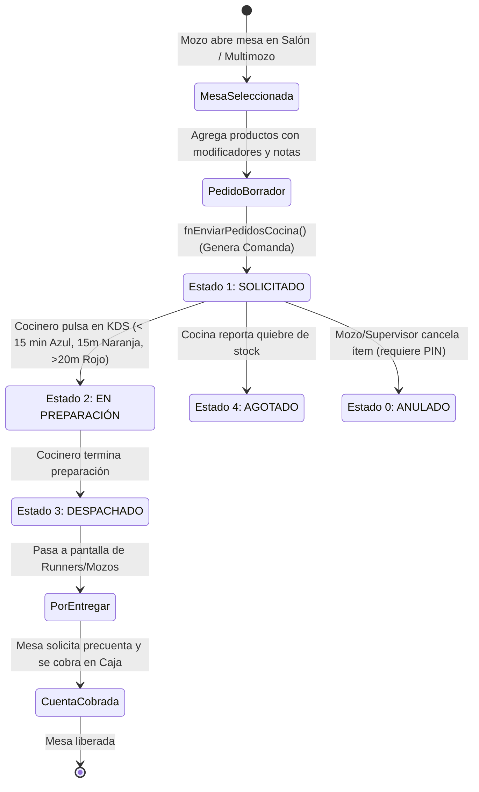

# Módulo de Ventas: Pedidos en Caja, Multimozo y Pantalla de Cocina (KDS)

**Sistema**: Restaurant.pe (Instancia de Producción: CAPRICHOS - Lima, Perú)  
**URL de Producción**: `https://caprichos.restaurant.pe/restaurant/#!/login`  
**Usuario de Auditoría**: `krosales`  
**Modalidad**: SOLO LECTURA estricto en entorno de PRODUCCIÓN en operación activa.  
**Fecha de Inspección**: 2026-10-13  
**Documento Generado**: `/home/jose/JoseEM/caprichos/web-anterior/administrativo/modulos/ventas.md`

---

## 1. Resumen Ejecutivo y Alcance del Módulo

El macro-módulo de **Ventas** constituye el núcleo transaccional operativo del restaurante CAPRICHOS. Comprende la cadena de valor completa desde la asignación de espacios físicos, la toma y comanda de pedidos en sala y mostrador, la gestión de subcuentas, notas y modificadores, la sincronización en tiempo real hacia las áreas de producción (cocina y barra), y el monitoreo del despacho y tiempos de atención.

Dentro de este reporte se auditan y documentan estructuralmente los tres componentes centrales asignados:
1. **Pedidos en caja / Salones** (`#!/ventas/hacer-pedidos/salones`)
2. **Pedidos Multimozo** (`#!/ventas/multimozo`)
3. **Pantalla de Cocina / KDS (Kitchen Display System)** (`#!/ventas/ver-pedidos/estado`)

> [!IMPORTANT]
> **Garantía de Solo Lectura**: Todas las pantallas fueron inspeccionadas de forma pasiva navegando a través del enrutador SPA Hashbang de AngularJS (`#!/`). No se presionó ningún botón de guardado, comanda, anulación, cobro, cambio de estado de mesas ni despacho de comandas. Para el análisis profundo del flujo técnico, se realizó ingeniería inversa sobre los controladores, modelos y llamadas REST públicas del frontend descargadas en el navegador (`scripts.426a6ac0.js`).

---

## 2. Pantalla 1: Pedidos en Caja - Salones (`#!/ventas/hacer-pedidos/salones`)

### 2.1 Propósito
Es el panel visual principal para el cajero o anfitrión de salón. Permite monitorear en tiempo real el estado de ocupación de las mesas agrupadas por salones (en CAPRICHOS: salón "Principal" con mesas `M01` a `M30`), visualizar si una mesa está libre, ocupada, con cuenta pedida (precuenta impresa o solicitada por QR), el tiempo de ocupación transcurrido o la cantidad de comensales sentados, y acceder al detalle de pedidos de una mesa específica.

### 2.2 Flujo de Uso Paso a Paso
1. **Acceso**: El cajero ingresa al módulo de ventas o hace clic en la pestaña "Salones". El sistema consulta automáticamente las mesas activas, el estado de precuentas y pedidos pendientes.
2. **Selección de Salón**: Si el local cuenta con múltiples zonas (ej. Salón Principal, Terraza, Segundo Piso), el usuario selecciona la pestaña correspondiente (en CAPRICHOS se observa el salón "Salon").
3. **Inspección Visual de Mesas**:
   - Cada mesa se representa como una tarjeta/botón cuadrangular con su código (`M01`, `M02`, ...).
   - El color de la mesa indica su estado:
     - **Verde**: Mesa Libre / Disponible.
     - **Rojo / Naranja**: Mesa Ocupada (con pedidos abiertos en curso).
     - **Ícono de campana / distintivo**: Mesa con solicitud de precuenta o precuenta QR generada.
4. **Alternancia de Indicadores**: Mediante el selector superior *"Ver en la mesa"*, el operador alterna entre ver los minutos transcurridos desde la apertura (`Tiempo`) o el número de comensales (`Personas`).
5. **Apertura de Mesa / Toma de Pedido**: Al hacer clic sobre una mesa, se valida si la mesa está bloqueada por otro mozo (configuración `CONFIGURACION_PERMITIR_PEDIDOS_MOZO_APERTURA`). Si está libre u ocupada por el mismo turno, redirige a la vista de oferta y demanda `#!/ventas/hacer-pedidos/salones/ver/:mesaId`.

### 2.3 Estructura de Interfaz

#### Botones y Acciones Disponibles (Visibles)
- **Toggle Menú Lateral**: Botón hamburguesa (`minimalize()`).
- **Navegación de Modalidades de Venta**:
  - `Salones` (`ui-sref="ventas.hacerpedidos.salones"`, botón activo principal).
  - `Delivery [Badge: 4]` (`ng-click="vm.fnIrDelivery()"`: muestra pedidos pendientes de delivery/reparto).
  - `Rápida` (`ui-sref="ventas.hacerpedidos.ventarapida"`: venta directa al paso en mostrador).
  - `Manual` (`ui-sref="ventas.hacerpedidos.comprobantemanual"`: registro diferido/manual de comprobantes).
  - `Prepagos` (`ui-sref="ventas.hacerpedidos.prepagos"`: pedidos cobrados por adelantado).
- **Ver Reservas Próximas**: Botón con spinner Ladda (`vm.configuracionMostrarModalReservasProximas = !vm.configuracionMostrarModalReservasProximas`).
- **Recargar / Refrescar Salones**: Botón de actualización pasiva (`vm.fnCargarSalones()`).

#### Filtros y Controles de Formulario
| Control / Campo | Tipo | Modelo Angular | Opciones Visibles | Obligatorio | Descripción |
| :--- | :--- | :--- | :--- | :--- | :--- |
| `Ver en la mesa:` | `<select>` | `vm.filtroMesa` | `Tiempo`, `Personas` | No | Cambia el badge inferior de cada mesa entre tiempo transcurrido o cantidad de personas. |

#### Pestañas / Tabs
- **Salon** (`tabset.tabs`, pestaña activa): Despliega la grilla de 30 mesas (`M01` a `M30`).

### 2.4 Endpoints GET y Servicios Observados
- `GET /restaurant/api/rest/salon/getAllByLocalId/1/1/0/0`: Obtiene el listado de salones y sus configuraciones activas por sucursal.
- `GET /restaurant/api/rest/mesa/obtenerMesasConPedidosPendientesDeEnvio/1/1/50`: Lista mesas que contienen ítems aún no comandados a producción.
- `GET /restaurant/api/rest/mesa/obtenerMesasConPrecuentaQR/1/1/100`: Consulta si los comensales solicitaron la precuenta mediante su teléfono vía QR.
- `GET /restaurant/api/rest/delivery/obtenerDeliverysPorLocal/1/0/50/0`: Alimenta el contador flotante de delivery en la barra superior de ventas.

---

## 3. Pantalla 2: Pedidos Multimozo (`#!/ventas/multimozo`)

### 3.1 Propósito
Es la interfaz optimizada para pantallas táctiles y dispositivos móviles/tablets de mozos. Permite a múltiples camareros operar sobre el mismo salón, filtrar rápidamente las mesas asignadas a su nombre, tomar comandas a pie de mesa con selección ágil de platos, variantes, modificadores y notas personalizadas, emitir precuentas y gestionar partición de cuentas (*split bill*) o traslado de mesas sin salir al módulo de caja.

### 3.2 Flujo de Uso Paso a Paso
1. **Identificación del Mozo**:
   - En la cabecera se dispone del selector *"Mesas atendidas por:"* (o mediante lectura de huella dactilar/PIN si está habilitado el protocolo NodeJS/huella).
   - El mozo selecciona su nombre (ej. `Kevin Jordan Rosales Ocampo`, `Mozo .`, `Mozo2 .` o `Todos`).
   - Las mesas en la grilla se filtran automáticamente mostrando solo aquellas asignadas a dicho colaborador (`mesa_debemostrarse = 1`).
2. **Selección de Mesa**:
   - Al tocar una mesa libre, el sistema abre el diálogo modal para indicar el número de comensales (`ModalNumeroPersonasCtrl`).
   - Al tocar una mesa ocupada, se cargan los pedidos existentes (`vm.pedidoList`) y se habilita la columna derecha de catálogo/demanda.
3. **Búsqueda y Agregación de Productos**:
   - El mozo puede buscar por texto rápido / código de barras (`vm.productoBuscado` con debounce de escáner a 4 caracteres) o navegar por categorías.
   - Si el producto tiene variantes o modificadores obligatorios (ej. términos de cocción, tipo de leche, salsas), se abre automáticamente el modal de modificadores (`ModalProductogeneralModificadorCtrl`).
   - Si es un producto regular, se abre el modal de cantidades y notas (`ModalIngresarCantidadInstanceCtrl`).
4. **Edición de Modificadores y Notas**:
   - El mozo pulsa botones de notas predefinidas (ej. *"Sin cebolla"*, *"Término medio"*, *"Bien caliente"*) o escribe una observación libre.
   - Ajusta la cantidad (+ / -).
   - Guarda el ítem, el cual entra a la lista local de *"Pedidos por Enviar"* (`vm.pedidosPorEnviarList`).
5. **Envío de Comanda a Cocina (Comandado)**:
   - El mozo presiona *"Enviar Pedidos"* (`vm.fnPreEnviarPedidos()`).
   - Los pedidos pasan de estado temporal a persistido en base de datos.
   - Se disparan las impresiones de comandas en las ticketeras de producción según el área de producción asociada (`Bebidas`, `Postres`, `Salados`).
   - La mesa pasa a estado Ocupada y se sincroniza en tiempo real con la pantalla de cocina (KDS) y otros mozos mediante WebSockets / Firebase.
6. **Gestión de Mesa Adicional (Operaciones Avanzadas)**:
   - **Imprimir Mensaje**: Permite enviar una nota impresa directamente a la ticketera de barra/cocina sin asociarla a un plato.
   - **Dividir Cuentas**: Despliega el modal de subcuentas (`C1`, `C2`, ...) para repartir consumos entre varios clientes.
   - **Mover Pedidos / Cambiar Mesa**: Traslada uno o varios ítems de una mesa a otra.
   - **Precuenta**: Emite el precálculo de la cuenta para entregar al comensal antes del cobro formal en caja.

### 3.3 Estructura de Interfaz

#### Botones y Acciones Disponibles (Visibles)
- **Toggle Menú Lateral**: (`minimalize()`).
- **Imprimir Mensaje**: (`ng-click="vm.fnAbrirModalEnviarMensaje()"`: envía comunicación escrita libre a impresoras remotas).
- **Alertas de Reservas Próximas**: (`vm.configuracionMostrarModalReservasProximas = !vm.configuracionMostrarModalReservasProximas`).
- **Recargar Salones y Mesas**: (`vm.fnCargarSalones()`).
- **Subir / Bajar Scroll**: (`vm.fnMoverScroll('subir')` / `vm.fnMoverScroll('bajar')`: flechas táctiles para desplazamiento de catálogo de categorías).
- **Acciones dentro del Panel de Mesa (Controlador RapidasMultimozoCtrl)**:
  - `Precuenta` (`vm.fnImprimirPrecuenta(precuenta)`).
  - `Agrupar Pedidos` (`vm.fnAgruparPedidos()`).
  - `Liberar Mesa` (`vm.fnLiberarMesa()`).
  - `Dividir Cuentas` (`vm.fnAbrirModalCaja('dividircuentas')`).
  - `Mover Pedidos` (`vm.fnAbrirModalCaja('moverpedidos')`).
  - `Enviar Cocina` (`vm.fnEnviarPedidosCocina()`).

#### Filtros y Controles de Formulario
| Control / Campo | Tipo | Modelo Angular | Opciones Visibles | Obligatorio | Descripción |
| :--- | :--- | :--- | :--- | :--- | :--- |
| `Mesas atendidas por:` | `<select>` | `vm.mozoAtendioMesa` | `Kevin Jordan Rosales Ocampo`, `Mozo .`, `Mozo2 .`, `Todos` | No | Filtra las mesas visibles según el camarero responsable. |
| `Ver en la mesa:` | `<select>` | `vm.filtroMesa` | `Tiempo`, `Personas` | No | Alterna indicadores visibles de tiempo transcurrido o comensales en el mapa. |

### 3.4 Endpoints GET y APIs Observadas
- `GET /restaurant/api/rest/mesa/obtenerMesasActivasPorLocal`: Recupera las 30 mesas de CAPRICHOS con su estado, pedidos asociados y mozo asignado.
- `GET /restaurant/api/rest/precuenta/obtenerPrecuentas/1/1/0/0`: Consulta los formatos y estados de precuentas activas.
- `GET /restaurant/api/rest/categoria/getAllByLocalId/1/1/0/0?readonly=true`: Lista el árbol de categorías activas para la barra lateral táctil.
- `GET /restaurant/api/rest/producto/getAllByLocalId/1/1/0/0/-1?readonly=true`: Catálogo general de productos comercializables.
- `POST /restaurant/api/rest/pedido/enviarPedidosCocina`: *(Mapeado por código)* Endpoint para comandar ítems pendientes.
- `POST /restaurant/api/rest/pedido/moverPedidos`: *(Mapeado por código)* Endpoint para transferir pedidos entre mesas.
- `POST /restaurant/api/rest/mesa/liberarMesa/:mesaId`: *(Mapeado por código)* Libera una mesa tras confirmación o autorización por PIN.

---

## 4. Pantalla 3: Pantalla de Cocina / KDS (`#!/ventas/ver-pedidos/estado`)

### 4.1 Propósito
Es el sistema KDS (*Kitchen Display System*) en tiempo real para el personal operativo de preparación (cocineros, baristas, reposteros). Reemplaza o complementa las comandas impresas en papel, mostrando una cola interactiva de órdenes clasificadas por estado, tipo de servicio y tiempo de espera, con alertas visuales por colores y notificaciones sonoras cuando ingresan nuevos pedidos.

### 4.2 Flujo de Uso Paso a Paso
1. **Selección del Área de Producción**:
   - En la barra de herramientas superior, el cocinero selecciona su estación en el desplegable *"Área:"*:
     - `Bebidas` (estación de cafetería / barra).
     - `Postres` (estación de repostería).
     - `Salados` (estación de cocina caliente / sándwiches).
   - Opcionalmente activa el checkbox *"Multi áreas"* si una misma pantalla supervisa varias estaciones simultáneamente.
2. **Recepción en Tiempo Real**:
   - Al generarse una comanda desde salón o delivery, se dispara un evento vía WebSocket (`SUBDOMINIO/nuevoPedido`) o Firebase (`/pedidos/lastupdate`).
   - Se reproduce una señal audible (`timbre_cocina.mp3`) y la orden aparece de inmediato sin requerir recargar la página.
3. **Interpretación Visual de Tiempos y Colores**:
   - El sistema calcula los segundos transcurridos desde que se comandó el plato:
     - **Azul**: Tiempo normal / dentro del estándar (`< 15 min`).
     - **Naranja (`#F8AC59`)**: Tiempo en riesgo / advertencia (`TIEMPO_ALERTA_PANTALLA_COCINA.MALO = 15 min`).
     - **Rojo (`#ED5565`)**: Tiempo crítico / retraso grave (`TIEMPO_ALERTA_PANTALLA_COCINA.CRITICO = 20 min`).
     - **Borde intermitente (`new-pedido`)**: Pedido recién entrante (`< 30 seg`).
4. **Gestión de Estados de la Comanda**:
   - **Estado 1 (`SOLICITADO` / Pendiente)**: El plato está en cola de espera.
   - **Estado 2 (`EN PREPARACIÓN`)**: El cocinero toca el pedido para indicar que comenzó a elaborarlo.
   - **Estado 3 (`DESPACHADO`)**: El plato está listo para que el mozo o runner lo retire hacia la mesa.
   - **Estado 4 (`AGOTADO`)**: Si la cocina se queda sin insumos para un plato, el cocinero pulsa *"Agotar"*, impidiendo que los mozos sigan comandándolo en salón.
5. **Vistas Alternativas de Cocina**:
   - El cocinero puede alternar entre 5 vistas especializadas usando los botones superiores:
     - `Por estado` (`#!/ventas/ver-pedidos/estado`): Agrupado por Pendientes y En Preparación.
     - `Por clientes` (`#!/ventas/ver-pedidos/clientes`): Agrupado por cliente/comensal.
     - `Por pedidos` (`#!/ventas/ver-pedidos/pedidos`): Agrupado por orden de llegada general.
     - `Por etapas` (`#!/ventas/ver-pedidos/etapas`): Agrupado por primer plato, segundo plato, postre.
     - `Por entregar` (`#!/ventas/ver-pedidos/porentregar`): Cola para los mozos/runners con platos listos para servir.

### 4.3 Estructura de Interfaz

#### Botones y Acciones Disponibles (Visibles)
- **Selector de Vistas KDS**:
  - `Por clientes` (`ui-sref="ventas.verpedidos.porclientes"`).
  - `Por pedidos` (`ui-sref="ventas.verpedidos.porpedidos"`).
  - `Por etapas` (`ui-sref="ventas.verpedidos.poretapas"`).
  - `Por estado` (`ui-sref="ventas.verpedidos.porestado"`, pestaña activa).
  - `Por entregar` (`ui-sref="ventas.verpedidos.porentregar"`).
- **Acciones Operativas**:
  - `Ordenar por tipo de plato o bebida` (`ng-click="vm.fnActualizarPorTipo('agrupar')"`: consolida platos idénticos de varias mesas, ej. "5 Frappé Café").
  - `Ver despachados` (`ng-click="vm.fnCambioVistaDespachados()"`: historial de platos ya terminados).
  - `Ver agotados` (`ng-click="vm.fnCambioVistaAgotados()"`: lista de productos bloqueados por falta de stock en cocina).
  - `Ver anulados` (`ng-click="vm.fnCambioVistaAnulados()"`: platos cancelados desde salón).
  - `Ocultar barra lateral` (`ng-click="vm.nomostrar=true"`: expande el KDS a pantalla completa en la tablet/monitor de cocina).
  - `Actualizar` (`ng-click="vm.fnActualizarPedidos()"` con Ladda spinner: fuerza refresco manual de la cola).
  - `Subir` / `Bajar` (`vm.fnMoverScroll('subir')` / `vm.fnMoverScroll('bajar')`: botones táctiles para desplazar la lista).
  - `Cerrar sesión` (`ng-click="Security.logout()"`).

#### Filtros y Formularios
| Control / Campo | Tipo | Modelo Angular | Opciones Visibles | Obligatorio | Descripción |
| :--- | :--- | :--- | :--- | :--- | :--- |
| `Área:` | `<select>` | `vm.areaProduccionSeleccionada` | `Bebidas`, `Postres`, `Salados` | No | Filtra la cola por área física de preparación. |
| `Multi áreas` | `<input type="checkbox">` | `vm.multiAreas` | `[Checked / Unchecked]` | No | Permite visualizar pedidos combinados de múltiples áreas seleccionadas. |

#### Tablas y Columnas Observadas
1. **Tabla de Pedidos Pendientes / En Preparación** (`table table-hover product-board`):
   - Columna 1: `Mesa/Mozo` (identificador de la mesa, ej. `M01`, y nombre del mozo que abrió la comanda).
   - Columna 2: `Plato/Cantidad` (descripción del producto, modificadores aplicados, notas especiales y unidades solicitadas).
   - Columna 3: `Tiempo` (contador dinámico progresivo en minutos/segundos con código de color azul/naranja/rojo).
2. **Tabla de Pedidos en Preparación** (`table table-hover product-board`):
   - Columna 1: `#` (checkbox o selector de despacho rápido).
   - Columna 2: `#/Mesa/Mozo` (número de ticket, mesa y camarero).
   - Columna 3: `Plato/Cantidad`.
   - Columna 4: `Tiempo`.

### 4.4 Endpoints GET y APIs Observadas
- `GET /restaurant/api/rest/areaproduccion/getAreasProduccionPorTipoUsuario`: Retorna las estaciones productivas asignadas (`Bebidas`, `Postres`, `Salados`).
- `GET /restaurant/api/rest/pedido/listarPendientes/2/0`: Consulta la lista de comandas pendientes para el área de producción seleccionada (`2` = Bebidas, `0` = offset/todos).
- `GET /restaurant/api/rest/pedido/obtenerPedidosConFormatoPorCliente/:areaId`: Consulta de cola agrupada por cliente.
- `GET /restaurant/api/rest/pedido/obtenerPedidosConFormatoPorPedido/:areaId`: Consulta de cola ordenada cronológicamente por número de comanda.
- `GET /restaurant/api/rest/pedido/obtenerPedidosConFormatoPorEtapas/:areaId/:etapa`: Consulta de cola segmentada por tiempos culinarios.
- `GET /restaurant/api/rest/pedido/prepararPedido/:pedidoId/:usuarioId/:estado`: *(Mapeado por código)* Transiciona el pedido a estado "En Preparación".
- `GET /restaurant/api/rest/pedido/despacharPedidoConSinDataRegreso/:pedidoId/:usuarioId/:estado`: *(Mapeado por código)* Marca el pedido como Despachado.
- `GET /restaurant/api/rest/pedido/recuperarPedido/:pedidoId/:usuarioId`: *(Mapeado por código)* Revierte un pedido despachado nuevamente a preparación en caso de error.

---

## 5. Arquitectura Técnica y Mecanismos en Tiempo Real

### 5.1 Ciclo de Vida del Pedido y Máquina de Estados


### 5.2 Sincronización en Tiempo Real (WebSockets + Firebase + Polling de Respaldo)
El sistema implementa una arquitectura híbrida de tres capas para asegurar que la cocina nunca pierda una comanda:
1. **Capa Primaria - Socket.IO (NodeJS)**:
   - Evento `SUBDOMINIO/nuevoPedido`: Alerta instantánea a cocina cuando se genera comanda.
   - Evento `SUBDOMINIO/updateMesa`: Actualiza el color y estado de mesas en salones y multimozo.
   - Evento `SUBDOMINIO/actualizarPedidoCocina`: Notifica modificaciones en ítems o cancelaciones.
   - Evento `SUBDOMINIO/despacharPedido`: Informa al salón que un plato salió de cocina.
2. **Capa Secundaria - Firebase Realtime Database**:
   - Referencia: `Dominios/{dominio}/{local_id}/pedidos/lastupdate`.
   - Si los sockets pierden conectividad o caen, un observador sobre `lastupdate` dispara el evento interno `$broadcast("actualizar-pedidos")`.
3. **Capa Terciaria - Polling HTTP de Seguridad**:
   - Intervalo cíclico de respaldo (`$interval(fnActualizarPedidosDebounce, 60000)`): Si no hubo eventos en 60 segundos, el KDS reconsulta silenciosamente el endpoint `/pedido/listarPendientes`.

---

## 6. Entidades de Datos Clave y Estructura de Campos

A partir de los modelos del frontend (`PedidoCollection`, `MesaCollection`, `ProductogeneralmodificadorCollection`) y las respuestas REST observadas, se identifican las siguientes entidades:

### Entidad 1: `Pedido` (Ítem de Comanda)
- `pedido_id` (int, PK): Identificador único del ítem.
- `mesa_id` (int, FK): Mesa a la que pertenece el consumo.
- `pedido_productoid` (int, FK): Producto de la carta.
- `pedido_productodescripcion` (string): Nombre del producto impreso en comanda.
- `pedido_cantidad` (decimal/int): Cantidad solicitada.
- `pedido_precio` (decimal): Precio unitario pactado al tomar la orden.
- `pedido_importe` (decimal): Monto total (`cantidad * precio - descuento`).
- `pedido_descuento` (decimal): Descuento directo aplicado al ítem.
- `pedido_nota` (string): Observación especial de cocina (ej. *"con edulcorante"*, *"sin sal"*).
- `pedido_estado` (int/enum): `0` = Anulado, `1` = Solicitado, `2` = En Preparación, `3` = Despachado.
- `pedido_mostrarencocina` (tinyint): `0` = Borrador pendiente de enviar, `1` = Ya enviado/comadado.
- `pedido_ordensalida` (int): Prioridad de despacho culinario (1er plato, 2do plato, postre).
- `areaproduccion_id` (int, FK): Identificador del área destino (`1` = Cocina/Salados, `2` = Barra/Bebidas, `3` = Repostería).
- `pedido_checksum` (string): Hash de integridad para evitar dobles envíos por latencia de red.
- `pedido_escortesia` (tinyint): Indicador de consumo de cortesía (requiere motivo y aprobación).

### Entidad 2: `Mesa`
- `mesa_id` (int, PK): Identificador físico de la mesa.
- `salon_id` (int, FK): Salón al que pertenece (ej. 1 = Principal).
- `mesa_descripcion` (string): Código visible (ej. `M01`, `M02`).
- `mesa_estado` (int): `0` = Inactiva, `1` = Libre, `2` = Ocupada, `3` = Precuenta solicitada.
- `mesa_mozoid` (int, FK): Mozo que abrió la mesa.
- `mesa_cantidadpersonas` (int): Comensales registrados en la mesa.
- `mesa_amortizacion` (decimal): Pagos parciales adelantados sobre la cuenta.
- `mesa_descuento` (decimal): Descuento global sobre la mesa.

### Entidad 3: `Modificador` y `ModificadorSeleccion`
- `productogeneralmodificador_id` (int, PK): Vínculo entre plato y grupo de variantes.
- `modificador_descripcion` (string): Nombre del grupo (ej. *"Elige tu salsa"*, *"Tipo de leche"*).
- `modificador_minimo` / `modificador_maximo` (int): Restricciones de selección forzada o múltiple.
- `modificadorseleccion_descripcion` (string): Opción puntual (ej. *"Leche de almendras (+S/ 3.00)"*).
- `modificadorseleccion_precioadicional` (decimal): Sobrecosto adicional sumado al precio base.

---

## 7. Relaciones con Otros Módulos

```
                   ┌────────────────────────┐
                   │    Ajustes / Carta     │
                   │ (Categorías, Productos,│
                   │     Modificadores)     │
                   └───────────┬────────────┘
                               │
                               ▼
┌──────────────┐   Comanda     ┌───────────────────┐    KDS Event     ┌─────────────────┐
│ Salones /    ├──────────────►│ Ventas: Pedidos   ├─────────────────►│   Pantalla de   │
│ Mesas        │               │ Multimozo / Caja  │                  │  Cocina (KDS)   │
└──────────────┘               └─────────┬─────────┘                  └────────┬────────┘
                                         │                                     │
                                         │ Precuenta / Cierre                  │ Despacho
                                         ▼                                     ▼
                               ┌───────────────────┐                  ┌─────────────────┐
                               │  Módulo de Caja   │                  │ Control Stock / │
                               │ (Cobro, Boletas,  │                  │  Kardex Insumos │
                               │  Facturas, Pagos) │                  │    (Almacén)    │
                               └───────────────────┘                  └─────────────────┘
```

1. **Con Ajustes y Catálogo de Productos**: La toma de pedidos consume directamente las categorías, productos generales, precios por local y grupos de modificadores configurados en Ajustes.
2. **Con Módulo de Caja (`#!/caja/cobrar`)**:
   - La precuenta emitida en Salones o Multimozo es la base que el cajero recupera para procesar el pago con tarjeta, efectivo, Yape/Plin o crédito.
   - Las subcuentas divididas en Multimozo se convierten en comprobantes fiscales independientes en Caja.
3. **Con Almacén y Recetas**: Al comandarse o pagarse una venta, el sistema valida la opción de descontar automáticamente las materias primas del stock según la receta del plato.
4. **Con Delivery / Carta Digital**: Los pedidos que ingresan desde la carta digital o canales externos comparten la cola de comandas de cocina y se identifican con modalidad `Delivery` o `Para llevar`.

---

## 8. Funcionalidades Imprescindibles para Replicar

Para que el nuevo sistema reemplace a restaurant.pe sin fricciones operativas en CAPRICHOS, se deben implementar de forma obligatoria las siguientes capacidades:
1. **Mapa de Salones y Mesas Táctil e Intuitivo**: Capacidad de ver mesas libres/ocupadas con código visual por colores y conteo de tiempo en mesa.
2. **Filtrado Rápido por Mozo (Modo Multimozo)**: Permitir que cada camarero filtre su estación de trabajo con un solo toque y opere en tablets de baja gama sin recargas lentas.
3. **Flujo de Modificadores y Notas de Cocina**: Selección ágil de variantes obligatorias/opcionales (temperatura, aderezos, leches vegetales) y catálogo de notas rápidas de comanda (*"caliente"*, *"para compartir"*, *"sin sal"*).
4. **División de Cuentas (*Split Bill*) y Traslado de Mesas**: Capacidad de separar ítems en múltiples cuentas antes de pagar o mover pedidos de una mesa a otra si el cliente se reubica.
5. **KDS Multiestación con Alertas por Tiempos**: Pantalla de cocina con separación por estaciones (`Bebidas`, `Postres`, `Salados`), alertas por colores dinámicos (15 y 20 min) y timbre sonoro ante nuevas órdenes.
6. **Agrupación de Pedidos en Cocina**: Botón para consolidar platos idénticos de diferentes comandas para optimizar tandas de preparación (ej. preparar 4 cafés al mismo tiempo).
7. **Control de Quiebre de Stock en Tiempo Real (*Agotados*)**: Capacidad de que cocina marque un producto como agotado e inhabilite su comanda inmediata en el salón.

---

## 9. Propuestas de Mejora para el Nuevo Sistema

1. **Arquitectura Offline-First para Mozos**:
   - *Problema actual*: Si la conexión Wi-Fi en salón fluctúa, AngularJS se queda en bucle de espera y no permite guardar comandas.
   - *Mejora*: Diseñar una PWA con IndexedDB y sincronización en segundo plano con cola de reintentos (*offline mutation queue*).
2. **Diseño UI/UX Moderno y Ergonómico**:
   - *Problema actual*: La interfaz de restaurant.pe es densa, con elementos pequeños de Bootstrap 3 pensados originalmente para PC de escritorio, obligando a usar scrolls diminutos y múltiples clics para tareas simples.
   - *Mejora*: Diseñar componentes táctiles nativos tipo "touch-target" (mínimo 48x48px), gestos swipe para cambiar estados en cocina y teclado numérico en pantalla optimizado para cantidades.
3. **Eliminación del Polling de Respaldo Pesado**:
   - *Problema actual*: El KDS realiza consultas HTTP periódicas completas cada 60 segundos que saturan el backend PHP.
   - *Mejora*: Usar WebSockets bidireccionales con reconexión automática garantizada (ej. Socket.IO o Server-Sent Events con Kafka/Redis PubSub).
4. **Comunicación Bidireccional Mozo - Cocina (Runner Alert)**:
   - *Mejora*: Cuando cocina pulsa "Despachado", el smartphone/tablet del mozo asignado debe vibrar o emitir notificación *push*: *"Mesa M05 lista para servir"*.

---

## 10. Elementos Marcados como NO OBSERVADO y Preguntas para el Cliente

### Elementos NO OBSERVADO (por directiva estricta de seguridad)
- **Modal de Creación y Edición de Clientes en Mesa**: **NO OBSERVADO** el flujo de guardado de un cliente nuevo durante la comanda para evitar alterar la base de datos de producción.
- **Acción Real de Despacho en Cocina**: **NO OBSERVADO** el clic real sobre los botones de despacho en producción para no desincronizar los pedidos reales que el personal de CAPRICHOS estaba preparando en ese momento.
- **Cancelación y Anulación con PIN**: **NO OBSERVADO** la ventana modal de validación de PIN de supervisor en vivo por no contar con una comanda de prueba para cancelar.

### Dudas para el Cliente (CAPRICHOS)
1. **¿Qué periféricos físicos utilizan actualmente en salón y cocina?** (¿Pantallas táctiles KDS industriales, tablets Android genéricas o ticketeras térmicas tradicionales en barra y cocina?).
2. **¿Cuál es la política habitual de división de cuentas?** (¿Suelen dividir consumos ítem por ítem en partes iguales o cada cliente paga lo que consumió de forma exacta?).
3. **¿Tienen habilitada la lectura de huella dactilar o PIN para los mozos, o todos operan seleccionando libremente su nombre en la lista?**
4. **¿Desean conservar los tres tiempos de alerta culinaria (normal <15 min, advertencia 15 min, crítico 20 min) o ajustarlos según la carta de cafetería de Lima?**
