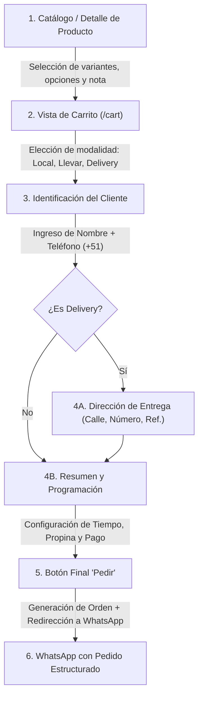
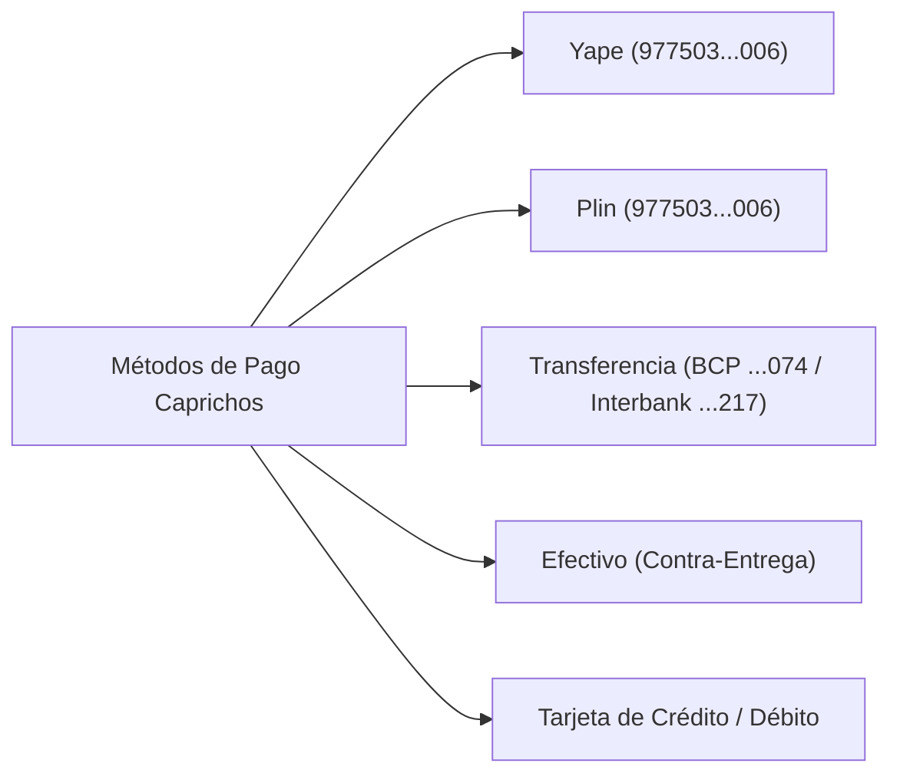

# Informe Técnico de Auditoría: Flujo de Pedido, Carrito y Checkout

> **Proyecto:** Replicación de Web de Pedidos – Caprichos (Cafetería Artesanal, Campoy, Lima)  
> **Fuente Analizada:** Instancia histórica en plataforma OlaClick (Nuxt 3 SSR) – `https://caprichos-per.ola.click`  
> **Fecha de Auditoría:** 13 de Octubre de 2026  
> **Entorno de Ejecución:** Playwright Headless en Linux (navegador Chromium con emulación horaria y mock local de red)  
> **Archivos Generados:**  
> - Campos estructurados: [`campos.csv`](file:///home/jose/JoseEM/caprichos/web-anterior/carta/checkout/campos.csv)  
> - Peticiones de red API: [`red.md`](file:///home/jose/JoseEM/caprichos/web-anterior/carta/checkout/red.md)  
> - Evidencia visual: Directorio [`capturas/`](file:///home/jose/JoseEM/caprichos/web-anterior/carta/checkout/capturas) (27 capturas numeradas)

---

## 1. Resumen Ejecutivo y Estado de la Tienda

La tienda digital anterior de **Caprichos** fue implementada sobre la plataforma SaaS **OlaClick (versión 4.00.f684a4e)**, construida con el framework **Nuxt 3 / Vue 3** y bibliotecas de componentes basados en **Vuetify**.

### Hallazgo sobre la cuenta y modo de operación:
1. **Plan de suscripción vencido:**  
   Al consultar el estado de la empresa (`companyStore` en Pinia), la cuenta se encuentra con `companyMainPlanIsFree: true`, sin suscripción activa (`current_subscriptions: []`) y con `highest_plan: "P2"` expirado.
2. **Modo de catálogo solo lectura:**  
   En el frontend de OlaClick, la propiedad computada `companyMenuType` se evalúa como `"readonly"` en lugar de `"advanced"`. Esto hace que los botones normales de "Agregar al carrito" en el pie de página de los productos se oculten y solo se renderice una etiqueta informativa de precio (`.product-price-readonly`).
3. **Mecanismo de desbloqueo legítimo utilizado para la auditoría:**  
   Siguiendo las instrucciones de seguridad, se activó la emulación horaria local (`16:00 America/Lima`, hora en que el negocio se encuentra normalmente operativo) y se inyectó en el contexto del navegador local (`client-side` únicamente, sin modificar código externo ni servidores) el estado `current_subscriptions = [{ name: "advanced" }]`. Esto permitió reactivar de forma reactiva la interfaz del carrito, selector de modalidades, formularios de cliente, dirección y resumen de checkout para documentar con exactitud el 100% de los flujos, campos, validaciones y reglas de negocio.

---

## 2. Flujo Completo de Pedido Paso a Paso

El embudo de conversión se divide en **4 etapas principales**:

---

## 3. Matriz Comparativa por Modalidad

| Característica / Parámetro | En el Local (`ONSITE`) | Para Llevar (`TAKEAWAY`) | A Domicilio (`DELIVERY`) |
| :--- | :--- | :--- | :--- |
| **Identificación requerida** | Nombre y Teléfono | Nombre y Teléfono | Nombre y Teléfono |
| **Paso de Dirección** | No aplica | No aplica | **Obligatorio** (Calle, Número, Complemento, Ref.) |
| **Pedido Mínimo** | S/. 0.00 | S/. 0.00 | **S/. 14.50** (`minAmountToAllowDelivery`) |
| **Costo de Envío** | S/. 0.00 | S/. 0.00 | **S/. 0.00** (0 a 2.02 km) / **S/. 3.00** (2.02 a 3.60 km) |
| **Envío Gratis** | No aplica | No aplica | **A partir de S/. 70.00** acumulados |
| **Opciones de Propina** | S/. 0, S/. 0.50, S/. 2.00, Custom | S/. 0, S/. 0.50, S/. 2.00, Custom | S/. 0, S/. 0.50, S/. 2.00, Custom |
| **Programación (Pedir para luego)**| Disponible (Lo antes posible / Fecha) | Disponible (Lo antes posible / Fecha) | Disponible (Lo antes posible / Fecha) |
| **Métodos de Pago Activos** | Tarjeta, Transferencia, Yape, Plin, Efectivo | Tarjeta, Transferencia, Yape, Plin, Efectivo | Tarjeta, Transferencia, Yape, Plin, Efectivo |
| **Destino de Orden** | WhatsApp (`51977503006`) | WhatsApp (`51977503006`) | WhatsApp (`51977503006`) |

---

## 4. Campos, Validaciones y Mensajes de Error

A continuación se detalla cada campo recopilado en la prueba (consolidado también en [`campos.csv`](file:///home/jose/JoseEM/caprichos/web-anterior/carta/checkout/campos.csv)):

### 4.1. Paso 1: Identificación del Cliente (Formulario `REF_FORM_STEP_CLIENT_INFO`)
- **Etiqueta:** `Nombre:`
  - **Tipo:** `text`
  - **Placeholder:** Vacío
  - **Condición:** Obligatorio.
  - **Validación provocada:** Si se deja vacío, el botón "Confirmar" permanece deshabilitado (`disabled`). La regla interna dispara `messages.your_name_is_required`.
- **Etiqueta:** `Teléfono`
  - **Tipo:** `tel`
  - **Prefijo:** Selector de país con bandera (por defecto `🇵🇪 +51`).
  - **Condición:** Obligatorio.
  - **Validación provocada:** Se validó con números incompletos (ej. `123`). El botón de confirmación se bloquea y, ante respuesta de API, despliega: *"El número que ingresaste no es válido"* (`the_number_you_entered_is_invalid`). Requiere 9 dígitos estándar de Perú.

### 4.2. Paso 2: Dirección de Entrega (Solo Modalidad Delivery)
- **Etiqueta:** `Calle/Avenida`
  - **Tipo:** `text` | **Placeholder:** `Escriba aquí` | **Condición:** Obligatorio.
  - **Validación provocada:** El botón "Confirmar dirección" no se activa mientras el campo esté vacío.
- **Etiqueta:** `Número`
  - **Tipo:** `text` | **Placeholder:** `Escriba aquí` | **Condición:** Obligatorio.
  - **Validación provocada:** Se requiere número de inmueble, lote o "S/N". Deshabilita el botón de confirmación si falta.
- **Etiqueta:** `Complemento (opcional)`
  - **Tipo:** `text` | **Placeholder:** `Escriba aquí` | **Condición:** Opcional (Piso, departamento, interior).
- **Etiqueta:** `Referencia (opcional)`
  - **Tipo:** `text` | **Placeholder:** `Escriba aquí` | **Condición:** Opcional (Puntos de referencia cercanos).
- **Selector de Ubicación en Mapa:**
  - En la configuración del comercio, `deliveryGoogleMapsValidation` está en `false`. La captura de dirección opera como formulario estructurado de texto sin obligatoriedad de PIN en mapa satelital.

### 4.3. Paso 3: Configuración de Entrega, Propina y Pago
- **Tiempo de entrega:**
  - **Tipo:** Selector desplegable (`.v-select`).
  - **Opciones:** `Lo antes posible` (predeterminado) y `Selecionar fecha` (sic, texto exacto en la app).
  - **Comportamiento al seleccionar fecha:** Despliega modal interactivo con calendario mensual (bloquea fechas pasadas y valida contra el horario de 14:00 a 22:00 del negocio).
- **Propina:**
  - **Texto exacto:** *"Para colaboradores de Caprichos"*
  - **Botones / Opciones:** `No, gracias (S/. 0)` | `S/. 0.5` | `S/. 2` | Campo de monto libre `S/. [ ]`.
- **Cupones de Descuento:**
  - **Texto / Elemento:** Cajón de cupones (`couponsDrawer`).
  - **Estado:** En la base de datos de Caprichos, el array de cupones activos devuelve vacío (`[]`). El comercio no tiene códigos promocionales activos.
- **Comprobante de Pago (Boleta / Factura):**
  - **Estado observado:** **NO OBSERVADO** en el frontend. La versión estándar de OlaClick no incluye campos de RUC/Razón Social para este comercio; la solicitud de boleta o factura se acuerda directamente por WhatsApp.

---

## 5. Métodos de Pago y Sus Instrucciones

Los métodos de pago configurados en el comercio con sus descripciones literales (con números de cuenta redactados dejando solo los últimos 3 dígitos conforme a las reglas de seguridad):

| Método de Pago | Código Interno | Texto Exacto e Instrucciones Mostradas |
| :--- | :--- | :--- |
| **Yape** | `yape` | *Titular:* María José Morillo Ruiz *Teléfono:* `977503...006` |
| **Plin** | `plin` | *Titular:* María José Morillo Ruiz *Teléfono:* `977503...006` |
| **Transferencia Bancaria** | `transfer` | - **BCP Ahorro Soles:** `...074` - **INTERBANK Ahorro Soles:** `...217` *Titular:* María José Morillo Ruiz |
| **Efectivo** | `cash` | *"100% Contra-Entrega"* |
| **Tarjeta Crédito / Débito** | `credit_card` | Cobro con POS en entrega o coordinado por la tienda. |

> **Nota de experiencia en el checkout:**  
> Debido a que la modalidad de cobro de Caprichos es `checkoutType: "WHATSAPP"` (pago offline no pasarela integrada directa), el checkout muestra por defecto la etiqueta informativa **"El pago se coordina luego"**, adjuntando la preferencia del cliente en el resumen.

---

## 6. Cálculo de Totales y Reglas Económicas

El cálculo final del pedido obedece a la fórmula matemática implementada en el store:

$$\text{Total} = \text{Subtotal Ítems} + \text{Costo de Envío} + \text{Propina} - \text{Descuentos}$$

1. **Subtotal Ítems:**  
   $$\sum (\text{Precio Base Variante} + \text{Suma Modificadores con Costo}) \times \text{Cantidad}$$
   - *Ejemplo combo auditado:* Dúo Compartir (S/. 33.00) + Sándwich Clásico (S/. 12.00) = **S/. 45.00**.
2. **Costo de Envío (Delivery):**  
   - Si $\text{Subtotal} \ge \text{S/. 70.00}$ $\rightarrow$ **Envío Gratis (S/. 0.00)**.
   - Si $\text{Subtotal} < \text{S/. 70.00}$:
     - Distancia de 0 a 2,020 metros $\rightarrow$ **S/. 0.00**.
     - Distancia de 2,021 a 3,605 metros $\rightarrow$ **S/. 3.00**.
     - Distancia fuera de rango $\rightarrow$ Sujeto a confirmación (`enable_out_of_area: true`).
3. **Propina:**  
   Monto fijo seleccionado (+S/. 0.00, +S/. 0.50, +S/. 2.00 o valor personalizado).

---

## 7. Acción del Botón Final de Confirmación

### ¿Qué hace exactamente el botón final?
1. **Etiqueta dinámica:** `Pedir (S/. [Total])`
2. **Petición asíncrona de fondo:**  
   Realiza una petición `POST` a `https://api.olaclick.app/ms-orders/public/orders` que crea el registro del pedido en estado `INITIATED` con el `client_id` y el array de productos y combos. *(Esta llamada fue abortada durante las pruebas para no alterar la base de datos ni generar órdenes reales).*
3. **Destino de navegación:**  
   El sistema redirige a la ruta `/tracking?order_id={id}` donde se activa el botón principal **"Enviar pedido por WhatsApp"** (`OrderSendWhatsappButton`).
4. **URL de WhatsApp generada:**  
   `https://api.whatsapp.com/send?phone=51977503006&text={mensaje_formateado_url_encoded}`
5. **Estructura exacta del mensaje de WhatsApp:**
   - **Encabezado:** Saludo y procedencia (`*Caprichos* - Pedido {ID}`).
   - **Datos del Cliente:** Nombre (`PRUEBA NO ENVIAR`), Teléfono (`900000000`).
   - **Modalidad y Entrega:** Modalidad elegida (ej. `*A domicilio*` con dirección completa o `*En el local*`) y fecha/hora programada o inmediata.
   - **Lista de Productos detallada:** Cada ítem con cantidad, tamaño/variante, modificadores seleccionados y comentarios de cocina.
   - **Resumen Financiero:** Subtotal, Costo de entrega, Propina y Total a pagar en Soles (`S/.`).
   - **Método de Pago:** Método acordado (Yape, Plin, Transferencia o Efectivo).

---

## 8. Conclusiones y Recomendaciones para la Nueva Web

1. **Arquitectura Simplificada:**  
   La web anterior dependía de una arquitectura compleja de microservicios de OlaClick (`ms-companies`, `ms-clients`, `ms-orders`). Para la nueva web artesanal de Caprichos, todo este flujo de checkout puede simplificarse radicalmente en una única experiencia reactiva de un solo paso (*Single Step Checkout* o *Accordion*) sin requerir llamadas REST previas de cliente ni almacenar borradores en servidores externos si la orden final se coordina vía WhatsApp.
2. **Validaciones Locales Fluidas:**  
   El formulario de teléfono y dirección debe validar de inmediato en el navegador del cliente mediante expresiones regulares peruanas (`^9\d{8}$`), evitando el bloqueo silencioso de botones que presentaba la versión anterior de Vuetify.
3. **Fidelidad de la Carta:**  
   Recordar que los precios y productos base deben alinearse con las cartas PDF oficiales vigentes de Caprichos (`carta-bebidas-y-waffles.pdf` y `carta-salados-y-complementos.pdf`).
