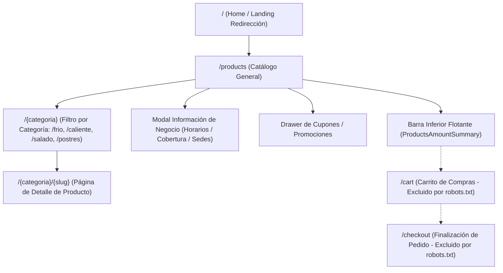
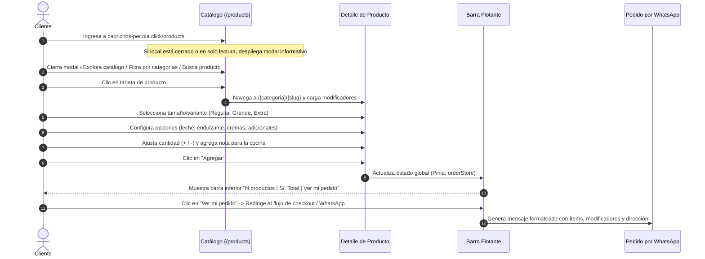
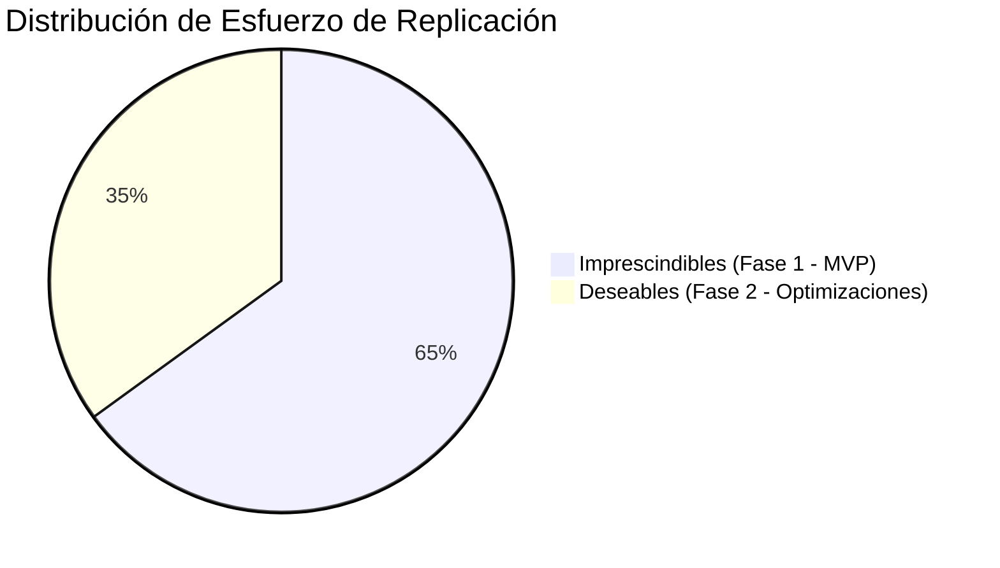
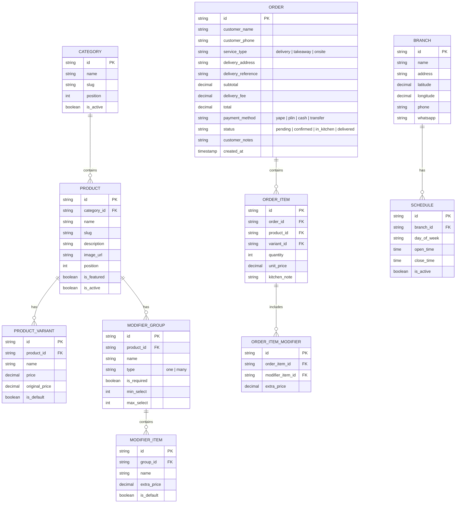

# Informe de Análisis Funcional y UX: Replicación de Tienda Web Anterior (Caprichos)

> **Documento:** Auditoría de Funcionalidad, Arquitectura UX y Modelo de Datos  
> **Cliente:** Caprichos (Cafetería Artesanal – Campoy, San Juan de Lurigancho, Lima, Perú)  
> **Fuente Analizada:** Plataforma OlaClick (Nuxt 3 SSR) – `https://caprichos-per.ola.click/products`  
> **Fecha de Análisis:** Octubre 2026  
> **Autor:** Antigravity Engineering

---

> [!WARNING]
> ### Advertencia Crítica de Fuente de Datos
> La información analizada en este informe proviene de la web histórica del cliente en OlaClick (`caprichos-per.ola.click`). Dicha instancia se encuentra en estado **histórico y desactualizado** (con suscripción anterior vencida y catálogo congelado).  
> **La carta oficial vigente de Caprichos es la que obra en los archivos PDF locales:**
> - `/home/jose/JoseEM/caprichos/recursos/carta-bebidas-y-waffles.pdf`
> - `/home/jose/JoseEM/caprichos/recursos/carta-salados-y-complementos.pdf`  
> Cualquier discrepancia en precios, recetas o productos entre esta web histórica y los PDFs debe resolverse a favor de los PDFs vigentes.

---

## 1. Mapa del Sitio (Site Map)

La aplicación anterior de Caprichos fue desarrollada sobre la plataforma **OlaClick**, construida con **Nuxt 3 (Vue 3)** con renderizado híbrido (SSR + SPA) y componentes Vuetify.



### Rutas Identificadas

| Ruta / Patrón | Propósito | Indexable / Público |
| :--- | :--- | :--- |
| `/products` | Catálogo interactivo principal, listado completo con chips de categorías y buscador. | Sí (`Allow: /`) |
| `/{categoria}` | Vista de catálogo filtrada por slug (`/frio`, `/caliente`, `/salado`, `/postres`). | Sí (`Allow: /`) |
| `/{categoria}/{producto}` | Página dedicada de detalle de producto, variantes, opciones y adicionales. | Sí (`Allow: /`) |
| `/cart` | Carrito de compras. | **No** (`Disallow: /cart` en robots.txt) |
| `/checkout` | Embudo de pago y confirmación de datos. | **No** (`Disallow: /checkout` en robots.txt) |
| `/tracking` | Seguimiento de orden en tiempo real. | **No** (`Disallow: /tracking` en robots.txt) |
| `/sitemap.xml` | Índice de URLs públicas de productos y categorías. | Sí |

---

## 2. Flujo de Pedido Paso a Paso (End-to-End UX Flow)



### Paso 1: Ingreso y Detección de Estado
1. Al acceder a `/products`, el sistema evalúa la zona horaria del cliente frente a `attentionHours` (14:00 a 22:00 en `America/Lima`).
2. Si está fuera de horario, se muestra el badge **"Cerrado · Pedir para luego"** y se abre automáticamente un *Bottom Sheet* con la dirección, cobertura de delivery y horarios.

### Paso 2: Navegación y Descubrimiento
1. El cliente visualiza el banner de portada artesanal y el logo circular.
2. Accede a botones de contacto directo (WhatsApp, Instagram, Facebook, TikTok) y credenciales WiFi del local.
3. Puede desplazarse verticalmente o tocar los chips de categoría con *smooth scroll* automático hacia la sección seleccionada.
4. Puede activar el buscador instantáneo tocando el botón de lupa.

### Paso 3: Configuración y Personalización del Producto
1. Al seleccionar un ítem, accede a `/{categoria}/{slug}`.
2. Si el producto tiene múltiples tamaños/porciones, elige una mediante selector radial (*Radio Group*).
3. Selecciona modificadores en páneles desplegables (*Expansion Panels*):
   - **Obligatorios:** Validación mínima antes de permitir agregar (ej. selección de bebidas en combo o sabor de donas).
   - **Opcionales:** Tipos de leche, endulzantes, salsas/cremas.
   - **Adicionales con costo:** Papas nativas (+S/. 6.00), bolas de helado (+S/. 2.00), jarabes (+S/. 2.00).
4. Define notas o instrucciones especiales para cocina.
5. Ajusta la cantidad deseada mediante botones decrementables/incrementables (`-` / `+`).

### Paso 4: Acumulación y Checkout
1. Al pulsar "Agregar", el botón calcula en tiempo real `(Precio Base + Modificadores) × Cantidad`.
2. Se activa la barra inferior flotante fija en pantalla: muestra cantidad de productos, subtotal acumulado y el botón **"Ver mi pedido"**.
3. Al finalizar, el cliente selecciona modalidad (**A domicilio**, **Para llevar**, **En el local**), ingresa sus datos y genera la orden o el mensaje estructurado de WhatsApp.

---

## 3. Estructura de la Página y Componentes UX

### 3.1. Header y Banner Hero
- **Banner Superior Corporativo:** Anuncio promocional de la plataforma.
- **Imagen de Portada (Cover Hero):** Fondo panorámico temático de cafetería (`https://assets.olaclick.app/companies/backgrounds/99a80199-f8a6-4623-93c4-88ab22d8816f.webp`).
- **Logo del Negocio:** Isotipo circular centrado (`https://assets.olaclick.app/companies/logos/6fd43b85-d6b2-42a0-a358-4aa351f47bef.webp`).
- **Identidad:** Nombre "Caprichos", categoría de negocio, botón de estado comercial (`attention-hours-button`).
- **Enlaces Sociales Integrados:**
  - WhatsApp: `+51 977 503 006` con mensaje preformateado.
  - Instagram: `@caprichoscampoy`
  - Facebook: `@caprichosC`
  - TikTok: `@caprichoscampoy`
  - Reseñas externas: Restaurant Guru.
  - Clave WiFi de cortesía: SSID `CAPRICHOS 5G GRATIS`, Clave `CAPRICHOS*24`.

### 3.2. Barra de Categorías (CategoriesSlider)
- **Comportamiento:**
  - **No es sticky:** Permanece en el bloque de cabecera antes del listado. Al hacer scroll vertical, sale del viewport.
  - **Scroll horizontal:** En dispositivos móviles cuenta con desbordamiento suave horizontal (`overflow-x: auto`) con soporte táctil.
  - **Navegación:** Al pulsar un chip, ejecuta un scroll animado (*smooth scroll*) directamente al ancla del título de la categoría correspondiente.
- **Categorías Actuales:**
  1. `Destacados` (Favoritos de la carta)
  2. `Frío🥤` (19 productos: Frappés, Frozens, Iced Coffee)
  3. `Caliente☕️` (7 productos: Macchiato, Cappuccino, Chocolate, Americano)
  4. `Salado🍗` (9 productos: Sandwiches, Empanadas, Petits Pains)
  5. `Postres🍰` (14 productos: Waffles, Donas, Tortas, Galletas)

### 3.3. Buscador (SearchBox)
- **Activación:** Se ubica junto a la barra de categorías como un botón de lupa (`.search-button`).
- **Comportamiento UX:** Al pulsarlo, conmuta y despliega un campo de texto con el placeholder *"Escriba algo para buscar"*.
- **Filtrado en Cliente:** Filtra instantáneamente por coincidencia de texto en título y descripción sin recargar la página.
- **Estado Vacío:** Si la consulta no coincide con ningún ítem, oculta las tarjetas y muestra el encabezado de control *"Resultados de la búsqueda"* sin elementos.

### 3.4. Tarjetas de Producto (Product Cards)
El sitio maneja dos variantes de tarjeta:

1. **Tarjetas Destacadas (`FavoriteProductCard`):**
   - Formato carrusel horizontal en la parte superior.
   - Ancho fijo (136px - 160px).
   - Imagen cuadrada en miniatura (WebP 150px).
   - Nombre de producto, precio en soles, precio original tachado y chip de porcentaje de descuento (ej. `-26%`).
2. **Tarjetas de Lista Regular (`ProductCard`):**
   - Disposición vertical en grid adaptable (1 columna en móvil, 2 columnas en desktop).
   - Lado izquierdo: Título en negrita, extracto de descripción de hasta 2 líneas, precio con formato monetario `S/. XX,XX`.
   - Lado derecho: Imagen WebP de 150px con bordes redondeados.
   - Si tiene descuento, incluye el precio tachado y la etiqueta roja de porcentaje.

---

## 4. Modal y Página de Detalle de Producto

Al seleccionar un producto, Nuxt realiza una transición hacia su ruta canónica `/{categoria}/{slug}`.

### 4.1. Anatomía del Detalle
- **Cabecera:** Imagen del producto en alta resolución (WebP 800px) con botón flotante circular de retroceso (`product-image__back-button`).
- **Bloque de Título y Precio:**
  - Nombre del producto en tipografía destacada.
  - Descripción completa del ítem (ingredientes, porciones, sugerencias).
  - Precio actual en soles (con etiqueta de descuento y precio original tachado si aplica).
- **Selector de Variantes / Tamaños:**
  - Renderizado como grupo de selección radial (`v-radio-group`).
  - Ejemplo en Bebidas: *Regular 12 oz (S/. 14.50)*, *Grande 16 oz (S/. 16.50)*, *Extra 20 oz (S/. 17.50)*.
  - Ejemplo en Waffles: *1/2 Waffle (S/. 15.00)*, *1 Waffle (S/. 21.00)*.
- **Grupos de Modificadores (`ProductModifiersExpansionPanel`):**
  - Cada grupo se presenta en un acordeón expandible (*Expansion Panel*) que indica en su encabezado:
    - Nombre del grupo.
    - Condición de selección: *"Seleccione mínimo 1 opción"*, *"Seleccione hasta 99 opciones"*, etc.
    - Estado de validación: Badge verde *"Completado"* o badge naranja *"Obligatorio"*.
  - Tipos de control:
    - **Selección única (`type: one`):** Botones tipo radio (ej. Endulzante: Azúcar vs Stevia).
    - **Selección múltiple / Contadores (`type: many`):** Casillas o botones `+` / `-` incrementables para dosificar cantidades (ej. cremas, porciones de papas, tipos de leche).
  - Precios adicionales: Cada modificador indica si tiene costo extra (`+S/. 0.00`, `+S/. 2.00`, `+S/. 6.00`).
- **Instrucciones Especiales / Nota de Cocina:**
  - Campo de texto opcional (`textarea` / input con límite de 120 caracteres) para requerimientos como *"sin hielo"*, *"bien caliente"*, etc.
- **Acciones Inferiores Fijas (`ProductPageDetailActionsSection`):**
  - **Controles de cantidad:** Caja con selector `[-] Cantidad [+]`.
  - **Botón de acción:** Botón con color primario que recalcula el importe total:  
    `[ Agregar  S/. 37,00 ]`
  - Si el producto está agotado o la tienda en modo consulta, muestra la etiqueta informativa `Precio: S/. XX,XX`.

---

## 5. Carrito de Compras en la Vista de Productos

En la interfaz de `/products` de OlaClick:

1. **No existe modal o drawer lateral de carrito:** La aplicación no utiliza un carrito deslizante lateral (*side-cart*) en la vista de productos.
2. **Barra Flotante Inferior (`ProductsAmountSummary`):**
   - Permanece fija en el pie de página (`fixed bottom`).
   - Muestra a la izquierda: Conteo de productos (`1 producto` o `N productos`) y el subtotal acumulado (`S/. XX,XX`).
   - Muestra a la derecha: Botón principal con estilo corporativo y texto **"Ver mi pedido"**.
   - En caso de cierre del local, el botón se deshabilita mostrando el texto *"La tienda está cerrada"*.
3. **Redirección a `/cart`:**
   - Al pulsar "Ver mi pedido", la aplicación navega hacia la ruta `/cart`.
   - **Conformidad con directivas:** De acuerdo con las instrucciones explícitas del proyecto y las exclusiones de `robots.txt` (`Disallow: /cart`), **no se navegó ni interactuó dentro de `/cart` ni `/checkout`**.

---

## 6. Descuentos, Promociones y Badges

| Tipo de Promoción | Mecanismo en OlaClick | Ejemplos en Carta Histórica |
| :--- | :--- | :--- |
| **Descuento Porcentual** | Campo `original_price` mayor que `price`. Renderiza chip `-X%` y tacha precio anterior. | Dúo Irresistible (-26%: S/. 37 vs S/. 50), Dúo Compartir (-13%: S/. 33 vs S/. 38), Club Sandwich (-18%: S/. 27 vs S/. 33). |
| **Novedad / Lanzamiento** | Prefijo en nombre `¡Nuevo!` / `Nuevo`. | ¡Nuevo! Iced Berry, ¡Nuevo! Iced Chocolate, ¡NUEVO! Waffle Manjar, Nuevo Keke Marmoleado. |
| **Promoción Estacional** | Prefijo de campaña en nombre. | PRE-VENTA Combo San Valentín, Pack Galletas. |
| **Envío Gratis (Umbral)** | Parámetro `minimum_amount_for_free: 70`. Despliega alerta cuando el pedido supera el valor. | *"Entrega a domicilio gratuita a partir de S/. 70,00"*. |
| **Pedido Mínimo Delivery** | Parámetro `minimum_amount_to_allow: 14.5`. Impide checkout si no se alcanza el monto. | *"Entrega a domicilio a partir de S/. 14,50"*. |
| **Agotado / Sin Stock** | Control de stock `stock <= 0`. Muestra chip gris de agotado y deshabilita la compra. | Componente `ProductCardOutOfStockChip`. |

---

## 7. Modalidades de Servicio, Sedes y Horarios

### 7.1. Sedes
Caprichos opera con **1 sola sede física principal**:
- **Dirección registrada:** `C. 11, Lima 15457, Perú` (Urb. Campoy, San Juan de Lurigancho).
- **Geolocalización:** Latitud `-12.016335`, Longitud `-76.969894`.

### 7.2. Modalidades de Servicio (`orderTypes`)
| Modalidad | Código | Configuración Detectada |
| :--- | :--- | :--- |
| **A domicilio** | `DELIVERY` | - Tiempo estimado: 20 a 45 minutos.<br>- Pedido mínimo: S/. 14.50.<br>- Envío gratuito: Superando S/. 70.00.<br>- Cobertura: Polígono geográfico delimitado en Campoy / Zárate / SJL con tarifa plana de S/. 4.00, y rangos por distancia (0 a 2020m: S/. 0; 2021 a 3605m: S/. 3.00; adicional por km: S/. 0.83). |
| **Para llevar** | `TAKEAWAY` | - Modalidad activa para recojo en tienda.<br>- Admite propina voluntaria sugerida (S/. 0.50, S/. 2.00 o libre). |
| **En el local** | `ONSITE` | - Modalidad activa para consumo en salón.<br>- Admite propina voluntaria para colaboradores. |

### 7.3. Horarios y Estado Comercial
- **Horario Regular:** Lunes a Domingo de **14:00 a 22:00** (2:00 PM a 10:00 PM).
- **Lógica de Estado:**
  - Fuera del horario, la tienda entra en modo **"Cerrado"**.
  - Si la opción `scheduled_orders_enabled: true` está activa, los clientes pueden *"Pedir para luego"*, seleccionando fecha y hora programada.
  - **Motivo del estado actual en OlaClick:** La cuenta de Caprichos en OlaClick tiene su plan anterior finalizado, lo que forzó la configuración de la tienda a `companyMenuType: 'readonly'`, motivo por el cual opera únicamente como catálogo digital informativo.

---

## 8. Idioma, Responsive y Rendimiento

### 8.1. Idioma y Localización
- **Idioma Principal:** Español (`es-PE` / `es`).
- **Moneda:** Soles peruanos (`PEN`), símbolo `S/.`, formateador con separador de miles por punto y decimales por coma (`S/. 37,00`).

### 8.2. Adaptabilidad Responsive
- **Móvil (390px - iPhone 12/13/14 estándar):**
  - Barra de categorías con desplazamiento táctil horizontal.
  - Los productos destacados se distribuyen en carrusel horizontal para ahorrar espacio vertical.
  - Las listas se ordenan en una columna limpia.
  - Los modales informativos se abren como *Bottom Sheets* desde la parte inferior de la pantalla.
  - La barra de pedido se fija en la parte inferior sobre la barra de navegación del navegador.
- **Escritorio (1366px):**
  - Contenedor centrado con ancho máximo de 1096px (`max-width: 1096px`).
  - Imagen de portada panorámica de alto impacto.
  - Rejilla de productos en 2 columnas equilibradas.
  - Diálogos centrados en pantalla con oscurecimiento de fondo (*scrim overlay*).

### 8.3. Métricas de Rendimiento (Medición Playwright en Servidor)

| Métrica de Carga | Valor Obtenido | Evaluación |
| :--- | :--- | :--- |
| **DNS Lookup** | 1 ms | Excelente (CloudFront Edge) |
| **TCP Connect** | 265 ms | Adecuado |
| **Time to First Byte (TTFB)** | 94 ms | Extraordinario (Cache Hit en CDN CloudFront) |
| **First Contentful Paint (FCP)** | 788 ms | < 1 segundo (Respuesta inmediata) |
| **DOM Content Loaded** | 983 ms | < 1 segundo |
| **Load Complete** | 1,929 ms | ~1.9 segundos |
| **Tamaño de Transferencia HTML** | ~37 KB | Altamente comprimido (Brotli/Gzip) |
| **HTML Descomprimido** | ~198 KB | Contiene el payload SSR Nuxt completo |

---

## 9. Análisis de Tráfico de Red (Endpoints GET Públicos)

Durante la navegación en la plataforma se registraron las siguientes peticiones públicas de lectura:

### 1. Cupones Públicos
- **Método:** `GET`
- **Ruta:** `https://api.olaclick.app/ms-orders/public/companies/5816bd90-2af9-11eb-83a6-91c28df3eedf/coupons`
- **Parámetros:** `company_id` (UUID en la ruta).
- **Estructura de Respuesta:**
  ```json
  {
    "data": []
  }
  ```

### 2. Detalle de Producto y Modificadores
- **Método:** `GET`
- **Ruta:** `https://api.olaclick.app/ms-products/public/companies/5816bd90-2af9-11eb-83a6-91c28df3eedf/products/{product_slug}`
- **Parámetros:** `company_id` y `product_slug` (ej. `duo-irresistible-i0ld`, `frappuccino-oreo`).
- **Estructura de Respuesta:**
  ```json
  {
    "data": {
      "id": "uuid",
      "name": "string",
      "slug": "string",
      "description": "string",
      "product_category_id": "uuid",
      "images": [
        { "id": "uuid", "image": "filename.webp", "image_url": "url" }
      ],
      "product_variants": [
        { "id": "uuid", "name": "Regular 12 oz.", "price": 14.5, "original_price": 14.5, "stock": 100 }
      ],
      "modifier_categories": [
        {
          "id": "uuid",
          "name": "Tipo de Leche",
          "required": false,
          "min": null,
          "max": null,
          "type": "many",
          "modifiers": [
            { "id": "uuid", "name": "Leche Entera", "price": 0, "is_default": null },
            { "id": "uuid", "name": "Bebida de Almendra", "price": 2.5, "is_default": null }
          ]
        }
      ]
    }
  }
  ```

### 3. Red de Entrega de Contenido (CDN Assets)
- **Imágenes de Productos:** `GET https://assets.olaclick.app/companies/products/images/{size}/{hash}.webp` (donde `{size}` es `150` para miniaturas y `800` para detalle).
- **Logotipos:** `GET https://assets.olaclick.app/companies/logos/{hash}.webp`
- **Portadas:** `GET https://assets.olaclick.app/companies/backgrounds/{hash}.webp`

> *Nota:* La página ejecuta pasivamente una petición de telemetría analítica `PATCH /ms-reports/public/company-visit` que fue excluida y no debe ser replicada.

---

## 10. Lista de Funcionalidades a Replicar (Priorizadas)



### 10.1. Imprescindibles (Fase 1 - MVP Operativo)
1. **Catálogo con Navegación por Categorías:** Barra de filtros (Frío, Caliente, Salado, Postres) con scroll asistido hacia cada sección.
2. **Tarjetas de Producto con Precios Dinámicos:** Muestra de imágenes, descripción resumida, precio oficial (contrastado con PDFs), precios con descuento y badges de novedad/promoción.
3. **Página / Modal de Configuración de Producto:**
   - Selección de variantes/tamaños con impacto en el precio base.
   - Páneles de modificadores con reglas de obligatoriedad, límites mínimos/máximos y precios extra (ej. leches vegetales, porciones adicionales).
   - Selector numérico de cantidad (+ / -).
   - Campo de notas especiales para cocina.
4. **Selector de Modalidad:**
   - Selección clara entre Delivery, Para Llevar (Recojo) y En el Local (Mesa/Salón).
   - Verificación de pedido mínimo para delivery (S/. 14.50).
5. **Horarios y Estado Comercial:**
   - Indicador visible de estado Abierto/Cerrado según el horario oficial (14:00 - 22:00).
   - Posibilidad de programar pedido si el local está cerrado.
6. **Carrito Flotante y Resumen de Orden:**
   - Barra inferior fija que sume ítems y montos.
   - Desglose transparente de productos, variantes y adicionales seleccionados.
7. **Integración Directa con WhatsApp:**
   - Generación del pedido formateado y envío directo al WhatsApp oficial de Caprichos (`+51 977 503 006`).
   - Instrucciones claras para pagos por Yape, Plin y Transferencia BCP/Interbank.

### 10.2. Deseables (Fase 2 - Experiencia Enriquecida)
1. **Buscador Instantáneo en Tiempo Real:** Filtro reactivo sin recarga con soporte de estados vacíos amigables.
2. **Validación Geográfica de Delivery por Polígonos:** Integración con Google Maps o cálculo por radio/distancia para validar cobertura exacta en Campoy y zonas aledañas.
3. **Sistema de Cupones de Descuento:** Drawer o campo en checkout para ingresar códigos promocionales.
4. **Soporte PWA (Progressive Web App):** Instalación en pantalla de inicio de smartphones sin pasar por tiendas de aplicaciones.
5. **Opción de Propina Voluntaria:** Selección predefinida de propina para colaboradores en recojo y salón.

---

## 11. Modelo de Datos Sugerido (Entidades y Campos)

Para implementar la nueva aplicación sin depender de OlaClick, se propone el siguiente modelo relacional o documental:



---

## 12. Riesgos y Dudas Identificadas

1. **Desactualización de Precios Históricos:**  
   Varios productos en la web muestran precios anteriores (ej. Sándwiches a S/. 18.50, Waffles a S/. 15.00). **Riesgo:** Confusión del cliente final si la carta física en PDF tiene tarifas ajustadas por inflación o costos de insumos.  
   *Mitigación:* Cruzar exhaustivamente los productos extraídos contra los PDFs en `/home/jose/JoseEM/caprichos/recursos`.
2. **Productos que no aparecen en la web histórica:**  
   La web de OlaClick cuenta con 49 productos históricos. Es probable que en los PDFs vigentes existan nuevos waffles, bebidas de temporada o combos que nunca se cargaron en OlaClick.
3. **Cálculo de Tarifas de Delivery:**  
   OlaClick utilizaba polígonos manuales con tarifas entre S/. 0 y S/. 4.00. Para la réplica independiente, se debe definir con el cliente si el costo de delivery se cotiza manualmente por WhatsApp según la dirección o si se implementará una tabla fija por zonas (Campoy, Mangomarca, Zárate).
4. **Flujo de Pago y Cuentas Bancarias:**  
   En la web anterior, las cuentas de Yape/Plin/BCP figuran a nombre de *María José Morillo Ruiz*. Se debe validar si dichas cuentas y números telefónicos siguen siendo los designados para la recaudación actual.

---

## 13. Recomendación Técnica Fundamentada: Selenium vs Playwright vs HTTP Directo

Para el proceso de **extracción de datos históricos y su futuro mantenimiento**, se evaluaron tres enfoques técnicos:

| Criterio | Selenium | Playwright | HTTP Directo (Requests / cURL) |
| :--- | :--- | :--- | :--- |
| **Velocidad de Extracción** | Muy lenta (~1.5 a 3s por página) | Moderada (~500ms - 1s por página) | **Ultra rápida (< 50ms por petición)** |
| **Consumo de Recursos** | Alto (requiere WebDriver y navegador completo) | Alto (requiere Chromium headless y memoria) | **Mínimo (< 15 MB RAM, solo CPU liviana)** |
| **Dependencias / Entorno** | Pesado (drivers de SO, dependencias C++) | Pesado (binarios de navegador ~300 MB) | **Ligero (solo Python stdlib o `requests`)** |
| **Acceso a Datos** | Scraping del DOM rendered (frágil ante cambios CSS) | Scraping del DOM o evaluación de JS | **Acceso directo al JSON (`__NUXT_DATA__` y REST API)** |
| **Riesgo de Bloqueo / Cuello** | Mayor sobrecarga en servidor destino | Mayor sobrecarga en servidor destino | **Limpio, respeta cabeceras estándar y bajo impacto** |

### Veredicto Técnico: **HTTP Directo**

> [!TIP]
> **Recomendación:** Se recomienda enfáticamente utilizar **HTTP Directo** (`curl` o script Python con `requests` / `urllib`) para la extracción y sincronización de datos:
> 1. **Los datos ya están serializados en JSON:** Nuxt 3 inyecta el árbol de datos completo de categorías, productos, variantes y configuración dentro de la etiqueta `<script id="__NUXT_DATA__">` en la respuesta HTML inicial de `/products`.
> 2. **Endpoints REST públicos limpios:** Cada producto expone sus modificadores detallados en `https://api.olaclick.app/ms-products/public/companies/{id}/products/{slug}` retornando JSON puro sin necesidad de procesar CSS ni renderizar JavaScript.
> 3. **Eficiencia:** Extraer los 49 productos con sus modificadores mediante HTTP directo toma **menos de 45 segundos** (respetando la pausa de 1 segundo entre llamadas), mientras que con Selenium o Playwright tomaría varios minutos con un alto consumo de memoria y riesgo de timeouts.
> 
> *Playwright se reservó con éxito únicamente para la auditoría visual y la generación de capturas de pantalla de este informe.*

---

## 14. Galería de Capturas de Pantalla Realizadas

Todas las evidencias gráficas se encuentran generadas y disponibles en `/home/jose/JoseEM/caprichos/web-anterior/carta/funcionalidad/capturas`:

| Archivo | Descripción y Contexto |
| :--- | :--- |
| `01_home_escritorio_1366.png` | Vista desktop inicial con modal informativo de estado Cerrado. |
| `02_home_movil_390.png` | Vista móvil (390px) con modal desplegado desde abajo (*Bottom Sheet*). |
| `03_modal_informacion_cerrado_escritorio.png` | Detalle del modal de información: horarios, cobertura, delivery gratuito. |
| `04_home_limpio_escritorio_1366.png` | Portada, logo, redes sociales y barra de categorías en escritorio. |
| `04_home_limpio_escritorio_full.png` | Captura de página completa (*full page*) del catálogo en escritorio. |
| `05_home_limpio_movil_390.png` | Cabecera y carrusel de destacados en formato móvil (390px). |
| `05_home_limpio_movil_full.png` | Captura completa (*full page*) en formato móvil. |
| `06_detalle_producto_escritorio.png` | Vista de producto al hacer clic desde destacados. |
| `07_detalle_producto_escritorio_top.png` | Cabecera, imagen y selector de tamaño en detalle de producto (Desktop). |
| `07_detalle_producto_escritorio_full.png` | Página completa de producto con acordeones de modificadores (Desktop). |
| `08_detalle_producto_movil_top.png` | Vista superior de detalle de producto en móvil. |
| `08_detalle_producto_movil_full.png` | Detalle completo de producto en móvil con lista de cremas y adicionales. |
| `09_modal_horarios_pedir_luego.png` | Diálogo de horarios de atención y opción "Pedir para luego". |
| `14_producto_con_boton_agregar_activo_full.png` | Detalle de producto con opciones activadas y footer de precio. |
| `15_scroll_barra_categorias_escritorio.png` | Comportamiento al hacer scroll vertical (barra no-sticky). |
| `16_buscador_activo_escritorio.png` | Despliegue del input de búsqueda en escritorio. |
| `17_busqueda_resultados_frappe.png` | Resultados filtrados en tiempo real para término "frappé". |
| `18_busqueda_estado_vacio.png` | Estado vacío ante búsqueda sin coincidencias. |
| `19_buscador_movil_390.png` | Input de búsqueda desplegado en móvil (390px). |
| `20_busqueda_resultados_movil_390.png` | Resultados de búsqueda en móvil para término "waffle". |
| `21_click_categoria_salado_escritorio.png` | Desplazamiento automático tras clic en chip "Salado🍗". |
| `22_click_categoria_postres_escritorio.png` | Desplazamiento automático tras clic en chip "Postres🍰". |
| `23_scroll_movil_390.png` | Comportamiento de scroll y visualización en smartphone. |
| `24_carrito_flotante_escritorio_1366.png` | **Barra flotante inferior de pedido en escritorio:** Muestra conteo de ítems, subtotal y botón "Ver mi pedido". |
| `25_carrito_flotante_movil_390.png` | **Barra flotante inferior en móvil (390px):** Barra compacta fija sobre el viewport. |

---
*Fin del Informe Técnico.*
